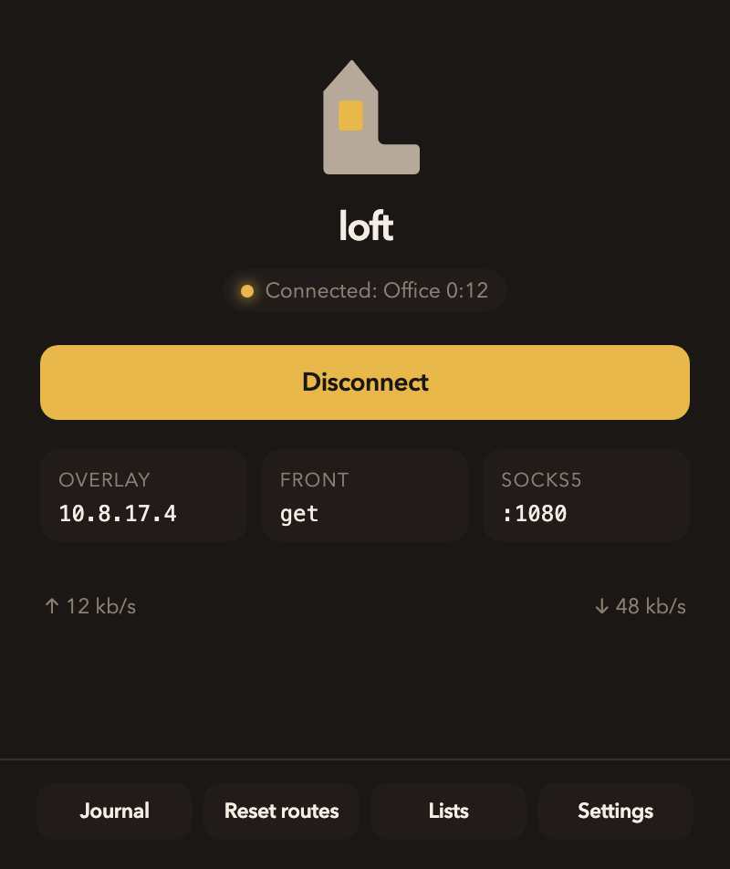
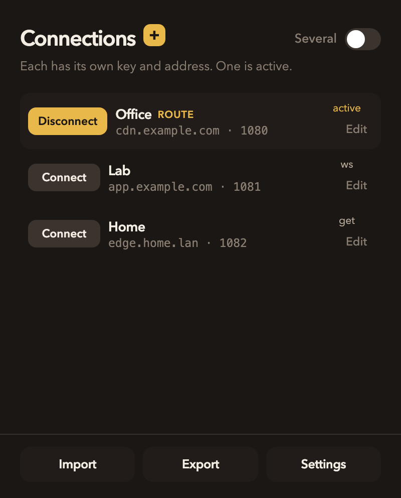
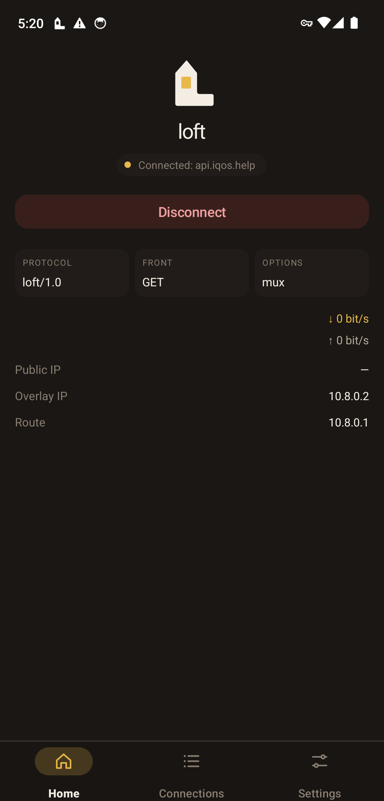
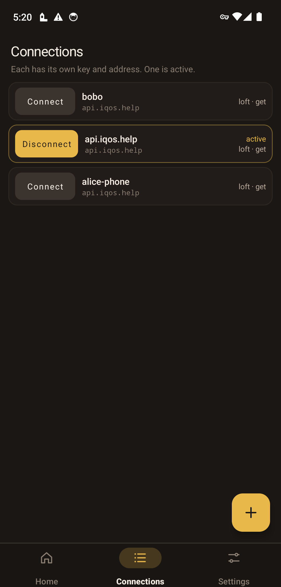
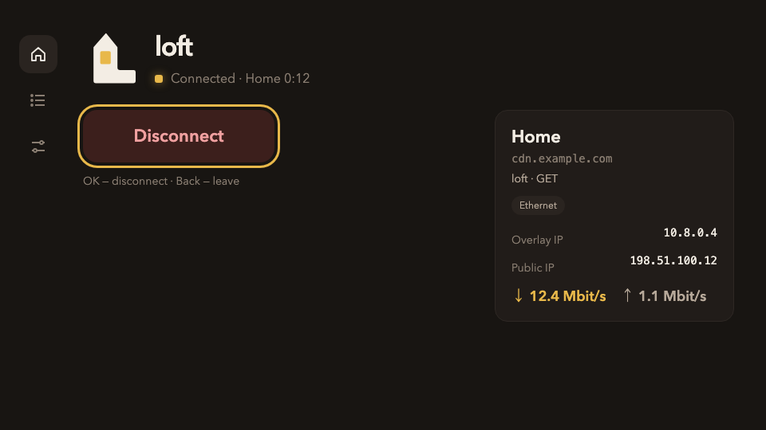
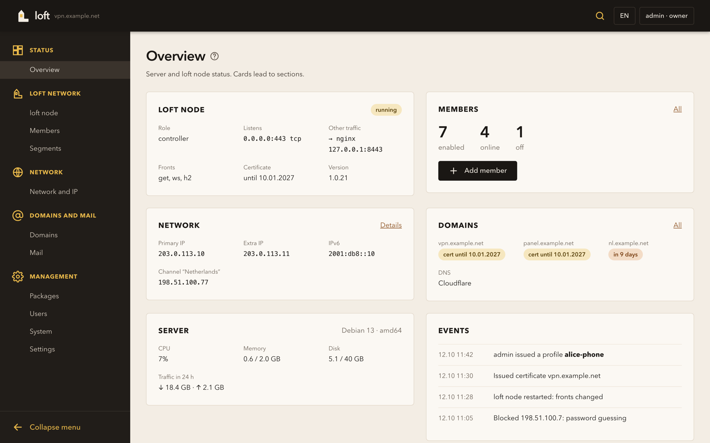
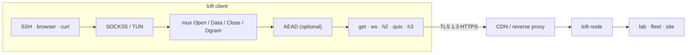

<div align="center">

<picture>
  <source media="(prefers-color-scheme: dark)" srcset="docs/brand/svg/loft-mark-on-dark.svg">
  
</picture>

# loft

**Overlay inside TLS. VLESS, Trojan, SSTP and loft over ordinary HTTPS.**

[](https://github.com/a3app/loft/actions/workflows/test.yml)
[](https://github.com/a3app/loft/releases)
[](https://github.com/a3app/loft/releases)
[](LICENSE)


**English** · [Русский](README_ru.md) · [中文](README_zh.md)

<p align="center">
<picture>
  <source media="(prefers-color-scheme: dark)" srcset="docs/brand/platforms/macos-on-dark.svg">
  
</picture>
<strong>macOS</strong>
<a href="https://github.com/a3app/loft/releases/download/v1.0.33/loft-1.0.33-macos-arm.dmg">arm</a>
·
<a href="https://github.com/a3app/loft/releases/download/v1.0.33/loft-1.0.33-macos-intel.dmg">Intel</a>
&emsp;&emsp;

<strong>Windows</strong>
<a href="https://github.com/a3app/loft/releases/download/v1.0.33/loft-1.0.33-windows-x86-64.zip">x86-64</a>
·
<a href="https://github.com/a3app/loft/releases/download/v1.0.33/loft-1.0.33-windows-x86.zip">x86</a>
·
<a href="https://github.com/a3app/loft/releases/download/v1.0.33/loft-1.0.33-windows-arm64.zip">arm64</a>
</p>
<p align="center">

<strong>Android</strong>
<a href="https://github.com/a3app/loft/releases/download/v1.0.33/loft-1.0.33-android.apk">Android</a>
·
<a href="https://github.com/a3app/loft/releases/download/v1.0.33/loft-1.0.33-android-tv.apk">Google TV</a>
&emsp;&emsp;

<strong>Linux</strong>
<a href="https://github.com/a3app/loft/releases/download/v1.0.33/loft-1.0.33-linux-arm64.tar.gz">arm64</a>
·
<a href="https://github.com/a3app/loft/releases/download/v1.0.33/loft-1.0.33-linux-amd64.tar.gz">amd64</a>
</p>

</div>

---

**loft** is an overlay inside TLS. The app connects over popular protocols that run on top of ordinary HTTPS — VLESS, Trojan and SSTP — and over its own protocol, loft.

loft is built for networks where ordinary VPN protocols work poorly or not at all: the link is unstable, only HTTPS is open to the outside, and traffic passes through proxies, CDNs and inspection systems (DPI). From the outside the handshake looks like a browser's, a scanner without a key is answered by the site the node fronts, and the connection survives drops and network changes.

In the loft protocol, streams are multiplexed over GET, WebSocket, HTTP/2, QUIC or HTTP/3, so CDNs, reverse proxies and TLS terminators pass the session through.

The protocol is **loft/1.0**. Connections are shared as **`loft://`**. YAML `kind: loft`.

This repository is the specification together with a reference node, a web panel, and clients (a macOS application, a Windows tray client, Android phone and TV, and CLI tools for Linux and macOS). Software `1.0.33`. A third party may implement loft from [docs/protocol.md](docs/protocol.md).

## Contents

- [Operators](#operators)
- [Download](#download)
- [App](#app)
- [Panel](#panel)
- [How it works](#how-it-works)
- [Repository](#repository)
- [Build](#build)
- [Support](#support)
- [License](#license)

## Operators

The intended use is operator access: a laboratory LAN reached from outside, a server fleet, or a site-to-site path. Members present a browser-shaped ClientHello. Should a middlebox rewrite the handshake, the session is not established.

## Download

Binaries are published in the [latest GitHub Release](https://github.com/a3app/loft/releases/latest). Dist names include the version (`loft-1.0.33-macos-arm.dmg`).

| | Apple Silicon / arm64 | Intel / amd64 |
|--|--|--|
| <picture><source media="(prefers-color-scheme: dark)" srcset="docs/brand/platforms/macos-on-dark.svg"></picture> macOS app | [DMG](https://github.com/a3app/loft/releases/download/v1.0.33/loft-1.0.33-macos-arm.dmg) | [DMG](https://github.com/a3app/loft/releases/download/v1.0.33/loft-1.0.33-macos-intel.dmg) |
| <picture><source media="(prefers-color-scheme: dark)" srcset="docs/brand/platforms/macos-on-dark.svg"></picture> macOS CLI | [tar.gz](https://github.com/a3app/loft/releases/download/v1.0.33/loft-1.0.33-darwin-arm64.tar.gz) | [tar.gz](https://github.com/a3app/loft/releases/download/v1.0.33/loft-1.0.33-darwin-amd64.tar.gz) |
|  Linux CLI | [tar.gz](https://github.com/a3app/loft/releases/download/v1.0.33/loft-1.0.33-linux-arm64.tar.gz) | [tar.gz](https://github.com/a3app/loft/releases/download/v1.0.33/loft-1.0.33-linux-amd64.tar.gz) |
| Node | [tar.gz](https://github.com/a3app/loft/releases/download/v1.0.33/loft-node-1.0.33-linux-arm64.tar.gz) · [deb](https://github.com/a3app/loft/releases/download/v1.0.33/loft-node_1.0.33_arm64.deb) | [tar.gz](https://github.com/a3app/loft/releases/download/v1.0.33/loft-node-1.0.33-linux-amd64.tar.gz) · [deb](https://github.com/a3app/loft/releases/download/v1.0.33/loft-node_1.0.33_amd64.deb) |
| Panel | [tar.gz](https://github.com/a3app/loft/releases/download/v1.0.33/loft-panel-1.0.33-linux-arm64.tar.gz) · [deb](https://github.com/a3app/loft/releases/download/v1.0.33/loft-panel_1.0.33_arm64.deb) | [tar.gz](https://github.com/a3app/loft/releases/download/v1.0.33/loft-panel-1.0.33-linux-amd64.tar.gz) · [deb](https://github.com/a3app/loft/releases/download/v1.0.33/loft-panel_1.0.33_amd64.deb) |
|  Android | [phone APK](https://github.com/a3app/loft/releases/download/v1.0.33/loft-1.0.33-android.apk) · [TV APK](https://github.com/a3app/loft/releases/download/v1.0.33/loft-1.0.33-android-tv.apk) | same fat APKs |
|  Windows | [arm64 zip](https://github.com/a3app/loft/releases/download/v1.0.33/loft-1.0.33-windows-arm64.zip) | [x86-64 zip](https://github.com/a3app/loft/releases/download/v1.0.33/loft-1.0.33-windows-x86-64.zip) · [x86 zip](https://github.com/a3app/loft/releases/download/v1.0.33/loft-1.0.33-windows-x86.zip) |
| <picture><source media="(prefers-color-scheme: dark)" srcset="docs/brand/platforms/mikrotik-on-dark.svg"></picture> MikroTik | [arm64 tar](https://github.com/a3app/loft/releases/download/v1.0.33/loft-mikrotik-1.0.33-arm64.tar) · [armv7 tar](https://github.com/a3app/loft/releases/download/v1.0.33/loft-mikrotik-1.0.33-armv7.tar) | [amd64 tar](https://github.com/a3app/loft/releases/download/v1.0.33/loft-mikrotik-1.0.33-amd64.tar) |
| iOS | source only ([clients/iOS/](clients/iOS/)); in development and App Store publication | no Dist binary |

Checksums: [clients](https://github.com/a3app/loft/releases/download/v1.0.33/loft-clients-1.0.33-SHA256SUMS.txt) · [node](https://github.com/a3app/loft/releases/download/v1.0.33/loft-node-1.0.33-SHA256SUMS.txt) · [panel](https://github.com/a3app/loft/releases/download/v1.0.33/loft-panel-1.0.33-SHA256SUMS.txt) · [Android](https://github.com/a3app/loft/releases/download/v1.0.33/loft-android-1.0.33-SHA256SUMS.txt) · [Windows](https://github.com/a3app/loft/releases/download/v1.0.33/loft-windows-1.0.33-SHA256SUMS.txt) · [MikroTik](https://github.com/a3app/loft/releases/download/v1.0.33/loft-mikrotik-1.0.33-SHA256SUMS.txt). The macOS DMG is the menu-bar application (ad-hoc signed). CLI archives contain `loft`, `loft-front`, `loft-probe`, and `loft-bench`. GitHub Android is sideload and self-updates from Dist; Play builds compile the updater out. Windows portable: x86-64 and x86 are Win7 SP1+; arm64 is Win10/11 ARM. MikroTik is also `ghcr.io/a3app/loft-mikrotik:1.0.33`.

## App

The macOS client is a menu-bar application. The overlay is opened from it; several named connections may be kept; a `loft://` link or a `.loft` file may be imported. SOCKS5 and TUN remain local.

| Status | Connections |
|:--:|:--:|
|  |  |

The Android phone is a system VPN (`VpnService`). Named connections, a `loft://` link or a `.loft` file; the overlay is one VPN row. GitHub APKs update from Dist; Play builds compile the updater out. Android TV is Leanback, same engine.

| Home | Connections |
|:--:|:--:|
|  |  |



The Windows client sits in the tray. x86 and x86-64: Windows 7 SP1 and later. arm64: Windows 10 on ARM / Windows 11 ARM. Unzip and run; the first tunnel connect installs the service. GitHub zips replace their own directory from Dist.

## Panel

Web administration of one loft server: the node, its networks and members, IP addresses and upstream channels, domains with DNS records and certificates, mail, packages, and panel users. The aim is that a loft server may be installed and configured without files being edited by hand. Spec: [server/panel](server/panel/).



## How it works



1. Applications speak to a local SOCKS5 or TUN listener. That listener is held by `Holder` while the front is rotated.
2. Streams share one mux. Inside TLS they may be sealed again (ChaCha20-Poly1305 or AES-256-GCM); on `get` that is always on.
3. On the public path the session is ordinary HTTPS, so that a CDN or reverse proxy may sit in front of the node.
4. A short disconnect causes the mux to be parked for `gap_hold_ms` (8 s by default). Resume is performed with a fresh `0x02` and the same `instance_id`; inner TCP is left standing.

| | |
|--|--|
| [docs/protocol.md](docs/protocol.md) | The wire protocol. A third-party client or node may be implemented from it. |
| [docs/architecture.md](docs/architecture.md) | Layout of this tree. |
| [docs/code-tour.md](docs/code-tour.md) | Code tour: where to start reading, one connection end to end, glossary. |
| [docs/guide.md](docs/guide.md) | Build, configuration, operation, Debian. |
| [docs/yandex-cdn_ru.md](docs/yandex-cdn_ru.md) | Yandex Cloud CDN operator guide (RU). |
| [docs/keenetic.md](docs/keenetic.md) | KeeneticOS Entware client (OpkgTun). [clients/Keenetic/](clients/Keenetic/). |
| [docs/mikrotik.md](docs/mikrotik.md) | RouterOS 7 container client. Catalog: [clients/MikroTik/](clients/MikroTik/). |
| [docs/ios.md](docs/ios.md) | iOS Packet Tunnel client. Catalog: [clients/iOS/](clients/iOS/). |
| [docs/android.md](docs/android.md) | Android VpnService client. Catalog: [clients/Android/](clients/Android/). |
| [docs/sailfish.md](docs/sailfish.md) | Sailfish OS ConnMan client. Catalog: [clients/Sailfish/](clients/Sailfish/). Aurora OS is the OMP packaging. |
| [docs/share.md](docs/share.md) | Import URI `loft://` and `.loft` files (one or several connections). |
| [docs/codeql.md](docs/codeql.md) | Why CodeQL hits on SSTP/Trojan/mask/probe are dismissed. |

## Repository

```
docs/             protocol, architecture, guide
docs/brand        mark and icons
internal/         wire, mux, crypto, transport, overlay
server/           loft-node (controller or relay)
server/panel      loft-panel web admin
clients/go        loft, loft-front, loft-probe, loft-bench
lab/              public debug stands (panel-dev)
clients/macOS     menu-bar app (launches loft-front)
clients/Keenetic  Entware / OpkgTun (loft-keenetic)
clients/MikroTik  RouterOS 7 container (image + .rsc)
clients/iOS       Packet Tunnel (thin host + appex)
clients/Android   VpnService (thin Java host)
clients/Windows   tray client (Win7 SP1+, Win32 + loft-svc)
clients/Sailfish  ConnMan overlay (Silica; Aurora is the OMP RPM)
clients/mobile    shared Go engine (gomobile bind)
```

## Build

Go 1.24+. From the repository root:

```bash
make test
make node       # ./loft-node
make client     # dist/clients/go/loft
make macos      # dist/clients/macOS/loft.app
make macos-dmg  # dist/clients/macOS/loft-*-macos-<arch>.dmg
make macos-dmgs # both arm and intel DMGs (CI)
make android    # dist/clients/Android/loft.app + loft-tv.app + loft-gtv.app + APKs
make ios        # dist/clients/iOS/loft.app (macOS) + iphonesimulator/loft.app
make windows    # dist/clients/Windows/x64 and x86
make dist       # node tarballs/.deb + CLI archives
```

A tag `vX.Y.Z` matching `VERSION` runs GitHub Actions: tests, `make dist`, macOS DMGs (arm and intel, ad-hoc), Windows portable zips (x86-64 and x86 on Win7 SP1+, arm64 on Windows 10/11 ARM), a Release, and a pkg.go.dev ping. The same Dist workflow may be started by hand from Actions.

```bash
export LOFT_TOKEN='change-me-long-random'
./loft-node -c server/configs/server.yaml -dir /var/lib/loft
./dist/clients/go/loft -c clients/go/configs/client.yaml
ALL_PROXY=socks5://127.0.0.1:1080 curl https://example.com
```

Debian package and installer: [server/debian/README.md](server/debian/README.md).

## Support

Work on an open internet is not free. Sponsorship is accepted so that the protocol, the node, and the clients may be kept independent.

| | Network | Address |
|--|--|--|
| Bitcoin | Bitcoin | `bc1q3q8vzxta0yegvwkgth44a0n2ee8d9kjtjs738t` |
| Ethereum | Ethereum | `0xEfBF2e1C8B76B6033ab00199Bdf36671ed0Dba3A` |
| Tether | Ethereum (USDT ERC-20) | `0xEfBF2e1C8B76B6033ab00199Bdf36671ed0Dba3A` |
| TRON | TRON | `TQq2CGEZ7rTE7RqA6rhh2H8j24qdUqd5Jx` |
| Tether | TRON (USDT TRC20) | `TQq2CGEZ7rTE7RqA6rhh2H8j24qdUqd5Jx` |
| Litecoin | Litecoin | `ltc1qq93zr9pjst9fy732qjuy0pltze4x4llcv30w79` |
| Zcash | Zcash (transparent) | `t1RCtApkwLxjuG2dmR7SdnHSVR1Xrx2c6Bk` |

ETH and USDT ERC-20 are received at the same Ethereum address. TRX and USDT TRC20 are received at the same TRON address. USDT must be sent on the network of that row. Details are given in [SUPPORT.md](SUPPORT.md).

## License

[Apache License 2.0](LICENSE). loft/1.0 may be implemented from [docs/protocol.md](docs/protocol.md) without a fee.
