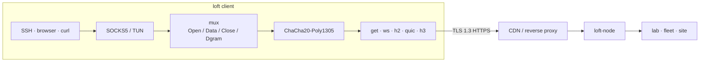

# loft

**English** · [Русский](README_ru.md)

loft is an overlay that runs inside TLS. Streams are multiplexed over GET, WebSocket, HTTP/2, QUIC, or HTTP/3 and sealed with ChaCha20-Poly1305. On the public path the session looks like ordinary HTTPS, so it passes CDNs, reverse proxies, and TLS terminators. The session holds through short disconnects and packet loss.

Protocol **loft/1.0**. Share URI **`loft://`**. YAML `kind: loft`.

This repository is the open specification and a reference node plus clients (macOS app, Linux and macOS CLI). Software `1.0.5`. A third party can implement loft from [docs/protocol.md](docs/protocol.md).

## Operators

Typical use is operator access: a lab LAN from outside, a server fleet, site-to-site. Members present a browser-shaped ClientHello. If a middlebox rewrites the handshake, the session does not come up.

## Download

Files from the [latest GitHub Release](https://github.com/a3app/loft/releases/latest). Dist uploads these names on every `v*` tag, so the links follow the current release.

| | Apple Silicon / arm64 | Intel / amd64 |
|--|--|--|
| macOS app | [DMG](https://github.com/a3app/loft/releases/latest/download/loft-macos-arm64.dmg) | [DMG](https://github.com/a3app/loft/releases/latest/download/loft-macos-x86_64.dmg) |
| macOS CLI | [tar.gz](https://github.com/a3app/loft/releases/latest/download/loft-darwin-arm64.tar.gz) | [tar.gz](https://github.com/a3app/loft/releases/latest/download/loft-darwin-amd64.tar.gz) |
| Linux CLI | [tar.gz](https://github.com/a3app/loft/releases/latest/download/loft-linux-arm64.tar.gz) | [tar.gz](https://github.com/a3app/loft/releases/latest/download/loft-linux-amd64.tar.gz) |
| Node | [tar.gz](https://github.com/a3app/loft/releases/latest/download/loft-node-linux-arm64.tar.gz) · [deb](https://github.com/a3app/loft/releases/latest/download/loft-node_arm64.deb) | [tar.gz](https://github.com/a3app/loft/releases/latest/download/loft-node-linux-amd64.tar.gz) · [deb](https://github.com/a3app/loft/releases/latest/download/loft-node_amd64.deb) |

Checksums: [clients](https://github.com/a3app/loft/releases/latest/download/loft-clients-SHA256SUMS.txt) · [node](https://github.com/a3app/loft/releases/latest/download/loft-node-SHA256SUMS.txt). macOS DMG is the menu-bar app (ad-hoc signed). CLI archives are `loft`, `loft-front`, `loft-probe`, `loft-bench`.

## How it works



1. Apps talk to local SOCKS5 or TUN. `Holder` keeps that listener while the front rotates.
2. Streams share one mux and are sealed with ChaCha20-Poly1305.
3. On the public path the session is ordinary HTTPS, so a CDN or reverse proxy can sit in front of the node.
4. A short disconnect parks the mux for `gap_hold_ms` (default 8 s). Resume uses ticket `0x03` and the same `instance_id`; inner TCP stays up.

| | |
|--|--|
| [docs/protocol.md](docs/protocol.md) | Wire protocol. Sufficient to implement a third-party client or node. |
| [docs/architecture.md](docs/architecture.md) | Layout of this tree. |
| [docs/guide.md](docs/guide.md) | Build, configure, run, Debian. |
| [docs/yandex-cdn_ru.md](docs/yandex-cdn_ru.md) | Yandex Cloud CDN operator guide (RU). |
| [docs/keenetic.md](docs/keenetic.md) | KeeneticOS Entware client (OpkgTun). Catalog: [clients/Keenetic/](clients/Keenetic/). |
| [docs/ios.md](docs/ios.md) | iOS Packet Tunnel client. Catalog: [clients/iOS/](clients/iOS/). |
| [docs/android.md](docs/android.md) | Android VpnService client. Catalog: [clients/Android/](clients/Android/). |
| [docs/share.md](docs/share.md) | Import URI `loft://` and `.loft` files (one or several connections). |

## Repository

```
docs/             protocol, architecture, guide
internal/         wire, mux, crypto, transport, overlay
server/           loft-node (controller or relay)
clients/go        loft, loft-front, loft-probe
clients/macOS     menu-bar app (launches loft-front)
clients/Keenetic  Entware / OpkgTun (plan and mock)
clients/iOS       Packet Tunnel (thin host + appex)
clients/Android   VpnService (thin Java host)
clients/mobile    shared Go engine (gomobile bind)
brand/            mark and icons
```

## Build

Go 1.24+. From the repository root:

```bash
make test
make node       # ./loft-node
make client     # dist/clients/go/loft
make macos      # dist/clients/macOS/loft.app
make macos-dmg  # dist/clients/macOS/loft-*-macos-<arch>.dmg
make macos-dmgs # both arm64 and x86_64 DMGs (CI)
make dist       # node tarballs/.deb + CLI archives
```

Tag `vX.Y.Z` (must match `VERSION`) runs GitHub Actions: tests, `make dist`, macOS DMGs arm64 and x86_64 (ad-hoc), and a Release. Manual: Actions → Dist.

```bash
export LOFT_TOKEN='change-me-long-random'
./loft-node -c server/configs/server.yaml -dir /var/lib/loft
./dist/clients/go/loft -c clients/go/configs/client.yaml
ALL_PROXY=socks5://127.0.0.1:1080 curl https://example.com
```

Debian package and installer: [server/debian/README.md](server/debian/README.md).

## License

[Apache License 2.0](LICENSE). loft/1.0 may be implemented from [docs/protocol.md](docs/protocol.md) without a fee.
