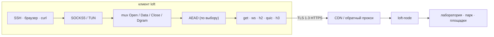

<div align="center">

<picture>
  <source media="(prefers-color-scheme: dark)" srcset="docs/brand/svg/loft-mark-on-dark.svg">
  
</picture>

# loft

**Оверлей внутри TLS. VLESS, Trojan, SSTP и loft поверх обычного HTTPS — для macOS, Android и Linux.**

[](https://github.com/a3app/loft/actions/workflows/test.yml)
[](https://github.com/a3app/loft/releases)
[](https://github.com/a3app/loft/releases)
[](LICENSE)


[English](README.md) · **Русский** · [中文](README_zh.md)

<a href="https://github.com/a3app/loft/releases/download/v1.0.32/loft-1.0.32-macos-arm64.dmg"></a>
<a href="https://github.com/a3app/loft/releases/download/v1.0.32/loft-1.0.32-android.apk"></a>
<a href="#скачать"></a>

</div>

---

**loft** — оверлей внутри TLS. Приложение подключается по популярным протоколам поверх обычного HTTPS — VLESS, Trojan и SSTP — и по собственному протоколу loft.

loft рассчитан на сети, где обычные VPN-протоколы работают плохо или не работают вовсе: связь нестабильна, наружу открыт только HTTPS, а трафик проходит через прокси, CDN и системы инспекции (DPI). Снаружи рукопожатие выглядит как у браузера, сканер без ключа получает сайт, за которым стоит нода, а подключение переживает обрывы и смену сети.

В протоколе loft потоки мультиплексируются поверх GET, WebSocket, HTTP/2, QUIC или HTTP/3, поэтому сессию пропускают CDN, обратные прокси и TLS-терминаторы.

Протокол **loft/1.0**. Ссылка **`loft://`**. В YAML `kind: loft`.

В этом репозитории лежат открытая спецификация, эталонная нода, веб-панель и клиенты (приложение для macOS, Android — телефон и TV, CLI для Linux и macOS). Версия ПО `1.0.32`. Свою реализацию можно писать по [docs/protocol_ru.md](docs/protocol_ru.md).

## Содержание

- [Для операторов](#для-операторов)
- [Скачать](#скачать)
- [Приложение](#приложение)
- [Панель](#панель)
- [Как это устроено](#как-это-устроено)
- [Репозиторий](#репозиторий)
- [Сборка](#сборка)
- [Поддержка](#поддержка)
- [Лицензия](#лицензия)

## Для операторов

Типичные задачи: доступ в сеть лаборатории снаружи, парк серверов, связь двух площадок. Участники предъявляют ClientHello такой же формы, как у браузера. Если промежуточный узел переписывает рукопожатие, сессия не поднимается.

## Скачать

Сборки опубликованы в [последнем релизе](https://github.com/a3app/loft/releases/latest). В имени файла указана версия (`loft-1.0.32-macos-arm64.dmg`).

| | Apple Silicon / arm64 | Intel / amd64 |
|--|--|--|
| macOS, приложение | [DMG](https://github.com/a3app/loft/releases/download/v1.0.32/loft-1.0.32-macos-arm64.dmg) | [DMG](https://github.com/a3app/loft/releases/download/v1.0.32/loft-1.0.32-macos-x86_64.dmg) |
| macOS, CLI | [tar.gz](https://github.com/a3app/loft/releases/download/v1.0.32/loft-1.0.32-darwin-arm64.tar.gz) | [tar.gz](https://github.com/a3app/loft/releases/download/v1.0.32/loft-1.0.32-darwin-amd64.tar.gz) |
| Linux, CLI | [tar.gz](https://github.com/a3app/loft/releases/download/v1.0.32/loft-1.0.32-linux-arm64.tar.gz) | [tar.gz](https://github.com/a3app/loft/releases/download/v1.0.32/loft-1.0.32-linux-amd64.tar.gz) |
| Нода | [tar.gz](https://github.com/a3app/loft/releases/download/v1.0.32/loft-node-1.0.32-linux-arm64.tar.gz) · [deb](https://github.com/a3app/loft/releases/download/v1.0.32/loft-node_1.0.32_arm64.deb) | [tar.gz](https://github.com/a3app/loft/releases/download/v1.0.32/loft-node-1.0.32-linux-amd64.tar.gz) · [deb](https://github.com/a3app/loft/releases/download/v1.0.32/loft-node_1.0.32_amd64.deb) |
| Панель | [tar.gz](https://github.com/a3app/loft/releases/download/v1.0.32/loft-panel-1.0.32-linux-arm64.tar.gz) · [deb](https://github.com/a3app/loft/releases/download/v1.0.32/loft-panel_1.0.32_arm64.deb) | [tar.gz](https://github.com/a3app/loft/releases/download/v1.0.32/loft-panel-1.0.32-linux-amd64.tar.gz) · [deb](https://github.com/a3app/loft/releases/download/v1.0.32/loft-panel_1.0.32_amd64.deb) |
| Android | [APK телефона](https://github.com/a3app/loft/releases/download/v1.0.32/loft-1.0.32-android.apk) · [APK TV](https://github.com/a3app/loft/releases/download/v1.0.32/loft-1.0.32-android-tv.apk) | те же fat APK |
| iOS | только исходники ([clients/iOS/](clients/iOS/)); в разработке и на публикации в App Store | в Dist нет |

Контрольные суммы: [клиенты](https://github.com/a3app/loft/releases/download/v1.0.32/loft-clients-1.0.32-SHA256SUMS.txt) · [нода](https://github.com/a3app/loft/releases/download/v1.0.32/loft-node-1.0.32-SHA256SUMS.txt) · [панель](https://github.com/a3app/loft/releases/download/v1.0.32/loft-panel-1.0.32-SHA256SUMS.txt) · [Android](https://github.com/a3app/loft/releases/download/v1.0.32/loft-android-1.0.32-SHA256SUMS.txt). В DMG — приложение для строки меню с подписью ad-hoc. В архивах CLI лежат `loft`, `loft-front`, `loft-probe`, `loft-bench`. Android с GitHub — sideload, обновляется из Dist; сборки для Play без встроенного обновления.

## Приложение

Клиент для macOS работает из строки меню. В нём поднимают оверлей, хранят несколько именованных подключений, импортируют ссылку `loft://` или файл `.loft`. SOCKS5 и TUN остаются локальными.

| Статус | Подключения |
|:--:|:--:|
|  |  |

На телефоне Android клиент работает как системный VPN (`VpnService`). Поддерживаются именованные подключения, ссылка `loft://` и файл `.loft`; оверлей занимает одну строку VPN. APK с GitHub обновляются сами из Dist; в сборках для Play встроенного обновления нет. На Android TV — интерфейс Leanback и тот же движок.

| Главная | Подключения |
|:--:|:--:|
|  |  |


## Панель

Веб-панель одного сервера loft: нода, её сети и участники, IP-адреса и внешние каналы, домены с DNS-записями и сертификатами, почта, пакеты, пользователи панели. Цель — поставить и настроить сервер loft без ручной правки файлов. Спецификация: [server/panel](server/panel/).


## Как это устроено



1. Приложения ходят в локальный SOCKS5 или TUN. `Holder` держит этот слушатель, пока фронт меняется.
2. Все потоки идут через один mux. Внутри TLS их можно дополнительно шифровать (ChaCha20-Poly1305 или AES-256-GCM); на `get` шифрование включено всегда.
3. Снаружи это обычный HTTPS, поэтому перед нодой может стоять CDN или обратный прокси.
4. При коротком обрыве mux паркуется на `gap_hold_ms` (по умолчанию 8 с). Для возобновления отправляется новый `0x02` с тем же `instance_id`; внутренний TCP при этом не рвётся.

| | |
|--|--|
| [docs/protocol_ru.md](docs/protocol_ru.md) | Спецификация. По ней можно написать свою реализацию. |
| [docs/architecture_ru.md](docs/architecture_ru.md) | Как устроен репозиторий. |
| [docs/code-tour_ru.md](docs/code-tour_ru.md) | Путеводитель по коду: с чего начать читать, путь соединения, словарь. |
| [docs/guide_ru.md](docs/guide_ru.md) | Сборка, настройка, запуск, Debian. |
| [docs/yandex-cdn_ru.md](docs/yandex-cdn_ru.md) | Yandex Cloud CDN: как подключить. |
| [docs/keenetic_ru.md](docs/keenetic_ru.md) | Клиент KeeneticOS (Entware, OpkgTun). Каталог: [clients/Keenetic/](clients/Keenetic/). |
| [docs/mikrotik_ru.md](docs/mikrotik_ru.md) | Клиент RouterOS 7 (контейнер). Каталог: [clients/MikroTik/](clients/MikroTik/). |
| [docs/ios_ru.md](docs/ios_ru.md) | Клиент iOS (Packet Tunnel). Каталог: [clients/iOS/](clients/iOS/). |
| [docs/android_ru.md](docs/android_ru.md) | Клиент Android (VpnService). Каталог: [clients/Android/](clients/Android/). |
| [docs/sailfish_ru.md](docs/sailfish_ru.md) | Клиент Sailfish OS (ConnMan). Каталог: [clients/Sailfish/](clients/Sailfish/). ОС Аврора — пакет OMP. |
| [docs/share_ru.md](docs/share_ru.md) | Ссылка импорта `loft://` и файлы `.loft` (одно или несколько подключений). |
| [docs/codeql_ru.md](docs/codeql_ru.md) | Почему закрыты срабатывания CodeQL на SSTP/Trojan/mask/probe. |

## Репозиторий

```
docs/             спецификация, архитектура, гайд
docs/brand        логотип и иконки
internal/         протокол, mux, crypto, транспорт, оверлей
server/           loft-node (controller или relay)
server/panel      веб-панель loft-panel
clients/go        loft, loft-front, loft-probe
clients/macOS     приложение в строке меню (запускает loft-front)
clients/Keenetic  Entware / OpkgTun (план и макет)
clients/MikroTik  контейнер RouterOS 7 (образ + .rsc)
clients/iOS       Packet Tunnel (хост + appex)
clients/Android   VpnService (хост на Java)
clients/Windows   клиент в трее (Win7 SP1+, Win32 + loft-svc)
clients/Sailfish  оверлей ConnMan (Silica; Аврора — RPM OMP)
clients/mobile    общий движок на Go (gomobile bind)
```

## Сборка

Go 1.24+. Из корня репозитория:

```bash
make test
make node       # ./loft-node
make client     # dist/clients/go/loft
make macos      # dist/clients/macOS/loft.app
make macos-dmg  # dist/clients/macOS/loft-*-macos-<arch>.dmg
make macos-dmgs # оба DMG, arm64 и x86_64 (CI)
make android    # dist/clients/Android/loft.app + loft-tv.app + loft-gtv.app + APKs
make ios        # dist/clients/iOS/loft.app (macOS) + iphonesimulator/loft.app
make windows    # dist/clients/Windows/x64 и x86
make dist       # tarball/.deb ноды + архивы CLI
```

Тег `vX.Y.Z` (как в `VERSION`) запускает GitHub Actions: тесты, `make dist`, DMG для arm64 и x86_64 (подпись ad-hoc), Release и пинг pkg.go.dev. Вручную: Actions → Dist.

```bash
export LOFT_TOKEN='change-me-long-random'
./loft-node -c server/configs/server.yaml -dir /var/lib/loft
./dist/clients/go/loft -c clients/go/configs/client.yaml
ALL_PROXY=socks5://127.0.0.1:1080 curl https://example.com
```

Пакет Debian и установщик: [server/debian/README_ru.md](server/debian/README_ru.md).

## Поддержка

Работа над свободным интернетом не бесплатна. Ваше спонсорство помогает сохранять протокол, ноду и клиенты независимыми.

| | Сеть | Адрес |
|--|--|--|
| Bitcoin | Bitcoin | `bc1q3q8vzxta0yegvwkgth44a0n2ee8d9kjtjs738t` |
| Ethereum | Ethereum | `0xEfBF2e1C8B76B6033ab00199Bdf36671ed0Dba3A` |
| Tether | Ethereum (USDT ERC-20) | `0xEfBF2e1C8B76B6033ab00199Bdf36671ed0Dba3A` |
| TRON | TRON | `TQq2CGEZ7rTE7RqA6rhh2H8j24qdUqd5Jx` |
| Tether | TRON (USDT TRC20) | `TQq2CGEZ7rTE7RqA6rhh2H8j24qdUqd5Jx` |
| Litecoin | Litecoin | `ltc1qq93zr9pjst9fy732qjuy0pltze4x4llcv30w79` |
| Zcash | Zcash (прозрачный) | `t1RCtApkwLxjuG2dmR7SdnHSVR1Xrx2c6Bk` |

ETH и USDT ERC-20 — один адрес Ethereum. TRX и USDT TRC20 — один адрес TRON. USDT отправляйте в сети, указанной в той же строке. Подробности: [SUPPORT_ru.md](SUPPORT_ru.md).

## Лицензия

[Apache License 2.0](LICENSE). Протокол loft/1.0 можно реализовать по [docs/protocol_ru.md](docs/protocol_ru.md), платить не нужно.
