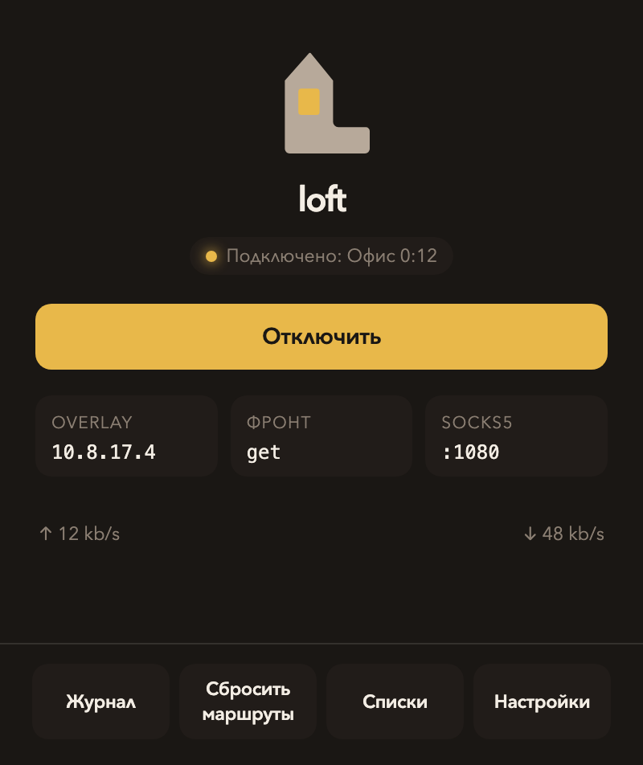
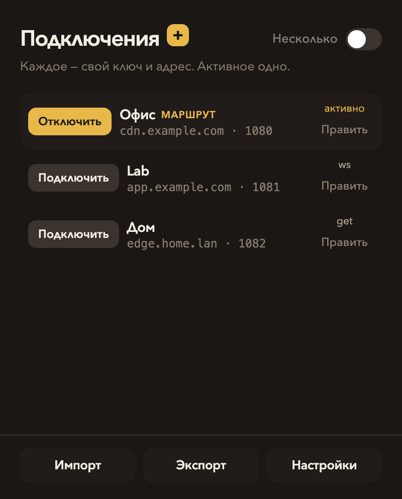
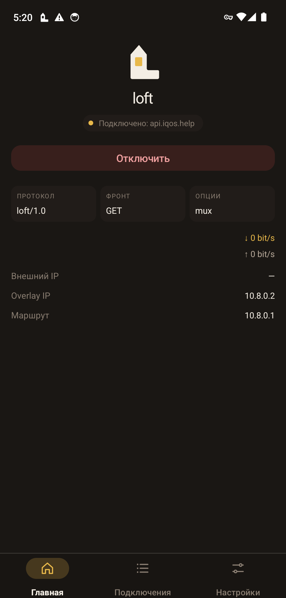
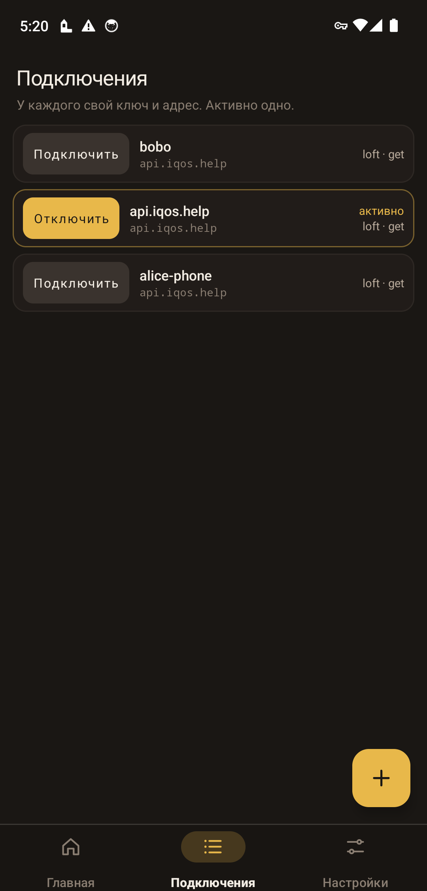
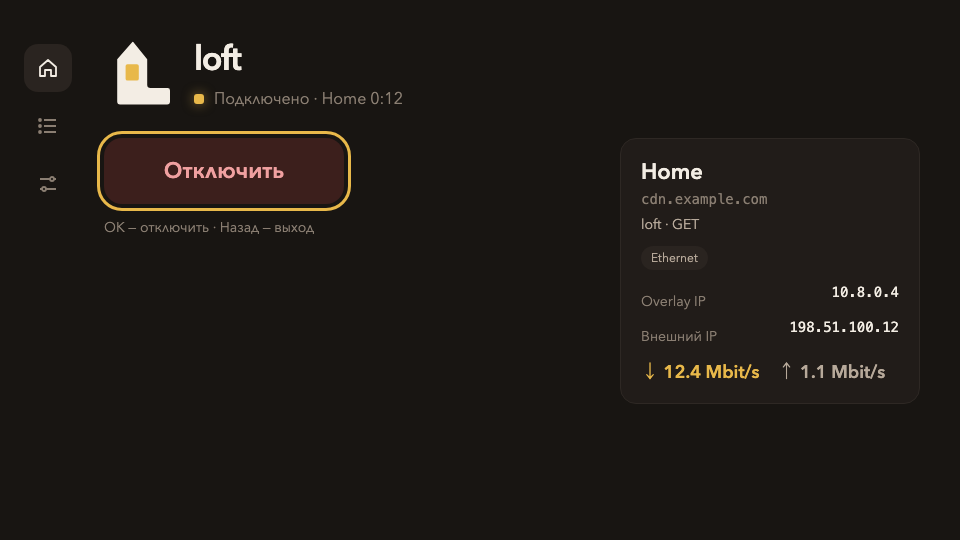
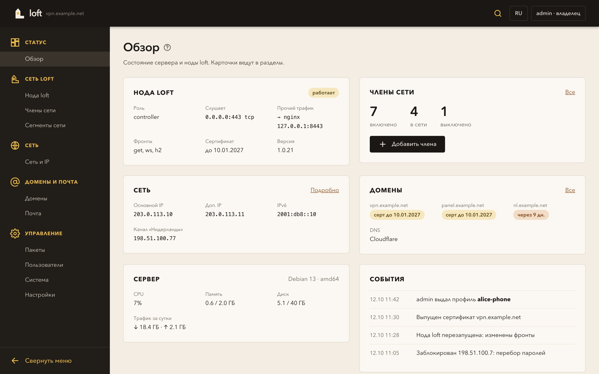
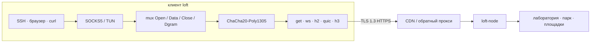

<picture>
  <source media="(prefers-color-scheme: dark)" srcset="docs/brand/png/loft-lockup-readme-on-dark.png">
  
</picture>

[English](README.md) · **Русский** · [中文](README_zh.md)

loft — оверлей внутри TLS. Потоки мультиплексируются поверх GET, WebSocket, HTTP/2, QUIC или HTTP/3 и шифруются ChaCha20-Poly1305. Снаружи сессия выглядит как обычный HTTPS, поэтому её пропускают CDN, обратные прокси и TLS-терминаторы. Сессия переживает короткие обрывы и потери пакетов.

Протокол **loft/1.0**. Ссылка **`loft://`**. В YAML `kind: loft`.

В этом репозитории открытая спецификация, эталонная нода, веб-панель и клиенты (приложение для macOS, Android — телефон и TV, CLI для Linux и macOS). Версия ПО `1.0.28`. Свою реализацию можно писать по [docs/protocol_ru.md](docs/protocol_ru.md).

## Содержание

- [Для операторов](#для-операторов)
- [Скачать](#скачать)
- [Приложение](#приложение)
- [Панель](#панель)
- [Как это устроено](#как-это-устроено)
- [Репозиторий](#репозиторий)
- [Сборка](#сборка)
- [Поддержка](#поддержка)
- [Лицензия](#лицензия)

## Для операторов

Обычные задачи: доступ в лабораторию снаружи, парк серверов, связь двух площадок. Участники предъявляют ClientHello в форме браузера. Если посредник переписывает рукопожатие, сессия не поднимается.

## Скачать

Сборки в [последнем релизе](https://github.com/a3app/loft/releases/latest). В имени файла — версия (`loft-1.0.28-macos-arm64.dmg`).

| | Apple Silicon / arm64 | Intel / amd64 |
|--|--|--|
| macOS, приложение | [DMG](https://github.com/a3app/loft/releases/download/v1.0.28/loft-1.0.28-macos-arm64.dmg) | [DMG](https://github.com/a3app/loft/releases/download/v1.0.28/loft-1.0.28-macos-x86_64.dmg) |
| macOS, CLI | [tar.gz](https://github.com/a3app/loft/releases/download/v1.0.28/loft-1.0.28-darwin-arm64.tar.gz) | [tar.gz](https://github.com/a3app/loft/releases/download/v1.0.28/loft-1.0.28-darwin-amd64.tar.gz) |
| Linux, CLI | [tar.gz](https://github.com/a3app/loft/releases/download/v1.0.28/loft-1.0.28-linux-arm64.tar.gz) | [tar.gz](https://github.com/a3app/loft/releases/download/v1.0.28/loft-1.0.28-linux-amd64.tar.gz) |
| Нода | [tar.gz](https://github.com/a3app/loft/releases/download/v1.0.28/loft-node-1.0.28-linux-arm64.tar.gz) · [deb](https://github.com/a3app/loft/releases/download/v1.0.28/loft-node_1.0.28_arm64.deb) | [tar.gz](https://github.com/a3app/loft/releases/download/v1.0.28/loft-node-1.0.28-linux-amd64.tar.gz) · [deb](https://github.com/a3app/loft/releases/download/v1.0.28/loft-node_1.0.28_amd64.deb) |
| Панель | [tar.gz](https://github.com/a3app/loft/releases/download/v1.0.28/loft-panel-1.0.28-linux-arm64.tar.gz) · [deb](https://github.com/a3app/loft/releases/download/v1.0.28/loft-panel_1.0.28_arm64.deb) | [tar.gz](https://github.com/a3app/loft/releases/download/v1.0.28/loft-panel-1.0.28-linux-amd64.tar.gz) · [deb](https://github.com/a3app/loft/releases/download/v1.0.28/loft-panel_1.0.28_amd64.deb) |

Контрольные суммы: [клиенты](https://github.com/a3app/loft/releases/download/v1.0.28/loft-clients-1.0.28-SHA256SUMS.txt) · [нода](https://github.com/a3app/loft/releases/download/v1.0.28/loft-node-1.0.28-SHA256SUMS.txt) · [панель](https://github.com/a3app/loft/releases/download/v1.0.28/loft-panel-1.0.28-SHA256SUMS.txt) · [Android](https://github.com/a3app/loft/releases/download/v1.0.28/loft-android-1.0.28-SHA256SUMS.txt). DMG — приложение в строке меню, подпись ad-hoc. В архивах CLI: `loft`, `loft-front`, `loft-probe`, `loft-bench`. Android с GitHub (sideload): [APK телефона](https://github.com/a3app/loft/releases/download/v1.0.28/loft-1.0.28-android.apk) · [APK TV](https://github.com/a3app/loft/releases/download/v1.0.28/loft-1.0.28-android-tv.apk). Сборка Play без обновления из приложения.

## Приложение

Клиент для macOS живёт в строке меню. Оттуда открывают оверлей, держат несколько именованных подключений, импортируют ссылку `loft://` или файл `.loft`. SOCKS5 и TUN остаются локальными.

| Статус | Подключения |
|:--:|:--:|
|  |  |

Телефон на Android — системный VPN (`VpnService`). Именованные подключения, ссылка `loft://` или файл `.loft`; оверлей — одна строка VPN. GitHub APK сами обновляются из Dist; в сборках Play встроенного обновления нет. Android TV — Leanback, тот же движок.

| Главная | Подключения |
|:--:|:--:|
|  |  |



## Панель

Веб-панель одного сервера loft: нода, её сети и члены, IP-адреса и внешние каналы, домены с DNS-записями и сертификатами, почта, пакеты, пользователи панели. Цель — поставить и настроить сервер loft без ручной правки файлов. Спецификация: [server/panel](server/panel/).



## Как это устроено



1. Приложения ходят в локальный SOCKS5 или TUN. `Holder` держит этот слушатель, пока фронт меняется.
2. Потоки живут в одном mux и шифруются ChaCha20-Poly1305.
3. Снаружи это обычный HTTPS, поэтому перед нодой может стоять CDN или обратный прокси.
4. Короткий обрыв паркует mux на `gap_hold_ms` (по умолчанию 8 с). Возобновление — свежий `0x02` и тот же `instance_id`; внутренний TCP не рвётся.

| | |
|--|--|
| [docs/protocol_ru.md](docs/protocol_ru.md) | Спецификация. По ней можно написать свою реализацию. |
| [docs/architecture_ru.md](docs/architecture_ru.md) | Как устроен репозиторий. |
| [docs/guide_ru.md](docs/guide_ru.md) | Собрать, настроить, запустить, Debian. |
| [docs/yandex-cdn_ru.md](docs/yandex-cdn_ru.md) | Yandex Cloud CDN: как подключить. |
| [docs/keenetic_ru.md](docs/keenetic_ru.md) | Клиент KeeneticOS (Entware, OpkgTun). Каталог: [clients/Keenetic/](clients/Keenetic/). |
| [docs/mikrotik_ru.md](docs/mikrotik_ru.md) | Клиент RouterOS 7 (контейнер). Каталог: [clients/MikroTik/](clients/MikroTik/). |
| [docs/ios_ru.md](docs/ios_ru.md) | Клиент iOS (Packet Tunnel). Каталог: [clients/iOS/](clients/iOS/). |
| [docs/android_ru.md](docs/android_ru.md) | Клиент Android (VpnService). Каталог: [clients/Android/](clients/Android/). |
| [docs/sailfish_ru.md](docs/sailfish_ru.md) | Клиент Sailfish OS (ConnMan). Каталог: [clients/Sailfish/](clients/Sailfish/). ОС Аврора — пакет OMP. |
| [docs/share_ru.md](docs/share_ru.md) | Ссылка импорта `loft://` и файлы `.loft` (одно или несколько подключений). |

## Репозиторий

```
docs/             спецификация, архитектура, гайд
docs/brand        логотип и иконки
internal/         протокол, mux, crypto, транспорт, оверлей
server/           loft-node (controller или relay)
server/panel      веб-панель loft-panel
clients/go        loft, loft-front, loft-probe
clients/macOS     приложение в строке меню (запускает loft-front)
clients/Keenetic  Entware / OpkgTun (план и макет)
clients/MikroTik  контейнер RouterOS 7 (образ + .rsc)
clients/iOS       Packet Tunnel (хост + appex)
clients/Android   VpnService (хост на Java)
clients/Sailfish  оверлей ConnMan (Silica; Аврора — RPM OMP)
clients/mobile    общий движок на Go (gomobile bind)
```

## Сборка

Go 1.24+. Из корня репозитория:

```bash
make test
make node       # ./loft-node
make client     # dist/clients/go/loft
make macos      # dist/clients/macOS/loft.app
make macos-dmg  # dist/clients/macOS/loft-*-macos-<arch>.dmg
make macos-dmgs # оба DMG, arm64 и x86_64 (CI)
make android    # dist/clients/Android/loft.app + loft-tv.app + loft-gtv.app + APKs
make ios        # dist/clients/iOS/loft.app
make dist       # tarball/.deb ноды + архивы CLI
```

Тег `vX.Y.Z` (как в `VERSION`) запускает GitHub Actions: тесты, `make dist`, DMG для arm64 и x86_64 (подпись ad-hoc), Release и пинг pkg.go.dev. Вручную: Actions → Dist.

```bash
export LOFT_TOKEN='change-me-long-random'
./loft-node -c server/configs/server.yaml -dir /var/lib/loft
./dist/clients/go/loft -c clients/go/configs/client.yaml
ALL_PROXY=socks5://127.0.0.1:1080 curl https://example.com
```

Пакет Debian и установщик: [server/debian/README_ru.md](server/debian/README_ru.md).

## Поддержка

Свободный интернет стоит работы. Ваше спонсорство важно: оно держит протокол, ноду и клиенты независимыми.

| | Сеть | Адрес |
|--|--|--|
| Bitcoin | Bitcoin | `bc1q3q8vzxta0yegvwkgth44a0n2ee8d9kjtjs738t` |
| Ethereum | Ethereum | `0xEfBF2e1C8B76B6033ab00199Bdf36671ed0Dba3A` |
| Tether | Ethereum (USDT ERC-20) | `0xEfBF2e1C8B76B6033ab00199Bdf36671ed0Dba3A` |
| TRON | TRON | `TQq2CGEZ7rTE7RqA6rhh2H8j24qdUqd5Jx` |
| Tether | TRON (USDT TRC20) | `TQq2CGEZ7rTE7RqA6rhh2H8j24qdUqd5Jx` |
| Litecoin | Litecoin | `ltc1qq93zr9pjst9fy732qjuy0pltze4x4llcv30w79` |
| Zcash | Zcash (прозрачный) | `t1RCtApkwLxjuG2dmR7SdnHSVR1Xrx2c6Bk` |

ETH и USDT ERC-20 — один адрес Ethereum. TRX и USDT TRC20 — один адрес TRON. USDT — в сеть той строки. Подробности: [SUPPORT_ru.md](SUPPORT_ru.md).

## Лицензия

[Apache License 2.0](LICENSE). Протокол loft/1.0 можно реализовать по [docs/protocol_ru.md](docs/protocol_ru.md), платить не нужно.
