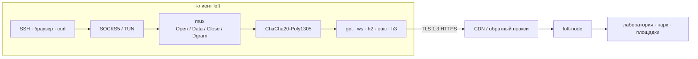

# loft

[English](README.md) · **Русский**

loft — оверлей внутри TLS. Потоки мультиплексируются поверх GET, WebSocket, HTTP/2, QUIC или HTTP/3 и шифруются ChaCha20-Poly1305. Снаружи сессия выглядит как обычный HTTPS, поэтому её пропускают CDN, обратные прокси и TLS-терминаторы. Сессия переживает короткие обрывы и потери пакетов.

Протокол **loft/1.0**. Ссылка **`loft://`**. В YAML `kind: loft`.

В этом репозитории открытая спецификация, эталонная нода и клиенты (приложение для macOS, CLI для Linux и macOS). Версия ПО `1.0.8`. Свою реализацию можно писать по [docs/protocol_ru.md](docs/protocol_ru.md).

## Для операторов

Обычные задачи: доступ в лабораторию снаружи, парк серверов, связь двух площадок. Участники предъявляют ClientHello в форме браузера. Если посредник переписывает рукопожатие, сессия не поднимается.

## Скачать

Сборки в [последнем релизе](https://github.com/a3app/loft/releases/latest). Dist на каждый тег `v*` заливает файлы с этими именами — ссылки всегда на текущий релиз.

| | Apple Silicon / arm64 | Intel / amd64 |
|--|--|--|
| macOS, приложение | [DMG](https://github.com/a3app/loft/releases/latest/download/loft-macos-arm64.dmg) | [DMG](https://github.com/a3app/loft/releases/latest/download/loft-macos-x86_64.dmg) |
| macOS, CLI | [tar.gz](https://github.com/a3app/loft/releases/latest/download/loft-darwin-arm64.tar.gz) | [tar.gz](https://github.com/a3app/loft/releases/latest/download/loft-darwin-amd64.tar.gz) |
| Linux, CLI | [tar.gz](https://github.com/a3app/loft/releases/latest/download/loft-linux-arm64.tar.gz) | [tar.gz](https://github.com/a3app/loft/releases/latest/download/loft-linux-amd64.tar.gz) |
| Нода | [tar.gz](https://github.com/a3app/loft/releases/latest/download/loft-node-linux-arm64.tar.gz) · [deb](https://github.com/a3app/loft/releases/latest/download/loft-node_arm64.deb) | [tar.gz](https://github.com/a3app/loft/releases/latest/download/loft-node-linux-amd64.tar.gz) · [deb](https://github.com/a3app/loft/releases/latest/download/loft-node_amd64.deb) |

Контрольные суммы: [клиенты](https://github.com/a3app/loft/releases/latest/download/loft-clients-SHA256SUMS.txt) · [нода](https://github.com/a3app/loft/releases/latest/download/loft-node-SHA256SUMS.txt). DMG — приложение в строке меню, подпись ad-hoc. В архивах CLI: `loft`, `loft-front`, `loft-probe`, `loft-bench`.

## Как это устроено



1. Приложения ходят в локальный SOCKS5 или TUN. `Holder` держит этот слушатель, пока фронт меняется.
2. Потоки живут в одном mux и шифруются ChaCha20-Poly1305.
3. Снаружи это обычный HTTPS, поэтому перед нодой может стоять CDN или обратный прокси.
4. Короткий обрыв паркует mux на `gap_hold_ms` (по умолчанию 8 с). Возобновление — билет `0x03` и тот же `instance_id`; внутренний TCP не рвётся.

| | |
|--|--|
| [docs/protocol_ru.md](docs/protocol_ru.md) | Спецификация. По ней можно написать свою реализацию. |
| [docs/architecture_ru.md](docs/architecture_ru.md) | Как устроен репозиторий. |
| [docs/guide_ru.md](docs/guide_ru.md) | Собрать, настроить, запустить, Debian. |
| [docs/yandex-cdn_ru.md](docs/yandex-cdn_ru.md) | Yandex Cloud CDN: как подключить. |
| [docs/keenetic_ru.md](docs/keenetic_ru.md) | Клиент KeeneticOS (Entware, OpkgTun). Каталог: [clients/Keenetic/](clients/Keenetic/). |
| [docs/ios_ru.md](docs/ios_ru.md) | Клиент iOS (Packet Tunnel). Каталог: [clients/iOS/](clients/iOS/). |
| [docs/android_ru.md](docs/android_ru.md) | Клиент Android (VpnService). Каталог: [clients/Android/](clients/Android/). |
| [docs/share_ru.md](docs/share_ru.md) | Ссылка импорта `loft://` и файлы `.loft` (одно или несколько подключений). |

## Репозиторий

```
docs/             спецификация, архитектура, гайд
internal/         протокол, mux, crypto, транспорт, оверлей
server/           loft-node (controller или relay)
clients/go        loft, loft-front, loft-probe
clients/macOS     приложение в строке меню (запускает loft-front)
clients/Keenetic  Entware / OpkgTun (план и макет)
clients/iOS       Packet Tunnel (хост + appex)
clients/Android   VpnService (хост на Java)
clients/mobile    общий движок на Go (gomobile bind)
brand/            логотип и иконки
```

## Сборка

Go 1.24+. Из корня репозитория:

```bash
make test
make node       # ./loft-node
make client     # dist/clients/go/loft
make macos      # dist/clients/macOS/loft.app
make macos-dmg  # dist/clients/macOS/loft-*-macos-<arch>.dmg
make macos-dmgs # оба DMG, arm64 и x86_64 (CI)
make dist       # tarball/.deb ноды + архивы CLI
```

Тег `vX.Y.Z` (как в `VERSION`) запускает GitHub Actions: тесты, `make dist`, DMG для arm64 и x86_64 (подпись ad-hoc) и Release. Вручную: Actions → Dist.

```bash
export LOFT_TOKEN='change-me-long-random'
./loft-node -c server/configs/server.yaml -dir /var/lib/loft
./dist/clients/go/loft -c clients/go/configs/client.yaml
ALL_PROXY=socks5://127.0.0.1:1080 curl https://example.com
```

Пакет Debian и установщик: [server/debian/README_ru.md](server/debian/README_ru.md).

## Лицензия

[Apache License 2.0](LICENSE). Протокол loft/1.0 можно реализовать по [docs/protocol_ru.md](docs/protocol_ru.md), платить не нужно.
