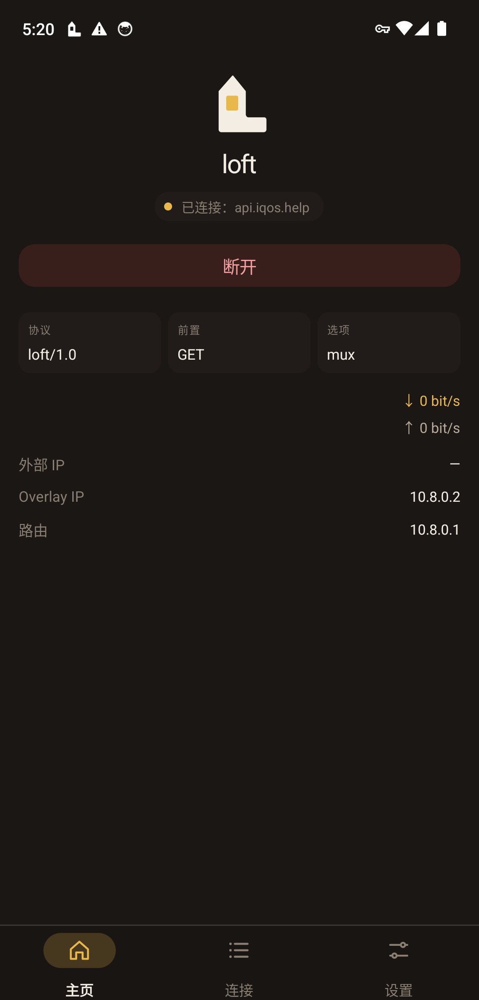
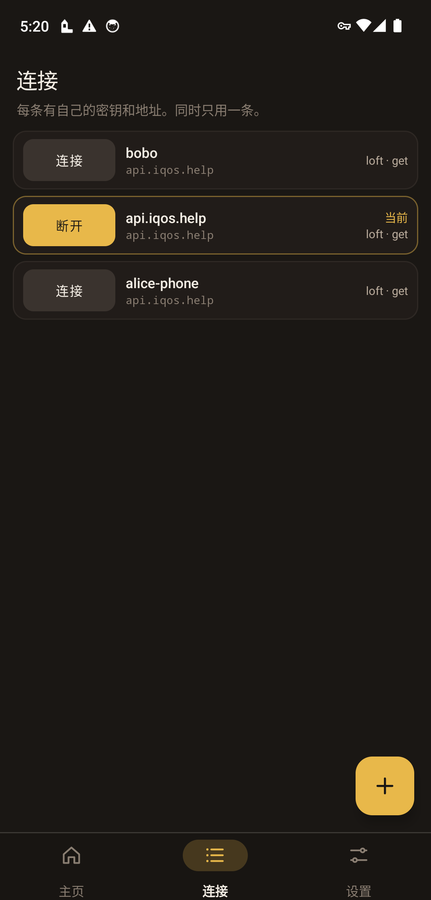
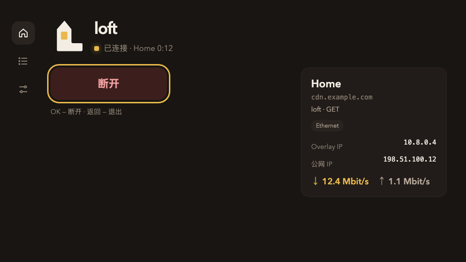
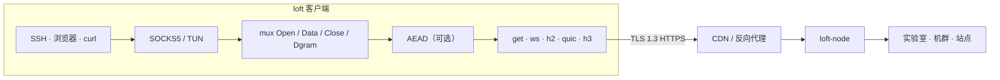

<div align="center">

<picture>
  <source media="(prefers-color-scheme: dark)" srcset="docs/brand/svg/loft-mark-on-dark.svg">
  
</picture>

# loft

**跑在 TLS 里面的覆盖网。VLESS、Trojan、SSTP 和 loft 走普通 HTTPS — 支持 macOS、Windows、Android 和 Linux。**

[](https://github.com/a3app/loft/actions/workflows/test.yml)
[](https://github.com/a3app/loft/releases)
[](https://github.com/a3app/loft/releases)
[](LICENSE)


[English](README.md) · [Русский](README_ru.md) · **中文**

<p align="center">
<picture>
  <source media="(prefers-color-scheme: dark)" srcset="docs/brand/platforms/macos-on-dark.svg">
  
</picture>
<strong>macOS</strong>
<a href="https://github.com/a3app/loft/releases/download/v1.0.33/loft-1.0.33-macos-arm.dmg">arm</a>
·
<a href="https://github.com/a3app/loft/releases/download/v1.0.33/loft-1.0.33-macos-intel.dmg">Intel</a>
&emsp;&emsp;

<strong>Windows</strong>
<a href="https://github.com/a3app/loft/releases/download/v1.0.33/loft-1.0.33-windows-x86-64.zip">x86-64</a>
·
<a href="https://github.com/a3app/loft/releases/download/v1.0.33/loft-1.0.33-windows-x86.zip">x86</a>
·
<a href="https://github.com/a3app/loft/releases/download/v1.0.33/loft-1.0.33-windows-arm64.zip">arm64</a>
</p>
<p align="center">

<strong>Android</strong>
<a href="https://github.com/a3app/loft/releases/download/v1.0.33/loft-1.0.33-android.apk">Android</a>
·
<a href="https://github.com/a3app/loft/releases/download/v1.0.33/loft-1.0.33-android-tv.apk">Google TV</a>
&emsp;&emsp;

<strong>Linux</strong>
<a href="https://github.com/a3app/loft/releases/download/v1.0.33/loft-1.0.33-linux-arm64.tar.gz">arm64</a>
·
<a href="https://github.com/a3app/loft/releases/download/v1.0.33/loft-1.0.33-linux-amd64.tar.gz">amd64</a>
</p>

</div>

---

**loft** 是跑在 TLS 里面的覆盖网。应用可以通过跑在普通 HTTPS 之上的常见协议连接——VLESS、Trojan 和 SSTP，也可以用自有协议 loft。

loft 面向普通 VPN 协议效果差或根本用不了的网络：链路不稳定，对外只开放 HTTPS，流量要经过代理、CDN 和流量检测系统（DPI）。从外面看，握手与浏览器相同，没有密钥的扫描器只会得到节点所代理的网站，连接能挺过断线和网络切换。

在 loft 协议里，流在 GET、WebSocket、HTTP/2、QUIC 或 HTTP/3 上多路复用，所以 CDN、反向代理和 TLS 终结都会放行会话。

协议 **loft/1.0**。分享链接 **`loft://`**。YAML 里 `kind: loft`。

本仓库是开放规范，加上参考节点、网页面板和客户端（macOS 应用、Windows 托盘、Android 手机和电视、Linux / macOS CLI）。软件版本 `1.0.33`。第三方按 [docs/protocol_zh.md](docs/protocol_zh.md) 就能自己实现 loft。

## 目录

- [给运营方](#给运营方)
- [下载](#下载)
- [应用](#应用)
- [面板](#面板)
- [怎么跑起来的](#怎么跑起来的)
- [仓库](#仓库)
- [编译](#编译)
- [支持](#支持)
- [许可](#许可)

## 给运营方

典型用途：从外面进实验室局域网、管一机群、站点互联。成员出示的是浏览器模样的 ClientHello。中间盒要是改写了握手，会话就起不来。

## 下载

文件在 [最新 GitHub Release](https://github.com/a3app/loft/releases/latest)。文件名带版本（`loft-1.0.33-macos-arm.dmg`）。

| | Apple Silicon / arm64 | Intel / amd64 |
|--|--|--|
| <picture><source media="(prefers-color-scheme: dark)" srcset="docs/brand/platforms/macos-on-dark.svg"></picture> macOS 应用 | [DMG](https://github.com/a3app/loft/releases/download/v1.0.33/loft-1.0.33-macos-arm.dmg) | [DMG](https://github.com/a3app/loft/releases/download/v1.0.33/loft-1.0.33-macos-intel.dmg) |
| <picture><source media="(prefers-color-scheme: dark)" srcset="docs/brand/platforms/macos-on-dark.svg"></picture> macOS CLI | [tar.gz](https://github.com/a3app/loft/releases/download/v1.0.33/loft-1.0.33-darwin-arm64.tar.gz) | [tar.gz](https://github.com/a3app/loft/releases/download/v1.0.33/loft-1.0.33-darwin-amd64.tar.gz) |
|  Linux CLI | [tar.gz](https://github.com/a3app/loft/releases/download/v1.0.33/loft-1.0.33-linux-arm64.tar.gz) | [tar.gz](https://github.com/a3app/loft/releases/download/v1.0.33/loft-1.0.33-linux-amd64.tar.gz) |
| 节点 | [tar.gz](https://github.com/a3app/loft/releases/download/v1.0.33/loft-node-1.0.33-linux-arm64.tar.gz) · [deb](https://github.com/a3app/loft/releases/download/v1.0.33/loft-node_1.0.33_arm64.deb) | [tar.gz](https://github.com/a3app/loft/releases/download/v1.0.33/loft-node-1.0.33-linux-amd64.tar.gz) · [deb](https://github.com/a3app/loft/releases/download/v1.0.33/loft-node_1.0.33_amd64.deb) |
| 面板 | [tar.gz](https://github.com/a3app/loft/releases/download/v1.0.33/loft-panel-1.0.33-linux-arm64.tar.gz) · [deb](https://github.com/a3app/loft/releases/download/v1.0.33/loft-panel_1.0.33_arm64.deb) | [tar.gz](https://github.com/a3app/loft/releases/download/v1.0.33/loft-panel-1.0.33-linux-amd64.tar.gz) · [deb](https://github.com/a3app/loft/releases/download/v1.0.33/loft-panel_1.0.33_amd64.deb) |
|  Android | [手机 APK](https://github.com/a3app/loft/releases/download/v1.0.33/loft-1.0.33-android.apk) · [电视 APK](https://github.com/a3app/loft/releases/download/v1.0.33/loft-1.0.33-android-tv.apk) | 同一套 fat APK |
|  Windows | [arm64 zip](https://github.com/a3app/loft/releases/download/v1.0.33/loft-1.0.33-windows-arm64.zip) | [x86-64 zip](https://github.com/a3app/loft/releases/download/v1.0.33/loft-1.0.33-windows-x86-64.zip) · [x86 zip](https://github.com/a3app/loft/releases/download/v1.0.33/loft-1.0.33-windows-x86.zip) |
| <picture><source media="(prefers-color-scheme: dark)" srcset="docs/brand/platforms/mikrotik-on-dark.svg"></picture> MikroTik | [arm64 tar](https://github.com/a3app/loft/releases/download/v1.0.33/loft-mikrotik-1.0.33-arm64.tar) · [armv7 tar](https://github.com/a3app/loft/releases/download/v1.0.33/loft-mikrotik-1.0.33-armv7.tar) | [amd64 tar](https://github.com/a3app/loft/releases/download/v1.0.33/loft-mikrotik-1.0.33-amd64.tar) |
| iOS | 只有源码（[clients/iOS/](clients/iOS/)）；开发中，正在上架 App Store | Dist 没有包 |

校验和：[客户端](https://github.com/a3app/loft/releases/download/v1.0.33/loft-clients-1.0.33-SHA256SUMS.txt) · [节点](https://github.com/a3app/loft/releases/download/v1.0.33/loft-node-1.0.33-SHA256SUMS.txt) · [面板](https://github.com/a3app/loft/releases/download/v1.0.33/loft-panel-1.0.33-SHA256SUMS.txt) · [Android](https://github.com/a3app/loft/releases/download/v1.0.33/loft-android-1.0.33-SHA256SUMS.txt) · [Windows](https://github.com/a3app/loft/releases/download/v1.0.33/loft-windows-1.0.33-SHA256SUMS.txt) · [MikroTik](https://github.com/a3app/loft/releases/download/v1.0.33/loft-mikrotik-1.0.33-SHA256SUMS.txt)。macOS DMG 是菜单栏应用（ad-hoc 签名）。CLI 归档里是 `loft`、`loft-front`、`loft-probe`、`loft-bench`。GitHub Android 是旁路安装，从 Dist 自更新；Play 包不含应用内更新。Windows portable：x86-64 和 x86 为 Win7 SP1+；arm64 为 Win10/11 ARM。MikroTik 另有 `ghcr.io/a3app/loft-mikrotik:1.0.33`。

## 应用

macOS 客户端住在菜单栏。从那里打开覆盖网，挂着几条有名字的连接，导入 `loft://` 链接或 `.loft` 文件。SOCKS5 和 TUN 都在本机。

| 状态 | 连接 |
|:--:|:--:|
|  |  |

Android 手机是系统 VPN（`VpnService`）。命名连接、`loft://` 链接或 `.loft` 文件；覆盖网占一行 VPN。GitHub APK 从 Dist 自更新；Play 包把更新器编掉。Android TV 是 Leanback，同一套引擎。

| 主页 | 连接 |
|:--:|:--:|
|  |  |



Windows 客户端在托盘。x86 和 x86-64：Windows 7 SP1 及更高。arm64：Windows 10 on ARM / Windows 11 ARM。解压即用；第一次打开隧道时安装服务。GitHub 的 zip 用 Dist 替换自己的目录。

## 面板

单台 loft 服务器的网页管理：节点、其网络与成员、IP 地址与上游通道、域名（DNS 记录与证书）、邮件、软件包、面板用户。目标：不手改文件即可安装并配置 loft 服务器。规范：[server/panel](server/panel/)。


## 怎么跑起来的



1. 应用走本机 SOCKS5 或 TUN。`Holder` 盯着这个监听口，前置怎么轮换都不撤。
2. 流共用一条 mux。在 TLS 里还可以再加一层加密（ChaCha20-Poly1305 或 AES-256-GCM）；`get` 上始终开启。
3. 公网路径上这就是普通 HTTPS，所以节点前面可以挂 CDN 或反向代理。
4. 短断会把 mux 停在 `gap_hold_ms`（默认 8 秒）。续上用新的 `0x02` 和同一个 `instance_id`；里面的 TCP 不断。

| | |
|--|--|
| [docs/protocol_zh.md](docs/protocol_zh.md) | 线协议。照着就能写第三方客户端或节点。 |
| [docs/architecture_zh.md](docs/architecture_zh.md) | 本仓库怎么摆。 |
| [docs/code-tour_zh.md](docs/code-tour_zh.md) | 代码导读：从哪里读起、一个连接的完整路径、词汇表。 |
| [docs/guide_zh.md](docs/guide_zh.md) | 编译、配置、跑起来、Debian。 |
| [docs/yandex-cdn_zh.md](docs/yandex-cdn_zh.md) | Yandex Cloud CDN 运营指南。 |
| [docs/keenetic_zh.md](docs/keenetic_zh.md) | KeeneticOS Entware 客户端（OpkgTun）。[clients/Keenetic/](clients/Keenetic/)。 |
| [docs/mikrotik_zh.md](docs/mikrotik_zh.md) | RouterOS 7 容器客户端。目录：[clients/MikroTik/](clients/MikroTik/)。 |
| [docs/ios_zh.md](docs/ios_zh.md) | iOS Packet Tunnel 客户端。目录：[clients/iOS/](clients/iOS/)。 |
| [docs/android_zh.md](docs/android_zh.md) | Android VpnService 客户端。目录：[clients/Android/](clients/Android/)。 |
| [docs/sailfish_zh.md](docs/sailfish_zh.md) | Sailfish OS ConnMan 客户端。目录：[clients/Sailfish/](clients/Sailfish/)。Aurora OS 是 OMP 打包。 |
| [docs/share_zh.md](docs/share_zh.md) | 导入链接 `loft://` 和 `.loft` 文件（一条或多条连接）。 |
| [docs/codeql_zh.md](docs/codeql_zh.md) | 为何关闭 SSTP/Trojan/mask/probe 上的 CodeQL 命中。 |

## 仓库

```
docs/             协议、架构、指南
docs/brand        标志和图标
internal/         wire, mux, crypto, transport, overlay
server/           loft-node（控制器或中继）
server/panel      loft-panel 网页面板
clients/go        loft, loft-front, loft-probe, loft-bench
lab/              公开调试台（panel-dev）
clients/macOS     菜单栏应用（拉起 loft-front）
clients/Keenetic  Entware / OpkgTun（loft-keenetic）
clients/MikroTik  RouterOS 7 容器（镜像 + .rsc）
clients/iOS       Packet Tunnel（薄宿主 + appex）
clients/Android   VpnService（薄 Java 宿主）
clients/Windows   托盘客户端（Win7 SP1+，Win32 + loft-svc）
clients/Sailfish  ConnMan 覆盖网（Silica；Aurora 是 OMP RPM）
clients/mobile    共用 Go 引擎（gomobile bind）
```

## 编译

Go 1.24+。在仓库根目录：

```bash
make test
make node       # ./loft-node
make client     # dist/clients/go/loft
make macos      # dist/clients/macOS/loft.app
make macos-dmg  # dist/clients/macOS/loft-*-macos-<arch>.dmg
make macos-dmgs # arm 和 intel 两份 DMG（CI）
make android    # dist/clients/Android/loft.app + loft-tv.app + loft-gtv.app + APKs
make ios        # dist/clients/iOS/loft.app（macOS）+ iphonesimulator/loft.app
make windows    # dist/clients/Windows/x64 和 x86
make dist       # 节点 tar/.deb + CLI 归档
```

打标签 `vX.Y.Z`（必须和 `VERSION` 一致）会跑 GitHub Actions：测试、`make dist`、macOS DMG（arm 和 intel，ad-hoc）、Windows portable zip（x86-64 和 x86 适用于 Win7 SP1+，arm64 适用于 Windows 10/11 ARM）、发 Release、ping 一下 pkg.go.dev。手动：Actions → Dist。

```bash
export LOFT_TOKEN='change-me-long-random'
./loft-node -c server/configs/server.yaml -dir /var/lib/loft
./dist/clients/go/loft -c clients/go/configs/client.yaml
ALL_PROXY=socks5://127.0.0.1:1080 curl https://example.com
```

Debian 包和安装脚本：[server/debian/README_zh.md](server/debian/README_zh.md)。

## 支持

开放的互联网需要投入。你的赞助很重要：它让协议、节点和客户端保持独立。

| | 网络 | 地址 |
|--|--|--|
| Bitcoin | Bitcoin | `bc1q3q8vzxta0yegvwkgth44a0n2ee8d9kjtjs738t` |
| Ethereum | Ethereum | `0xEfBF2e1C8B76B6033ab00199Bdf36671ed0Dba3A` |
| Tether | Ethereum（USDT ERC-20） | `0xEfBF2e1C8B76B6033ab00199Bdf36671ed0Dba3A` |
| TRON | TRON | `TQq2CGEZ7rTE7RqA6rhh2H8j24qdUqd5Jx` |
| Tether | TRON（USDT TRC20） | `TQq2CGEZ7rTE7RqA6rhh2H8j24qdUqd5Jx` |
| Litecoin | Litecoin | `ltc1qq93zr9pjst9fy732qjuy0pltze4x4llcv30w79` |
| Zcash | Zcash（透明地址） | `t1RCtApkwLxjuG2dmR7SdnHSVR1Xrx2c6Bk` |

ETH 和 USDT ERC-20 共用 Ethereum 地址。TRX 和 USDT TRC20 共用 TRON 地址。USDT 按该行的网络发送。说明：[SUPPORT_zh.md](SUPPORT_zh.md)。

## 许可

[Apache License 2.0](LICENSE)。按 [docs/protocol_zh.md](docs/protocol_zh.md) 实现 loft/1.0 不收费。
