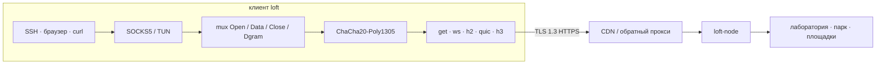

# loft

[English](index.md) · **Русский** · [中文](README_zh.md)

loft — оверлей внутри TLS. Потоки мультиплексируются поверх GET, WebSocket, HTTP/2, QUIC или HTTP/3 и шифруются ChaCha20-Poly1305. Снаружи сессия выглядит как обычный HTTPS, поэтому её пропускают CDN, обратные прокси и TLS-терминаторы. Сессия переживает короткие обрывы и потери пакетов.

Протокол **loft/1.0**. Ссылка **`loft://`**. Apache License 2.0.

Это сайт спецификации. Эталонная нода и клиенты — в [репозитории](https://github.com/a3app/loft).

## Как это устроено

1. Приложения ходят в локальный SOCKS5 или TUN. `Holder` держит этот слушатель, пока фронт меняется.
2. Потоки живут в одном mux и шифруются ChaCha20-Poly1305.
3. Снаружи это обычный HTTPS, поэтому перед нодой может стоять CDN или обратный прокси.
4. Короткий обрыв паркует mux на `gap_hold_ms` (по умолчанию 8 с). Возобновление — свежий `0x02` и тот же `instance_id`; внутренний TCP не рвётся.

## Спецификация

| | |
|--|--|
| [protocol_ru.md](protocol_ru.md) | Протокол. Достаточно, чтобы написать сторонний клиент или ноду. |
| [architecture_ru.md](architecture_ru.md) | Это дерево: controller, relay, клиент, оверлей. |
| [guide_ru.md](guide_ru.md) | Сборка, конфиг, decoy, roster, Debian. |
| [yandex-cdn_ru.md](yandex-cdn_ru.md) | Yandex Cloud CDN: куда нажимать. |
| [keenetic_ru.md](keenetic_ru.md) | KeeneticOS: OpkgTun, приоритеты, вход в панель. |
| [mikrotik_ru.md](mikrotik_ru.md) | RouterOS 7: контейнер, SOCKS, policy routing. |
| [ios_ru.md](ios_ru.md) | iOS: Packet Tunnel, Personal VPN. Apple TV позже. |
| [android_ru.md](android_ru.md) | Android: VpnService. Android TV / Google TV позже. |
| [aurora_ru.md](aurora_ru.md) | ОС Аврора: оверлей ConnMan, loft-front. |
| [share_ru.md](share_ru.md) | URI импорта: `loft://`, `.loft` (одно или несколько подключений), QR. |

| Ещё | |
|--|--|
| [../README_ru.md](../README_ru.md) | Обзор |
| [../server/README_ru.md](../server/README_ru.md) | loft-node |
| [../server/debian/README_ru.md](../server/debian/README_ru.md) | Установщик и `.deb` |
| [../clients/README_ru.md](../clients/README_ru.md) | CLI, macOS, Keenetic, MikroTik, iOS, Android, Aurora |
| [brand/README_ru.md](brand/README_ru.md) | Марка |
