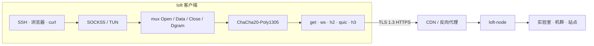

# loft

[English](index.md) · [Русский](README_ru.md) · **中文**

loft 是跑在 TLS 里面的覆盖网。流在 GET、WebSocket、HTTP/2、QUIC 或 HTTP/3 上做多路复用，再用 ChaCha20-Poly1305 封住。在公网路径上，会话看起来就是普通 HTTPS，所以能过 CDN、反向代理和 TLS 终结。短断和丢包撑得住。典型用途：从外面进实验室局域网、管一机群、站点互联。

协议 **loft/1.0**。分享链接 **`loft://`**。Apache License 2.0。

本站是开放规范。参考节点和客户端在 [仓库](https://github.com/a3app/loft) 里。

## 怎么跑起来的

1. 应用走本机 SOCKS5 或 TUN。`Holder` 盯着这个监听口，前置怎么轮换都不撤。
2. 流共用一条 mux，用 ChaCha20-Poly1305 封住。
3. 公网路径上这就是普通 HTTPS，所以节点前面可以挂 CDN 或反向代理。
4. 短断会把 mux 停在 `gap_hold_ms`（默认 8 秒）。续上用新的 `0x02` 和同一个 `instance_id`；里面的 TCP 不断。

## 规范

| | |
|--|--|
| [protocol_zh.md](protocol_zh.md) | 线协议。照着就能写第三方客户端或节点。 |
| [architecture_zh.md](architecture_zh.md) | 本仓库：控制器、中继、客户端、覆盖网。 |
| [code-tour_zh.md](code-tour_zh.md) | 代码导读：从哪里读起、一个连接的完整路径、词汇表。 |
| [guide_zh.md](guide_zh.md) | 编译、配置、诱饵、名册、Debian。 |
| [yandex-cdn_zh.md](yandex-cdn_zh.md) | Yandex Cloud CDN：控制台怎么点。 |
| [keenetic_zh.md](keenetic_zh.md) | KeeneticOS：OpkgTun、优先级、面板登录。 |
| [mikrotik_zh.md](mikrotik_zh.md) | RouterOS 7：容器、SOCKS、策略路由。 |
| [ios_zh.md](ios_zh.md) | iOS：Packet Tunnel，Personal VPN。Apple TV 以后再说。 |
| [android_zh.md](android_zh.md) | Android：VpnService。Android TV / Google TV 以后再说。 |
| [sailfish_zh.md](sailfish_zh.md) | Sailfish OS：ConnMan 覆盖网，loft-front。Aurora OS 是 OMP 打包。 |
| [share_zh.md](share_zh.md) | 导入 URI：`loft://`、`.loft`（一条或多条连接）、二维码。 |

| 还有 | |
|--|--|
| [../README_zh.md](../README_zh.md) | 总览 |
| [../server/README_zh.md](../server/README_zh.md) | loft-node |
| [../server/debian/README_zh.md](../server/debian/README_zh.md) | 安装脚本和 `.deb` |
| [../clients/README_zh.md](../clients/README_zh.md) | CLI、macOS、Keenetic、MikroTik、iOS、Android、Sailfish |
| [brand/README_zh.md](brand/README_zh.md) | 标志 |

[下载](https://github.com/a3app/loft/releases/latest) · [源码](https://github.com/a3app/loft)
