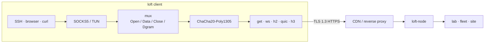

# loft

**English** · [Русский](README_ru.md)

loft is an overlay that runs inside TLS. Streams are multiplexed over GET, WebSocket, HTTP/2, QUIC, or HTTP/3 and sealed with ChaCha20-Poly1305. On the public path the session looks like ordinary HTTPS, so it passes CDNs, reverse proxies, and TLS terminators. The session holds through short disconnects and packet loss. Typical use is operator access: a lab LAN from outside, a server fleet, site-to-site.

Protocol **loft/1.0**. Share URI **`loft://`**. Apache License 2.0.

This site is the open specification. The reference node and clients are in the [repository](https://github.com/a3app/loft).

## How it works

1. Apps talk to local SOCKS5 or TUN. `Holder` keeps that listener while the front rotates.
2. Streams share one mux and are sealed with ChaCha20-Poly1305.
3. On the public path the session is ordinary HTTPS, so a CDN or reverse proxy can sit in front of the node.
4. A short disconnect parks the mux for `gap_hold_ms` (default 8 s). Resume uses ticket `0x03` and the same `instance_id`; inner TCP stays up.

## Spec

| | |
|--|--|
| [protocol.md](protocol.md) | Wire protocol. Sufficient to implement a third-party client or node. |
| [architecture.md](architecture.md) | This tree: controller, relay, client, overlay. |
| [guide.md](guide.md) | Build, config, decoy, roster, Debian. |
| [share.md](share.md) | Import URI: `loft://`, `.loft` (one or several connections), QR. |
| [keenetic.md](keenetic.md) | KeeneticOS Entware client. |
| [ios.md](ios.md) | iOS Packet Tunnel. |
| [android.md](android.md) | Android VpnService. |
| [yandex-cdn_ru.md](yandex-cdn_ru.md) | Yandex Cloud CDN operator guide (RU). |

[Download](https://github.com/a3app/loft/releases/latest) · [Source](https://github.com/a3app/loft)
