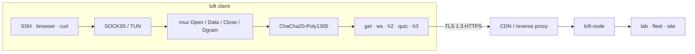

# loft

**English** · [Русский](README_ru.md) · [中文](README_zh.md)

A private overlay is described which is carried inside TLS 1.3. Application streams are multiplexed over GET, WebSocket, HTTP/2, QUIC, or HTTP/3 and are sealed with ChaCha20-Poly1305. On the public path the session is ordinary HTTPS, and may therefore be passed through a CDN, reverse proxy, or TLS terminator. Short disconnects and packet loss are tolerated. The intended use is operator access: a laboratory LAN reached from outside, a server fleet, or a site-to-site path.

The protocol is **loft/1.0**. Connections are shared as **`loft://`**. Apache License 2.0.

This site is the specification. The reference node and clients are in the [repository](https://github.com/a3app/loft).

## How it works

1. Applications speak to a local SOCKS5 or TUN listener. That listener is held by `Holder` while the front is rotated.
2. Streams are carried on one mux and are sealed with ChaCha20-Poly1305.
3. On the public path the session is ordinary HTTPS, so that a CDN or reverse proxy may sit in front of the node.
4. A short disconnect causes the mux to be parked for `gap_hold_ms` (8 s by default). Resume is performed with a fresh `0x02` and the same `instance_id`; inner TCP is left standing.

## Spec

| | |
|--|--|
| [protocol.md](protocol.md) | The wire protocol. A third-party client or node may be implemented from it. |
| [architecture.md](architecture.md) | This tree: controller, relay, client, overlay. |
| [code-tour.md](code-tour.md) | Code tour: where to start reading, one connection end to end, glossary. |
| [guide.md](guide.md) | Build, config, decoy, roster, Debian. |
| [share.md](share.md) | Import URI: `loft://`, `.loft` (one or several connections), QR. |
| [keenetic.md](keenetic.md) | KeeneticOS Entware client. |
| [mikrotik.md](mikrotik.md) | RouterOS 7 container client. |
| [ios.md](ios.md) | iOS Packet Tunnel. |
| [android.md](android.md) | Android VpnService. |
| [sailfish.md](sailfish.md) | Sailfish OS ConnMan. Aurora OS is the OMP packaging. |
| [yandex-cdn_ru.md](yandex-cdn_ru.md) | Yandex Cloud CDN operator guide (RU). |

[Download](https://github.com/a3app/loft/releases/latest) · [Source](https://github.com/a3app/loft)
