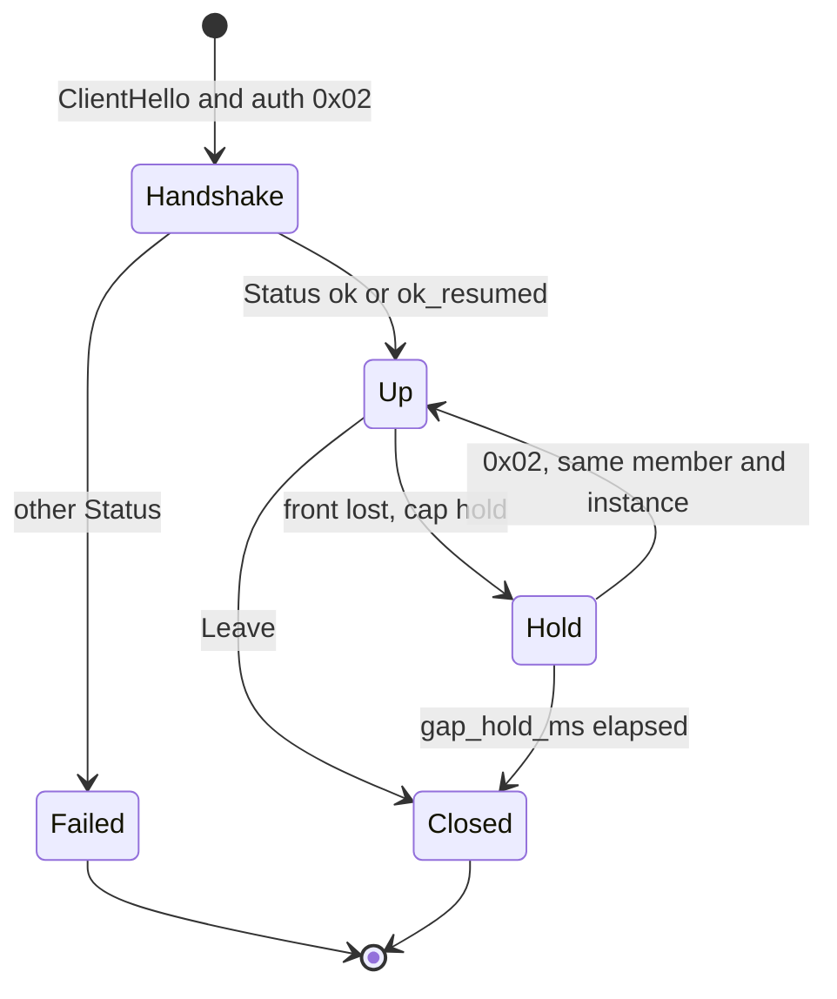
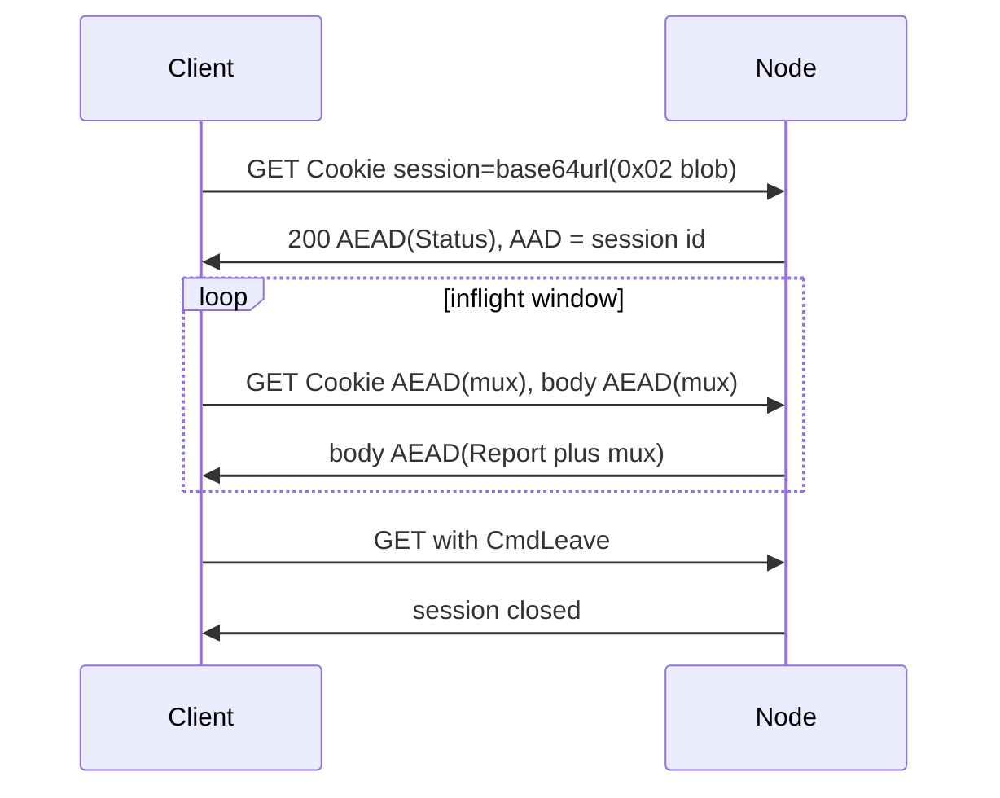

# loft protocol 1.0

**English** · [Русский](protocol_ru.md) · [中文](protocol_zh.md)

This document specifies **loft/1.0**, a multiplexed overlay carried inside ordinary HTTPS. A third-party implementation that follows this text MAY interoperate with a loft node. The Go program in this repository is one implementation. License: [Apache-2.0](../LICENSE).

Protocol version loft/1.0 (`0x0100`) is independent of the implementation version string (`VERSION`, currently 1.0.30). The handshake carries both. Keywords **MUST**, **MUST NOT**, **SHOULD**, **MAY** follow [RFC 2119](https://www.rfc-editor.org/rfc/rfc2119). A receiver MUST ignore unknown trailing fields of Hello and Status.

Operation of the reference node: [guide.md](guide.md). Source layout: [architecture.md](architecture.md).

---

## Abstract

loft is a private overlay whose external path is TLS 1.3 on port 443 with a browser-shaped ClientHello and HTTPS application data. A CDN, reverse proxy, or TLS terminator MAY terminate that TLS session. Inner streams are multiplexed. The default data seal is ChaCha20-Poly1305, so a terminator of TLS does not obtain mux plaintext. A direct front (`ws`, `h2`, `quic`, `h3`, `l3`) MAY negotiate no inner AEAD or AES-256-GCM after Status. Front `get` stays ChaCha20-Poly1305: a CDN MAY terminate TLS on that path.

The inner protocol is one. The outer transfer — GET, WebSocket, HTTP/2 CONNECT, QUIC, HTTP/3 CONNECT, or optional L3 CONNECT — is selected per deployment and MAY change without a protocol-version increase. A node MAY present a configured HTTPS origin to peers that lack a member key, so a scanner or health check observes a website. Member keys, address leases, and the list of live fronts are held on a controller. Relays are replaceable TLS edges. Clients fetch a signed roster of fronts and named address lists and map those lists to local routing. Members of one network MAY be isolated at a hub, meshed through the node, or permitted a direct TCP attempt.

Typical deployments: laboratory LAN access from outside, a server fleet, site-to-site.

---

## Contents

1. [Introduction](#1-introduction)
2. [Notation, terminology, and architecture](#2-notation-terminology-and-architecture)
3. [Fronts](#3-fronts)
4. [Authentication and session key](#4-authentication-and-session-key)
5. [Hello and Status](#5-hello-and-status)
6. [Multiplex](#6-multiplex)
7. [Member, instance, and timers](#7-member-instance-and-timers)
8. [Status codes](#8-status-codes)
9. [Overlay](#9-overlay)
10. [Controller and relays](#10-controller-and-relays)
11. [Security Considerations](#11-security-considerations)
12. [Privacy](#12-privacy)
13. [Registries and extension](#13-registries-and-extension)
14. [Limits](#14-limits)
15. [Versioning](#15-versioning)
16. [Test vectors](#16-test-vectors)
17. [References](#17-references)

---

## 1. Introduction

CDNs, reverse proxies, and TLS terminators forward ordinary HTTPS: TLS 1.3, a browser ClientHello, then GET, WebSocket, or CONNECT. A protocol that uses a private handshake on a private port is not forwarded by those devices. A tunnel bound to a dedicated IP must be listed in every ACL along the path; that address is a single point of failure.

loft occupies the same external place as HTTPS, so it MAY be deployed behind a CDN or proxy as a site is. Inside one mux runs. Outside, GET, WebSocket, HTTP/2 CONNECT, QUIC, or HTTP/3 CONNECT carry that mux according to the node’s configured fronts. The TLS server name is chosen by the node. A client without a member key completes TLS with the configured origin.

A front that stops answering is replaced from a signed roster without renumbering overlay addresses. Relays enrol, send heartbeats, and leave the roster when silent. The member key does not appear in the roster.

**Scope.** This document specifies framing, authentication, multiplex, overlay forwarding, the control plane (roster, fleet, address lists), and the observable path. SOCKS, TUN, and operating-system routing are local to a client and are not protocol capabilities.

**Non-goals.** loft is not a mixnet. This specification does not claim confidentiality against a middlebox that already holds the member key, against a path on which no permitted destination exists, or against a TLS terminator that also holds the inner session key. A direct front that negotiated clear shows mux plaintext to whoever terminates TLS on that front. Front `get` does not negotiate clear.

---

## 2. Notation, terminology, and architecture

### 2.1 Encoding

Integers are big-endian. String fields on Hello, Status, and most fleet records are `u8 length || bytes`, at most 64 bytes. URLs and list values are `u16be length || bytes`, at most 255 bytes unless a section states otherwise.

### 2.2 Terminology

| Term | Meaning |
|------|---------|
| **Node** | Overlay server (`loft-node`) that authenticates members and forwards mux. |
| **Member** | Holder of a member key. The key is `lt_` and 48 lowercase hex characters (24 bytes). The node stores SHA-256 of the whole string. |
| **Instance** | Client-generated identifier stored locally. Together with the member it names a lease. |
| **Front** | External HTTPS transfer that carries mux: `get`, `ws`, `h2`, `quic`, `h3`. Optional `connect` splices TCP without inner mux Open. Optional `l3` is the same HTTP/2 CONNECT as `h2`, then IP datagrams instead of mux. |
| **Origin** | Configured HTTPS site. A peer without a valid member mark is spliced to this site (decoy splice). |
| **Mux** | Inner stream and datagram protocol under AEAD. |
| **Roster** | Ed25519-signed list of live fronts. |
| **Relay** | Replaceable TLS edge. It does not store member keys and does not decrypt mux. |
| **Controller** | Holder of keys, leases, ACLs, and the roster signing key. |
| **Hold** | Retention of mux streams across a short front loss, then resume with a new `0x02` and the same member plus `instance_id`. |
| **Park** | Local state after an unexpected front drop while Hold is in effect: mux streams stay, the front is gone. |
| **Resin** | Mux frames that MUST be retransmitted on the same GET sequence until Report covers that sequence. |
| **Draft** | Mux frames sent once. |
| **Canary** | Status flags for TLS path integrity (padded or split ClientHello). They do not hide SNI from a reassembling inspector. |
| **Sid** | 32-byte TLS ClientHello `session_id` used as a member mark (v3 or v2). Distinct from the GET session identifier (24 hex in the URL path). |
| **Seal** | Data framing after Status. Default and the handshake: `nonce[12] \|\| ChaCha20-Poly1305` ([RFC 8439](https://www.rfc-editor.org/rfc/rfc8439)). Negotiated AES-256-GCM uses the same 12-byte nonce and 16-byte tag ([RFC 5116](https://www.rfc-editor.org/rfc/rfc5116)). Negotiated clear is the plaintext, with no nonce and no tag. |

### 2.3 Layers

```
application   TCP / UDP          (SOCKS and TUN are local)
    mux       Open Data Close Reset Ping Pong Pad Dgram Leave
      AEAD    ChaCha20-Poly1305 (default)
        front get | ws | h2 | quic | h3 | l3
          TLS 1.3
            TCP/443 or UDP/443
```

1. **TLS.** External. A CDN, load balancer, or origin MAY terminate it.
2. **Authentication and AEAD.** Inner. Possession of the member key proves membership. Handshake Status is always ChaCha20-Poly1305. Later data on a direct front MAY be clear or AES-256-GCM (§4.3). Front `get` stays ChaCha20-Poly1305, so a CDN that terminates TLS still does not obtain mux plaintext.
3. **Mux.** Streams and datagrams between client and node, and through the node to the Internet or other members. Front `l3` carries IP datagrams here instead of mux.

The TLS ClientHello SHOULD match a current browser (cipher list, extensions, JA3/JA4). CDN vendor names are deployment profiles. They MUST NOT appear as protocol capabilities.

Reserved mux targets on a relay trunk: `hub:1` (HTTP/1.1), `hub:2` (HTTP/2), `ctl:1` (fleet control). Overlay listen announce: `loft.peer:<port>`.



---

## 3. Fronts

A node advertises enabled fronts in Status `caps`. A client advertises the fronts it will use in Hello `caps`. After the first Status the client MUST use only the intersection, in its configured order, and MUST move to the next remaining front when the current one fails.

If a node omits `fronts`, only `get` is enabled. `ws`, `h2`, `quic`, `h3`, `connect`, and `l3` are off until listed. When both sides list every transport front, the try order is `get`, `ws`, `h2`, `quic`, `h3`. `l3` is not in that try list.

### 3.1 Decoy splice

A loft ClientHello carries a 32-byte `session_id`. The node accepts either construction below, trying v3 first.

**sid v3.** Let `P` be the node’s static X25519 private key (HKDF-SHA256 of the node secret, info `"loft-mask-x25519"`), `X` the ClientHello X25519 `key_share`, `R` the 32-byte `client_random`, `S` the lowercase SNI:

```
shared = X25519(P, X)
session_id = HKDF-SHA256(ikm=shared, salt=R, info="loft-sid-v3" || 0x00 || S, L=32)
```

The matching public key is Status / roster `mask_pub` (32 bytes) and MAY appear as import-URI query `pbk`. Distinguishing these ClientHellos requires `P`. A stolen member key does not mark them.

**sid v2 (fallback).** Let `token` be the member key:

```
HKDF-SHA256(ikm=token, salt=R, info="loft-sid-v2" || 0x00 || S || X, L=32)
```

A client that has not yet learned `mask_pub` sends v2. Possession of `token` allows detection of v2 ClientHellos. Binding to `R`, `S`, and `X` prevents a construction of the form HMAC(`token`, `random`) from matching.

When mask is enabled, a ClientHello whose SNI is a decoy name is admitted only as sid v3. sid v2 on that name is spliced to the origin, so a stolen member key does not mark it. Own SNI still accepts v2: that path presents the node certificate. A client that has `mask_pub` MUST send sid v3 and MUST NOT fall back to v2. A `client_random` already seen in the last 10 minutes is spliced.

Any other TCP ClientHello is spliced to a configured origin: TLS is already complete; subsequent bytes go to that site. The first origin is the node’s identity. If SNI matches one of the node’s origins, that origin is used; otherwise the primary. Origin hostnames are configuration. They MUST NOT appear as protocol constants.

Without a valid `session_id` the field is a 32-byte string of the same shape as Chrome’s compatibility `session_id`. On a direct path the client MUST send the node’s primary origin hostname as SNI. It learns that name from Status, from the roster, or from the certificate a probe would see. After Status, a mismatch MUST reconnect with the advertised name. A CDN front keeps the CDN hostname.

### 3.2 Decoy mask

When mask is enabled, a loft ClientHello completes TLS 1.3 with a certificate shaped like the destination: an ECDSA P-256 leaf that copies the origin Subject, SAN, and validity. The leaf serial is

```
HKDF-SHA256(ikm=shared, salt=R, info="loft-cert-serial", L=16)
```

with `shared` the sid-v3 ECDH. CertificateVerify is `ecdsa_secp256r1_sha256` under that leaf. A client that knows `mask_pub` MUST check the serial binding and the ECDSA signature. Application-record lengths SHOULD follow a pattern sampled from the origin, including after the first sampled records. Status `mask_pub` and roster `mask_pub` carry the 32-byte X25519 public key. Empty means mask is off. Probes continue to splice. An implementation that only splices remains compatible with nodes that do not mask.

If the ClientHello offers group X25519MLKEM768 (`0x11EC`, [RFC 10024](https://www.rfc-editor.org/rfc/rfc10024)), the server selects it. The TLS 1.3 key-schedule input is the ML-KEM-768 shared secret concatenated with the X25519 shared secret. The X25519 half is the 32 bytes inside that group. It is not required to equal the standalone X25519 share. sid v3 keeps using the standalone share (group `0x001d`) when both are present, and the hybrid half when it is the only X25519. A ClientHello that offers only X25519 is answered with X25519. The hybrid group does not make the leaf a public CA chain.

### 3.3 WebSocket (`ws`)

TLS, then HTTP upgrade. The path is node-local (default `/api/v1/sync`). The first client message is the authentication blob in the clear. The first node message is AEAD(Status). Further messages are AEAD(mux batch). Empty batches MUST NOT be sent. Closing the socket ends the session. The client SHOULD send CmdLeave in a mux batch before that close.

### 3.4 GET (`get`)

For edges that forward GET only. Transfer is HTTP/2. Paths have the shape of static assets: `{base}/{session}/{seq}.js`. Mux is carried as batches of requests and responses, not as one long-lived TCP byte stream.



**Handshake GET.** Cookie `session=<base64url(auth blob)>`. The blob tag is `0x02`. The path already contains a client-chosen session identifier (24 hex). Response 200, `Cache-Control: private, no-store`, body AEAD(Status) with AAD equal to that identifier. The node SHOULD echo the same identifier in `X-Session`.

**Subsequent GET.** Cookie `session=` carries base64url or Z85 of AEAD(mux batch), AAD = session identifier, body AEAD(mux batch). The node SHOULD prepend CmdReport (`applied` = last contiguous ingested GET sequence) to that body. A client that receives it MUST stop retrying uplink sequences ≤ `applied`. The handshake Cookie verifies as `0x02`; later GETs are AEAD. Failed authentication MUST be HTTP 404 with an HTML body.

**Budget and encoding.** Uplink MUST fit in one header. Status `header_budget` is encoded Cookie bytes; if omitted, 16 KiB of HTTP header. Status `uplink_enc` 1 is `~` plus Z85 of `u16be length || AEAD` (ZeroMQ Z85); 0 and omitted are base64url. The handshake Cookie remains base64url. A node MUST accept both. Status `h2_conns` (1–4) is the number of HTTP/2 connections to this front; 0 keeps one. Inflight is the total of outstanding GETs across those connections. Concurrent outstanding GETs are 2–8 (protocol default 4; Status `inflight` is a ceiling).

**Edge preset.** The handshake GET is one request. Status `edge` follows it, before the client opens the inflight pump. `0` or omitted is `plain`: the client keeps the limits of that first GET. `1` is `tight`: Cookie budget 16 KiB, 16 outstanding GETs, and a 6 s trip on each later GET. Preset `1` is for an origin behind a CDN or reverse proxy that drops a fat concurrent HEADERS burst. `header_budget` and `inflight`, when non-zero, are a ceiling below that preset. *Informative, not normative.* The node configuration spells preset `1` as `edge: tight`. See [guide.md](guide.md). A vendor name is not a Status field.

**GET did not complete.** A client that enabled other mux fronts MUST try those fronts when the GET handshake does not produce a session. The try order is the enabled subset of GET, WebSocket, HTTP/2, QUIC, HTTP/3. A separate edge URL, when the client has one, is that first GET. The next GET and the other fronts use the node host. The node MUST NOT seal an authentication failure: GET answers HTTP 404 exactly as for any other miss, and `ws`, `h2`, `quic`, and `h3` close the transfer without a reply. A sealed Status would open for a prober that chose `eph_c` and so confirm a loft node. HTTP 404 on the GET handshake is `auth_bad_key` for GET alone; it does not by itself forbid the next front. A client reads a clean close right after `0x02` on `ws`, `h2`, `quic`, `h3`, or `l3` the same way: a WebSocket close, the end of the stream, RST_STREAM `CANCEL` or `NO_ERROR`, or a QUIC application close with code 0. A timeout or a connection reset is a network error. The client reports `auth_bad_key` and stops retrying only when every tried front refused. With `mask_pub` the TLS layer has already authenticated the node, so that refusal is unambiguous.

**Socket change without session change.** A client MAY replace an HTTP/2 connection after a local max-age (omitted or 0: keep until error). Mux and the GET session identifier do not change. A client MAY also replace the HTTP/2 pool after a local egress change: mux, GET session identifier, sequence, and AEAD key remain; there is no new `0x02`. The node keys the session on the GET sid, not on the client address. CONNECT splices on the old pool end with those sockets.

**HTTP errors.** 413: halve the budget, floor 1024, and split. 405: this front is not GET. A client that receives HTTP/2 `GOAWAY ENHANCE_YOUR_CALM` MUST back off on the same session and MAY send CmdTune event 1 on the next GET that already carries mux. The node MAY lower `header_budget` / `inflight` for that front and echo CmdTune event 0 in that GET body.

**Idle and hold of a GET.** Empty idle uplink: wait at least `keepalive_ms / 2` and not less than 1 s. A GET that already carries mux Data, Open, Dgram, or Leave is not idle. The node SHOULD wait up to 250 ms for downlink and MUST NOT hold a GET longer than 1 s. When the uplink already contains CmdData, the node MAY return as soon as downlink Data is queued. When that uplink has ≥ 2 KiB CmdData, the node SHOULD cap that GET body at 96 KiB so the next Cookie recycles; download-only GETs keep 256 KiB (192 KiB with several streams).

Dropping HTTP/2 without Leave does not end the session. Before process exit the client MUST send one last GET whose uplink batch contains CmdLeave. The node then closes the mux session, forgets the GET session identifier, drops the overlay peer, and frees the lease. `lease_hold` still keeps the overlay IP for `ok_resumed`. *Informative, not normative.* One implementation names the drop Detach and the free Release.

### 3.5 HTTP/2 CONNECT (`h2`)

ALPN `h2`. CONNECT to a node-local path (default `/api/v1/tunnel`). Response 200, then messages `u32be length || bytes`: authentication, AEAD(Status), AEAD(mux batch).

### 3.6 QUIC mux (`quic`)

First client-initiated bidirectional stream; the same length-prefixed messages as `h2`. ALPN MUST be `h3`. If HTTP/3 CONNECT is also enabled on that UDP port, the node distinguishes them by the first byte of the first stream: 0 is this mux (4-byte length, at most 1 MiB), 1 is an HTTP/3 HEADERS frame. The node sends HTTP/3 SETTINGS before it knows; a mux client ignores that stream.

### 3.7 HTTP/3 CONNECT (`h3`)

ALPN `h3`. CONNECT to the same path shape as `h2`.

### 3.8 Path canary

Canary measures TLS path integrity. Members present a browser-shaped ClientHello so CDNs, reverse proxies, and TLS middleboxes observe ordinary HTTPS. If a middlebox rewrites the handshake, the session does not come up: the node refuses a mangled TLS path. Canary does not hide SNI from an inspector that reassembles records.

Status MAY set `canary_flags`: bit 0 padded (“fat”) ClientHello, bit 1 ClientHello split across two TLS records (the node concatenates). `canary_pad` is extra padding, 0–2048 bytes.

### 3.9 CONNECT splice (`connect`)

GET mux is a stream protocol over request/response. A node MAY set Status cap `connect` when `fronts` lists `connect` (off by default). After the GET or WebSocket handshake (lease, overlay IP), a client MAY open TCP with HTTP/2 `CONNECT` `:authority` `host:port` instead of mux `CmdOpen`. CONNECT uses the same live GET HTTP/2 pool (optional `h2_max_age_ms`). That CONNECT MUST carry the same 0x02 Cookie as the GET handshake (`Cookie: session=` base64url). Failed proof is HTTP 404. The node dials the target and splices bytes. It MUST refuse loopback, link-local (including `169.254.169.254`), multicast, unspecified, and `localhost`. Overlay member IPs, UDP, and ICMP stay on mux. A node without `connect` keeps mux for every TCP. HTTP CONNECT without this front MUST be 404.

### 3.10 L3 (`l3`)

A node MAY set Status cap `l3` when `fronts` lists `l3` (off by default). The outer transfer is the same HTTP/2 CONNECT as `h2` (§3.5): ALPN `h2`, CONNECT to the node-local path (default `/api/v1/tunnel`), `:protocol` `loft`. Authentication and AEAD(Status) are the same length-prefixed messages. After Status the inner plaintext is not mux. Each AEAD plaintext is:

```
u8    type
bytes payload
```

Type `0x00` is one IPv4 or IPv6 datagram (the version nibble of the first payload byte). Type `0x01` is a batch of `u16be n || datagram` (n is the datagram length). A sender SHOULD cork datagrams into one AEAD plaintext, at most 16 KiB or 2 ms, so Seal is not per MSS. ICMP and TCP SYN, FIN, and RST SHOULD flush at once. A receiver MUST accept both `0x00` and `0x01`. Unknown types are ignored.

The node forwards by overlay destination: the overlay gateway answers ICMP echo; another member with an `l3` session receives the datagram; a destination outside the overlay CIDR is emitted from the node. Hello MUST set cap `l3` for this inner; a CONNECT Hello without that bit stays mux when `h2` is enabled. Closing the CONNECT stream ends that front. Overlay IP follows `instance_id` and `lease_hold` as on other fronts. A new CONNECT with the same `instance_id` MAY keep NAT flows: replies look up the live L3 sink by overlay IP. There is no mux hold. SOCKS, TUN, and operating-system routing remain local to the client.

---

## 4. Authentication and session key

A member key is `lt_` followed by 48 hex characters (24 bytes). The node stores SHA-256 of the whole string. A deployment MAY use one token for every member; that is configuration.

### 4.1 Proof without a client clock

Authentication does not use the client clock. A host with an incorrect clock can still join.

```
0x02 || nonce[16] || eph_c[32] || HMAC-SHA256(key, "lft-a2" || nonce || eph_c)[0:16] || Hello
```

`eph_c` is the client’s ephemeral X25519 public key. A new nonce is a new handshake. The same `nonce||eph_c` inside a 10-minute cache keyed by the node clock is an idempotent retry (GET Cookie). A different `eph_c` on that nonce is refused.

### 4.2 Resume

GET MAY keep the session across a local egress change without a new `0x02` (§3.4). A path change on `ws`, `h2`, `quic`, or `h3`, a failed GET rebind, or a process restart sends a fresh `0x02` with a new ephemeral key and the same Hello `instance_id`. Hold reattaches the parked mux by authenticated member plus instance. Failover to a replica uses `0x02` on the new node; overlay IP follows `lease_hold` and the instance. After a GET handshake Status `ticket` is that GET session identifier. An empty ticket means the node does not speak attach (§4.4).

### 4.3 Session key

```
ss = X25519(sk_c, eph_n)
HKDF-SHA256(ikm=ss, salt=nonce, info="loft-v1", L=32)
```

The first node message is `eph_n[32] || Seal(Status)`. Later mux messages are Seal only. `eph_n` is the node’s ephemeral X25519 public key for this handshake. HMAC covers `eph_c`, so a stolen Cookie cannot complete a session: the AEAD key requires `sk_c`, which never left the client.

Handshake Seal of Status is always `nonce[12] || ChaCha20-Poly1305(key, nonce, plaintext, aad)` ([RFC 8439](https://www.rfc-editor.org/rfc/rfc8439)). The nonce MUST be unique per session key for ChaCha20-Poly1305 and for AES-256-GCM. A later record MUST NOT reuse a nonce already used with that key and that algorithm. Clear records carry no nonce and no tag. GET uses AAD = session identifier; attached fronts (§4.4) and a `0x02` handshake on `ws`/`h2`/`quic`/`h3`/`l3` use empty AAD. Attach shares the session key. Clear ignores AAD.

*Informative, not normative.* One implementation draws a 32-bit random prefix and a 64-bit counter so a parked GET session continues the same counter. The handshake Seal takes one value of that counter. Later AES-256-GCM records on that key continue it. A receiver accepts any unique nonce and does not require this layout.

The data cipher after Status is one byte on Hello and on Status (§5.1, §5.2). An absent byte is ChaCha20-Poly1305. `0` is no inner AEAD: only the TLS of that front remains. `1` is ChaCha20-Poly1305, the same as an absent byte. `2` is AES-256-GCM: the 32-byte HKDF key, a 12-byte nonce, a 16-byte tag, and the same `nonce[12] || ciphertext` framing as ChaCha ([RFC 5116](https://www.rfc-editor.org/rfc/rfc5116)). One session key has one data cipher.

The client asks in Hello. The node confirms exactly one id in Status, or omits the byte. ChaCha20-Poly1305 is always acceptable and cannot be disabled. An unknown id, an id the node policy does not list, or any other disagreement leaves the session on ChaCha20-Poly1305. The session still comes up. Front `get` MUST NOT confirm `0` or `2`: a CDN MAY terminate TLS, and the inner AEAD is what hides mux from that CDN. Fronts `ws`, `h2`, `quic`, `h3`, and `l3` MAY confirm `0` or `2` when the client asked for that id and the node policy lists it. `connect` is a splice and has no data cipher. A session that selected `0` MUST NOT attach front `get` (§4.4). AES-256-GCM MAY attach `get`: the CDN still sees ciphertext. An old peer omits the byte and stays on ChaCha20-Poly1305. Both sides that omit the byte interoperate. This choice does not change protocol version `0x0100`.

*Informative, not normative.* Operator spelling of the node policy and of the client ask is in [guide.md](guide.md). File names and flags are not part of the wire format.

### 4.4 Attach (`0x04`)

A session is created by GET `0x02`. Further fronts join that session with tag `0x04`. They MUST NOT send a second `0x02`.

```
0x04 || u8 sid_len || sid || nonce[16] || u8 front_len || front || HMAC-SHA256(session_key, "lft-a4" || sid || nonce || front)[0:16]
```

`sid` is Status `ticket` (the GET session identifier, 24 hex). `front` is `ws`, `h2`, `quic`, or `h3`. HMAC uses the **session AEAD key** from §4.3, not the member token. `l3` and `connect` MUST NOT attach.

The node looks up the GET session by `sid`, checks HMAC, and refuses a nonce already used on that session (10-minute cache, node clock). Success: one length-prefixed AEAD plaintext containing mux `CmdFront` with that front name (empty AAD). Failure: close the front (HTTP 404 on GET; drop the stream otherwise).

GET stays in the session for keepalive, Leave, and bulk fallback. Mux bulk runs on one front at a time (`CmdFront`). When the attached front dies, bulk returns to GET: same key, same mux, same sequence, no new `0x02`. A `CmdFront` of `get` on GET uplink drops the attach.

Old clients ignore a non-empty `ticket`. Old nodes leave `ticket` empty; the client MUST NOT send `0x04`. A `0x02` handshake on `ws`/`h2`/`quic`/`h3` remains valid when there is no GET session to attach to.

Attach is local to the node that holds the GET session. A relay does not attach a front on the controller for a GET that terminated on the relay.

AEAD covers mux when the data cipher is ChaCha20-Poly1305 or AES-256-GCM. TLS covers the path to the terminator. A CDN that terminates TLS on `get` sees mux ciphertext. A session whose data cipher is clear MUST NOT attach `get`. AES-256-GCM on an attached `get` stays ciphertext.

---

## 5. Hello and Status

Hello is appended to the authentication blob. The first node message is `eph_n[32] || Seal(Status)`. Status is AEAD plaintext. Neither Hello nor Status is a mux command.

### 5.1 Hello

```
u8    version          (= 1)
u8    member_id_len || member_id
u8    instance_id_len || instance_id
u16be proto_min
u16be proto_max
u64be caps
u8    program_len || program
u8    software_len || software
u8    inner            optional. One byte only when the client asks
u8    pin_len || controller_pin   optional after inner
```

`instance_id` persists on the client. Empty means the node mints one in Status; the client MUST store it. Strings ≤ 64 bytes. Protocol version is `major<<8|minor` (`0x0100` = 1.0). Cap `relay` marks a relay trunk. Cap `p2p` marks a client that will announce a listen port.

An old blob without proto/caps still decodes. Trailing unknown bytes MUST be ignored. When one byte remains after `software`, it is the data-cipher ask (§4.3): `0` clear, `2` AES-256-GCM. Absence is not `0`. `controller_pin` is the first 8 bytes of SHA-256 of the controller public key the client trusts now (§10.4); a client that sends it and asks no cipher writes `inner` = `1`. The node uses it only to count who has moved to a new key during a key roll; it grants nothing. Further bytes MUST be ignored. An old decoder ignores the ask and stays on ChaCha20-Poly1305.

### 5.2 Status

Fields in order:

| field | encoding |
|-------|----------|
| code | u16be |
| lease_sec | u32be |
| mtu | u16be |
| vlan | u16be |
| keepalive_ms, idle_ms, reconnect_min_ms, reconnect_max_ms | u32be each |
| reconnect_fast_n | u16be |
| ip, gateway, instance_id | u8 len \|\| bytes |
| reconnect_fast_for_ms | u32be |
| selected proto, min, max | u16be each |
| caps | u64be |
| program, software | u8 len \|\| bytes |
| ticket | u16be len \|\| bytes |
| decoy | u8 n, then n × (u8 len \|\| bytes) |
| mask_pub | u8 len \|\| bytes (0 or 32) |
| replicas | u8 n, then n × (u8 len \|\| bytes) |
| canary_flags | u8 |
| canary_pad | u16be |
| roster | u16be len \|\| bytes |
| lists_serial | u64be |
| lists_hash | u8 len \|\| bytes (0 or 32) |
| peers | u8 (0 hub, 1 mesh, 2 vlan) |
| p2p | u8 (1 = node allows) |
| peer hints | u8 n ≤ 16, then n × (ip, host, port u16be, vlan u16be) |
| dns | u8 n ≤ 8, then n × (u8 len \|\| bytes) — resolver IPv4/IPv6 for the client TUN. Empty: the client MUST leave OS DNS unchanged. |
| ip6, gateway6 | optional tail: each u8 len \|\| bytes. Omitted entirely when both are empty (IPv4-only). A decoder that does not read them MUST ignore the trailing bytes. |
| header_budget, inflight | optional after ip6/gateway6: u16be encoded GET Cookie budget, u8 inflight. Present when either is non-zero (ip6/gateway6 are then empty strings on IPv4). Handshake values are a ceiling; live CmdTune is authoritative. 0 = client keeps its own. |
| h2_conns, uplink_enc | optional after inflight: u8 HTTP/2 connections (1–4; 0 = client keeps one), u8 uplink encoding (0 base64url, 1 Cookie Z85). Present when either is non-zero. Old clients ignore the extra bytes. |
| gap_hold_ms | optional after uplink_enc: u32be. How long the node keeps mux streams after a front drop without Leave. 0 = client default (8 s). Old clients ignore the extra bytes. |
| routes | optional after gap_hold_ms: u8 n ≤ 16, then n × (dst, via) as u8 len \|\| bytes. Managed CIDRs: a laboratory LAN behind a member (`via` is that member’s overlay IP, resolved from `ip route` VIA / `member ID` / `tag NAME`). The node splices Open `host:port` onto that member. A client MUST NOT install a route whose `via` is its own overlay IP. Old clients ignore the extra bytes. |
| policy | optional after routes: compact ACL so a client can enforce the same Allow on direct P2P. `u8 n_own_tags` then tags; `u8 acl_default` (0 peers/accept, 1 drop); `u8 n_rules` then rules; `u8 n_peers` then overlay IP and tags. Omitted when empty. A decoder that sees this tail MUST set Present. Old clients ignore the extra bytes. |
| session_ttl_ms | optional after policy: u32be live-session maximum. 0 = off. Distinct from `lease_sec` (IP hold after disconnect). When this field is present without a policy, the encoder writes an empty policy first. Old clients ignore the extra bytes. |
| rate_bps | optional after session_ttl_ms: u32be bulk `CmdData`/`CmdDgram` cap for this session, both directions, bytes per second. 0 = off. Control and small frames (Open, Ping, ACK ≤ 4 KiB, DNS/ICMP Dgram ≤ 512 B) are unshaped. The node enforces. When this field is present without `session_ttl_ms`, the encoder writes ttl 0 first. Old clients ignore the extra bytes. |
| fronts | optional after rate_bps: u8 n ≤ 8, then n × (name, path, url) as u8 len \|\| bytes. Mux fronts this node accepts (`get` `ws` `h2` `h3` `quic`). Empty url is the host:port of the front that did `0x02`. `quic` has an empty path. Empty list = the client keeps URI/defaults. When this field is present without `rate_bps`, the encoder writes rate 0 first. Old clients ignore the extra bytes. After a successful Status the node map is source of truth; the client SHOULD persist it into the saved profile. |
| edge | optional after fronts: u8 GET preset. `0` plain, omitted when `inner` is also absent. `1` tight. A present `inner` forces this byte even when it is `0`, and forces `fronts` (n MAY be 0) so the next byte is not read as `edge`. Old clients ignore the extra byte. |
| inner | optional after edge: u8 data cipher for records after this Status. The node writes it only when Hello asked, the policy allows that id, and the front that completed `0x02` is not `get`. `0` no inner AEAD. `1` ChaCha20-Poly1305, the same as omitting the byte; a node MAY omit `1`. `2` AES-256-GCM. Absence, an unknown id, or a refused ask is ChaCha20-Poly1305, and the session still comes up. Handshake Seal of this Status is ChaCha20-Poly1305 either way. Old clients ignore the extra byte. |
| key_roll | optional after inner: u16be len \|\| bytes, a KeyRoll (§10.4) while the controller signing key changes. When it is present and no data cipher was negotiated, `inner` is `1` (ChaCha20-Poly1305), which changes nothing. |

Selected protocol is the maximum of the intersection of the two ranges. Empty intersection yields code `protocol` (0x0203) and no mux.

### 5.3 Capability bits

| bit | name | meaning |
|-----|------|---------|
| 0 | multi | several instances on one key |
| 1 | resume | `ok_resumed` and lease hold |
| 2 | sticky_ip | reserved overlay IP on the key |
| 3 | vlan | VLAN from the key |
| 4 | rules | switch ACL |
| 5 | get | GET front |
| 6 | ws | WebSocket front |
| 7 | status | Hello/Status with code |
| 8 | timers | keepalive / idle / reconnect in Status |
| 9 | hello_caps | this cap block |
| 10 | reset | CmdReset |
| 11 | quic | QUIC mux front |
| 12 | dgram | CmdDgram |
| 13 | clockless | authentication without client clock |
| 14 | ticket | Status `ticket` is the GET sid; `0x04` attach (§4.4) |
| 15 | decoy | Status lists origins |
| 16 | h2 | HTTP/2 CONNECT |
| 17 | h3 | HTTP/3 CONNECT |
| 18 | mask | destination-shaped certificate |
| 19 | relay | this session is a relay trunk |
| 20 | roster | Status MAY carry a signed roster |
| 21 | lists | Status MAY advertise list serial/hash |
| 22 | p2p | peer-to-peer overlay when mesh |
| 23 | dns | Status MAY carry DNS servers; gateway:53 is a resolver |
| 24 | connect | HTTP/2 CONNECT splice: TCP Open without inner mux |
| 25 | resin | CmdReport and resin/draft GET uplink |
| 26 | hold | mux streams survive a brief front drop; resume with `0x02` and the same member plus `instance_id` |
| 27 | quic_mark | quic on a decoy node: the Initial MUST carry the loft mark (§11.3) |
| 28 | h3_mark | h3 on a decoy node: the Initial MUST carry the loft mark (§11.3) |
| 29 | l3 | HTTP/2 CONNECT carrying IP datagrams (no mux) |

A node that disables a front MUST clear that bit. A client that will not use a front MUST clear it. SOCKS, TUN, CDN vendor, OS, git, and origin hostnames are not capabilities. Bits 30–63 have no name in this revision (§13.1).

Version negotiation: `max(intersection(client.min..client.max, node.min..node.max))`. Caps in Status are the node’s advertised set. The client decides which of those it uses.

---

## 6. Multiplex

After Status, each AEAD plaintext is a concatenation of frames:

```
u16be payload_length   0..16384
u8    cmd
u32be stream_id
bytes payload
```

Client stream identifiers are odd, starting at 1. Node identifiers are even, starting at 2. A live identifier MUST NOT be reused. After Close or Reset it MAY be reused.

| cmd | name | payload |
|-----|------|---------|
| 1 | Open | target |
| 2 | Data | bytes |
| 3 | Close | empty |
| 4 | Ping | 8 bytes, echoed |
| 5 | Pong | those 8 bytes |
| 6 | Pad | ignored |
| 7 | Reset | u16be code |
| 8 | Dgram | Open-target prefix then UDP payload |
| 9 | Leave | empty; stream_id MUST be 0 |
| 10 | Tune | 4 bytes: `u8 event \|\| u8 inflight \|\| u16be header_budget`, optional 5th byte `h2_conns`. Client event ≠ 0 is one front break (1 `ENHANCE_YOUR_CALM`, 2 HTTP 413, 3 HTTP 404, 4 connection reset, 5 HTTP 429, 6 other GOAWAY), sent once on the next GET that already carries mux. Node event 0 sets live GET `header_budget` / `inflight` / `h2_conns` (0 in a field = leave unchanged). The node replies only when those values change. stream_id MUST be 0. |
| 11 | Report | `u64be applied` (highest contiguous GET sequence the node has ingested). stream_id MUST be 0. Old clients ignore unknown mux commands. |
| 12 | Front | front name (`get`, `ws`, `h2`, `quic`, `h3`). stream_id MUST be 0. Client: bulk mux on this attached front. Node: ack. `get` returns bulk to GET. |

**Resin and draft.** A mux frame is resin or draft.

- **Resin** is held until a Report covers its GET sequence, then retransmitted on that same sequence: Open, Ping, Pong, Leave, Tune, Report, Front, Close, Reset, and Dgram to port 53.
- **Draft** is sent once: Data, Pad, other Dgram. Inner TCP or UDP produces a new frame if the application still needs the bytes.

One mux Pull becomes up to three GET sequences: control resin, draft Data, then Close/Reset. Close MUST NOT share a Cookie with Data for the same stream. After an HTTP error the client retries the same sequence with resin only (or Pad if the Cookie was draft-only) so the sequence hole fills and draft is not replayed. A first-attempt HTTP 404 on several inflight GETs is edge noise; three **retry** 404s on the same sid mean the origin lost the session. A duplicate Open for a live stream_id MUST be ignored.

Open target: `u16be host_len || host || u16be port`. Dgram payload is that prefix plus the datagram.

Leave ends the mux session. stream_id is 0. Payload is empty. The node MUST close the mux session, drop the overlay peer, and free the lease. That peer is no longer online. `lease_hold` still keeps the IP for the same `instance_id`. Frames after Leave in the same batch MAY be ignored. An implementation that does not yet handle Leave MUST ignore the command (unknown mux commands MUST be ignored and MUST NOT reset the session, §13.2). *Informative, not normative.* One implementation names the drop Detach and the free Release, and clears a flag `Online`. CmdClose ends one stream; it does not end the session.

Implementations MUST batch frames (about 1–16 KiB per AEAD plaintext). They MUST NOT drop Data under buffer pressure: they apply backpressure. Per-stream receive buffer is at least 64 KiB and at most 256 KiB. An Open that cannot be completed is Reset `stream_refused` (0x0501). Ping interval is `keepalive_ms`. Idle timeout is `idle_ms`. On `get`, Pad so plaintext before AEAD is about 400–600 bytes.

Length-prefixed wrappers (`h2`, `quic`, `h3`, `ctl`): `u32be length || payload`, at most 1 MiB. Mux payload inside AEAD remains ≤ 16384.

---

## 7. Member, instance, and timers

A member is a key. An instance is a client-generated identifier stored locally. Empty instance: the node mints one in Status; the client persists it.

The same instance reconnecting receives `ok_resumed` and the same overlay IP. A second instance with `multi` off receives `auth_already_online`. With `multi` on, further instances receive pool addresses until `multi_limit` (default 8), then `auth_limit`. A sticky IP on the key is given to the first instance.

After disconnect, `lease_hold_ms` (default 45 s) keeps the IP for that instance. Leave marks that peer offline immediately; the hold is only the IP reservation for resume. A GET session that vanishes without Leave stays online until the node next sees that session.

When both Hello and Status advertise `hold`, an unexpected front drop (radio gap, or a path change that Parks) MUST NOT close mux streams for `gap_hold_ms` (default 8 s). Replacing HTTP/2 on GET with the same sid is not a drop. The client that Parks redials with a fresh `0x02` and the same `instance_id`; the node reattaches the parked mux only for the member that matches the new proof. Inner TCP stays up. After `gap_hold_ms` with no resume, the node closes the mux. Leave still closes immediately.

A client MAY pause draft locally around a known gap; resin still goes. That pause is not a protocol field.

Defaults: handshake 10 s, idle 120 s, keepalive 15 s, lease hold 45 s, gap hold 8 s, reconnect minimum 200 ms, maximum 8 s, 5 fast tries inside 8 s, then exponential backoff.

---

## 8. Status codes

Numeric values are stable. Names MAY grow. Numbers do not move.

| code | name | meaning |
|------|------|---------|
| 0x0000 | ok | new lease |
| 0x0001 | ok_resumed | same instance, same IP |
| 0x0101 | auth_bad_key | unknown key |
| 0x0102 | auth_revoked | key rotated or deleted |
| 0x0103 | auth_expired | join TTL |
| 0x0104 | auth_not_authorized | member disabled |
| 0x0105 | auth_limit | multi_limit |
| 0x0106 | auth_already_online | multi off, other instance |
| 0x0107 | auth_instance | bad instance id |
| 0x0108 | auth_clock | timestamp skew (unused if clockless) |
| 0x0201 | net_disabled | network off |
| 0x0202 | net_unknown | wrong network |
| 0x0203 | protocol | no common version |
| 0x0204 | rate_limit | too many handshakes |
| 0x0205 | timeout | handshake or idle |
| 0x0206 | internal | node fault |
| 0x0301 | ip_pool | pool exhausted |
| 0x0302 | ip_conflict | sticky clash |
| 0x0303 | vlan_denied | VLAN not allowed |
| 0x0401 | policy_drop | ACL or hub isolation |
| 0x0501 | stream_refused | Open failed |
| 0x0502 | stream_reset | peer Reset |

A non-OK Status forbids mux. HTTP 404 on GET authentication is treated as `auth_bad_key`. Codes absent from the table have no name in this revision (§13.3).

---

## 9. Overlay

The node loads a network document (CIDR, gateway, members, ACLs). Overlay IP and VLAN appear in Status. Open to an address inside the overlay CIDR is forwarded according to `peers`:

| peers | Overlay Open |
|-------|----------------|
| hub | Reset `policy_drop`. Internet Open is unchanged. Open to a managed CIDR behind a member still splices. |
| mesh | Splice to the peer session: Open `127.0.0.1:port` on that member. |
| vlan | As mesh, only if both ends share a VLAN. |

Hub splice: the receiving client accepts the stream and dials the local port.

`p2p` on the network defaults to on for mesh and vlan. When on, Status carries up to 16 peer hints (overlay IP, TLS-observed host, listen port, VLAN, 32-byte X25519 public key). A client with Hello cap `p2p` listens on TCP, announces with Open `loft.peer:<port>` plus a 32-byte X25519 public key on that stream, and MAY dial `host:port` and run the sealed handshake below before falling back to hub splice. Nothing on that TCP connection is in clear and no byte of it is fixed:

```
initiator → e_pub[32] || Seal(k1, head, aad = e_pub) || pad
            head = src_ipv4[4] || dest_port u16be || at u64be || proof[16] || pad_len u8
responder → r_pub[32] || Seal(k2, pad_len u8, aad = r_pub) || pad
each way  → Seal(k, len u16be) || Seal(k, data[len])        len ≤ 16384
```

`e` and `r` are fresh X25519 keys for each connection. On the wire the top bit of `e_pub` and `r_pub` is random; X25519 ignores it. `s` is the member P2P key announced with `loft.peer`. `ss` = X25519(s_initiator, s_responder), `es` = X25519(e, s_responder), `ee` = X25519(e, r). `k1` = HKDF-SHA256(ikm = es, salt = e_pub, info = "loft p2p hello", L = 32), `k2` = HKDF-SHA256(es, salt = e_pub || r_pub, info = "loft p2p reply", L = 32). The data keys are HKDF-SHA256(ee || es || ss, salt = e_pub || r_pub, info = "loft p2p data", L = 64): the first 32 bytes for initiator → responder, the rest for the way back. The AEAD is ChaCha20-Poly1305. Handshake seals use a zero nonce, since each of those keys seals once; data uses a 96-bit little-endian counter per direction, from 0, one step per seal. `proof` = HMAC-SHA256(ss, "loft p2p proof" || e_pub || src_ipv4 || dest_port || at)[0:16], `at` is unix seconds, `pad` is `pad_len` random bytes.

The responder opens the header, looks up `src_ipv4` in its hints and checks `proof` against that member's key, requires `at` within 60 s of its own clock, and refuses an `e_pub` (top bit cleared) it has accepted in the last 120 s. Any failure closes the socket; the initiator then uses hub splice. A client with `p2p: false` MUST use hub splice only. Observed host through a relay is the relay; a direct attempt then fails and hub splice is used. When Status carries policy, both the initiator and the responder MUST apply the same Allow as hub splice before splicing local ports. A Status without policy (old node) skips that check.

Each hint record is `u8 ip | ip | u8 host | host | u16be port | u16be vlan`, then optionally `u8 32 | pub[32]`. A decoder MUST treat a following byte other than 32 as the next field (older blobs, or a peer that has not announced a public key).

ACL rules are first match, `accept` or `drop`. Empty rules still apply `peers`. Packet fields: source, destination, source VLAN, destination VLAN, source tag, destination tag, to-gateway, routed (destination matches `ip route` via a member). Address tokens: `any`, `host <IP>`, CIDR, `tag NAME` (`group` is the same token). `default deny` under `ip access-list overlay` keeps traffic to the gateway and drops the rest unless a permit matches. TCP Open uses the same Allow path as overlay ICMP. `ip route DST` next hop is an overlay IP, `member ID`, or `tag NAME` (first live member, else sticky IP).

Overlay ICMP echo is CmdDgram to `dst:1` (IP protocol ICMP) with the IPv4 packet as payload. The node answers the gateway address. Other overlay destinations follow `peers` (hub drops member-to-member; mesh/vlan splice to that member). Echo to an address outside the overlay CIDR is emitted by the node as a real ICMP echo; the reply is returned as CmdDgram `session-ip:1`. A client answers echo for its own overlay IP locally and MUST NOT fabricate replies for other overlay or Internet addresses. The node MUST treat the session overlay IP as the packet source (a Darwin utun dummy `169.254.8.1` is rewritten). The client MAY restore that dummy address on echo-reply so the kernel matches the ping socket.

---

## 10. Controller and relays

A controller holds keys, leases, ACLs, and signing. A relay terminates external TLS and copies HTTP after TLS onto a trunk session: Open `hub:1` or `hub:2`. Inner mux AEAD and FinishAuth stay on the controller; the relay does not decrypt overlay frames and does not store member keys. Only a Hello with cap `relay` MAY Open `hub:*` or `ctl:1`. Members MUST NOT set that bit (it is not a front). A relay sets it. A relay authenticates `0x02` with a relay key: a key the controller issued for one relay id and keeps apart from member keys. The controller MUST give a trunk only to a relay key whose id is on its relay list and whose Hello has cap `relay`; it MUST NOT accept a relay key as a member key, nor a member key as a trunk. A trunk gets no overlay address. Cap `hold` and resume `0x02` are independent of this bit. *Informative, not normative.* One client omits the bit. The Go node in the relay role sets it with ExtraCaps and reads its key from `relay.key`; the controller keeps relay keys in `relays.keys` and their SHA-256 on the `relay` lines of `node.conf`. See [guide.md](guide.md). Member authentication and overlay IP remain on the controller.

```
client ──TLS──► relay ──trunk (mux hub:1|hub:2, ctl:1)──► controller
                     ▲
                     member key is never stored on the relay
```

### 10.1 Roster

Ed25519 over the body:

```
u64be serial
u8 n
repeat n:
  id                 (u8+bytes)
  url                (u16be+bytes)
  decoy              (u8+bytes)
  fronts             u8 k, k × (u8+bytes), k ≤ 16
  drain              u8
  weight             u8 (0 means 100)
  path               (u8+bytes)
  mask_pub           u8 len, 0..32 bytes
```

Then `u8 pub_len || pub || u16be sig_len || sig`. Signature is Ed25519 over the body. Public key is 32 bytes. Signature is 64 bytes.

The live roster is `advertise` (id `self`) plus heartbeating relays that are not drain. Three missed beats (default interval 10 s) or a dead `ctl` stream remove the relay and increment serial.

Fetch after authentication: Status `roster`. Fetch before authentication: `GET {roster_path}` (default `/static/v3/manifest.json`), JSON `{"v":1,"p":"<base64url>"}, plus `"r":"<base64url KeyRoll>"` while the controller key changes (§10.4)`, `Cache-Control: public, max-age=60`. That GET succeeds on a CDN or a host with a real certificate. A decoy-spliced IP without session HMAC is forwarded to the origin. The document MUST NOT contain a member token. A client MUST reject a roster whose signer does not match the pinned controller public key. Accepting an unknown signer is an operator opt-in and is off by default. *Informative, not normative.* One client spells the pin `controller_pub` and the opt-in `tofu`. See [guide.md](guide.md).

### 10.2 Fleet (`ctl:1`)

Each message `u32be length || u8 type || body`.

| type | name | body |
|------|------|------|
| 1 | enrol_req | id, url, decoy, fronts |
| 2 | enrol_ok | signed slice |
| 3 | enrol_no | u16be code, reason |
| 4 | beat | load u8, conns u32be, program, uptime_s u32be |
| 5 | slice | signed slice |
| 6 | drain | id, u8 |
| 7 | key_roll | KeyRoll (§10.4); sent before enrol_ok while the controller key changes |
| 8 | state | to a standby controller only: the controller's state as named files (u8 n, then n × (u8 name_len \|\| name \|\| u32be len \|\| bytes)), after enrol_ok and again when it changes |
| 9 | takeover | Takeover: the newest controller generation the sender knows. A relay sends it first, before `enrol_req`; the controller sends its own before `enrol_ok` |

Slice (Ed25519 over the body): serial, id, url, decoy, fronts, drain, weight, beat_ms u32be, expires unix u64be, then pub and sig as in the roster. The `enrol_req` id MUST equal the relay id of the key the trunk authenticated with, so one relay cannot enrol as another. The relay MUST verify every slice with the controller public key it was installed with and MUST refuse a slice signed by any other key. Enrol deny: 1 unknown id, 2 bad form, 3 duplicate, 4 disabled. *Informative, not normative.* Configuration names for the relay list, relay keys, and per-relay overrides of URL, decoy, fronts, and weight are in [guide.md](guide.md).

Provisioning of machines and certificates is outside this protocol.

A standby controller is a relay that the controller marks as such. The controller MUST send `state` only to a trunk whose key belongs to a relay marked standby. *Informative, not normative.* What the state holds and how a standby takes over are deployment matters; this tree's are in [guide.md](guide.md).

A standby that takes over holds the controller's own key, so signatures alone cannot tell it from the old controller. Each takeover therefore signs a Takeover with the controller key: `"lft-take" || u64be epoch || u64be at || u8 len || by || sig[64]`. `epoch` is one above the newest generation the standby knows, `at` is unix seconds, `by` is the standby id. A controller with a Takeover MUST send it as `takeover` before `enrol_ok`. A relay MUST keep the newest valid Takeover it has seen (signed by the key it pins) and MUST send it as the first `takeover` message on every ctl:1 stream. A controller that receives a valid Takeover with an epoch above its own has been replaced: it MUST stop serving as the controller. A relay MUST refuse a controller whose generation is below the newest it has seen. A relay with more than one controller address SHOULD periodically send its Takeover to each of them, so an old controller that comes back learns of the takeover even when no trunk lands on it.

A relay is a witness for every standby in its controller list: it tells each one whether it reaches the controller, so a standby can tell a lost controller from a broken link of its own. A report is `"lft-wit" || u8 id_len || id || u64be at || u8 sees || mac[16]`, where `at` is unix seconds, `sees` is `1` when the relay reaches the controller, and `mac` is the first 16 bytes of HMAC-SHA256 under the relay key over everything before it. The relay sends it as the body of an HTTP/1.1 `POST /api/v1/health` inside TLS to the standby's public address, with the ClientHello marked by the relay key as a member's is (§3.1), so the standby keeps the connection instead of handing it to its decoy. The relay SHOULD keep one connection open and send a report about every 10 s with random spread, not open a new connection each time. The standby answers `204` to a report that verifies under the key of that relay id in its copy of the controller's state and is within 30 s of its clock, and `403` otherwise. A report MUST NOT appear outside TLS.

### 10.3 Address lists

The controller MAY publish named lists of addresses. Names have no protocol meaning. The client maps names to `direct`, `via`, or `drop`. If a host matches several mapped lists, apply drop, then direct, then via. Unmatched destinations use the client default (SHOULD be `via`).

Body (Ed25519, same key as the roster). A client MUST reject lists whose signer is not the controller key it accepts for the roster, and lists with a lower serial than the lists it holds: lists decide which traffic leaves the tunnel, and they are often fetched through a CDN.

```
u64be serial
u8 nsets
repeat:
  name               (u8+bytes)
  u16be n
  repeat n: u8 kind, u16be+bytes value
```

Kind 1 exact domain, 2 suffix, 3 CIDR. Then public key and signature as in the roster.

Status carries `lists_serial` and SHA-256 of the signed blob. The client fetches `GET {lists_path}` (default `/static/v3/lists.json`) when serial or hash is newer. Matching is case-insensitive for names. *Informative, not normative.* How an operator file spells a suffix or a CIDR is in [guide.md](guide.md). SOCKS matches hostname. TUN matches IP (CIDR).

### 10.4 Controller key roll

A controller MAY replace its signing key without reissuing the clients that pin it. The old key signs one KeyRoll:

```
"lft-roll" || serial u64be || not_after u64be (unix seconds) || old_pub[32] || new_pub[32] || Ed25519(old_pub's key, all bytes before)[64]
```

The controller then signs roster, lists, and slices with the new key and publishes the KeyRoll until `not_after`: Status `key_roll`, the roster manifest field `"r"` (base64url, no padding), and ctl message `key_roll` before `enrol_ok`. A client or relay MUST accept a KeyRoll only when the signature verifies under `old_pub`, `old_pub` is the controller key it trusts now, `not_after` has not passed, and `serial` is greater than that of any KeyRoll it applied. It then MUST trust `new_pub` instead of `old_pub`. It SHOULD keep what it applied, so that a restart that begins from `old_pub` ends on `new_pub` again. A client that sees no KeyRoll before `not_after` keeps `old_pub` and needs the new key from its operator. *Informative, not normative.* In this tree: `loft-node -roll-key DAYS` or the panel; the controller keeps `controller.roll`, a client `controller.rolls`, a relay `controller.pub`.

---

## 11. Security Considerations

What a CDN, reverse proxy, or TLS terminator can observe, and which checks the handshake relies on. Who else can read member keys, overlay addresses, and the roster is §12.

| Observer | Sees |
|----------|------|
| TLS terminator without member key | HTTPS to the origin or a destination-shaped certificate (mask); mux is AEAD ciphertext on ChaCha20-Poly1305 and on AES-256-GCM |
| TLS terminator on a direct front that negotiated clear | mux plaintext. Front `get` does not negotiate clear |
| Middlebox without node private `P` | 32-byte `session_id` of Chrome length; sid v3 is not distinguishable without `P` |
| Holder of a stolen member key | sid v2 ClientHellos; not sid v3 |
| Active probe without valid sid | configured origin (live certificate and bytes) |
| TLS terminator that also holds the AEAD session key | mux plaintext (outside this protocol) |

### 11.1 Handshake

A ClientHello that matches a current browser passes the same JA3/JA4 filters already deployed in front of banks and portals. A private ALPN, a private GREASE pattern, or the Go default cipher list identifies a non-browser. QUIC ALPN is therefore `h3`. *Informative, not normative.* One client builds that ClientHello with uTLS. See [guide.md](guide.md).

`session_id` is 32 random-looking bytes. sid v3 is HKDF under ECDH with the node’s static X25519; a middlebox needs that private key to mark those ClientHellos. A stolen member key marks only sid v2. A mask node does not admit sid v2 on a decoy SNI, so that key does not mark the ClientHello that carries the decoy name. A middlebox without either secret sees a string of the same length Chrome already sends.

Mask presents a destination-shaped ECDSA P-256 leaf and `ecdsa_secp256r1_sha256` CertificateVerify, bound by the serial to the same ECDH. A middlebox that verifies a public CA chain will not accept the leaf; a middlebox that inspects names, dates, and the signature scheme sees destination-typical values. When the ClientHello offers X25519MLKEM768, the ServerHello selects that group. Application-record lengths on the loft path SHOULD follow a pattern sampled from the origin. Splice-only nodes skip mask. The leaf remains outside WebPKI either way.

### 11.2 Destination

An IP that serves only loft is a single point of failure. A CDN hostname, or an origin that already serves a site, is the intended front. Relays exist so that an address can leave the roster while member identity stays on the controller.

A probe without a key sees the origin. Taking the origin hostname or IP out of service is an operational decision, not a protocol constant.

### 11.3 Active probe

A scanner that opens TLS without a valid `session_id` is spliced to the configured origin, including own SNI (CT / reverse-DNS hostname), empty SNI, and a first packet that is not a TLS ClientHello. It receives the origin’s live certificate and bytes. UDP on that IP is forwarded to the same origin, so a QUIC probe sees the destination, not loft. The exception is a marked loft QUIC v1 Initial. Its source connection ID is 20 bytes of `HKDF-SHA256(secret, salt = client_random, info = "loft-quic-v3")`, where client_random is an ephemeral X25519 public key (top bit random) and secret is ECDH(that ephemeral, `mask_pub`). A client without `mask_pub` uses info `loft-quic-v2` with its member key as secret. The node opens the Initial with the public Initial keys ([RFC 9001](https://www.rfc-editor.org/rfc/rfc9001) §5.2), checks the mark, holds each client_random single-use for 10 minutes, and gives that client address to its quic/h3 fronts. A TCP `client_random` is single-use for the same 10 minutes; a repeat is spliced. On a mask node the QUIC mark is v3 only (`quic_mark` / `h3_mark`): a v2 Initial is forwarded to the origin. The node’s own connection IDs carry an HMAC, so a short-header packet from a new address stays on loft. Such a node advertises `quic_mark` / `h3_mark` instead of `quic` / `h3`; a client that does not mark MUST NOT use them. Forming sid v3 requires `mask_pub`; overlay Hello still requires the member key. CDN origin pull is the exception: configured `cdn_peers` CIDRs MAY complete TLS with the node certificate on own SNI without sid.

GET without a valid Cookie returns 404 with HTML. A well-formed `0x02` under an unknown member key is the same 404. Roster, lists, and static assets are ordinary GET.

### 11.4 Replay and clocks

Auth `0x02` is a nonce, an ephemeral X25519 public key, and HMAC under the member key. The same `nonce||eph_c` inside the cache TTL is an idempotent retry. A new nonce is a new handshake. The client clock is unused. Replicas accept a fresh `0x02`; they do not share this cache.

### 11.5 Roster and lists

The signed roster is a public file on a CDN path. Anyone who can GET that path can read live fronts. The member key is absent. A client that has a pinned controller public key rejects a substituted key. Trust-on-first-use is off: a client MUST NOT pin an unknown signer unless the operator turned that opt-in on (§10.1).

### 11.6 Overlay

Hub isolation is Reset `policy_drop` on member-to-member Open. Mesh splices through the node. P2P is an optional TCP attempt using the TLS-observed host; NAT and relays make that attempt fail, after which hub splice is used. Direct P2P uses Status policy for the same ACL as the node. The controller holds member key hashes, leases, and overlay addresses. Other members learn a peer’s overlay IP when they Open it (mesh/vlan). With `p2p` on, Status peer hints also carry the TLS-observed host, listen port, and X25519 public key. Direct TCP is sealed and authenticated with the pair secret (§9); none of its bytes is fixed. `session_ttl_ms` is a live-session maximum; `lease_sec` is IP hold after disconnect. A fresh `0x02` with the same `instance_id` starts a new TTL.

### 11.7 Outside this protocol

A TLS middlebox that already holds the member key is not addressed. A path on which no permitted destination exists is not addressed. A TLS terminator that also holds the inner overlay key sees mux plaintext. A direct front that negotiated clear shows mux plaintext to its TLS terminator without that key. Those cases are outside the protocol.

---

## 12. Privacy

loft is not a mixnet. The path sees a TLS 1.3 session. The controller sees members, leases, and overlay addresses. A relay that terminates TLS sees the client address and the HTTP bytes after TLS. It does not hold member keys and does not decrypt mux frames.

| Data | Who can read it |
|------|-----------------|
| Member key | The member and the controller. The roster, the address lists, and a relay do not carry it. |
| Controller signing key | The controller. A client that has the public key rejects a substituted signer. Pinning an unknown signer is off unless the operator turns that opt-in on (§10.1). |
| Overlay IP, VLAN, lease | The controller. Another member learns an overlay IP when mesh or vlan forwards an Open to it. With `p2p` on, Status peer hints also carry that overlay IP, the TLS-observed host, the listen port, and an X25519 public key (§11.6). |
| Mux plaintext | Holders of the session key. A TLS terminator without that key sees AEAD ciphertext on ChaCha20-Poly1305 and on AES-256-GCM (§11). Front `get` does not negotiate clear, so a CDN that terminates TLS on `get` does not obtain mux plaintext. A direct front that negotiated clear shows mux plaintext to that front’s TLS terminator. |
| Roster and address lists | Anyone who can GET the public path. `Cache-Control: public`. Not a member directory. |
| Sizes and timing on `get` | The CDN or reverse proxy that terminates that TLS, including Cookie length. The inner AEAD still hides mux plaintext. |

The member key, the controller signing key, and the overlay addressing plan are deployment secrets. Publishing the roster does not publish them.

---

## 13. Registries and extension

This specification is the registry for capability bits, multiplex commands, and status codes. A value this text has not assigned is either reserved for a later revision of this specification or experimental. A fork that uses a reserved value for its own meaning will collide with a later assignment. An experimental value is safe only between peers that agreed to that meaning out of band.

The capability field is an unsigned 64-bit set. Bit 63 is not a sign bit.

### 13.1 Capability bits

| bits | class |
|------|--------|
| 0–29 | assigned (§5.3) |
| 30–47 | reserved |
| 48–63 | experimental |

A reserved bit MUST NOT be set for a meaning this specification has not assigned. This specification assigns the next bits from 30 upward. An experimental bit MUST NOT be set toward a peer that did not agree to that meaning out of band. A receiver MUST ignore a bit it does not implement. An unknown bit does not fail the handshake. The receiver MUST NOT reset the session because of it.

### 13.2 Multiplex commands

The command is one byte.

| cmd | class |
|-----|--------|
| 0 | reserved, unused |
| 1–12 | assigned (§6) |
| 13–191 | reserved |
| 192–255 | experimental |

A receiver that does not implement a command MUST ignore it and MUST NOT reset the session (§6). That rule covers reserved and experimental values. A sender MUST NOT use a reserved command. An experimental command MUST NOT be sent to a peer that did not agree to that meaning out of band.

### 13.3 Status codes

A code is `u16be`. The high byte is the class.

| range | class |
|-------|--------|
| 0x0000–0x00FF | success. Assigned: `0x0000` ok, `0x0001` ok_resumed. The rest of this class is reserved. |
| 0x0100–0x01FF | authentication. Assigned: `0x0101`–`0x0108` (§8). The rest is reserved. |
| 0x0200–0x02FF | network and protocol. Assigned: `0x0201`–`0x0206`. The rest is reserved. |
| 0x0300–0x03FF | address. Assigned: `0x0301`–`0x0303`. The rest is reserved. |
| 0x0400–0x04FF | policy. Assigned: `0x0401`. The rest is reserved. |
| 0x0500–0x05FF | stream. Assigned: `0x0501`, `0x0502`. The rest is reserved. |
| 0x0600–0x7FFF | reserved. New classes are `0x06`–`0x7F`. |
| 0x8000–0xFFFF | experimental |

Only `0x0000` and `0x0001` are success. Any other code forbids mux (§8). That includes an unknown code in class `0x00` and an experimental code the receiver does not implement. A sender MUST NOT emit a reserved code. An experimental code MUST NOT be sent to a peer that did not agree to that meaning out of band.

Numbers already assigned do not move. A later revision adds a name in a reserved slot. It does not take an experimental value for a standard meaning.

---

## 14. Limits

| limit | value |
|-------|-------|
| mux payload | ≤ 16384 |
| Hello/Status strings | ≤ 64 |
| roster URL | ≤ 255 |
| inflight GET | ≤ 8 |
| streams per session | SHOULD ≤ 256 |
| AEAD batch | ≤ 48 KiB (`ws`), ≤ header budget (`get`) |
| GET padding plaintext | about 400 bytes before AEAD |
| length-prefixed wrapper | ≤ 1 MiB |
| peer hints | ≤ 16 |
| roster entries | ≤ 255 |
| fronts per entry | ≤ 16 |
| nonce cache | TTL 10 min; sweep above 50 000 entries |
| canary_pad | 0–2048 |
| gap_hold_ms | 0–600000 (default 8000) |
| rate_bps | 0 = off; else bytes/s, u32 |
| fronts | n ≤ 8; name/path/url each ≤ 64 |

---

## 15. Versioning

Protocol version 1.0 (`0x0100`) does not change with the implementation version string. A major increase is incompatible framing or authentication. A minor increase adds capabilities; old clients still speak. The handshake selects the highest version in both ranges. The data-cipher byte (§4.3) is an optional tail. It does not increase `0x0100`. A minor increase assigns capability bits from the reserved range (§13.1). Experimental values (§13) are not how this specification extends itself.

The implementation version is a string on Hello and Status. Git hashes are omitted. Program name and semver are enough on the path.

A client MUST implement at least `get` or `ws`, mux, and authentication. Roster fetch, decoy, mask, lists, and overlay forwarding are required of a client that will run through a CDN or TLS terminator, or in a meshed network.

---

## 16. Test vectors

All values are hex unless quoted. *Informative, not normative.* One implementation checks the vectors below in `internal/crypto/vectors_test.go` and `internal/transport/vectors_test.go`. X25519 scalars are the raw 32 bytes before RFC 7748 clamping.

### 16.1 Mux frames

These are mux-frame payloads before Seal.

Data, stream 1, payload `hi`:

```
00 02 02 00 00 00 01 68 69
```

Open `example.com:443` (payload of CmdOpen):

```
00 0b 65 78 61 6d 70 6c 65 2e 63 6f 6d 01 bb
```

Reset `stream_refused`: payload `05 01`.

Member key shape: `lt_` + 48 lowercase hex. SHA-256 of the whole string is what the node stores.

### 16.2 Authentication `0x02`

Member key `"lt_4576657279206c6574746572206973207072697661746521"`. The HMAC key is the ASCII bytes of that whole string (51 bytes). `nonce` is `554448522d313934382d4172742d3132`. Client ephemeral scalar `sk_c` is `4576657279206c657474657220697320707269766174652e204172742e203132`.

Hello: version 1, empty `member_id`, `instance_id` `"0123456789abcdef01234567"`, `proto_min` = `proto_max` = `0x0100`, caps `0x060077e0` (get, ws, status, timers, hello_caps, reset, dgram, clockless, ticket, resin, hold), program `"loft"`, software `"1.0.28"`, no data-cipher byte.

```
eph_c   32c45e8f52d9c0bb8a6cc2ffbd4e77192774145cad9a8708357a519051124a79
hello   0100183031323334353637383961626364656630313233343536370100010000000000060077e0046c6f667406312e302e3238
mac     8efb91df15eb9b7f04fb08d442693be4
auth    02554448522d313934382d4172742d313232c45e8f52d9c0bb8a6cc2ffbd4e77192774145cad9a8708357a519051124a798efb91df15eb9b7f04fb08d442693be40100183031323334353637383961626364656630313233343536370100010000000000060077e0046c6f667406312e302e3238
```

The GET handshake Cookie value is base64url without padding:

```
AlVESFItMTk0OC1BcnQtMTIyxF6PUtnAu4pswv-9TncZJ3QUXK2ahwg1elGQURJKeY77kd8V65t_BPsI1EJpO-QBABgwMTIzNDU2Nzg5YWJjZGVmMDEyMzQ1NjcBAAEAAAAAAAYAd-AEbG9mdAYxLjAuMjg
```

### 16.3 Session key and first node message

Node ephemeral scalar `sk_n` is `746865204e657420726f757465732061726f756e642063656e736f7273686970`. `X25519(sk_c, eph_n)` equals `X25519(sk_n, eph_c)`; the key is HKDF of that secret with salt `nonce` of §16.2 (§4.3).

Status: code `ok`, `lease_sec` 3600, `mtu` 1380, `vlan` 0, keepalive 15000, idle 120000, reconnect 200 / 8000, `reconnect_fast_n` 5, ip `"10.77.0.2"`, gateway `"10.77.0.1"`, the `instance_id` of §16.2, `reconnect_fast_for_ms` 8000, protocol `0x0100` / `0x0100` / `0x0100`, caps `0x000063e0` (get, ws, status, timers, hello_caps, clockless, ticket), program `"loft-node"`, software `"1.0.28"`, ticket `"415254205849582031393438"`, no decoy, mask, replicas, canary, roster, or lists, peers hub, p2p 0, no peer hints, dns `"10.77.0.1"`, no optional tail.

The handshake is GET, so AAD is the ASCII of that 24-character session identifier. The Seal nonce is `55444852 0000000000000001` (prefix and counter of §4.3).

```
eph_n   f54cc5cde68414ebb35ced960185d2cd307a2f0942281d3c3b37133a0d55676e
key     560604d0c0dca87fd5a1180216ffce0feb8b4e2ac1e03166c36af7b78939157a
status  000000000e100564000000003a980001d4c0000000c800001f4000050931302e37372e302e320931302e37372e302e311830313233343536373839616263646566303132333435363700001f4001000100010000000000000063e0096c6f66742d6e6f646506312e302e323800183431353235343230353834393538323033313339333433380000000000000000000000000000000000000000010931302e37372e302e31
first   f54cc5cde68414ebb35ced960185d2cd307a2f0942281d3c3b37133a0d55676e55444852000000000000000177e1a52129d70e616413165f1ad9b635a1104d0fd7ec9f840ff529358825405d4f5f6e3f416695385291b4b92e286254688991005a7dd2e1450d2747f64138d4b8d913f75387f007b4e5826ba144a3277ecb1477443b8e78e9d6aac93da1f8382d56aae4f32544786437122fc046062869acc2e4cc1eaa492fdba7234a7b715b05077d1d433d3801eeb76a03e9c9bf6343dee64ceb7af54f238bd5e6a9e9b98c3568a8e5910c313784f6ff0e5421794caf67aaf371
```

`first` is `eph_n || Seal(status)`.

### 16.4 Status optional tail

The Status of §16.3 with `gap_hold_ms` 8000 and one route `"192.168.10.0/24"` via `"10.77.0.5"`. The bytes below follow `dns`. Every optional field before `routes` is written, zero or empty: `ip6`, `gateway6`, `header_budget`, `inflight`, `h2_conns`, `uplink_enc`.

```
tail    0000000000000000001f40010f3139322e3136382e31302e302f32340931302e37372e302e35
```

### 16.5 Attach `0x04`

Session key of §16.3, `sid` the ticket of §16.3, `nonce` `6f66666c696e65203d206f6e6c696e65`, front `"ws"`.

```
attach  04183431353235343230353834393538323033313339333433386f66666c696e65203d206f6e6c696e650277730942e1cd2a573568a57c2c74dd7a358e
```

### 16.6 Roster and address lists

Controller Ed25519 seed is `4c696265727479204f662046726565205472616e736d697373696f6e20312e30`.

Roster: serial 19481210, one entry: id `"self"`, url `"https://loft.example.com"`, decoy `"origin.example"`, fronts `get` `ws`, drain 0, weight 0 (encoded as 100), path `"/static/v3/build"`, `mask_pub` of §16.8.

Lists: serial 19661216, one set `"lan"`: kind 3 `"10.0.0.0/8"`, kind 2 `"example.com"`.

```
pub     0fd3ecac78db360ace8ab85e4d92d897feb4a5e8565421ee9dcc6efbaf63ae05
roster  000000000129427a010473656c66001868747470733a2f2f6c6f66742e6578616d706c652e636f6d0e6f726967696e2e6578616d706c6502036765740277730064102f7374617469632f76332f6275696c6420cccb563311f0de9f0c3dd28b1450d978bdabfc63ca6d73cf561f2ff3ecc09443200fd3ecac78db360ace8ab85e4d92d897feb4a5e8565421ee9dcc6efbaf63ae050040d3aedaddbc78bf5c8c29b7e5802b4ea8ae80acc57490ce8a8bfc1bc596f6ea15c861451304262fb6b4c05ddcf0d35ac2cfc6fdccfb531141b986f3a12c68410c
lists   00000000012c01a001036c616e000203000a31302e302e302e302f3802000b6578616d706c652e636f6d200fd3ecac78db360ace8ab85e4d92d897feb4a5e8565421ee9dcc6efbaf63ae050040506182dab9d93d73af943ce5a5bcd097e024b7b51666acb654145b6a16f5c250cb6af43fb4a3b365a802bb4fe8f7b7be479e3bd84c1a7ca9f036feadd51b0203
hash    647fe575001d7d8dd007eb04efebacb72b23881ad5ea241ec4440692b22fddc4
```

`hash` is Status `lists_hash`: SHA-256 of `lists`. The roster document at `roster_path` carries base64url without padding:

```
{"v":1,"p":"AAAAAAEpQnoBBHNlbGYAGGh0dHBzOi8vbG9mdC5leGFtcGxlLmNvbQ5vcmlnaW4uZXhhbXBsZQIDZ2V0AndzAGQQL3N0YXRpYy92My9idWlsZCDMy1YzEfDenww90osUUNl4vav8Y8ptc89WHy_z7MCUQyAP0-yseNs2Cs6KuF5NktiX_rSl6FZUIe6dzG77r2OuBQBA067a3bx4v1yMKbflgCtOqK6ArMV0kM6Ki_wbxZb26hXIYUUTBCYvtrTAXdzw01rCz8b9zPtTEUG5hvOhLGhBDA"}
```

### 16.7 Cookie Z85

Uplink encoding 1 of the Data frame in §16.1. `u16be length || blob` is 11 bytes; it is padded with one zero byte to 12, a multiple of 4. A decoder takes the length from the first two bytes and ignores the padding.

```
~00@Sb0SSi20CDfE
```

### 16.8 ClientHello mark and P2P handshake

sid v3, cert serial, and the QUIC v3 source connection ID. Node secret is the ASCII string `loft-vector-node`. Client X25519 scalar is `01 02 … 20` (32 bytes). `R` is 32 bytes of `0x11`. SNI is `origin.example`. QUIC `client_random` is X25519(scalar, basepoint), top bit clear, and the HKDF key is the same ECDH as the cert serial.

```
mask_pub   cccb563311f0de9f0c3dd28b1450d978bdabfc63ca6d73cf561f2ff3ecc09443
X          07a37cbc142093c8b755dc1b10e86cb426374ad16aa853ed0bdfc0b2b86d1c7c
session_id 699f169d38b0f02b98ade7ad3234aab2006d7cb3da449842d3a0d791b12dfb87
serial     46112462b0f8327be74b9dac22a7ce55
quic scid  25b8c53ebe475334b474445e3ee3253691b18faa
```

The node static scalar is `HKDF-SHA256(ikm = node secret, salt = empty, info = "loft-mask-x25519", L = 32)`.

sid v2 on the same ClientHello, with the member key of §16.2 as `token`:

```
sid v2  d2953bbc3bcad53751c4eebc631d4a48425731080439c99eae5bcd148a79b9ca
```

P2P handshake (§9). Initiator member scalar `50726976616379206973206e65636573736172792e2048756768657320273933`, responder member scalar `5468697320697320666f722065766572796f6e652e2054696d424c2032303132`, initiator fresh scalar `4172742e3233204b6f6e73742e2052462073656372656379206f66206d61696c`, responder fresh scalar `41727469636c6520313220554448523a206e6f20696e746572666572656e6365`, public keys sent with the top bit clear, `src_ipv4` 10.77.0.2, `dest_port` 8080, `at` 2524608000, initiator pad `706164`, responder pad empty. `record` is the first initiator → responder data record, carrying `ping`.

```
peer_pub  2a4cd76bd42aaa397c78d84f0e3fa3643dfad73d128237b66e8572688fc8a306
hello     1222bc2690224afdf79af2353f4b1e6a413509a02b55edf17ee77b120c97f02ff329464388923d4616c229688f928cd3171fcbc3a2c9cda759cc35c2a7acef59eae3000bdb7d97c5a83bbcb0f00b0f706164
reply     24c5c85b756c65ee52638724ee40049b69916e77d878bc507b72d04211f5543eca4bde80e88b6f53d067e8874af6450401
record    39b9fc9869bfe0580b40de9f12a7c1a3dd87f6469543822a1385ea6e9364ee21edd26e9e8d7b
```

### 16.9 Controller key roll

The old key is the roster vector key (§16.6); the new key is from the next seed. Both seeds are ASCII.

```
seed_old  "Liberty Of Free Transmission 1.0"   (the roster vector key)
seed_new  "Liberty Of Free Transmission 1.1"
old_pub   0fd3ecac78db360ace8ab85e4d92d897feb4a5e8565421ee9dcc6efbaf63ae05
new_pub   4c4bd2cfd6b9b0741b7f7f31967f58e9e063ef28ab6edac047299effa80025f5
serial    1
not_after 2524608000   (2050-01-01)
key_roll  6c66742d726f6c6c000000000000000100000000967a76000fd3ecac78db360ace8ab85e4d92d897feb4a5e8565421ee9dcc6efbaf63ae05
          4c4bd2cfd6b9b0741b7f7f31967f58e9e063ef28ab6edac047299effa80025f5
          7712b8da2955ab0df3f7a6f64fbcc784280075f964bd85e0d95e2e72cd0a27c473c869ee53c08d63cdeb3f90611acda4b99db6e9c1b1d6a286afdda469b47103
```

---

## 17. References

1. [RFC 2119](https://www.rfc-editor.org/rfc/rfc2119). Key words for use in RFCs to Indicate Requirement Levels.
2. [RFC 5869](https://www.rfc-editor.org/rfc/rfc5869). HMAC-based Extract-and-Expand Key Derivation Function (HKDF).
3. [RFC 7748](https://www.rfc-editor.org/rfc/rfc7748). Elliptic Curves for Security (X25519).
4. [RFC 8439](https://www.rfc-editor.org/rfc/rfc8439). ChaCha20 and Poly1305 for IETF Protocols.
5. [RFC 8032](https://www.rfc-editor.org/rfc/rfc8032). Edwards-Curve Digital Signature Algorithm (Ed25519).
6. [RFC 8446](https://www.rfc-editor.org/rfc/rfc8446). The Transport Layer Security (TLS) Protocol Version 1.3.
7. [RFC 9000](https://www.rfc-editor.org/rfc/rfc9000) / [RFC 9001](https://www.rfc-editor.org/rfc/rfc9001). QUIC.
8. [RFC 9113](https://www.rfc-editor.org/rfc/rfc9113). HTTP/2.
9. [RFC 9114](https://www.rfc-editor.org/rfc/rfc9114). HTTP/3.
10. [RFC 6455](https://www.rfc-editor.org/rfc/rfc6455). The WebSocket Protocol.
11. [RFC 1928](https://www.rfc-editor.org/rfc/rfc1928). SOCKS Protocol Version 5.
12. ZeroMQ RFC 32. Z85 (ZeroMQ Base-85 Encoding).
13. [RFC 10024](https://www.rfc-editor.org/rfc/rfc10024). Post-Quantum Traditional (PQ/T) Hybrid Key Agreement Mechanisms for TLS 1.3. August 2026. Group X25519MLKEM768 is 4588 (`0x11EC`).
14. [RFC 5116](https://www.rfc-editor.org/rfc/rfc5116). An Interface and Algorithms for Authenticated Encryption. AES-256-GCM, 12-byte nonce, 16-byte tag.
