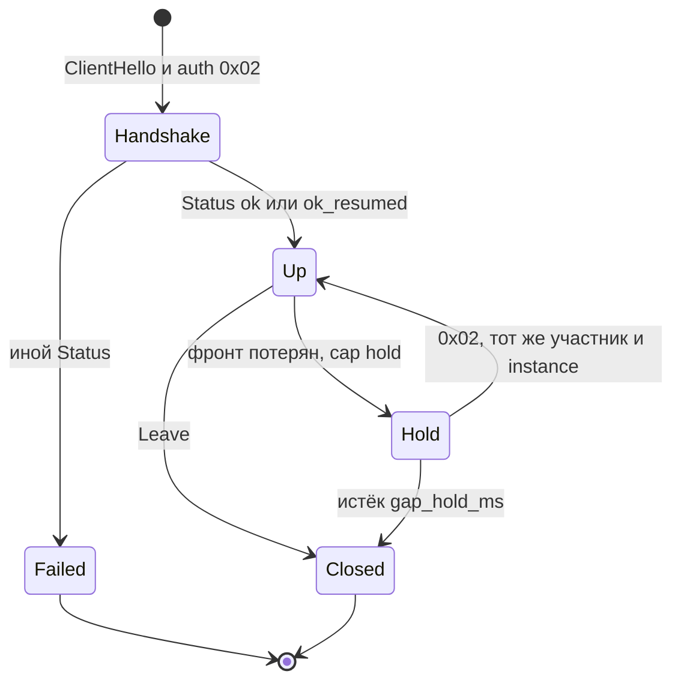
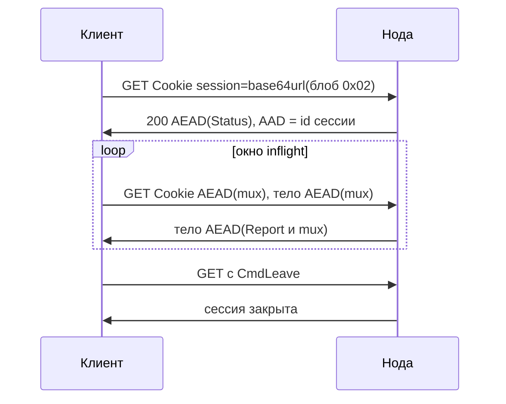

# Протокол loft 1.0

[English](protocol.md) · **Русский** · [中文](protocol_zh.md)

Этот документ задаёт **loft/1.0** — мультиплексированный оверлей внутри обычного HTTPS. Сторонняя реализация, следующая этому тексту, МОЖЕТ работать с нодой loft. Программа на Go в этом репозитории — одна из реализаций. Лицензия: [Apache-2.0](../LICENSE).

Версия протокола loft/1.0 (`0x0100`) не зависит от строки версии реализации (`VERSION`, сейчас 1.0.29). В рукопожатии передаются обе. Слова **ДОЛЖЕН**, **НЕ ДОЛЖЕН**, **СЛЕДУЕТ**, **МОЖЕТ** соответствуют MUST, MUST NOT, SHOULD, MAY из [RFC 2119](https://www.rfc-editor.org/rfc/rfc2119). Получатель ДОЛЖЕН игнорировать неизвестные поля в хвосте Hello и Status.

Эксплуатация эталонной ноды: [guide_ru.md](guide_ru.md). Раскладка исходников: [architecture_ru.md](architecture_ru.md).

---

## Аннотация

loft — частный оверлей. Снаружи он выглядит как TLS 1.3 на порту 443: ClientHello в форме браузера и прикладные данные HTTPS. CDN, обратный прокси или TLS-терминатор МОЖЕТ завершить эту сессию TLS. Внутренние потоки мультиплексируются. По умолчанию данные запечатываются ChaCha20-Poly1305, поэтому терминатор TLS не получает открытый текст mux. Прямой фронт (`ws`, `h2`, `quic`, `h3`, `l3`) МОЖЕТ после Status согласовать отсутствие внутреннего AEAD или AES-256-GCM. Фронт `get` остаётся на ChaCha20-Poly1305: CDN МОЖЕТ завершить TLS на этом пути.

Внутренний протокол всегда один и тот же. Внешний транспорт — GET, WebSocket, HTTP/2 CONNECT, QUIC, HTTP/3 CONNECT или необязательный L3 CONNECT — выбирается для каждого развёртывания и МОЖЕТ меняться без повышения версии протокола. Нода МОЖЕТ предъявлять настроенный HTTPS-origin тем, у кого нет ключа участника, поэтому сканер или проверка доступности видят веб-сайт. Ключи участников, аренды адресов и список живых фронтов хранятся на контроллере. Relay — сменные TLS-края. Клиенты получают подписанный roster фронтов и именованные списки адресов и отображают эти списки на локальную маршрутизацию. Участников одной сети МОЖНО изолировать на хабе, соединять через ноду (mesh) или разрешить им попытку прямого TCP-соединения.

Типичные развёртывания: доступ в лабораторную сеть снаружи, парк серверов, связь площадок.

---

## Содержание

1. [Введение](#1-введение)
2. [Обозначения, термины и архитектура](#2-обозначения-термины-и-архитектура)
3. [Фронты](#3-фронты)
4. [Аутентификация и ключ сессии](#4-аутентификация-и-ключ-сессии)
5. [Hello и Status](#5-hello-и-status)
6. [Мультиплекс](#6-мультиплекс)
7. [Участник, экземпляр и таймеры](#7-участник-экземпляр-и-таймеры)
8. [Коды Status](#8-коды-status)
9. [Оверлей](#9-оверлей)
10. [Контроллер и relay](#10-контроллер-и-relay)
11. [Вопросы безопасности](#11-вопросы-безопасности)
12. [Конфиденциальность](#12-конфиденциальность)
13. [Реестры и расширение](#13-реестры-и-расширение)
14. [Ограничения](#14-ограничения)
15. [Версии](#15-версии)
16. [Тестовые векторы](#16-тестовые-векторы)
17. [Ссылки](#17-ссылки)

---

## 1. Введение

CDN, обратный прокси и TLS-терминатор передают обычный HTTPS: TLS 1.3, ClientHello браузера, затем GET, WebSocket или CONNECT. Протокол с собственным рукопожатием на отдельном порту такие устройства не проксируют. Туннель на выделенном IP необходимо явно указывать в каждом ACL на пути; этот адрес — единственная точка отказа.

Снаружи loft выглядит как HTTPS, поэтому он МОЖЕТ стоять за CDN или прокси, как обычный сайт. Внутри работает один mux. Снаружи его несут GET, WebSocket, HTTP/2 CONNECT, QUIC или HTTP/3 CONNECT — в зависимости от фронтов ноды. Имя сервера TLS выбирает нода. Клиент без ключа участника завершает TLS с настроенным origin.

Фронт, переставший отвечать, заменяется другим из подписанного roster, и адреса оверлея при этом не перенумеровываются. Relay регистрируются, отправляют heartbeat и выпадают из roster, если замолкают. Ключ участника в roster не входит.

**Область действия.** Документ задаёт кадрирование, аутентификацию, мультиплекс, пересылку оверлея, плоскость управления (roster, флот, списки адресов) и наблюдаемый путь. SOCKS, TUN и маршрутизация ОС локальны для клиента и к возможностям протокола не относятся.

**Вне области.** loft не является mixnet. Спецификация не обещает конфиденциальности против посредника, у которого уже есть ключ участника; против пути, на котором нет ни одного разрешённого назначения; против TLS-терминатора, которому также известен внутренний ключ сессии. Прямой фронт, согласовавший clear, раскрывает открытый текст mux тому, кто завершает TLS на этом фронте. Фронт `get` clear не согласовывает.

---

## 2. Обозначения, термины и архитектура

### 2.1 Кодирование

Целые числа — в порядке big-endian. Строковые поля Hello, Status и большинства записей флота — `u8 length || bytes`, не длиннее 64 байт. URL и значения списков — `u16be length || bytes`, не длиннее 255 байт, если в разделе не сказано иное.

### 2.2 Термины

| Термин | Значение |
|--------|----------|
| **Нода** | Сервер оверлея (`loft-node`): аутентифицирует участников и пересылает mux. |
| **Участник** (member) | Обладатель ключа. Ключ — `lt_` и 48 шестнадцатеричных символов в нижнем регистре (24 байта). Нода хранит SHA-256 всей строки. |
| **Экземпляр** (instance) | Идентификатор, который клиент генерирует и хранит локально. Вместе с участником определяет аренду. |
| **Фронт** | Внешний HTTPS-транспорт, несущий mux: `get`, `ws`, `h2`, `quic`, `h3`. Необязательный `connect` стыкует TCP без внутреннего Open. Необязательный `l3` — тот же HTTP/2 CONNECT, что и `h2`, но после него идут IP-дейтаграммы, а не mux. |
| **Origin** | Настроенный HTTPS-сайт. Участник без действительной метки стыкуется с этим сайтом (decoy splice). |
| **Mux** | Внутренний протокол потоков и датаграмм под AEAD. |
| **Roster** | Список живых фронтов, подписанный Ed25519. |
| **Relay** | Сменный край TLS. Не хранит ключи участников и не расшифровывает mux. |
| **Контроллер** | Хранилище ключей, аренд, ACL и ключа подписи roster. |
| **Hold** | Удержание потоков mux при кратковременной потере фронта и возобновление новым `0x02` с тем же участником и `instance_id`. |
| **Park** | Локальное состояние после неожиданной потери фронта при действующем Hold: потоки mux сохранены, фронта нет. |
| **Resin** | Кадры mux, которые ДОЛЖНЫ повторно передаваться на том же порядковом номере GET, пока Report не покроет этот номер. |
| **Draft** | Кадры mux, передаваемые один раз. |
| **Canary** | Флаги Status о целостности пути TLS (дополненный или разрезанный ClientHello). Не скрывают SNI от инспектора, собирающего записи. |
| **Sid** | 32-байтовый `session_id` TLS ClientHello, метка участника (v3 или v2). Не путать с идентификатором GET-сессии (24 hex в пути URL). |
| **Seal** | Формат данных после Status. По умолчанию и на рукопожатии: `nonce[12] \|\| ChaCha20-Poly1305` ([RFC 8439](https://www.rfc-editor.org/rfc/rfc8439)). Согласованный AES-256-GCM — тот же nonce 12 байт и тег 16 байт ([RFC 5116](https://www.rfc-editor.org/rfc/rfc5116)). Согласованный clear — открытый текст, без nonce и без тега. |

### 2.3 Слои

```
приложение   TCP / UDP          (SOCKS и TUN локальны)
    mux       Open Data Close Reset Ping Pong Pad Dgram Leave
      AEAD    ChaCha20-Poly1305 (по умолчанию)
        фронт get | ws | h2 | quic | h3 | l3
          TLS 1.3
            TCP/443 или UDP/443
```

1. **TLS.** Внешний слой. Его МОЖЕТ завершить CDN, балансировщик или origin.
2. **Аутентификация и AEAD.** Внутренний слой. Обладание ключом участника доказывает принадлежность к сети. Status рукопожатия всегда запечатан ChaCha20-Poly1305. Дальше на прямом фронте данные МОГУТ идти без внутреннего AEAD или на AES-256-GCM (§4.3). Фронт `get` остаётся на ChaCha20-Poly1305, поэтому CDN, завершивший TLS, открытый текст mux не получает.
3. **Mux.** Потоки и датаграммы между клиентом и нодой и через ноду — в Интернет или к другим участникам. Фронт `l3` несёт здесь IP-дейтаграммы вместо mux.

ClientHello СЛЕДУЕТ формировать как у актуального браузера (список шифров, расширения, JA3/JA4). Имена вендоров CDN относятся к профилям развёртывания и НЕ ДОЛЖНЫ входить в возможности протокола.

Зарезервированные цели mux на транке relay: `hub:1` (HTTP/1.1), `hub:2` (HTTP/2), `ctl:1` (управление флотом). Объявление прослушивания оверлея: `loft.peer:<port>`.



---

## 3. Фронты

Нода объявляет включённые фронты в Status `caps`. Клиент объявляет фронты, которыми будет пользоваться, в Hello `caps`. После первого Status клиент ДОЛЖЕН использовать только пересечение, в своём настроенном порядке, и ДОЛЖЕН переходить к следующему оставшемуся фронту, когда текущий отказывает.

Если нода не указала `fronts`, включён только `get`. `ws`, `h2`, `quic`, `h3`, `connect` и `l3` выключены, пока их не перечислят. Когда обе стороны перечислили все транспортные фронты, порядок попыток: `get`, `ws`, `h2`, `quic`, `h3`. `l3` в этот список попыток не входит.

### 3.1 Decoy splice

ClientHello loft несёт 32-байтовый `session_id`. Нода принимает любую из двух конструкций ниже и сначала пробует v3.

**sid v3.** Пусть `P` — статический закрытый ключ X25519 ноды (HKDF-SHA256 от секрета ноды, info `"loft-mask-x25519"`), `X` — X25519 `key_share` из ClientHello, `R` — 32-байтовый `client_random`, `S` — SNI в нижнем регистре:

```
shared = X25519(P, X)
session_id = HKDF-SHA256(ikm=shared, salt=R, info="loft-sid-v3" || 0x00 || S, L=32)
```

Парный открытый ключ передаётся в поле `mask_pub` Status и roster (32 байта); он МОЖЕТ передаваться и в query ссылки импорта как `pbk`. Чтобы отличить такие ClientHello, нужен `P`. Украденным ключом участника их не пометить.

**sid v2 (запасной).** Пусть `token` — ключ участника:

```
HKDF-SHA256(ikm=token, salt=R, info="loft-sid-v2" || 0x00 || S || X, L=32)
```

Клиент, ещё не получивший `mask_pub`, отправляет v2. Обладание `token` позволяет обнаруживать ClientHello v2. Благодаря привязке к `R`, `S` и `X` конструкция не совпадает с HMAC(`token`, `random`).

Когда mask включён, ClientHello, в SNI которого стоит имя-приманка, принимается только как sid v3. sid v2 с этим именем стыкуется с origin, поэтому украденный ключ участника такой ClientHello не пометит. На own SNI v2 по-прежнему принимается: на этом пути предъявляется сертификат ноды. Клиент, у которого есть `mask_pub`, ДОЛЖЕН слать sid v3 и НЕ ДОЛЖЕН откатываться на v2. ClientHello, чей `client_random` уже встречался за последние 10 минут, стыкуется.

Любой другой TCP ClientHello стыкуется с настроенным origin: TLS уже завершён, последующие байты уходят на этот сайт. Первый origin задаёт личность ноды. Если SNI совпал с одним из origin ноды, используется он, иначе основной. Имена origin — конфигурация. Они НЕ ДОЛЖНЫ быть константами протокола.

Без действительного `session_id` это поле — 32-байтовая строка той же формы, что compatibility-`session_id` у Chrome. На прямом пути клиент ДОЛЖЕН ставить в SNI основное имя origin ноды. Имя берётся из Status, из roster или из сертификата, который увидел бы зонд. Если после Status имя не совпало, клиент ДОЛЖЕН переподключиться с объявленным именем. CDN-фронт сохраняет hostname CDN.

### 3.2 Decoy mask

Когда mask включён, рукопожатие TLS 1.3 с ClientHello loft завершается сертификатом, повторяющим форму назначения: лист ECDSA P-256 копирует Subject, SAN и срок действия origin. Серийный номер листа:

```
HKDF-SHA256(ikm=shared, salt=R, info="loft-cert-serial", L=16)
```

`shared` — тот же ECDH, что у sid v3. CertificateVerify — `ecdsa_secp256r1_sha256` под этим листом. Клиент, знающий `mask_pub`, ДОЛЖЕН проверить привязку серийного номера и подпись ECDSA. Длины application-записей СЛЕДУЕТ выдерживать по образцу origin, в том числе после первых снятых записей. Status `mask_pub` и roster `mask_pub` несут 32-байтовый открытый ключ X25519. Пустое значение означает, что mask выключен. Зонды по-прежнему стыкуются. Реализация, которая только стыкует, совместима с нодами без mask.

Если ClientHello предлагает группу X25519MLKEM768 (`0x11EC`, [RFC 10024](https://www.rfc-editor.org/rfc/rfc10024)), сервер выбирает её. На вход расписания ключей TLS 1.3 подаётся общий секрет ML-KEM-768, а за ним — общий секрет X25519. Половина X25519 — это 32 байта внутри этой группы. Совпадать с отдельным X25519 share она не обязана. sid v3 по-прежнему берёт отдельный share (группа `0x001d`), когда присутствуют оба, и половину гибрида, когда это единственный X25519. ClientHello только с X25519 получает ответ X25519. Гибридная группа не превращает лист в цепочку публичного УЦ.

### 3.3 WebSocket (`ws`)

Сначала TLS, затем HTTP upgrade. Путь локален для ноды (по умолчанию `/api/v1/sync`). Первое сообщение клиента — блоб аутентификации открытым текстом. Первое сообщение ноды — AEAD(Status). Далее — AEAD(пачка mux). Пустые пачки НЕ ДОЛЖНЫ отправляться. Закрытие сокета завершает сессию. Перед закрытием клиенту СЛЕДУЕТ послать CmdLeave в пачке mux.

### 3.4 GET (`get`)

Фронт для краёв, которые пропускают только GET. Транспорт — HTTP/2. Пути имеют форму статических ресурсов: `{base}/{session}/{seq}.js`. Mux переносится пачками запросов и ответов, а не одним длинным потоком TCP.



**GET рукопожатия.** Cookie `session=<base64url(блоб аутентификации)>`. Тег блоба — `0x02`. В пути уже стоит выбранный клиентом идентификатор сессии (24 hex). Ответ 200, `Cache-Control: private, no-store`, тело AEAD(Status) с AAD, равным этому идентификатору. Ноде СЛЕДУЕТ повторить тот же идентификатор в `X-Session`.

**Последующие GET.** Cookie `session=` несёт base64url или Z85 от AEAD(пачка mux), AAD = идентификатор сессии, тело AEAD(пачка mux). Ноде СЛЕДУЕТ ставить в начало тела CmdReport (`applied` — последний сплошной принятый порядковый номер GET). Клиент, получивший его, ДОЛЖЕН прекратить повторы исходящих номеров ≤ `applied`. Cookie рукопожатия проверяется как `0x02`, у последующих GET проверяется AEAD. Неудачная аутентификация ДОЛЖНА давать HTTP 404 с телом HTML.

**Бюджет и кодирование.** Исходящие данные ДОЛЖНЫ умещаться в один заголовок. Status `header_budget` задаёт размер закодированного Cookie в байтах; если поле опущено, бюджет равен 16 КиБ HTTP-заголовка. Status `uplink_enc` 1 — `~` плюс Z85 от `u16be длина || AEAD` (ZeroMQ Z85); 0 и отсутствие поля — base64url. Cookie рукопожатия остаётся base64url. Нода ДОЛЖНА принимать оба. Status `h2_conns` (1–4) — число HTTP/2-соединений к этому фронту; 0 оставляет одно. Inflight — сумма незавершённых GET по всем этим соединениям. Одновременно незавершённых GET — от 2 до 8 (в протоколе по умолчанию 4; Status `inflight` — верхняя граница).

**Пресет GET.** GET рукопожатия — один запрос. Status `edge` приходит следом, до того как клиент откроет inflight-насос. `0` или отсутствие поля — `plain`: клиент сохраняет пределы того первого GET. `1` — `tight`: бюджет Cookie 16 КиБ, 16 незавершённых GET и 6 с на каждый последующий GET. Пресет `1` — для origin за CDN или обратным прокси, который сбрасывает толстый одновременный всплеск HEADERS. `header_budget` и `inflight`, если они не нулевые, задают потолок ниже этого пресета. Имя вендора в Status не передаётся. *Пояснение, не норма.* В конфигурации ноды пресет `1` записан как `edge: tight`. См. [guide_ru.md](guide_ru.md).

**GET не состоялся.** Клиент, у которого включены другие mux-фронты, ДОЛЖЕН перебрать эти фронты, если GET-рукопожатие не дало сессии. Порядок попыток — включённое подмножество GET, WebSocket, HTTP/2, QUIC, HTTP/3. Отдельный URL края, если он задан, используется для этого первого GET. Следующий GET и остальные фронты идут на хост ноды. Нода НЕ ДОЛЖНА запечатывать отказ аутентификации: GET отвечает HTTP 404 точно так же, как на любой другой промах, а `ws`, `h2`, `quic` и `h3` закрывают передачу без ответа. Зонд, который сам выбрал `eph_c`, сможет открыть запечатанный Status и убедится, что перед ним нода loft. HTTP 404 на GET-рукопожатии означает `auth_bad_key` только для GET; сам по себе он не запрещает пробовать следующий фронт. Чистое закрытие сразу после `0x02` на `ws`, `h2`, `quic`, `h3` или `l3` клиент трактует так же: close-фрейм WebSocket, конец потока, RST_STREAM `CANCEL` или `NO_ERROR`, закрытие QUIC на уровне приложения с кодом 0. Таймаут или сброс соединения — сетевая ошибка. Клиент сообщает `auth_bad_key` и прекращает попытки, только когда отказали все опробованные фронты. При известном `mask_pub` нода уже аутентифицирована на уровне TLS, поэтому такой отказ однозначен.

**Смена сокета без смены сессии.** Клиент МОЖЕТ заменить HTTP/2-соединение по локальному max-age (0 или отсутствие — держать до ошибки). Mux и идентификатор GET-сессии не меняются. Клиент МОЖЕТ также заменить пул HTTP/2 после смены локального исходящего адреса: mux, идентификатор GET-сессии, порядковый номер и ключ AEAD сохраняются, новый `0x02` не отправляется. Нода идентифицирует сессию по GET sid, а не по адресу клиента. Стыковка CONNECT на старом пуле завершается вместе с этими сокетами.

**Ошибки HTTP.** 413: уменьшить бюджет вдвое, нижняя граница 1024, и разбить. 405: этот фронт не GET. Клиент, получивший HTTP/2 `GOAWAY ENHANCE_YOUR_CALM`, ДОЛЖЕН сделать паузу на той же сессии и МОЖЕТ послать CmdTune event 1 на следующем GET, который уже несёт mux. Нода МОЖЕТ снизить `header_budget` / `inflight` для этого фронта и ответить CmdTune event 0 в теле того же GET.

**Простой и удержание GET.** Пустой исходящий канал в простое: ждать не меньше `keepalive_ms / 2` и не меньше 1 с. GET, который уже несёт mux Data, Open, Dgram или Leave, простоем не считается. Ноде СЛЕДУЕТ ждать входящие данные до 250 мс, и она НЕ ДОЛЖНА удерживать GET дольше 1 с. Если исходящий канал уже содержит CmdData, нода МОЖЕТ ответить, как только входящие Data встали в очередь. Если в этом исходящем запросе ≥ 2 КиБ CmdData, ноде СЛЕДУЕТ ограничить тело этого GET 96 КиБ, чтобы следующая Cookie ушла быстрее; у GET, работающих только на скачивание, предел остаётся 256 КиБ (192 КиБ при нескольких потоках).

Обрыв HTTP/2 без Leave сессию не завершает. Перед выходом процесса клиент ДОЛЖЕН послать последний GET, чья исходящая пачка содержит CmdLeave. Тогда нода закрывает mux-сессию, забывает идентификатор GET-сессии, снимает пира оверлея и освобождает аренду. `lease_hold` по-прежнему держит IP оверлея для `ok_resumed`. *Пояснение, не норма.* Одна реализация называет снятие Detach, а освобождение аренды — Release.

### 3.5 HTTP/2 CONNECT (`h2`)

ALPN `h2`. CONNECT на путь ноды (по умолчанию `/api/v1/tunnel`). Ответ 200, затем сообщения `u32be length || bytes`: аутентификация, AEAD(Status), AEAD(пачка mux).

### 3.6 QUIC mux (`quic`)

Используется первый двунаправленный поток, открытый клиентом; в нём идут те же сообщения с префиксом длины, что у `h2`. ALPN ДОЛЖЕН быть `h3`. Если HTTP/3 CONNECT также включён на этом UDP-порту, нода различает их по первому байту первого потока: 0 — этот mux (4-байтная длина, не больше 1 МиБ), 1 — кадр HEADERS HTTP/3. SETTINGS HTTP/3 нода отправляет до того, как узнает тип; клиент mux этот поток не читает.

### 3.7 HTTP/3 CONNECT (`h3`)

ALPN `h3`. CONNECT на путь той же формы, что у `h2`.

### 3.8 Канарейка пути

Канарейка измеряет целостность TLS на пути. Участники предъявляют ClientHello в форме браузера, чтобы CDN, обратные прокси и TLS-посредники видели обычный HTTPS. Если посредник переписывает рукопожатие, сессия не устанавливается: нода отказывает искажённому пути TLS. Канарейка не скрывает SNI от инспектора, собирающего записи.

Status МОЖЕТ выставить `canary_flags`: бит 0 — дополненный («толстый») ClientHello, бит 1 — ClientHello разрезан на две TLS-записи (нода склеивает). `canary_pad` — дополнительные байты заполнения, 0–2048.

### 3.9 Стыковка CONNECT (`connect`)

GET-mux — потоковый протокол поверх запросов и ответов. Нода МОЖЕТ выставить в Status возможность `connect`, если в `fronts` есть `connect` (по умолчанию выключено). После рукопожатия GET или WebSocket (аренда, IP оверлея) клиент МОЖЕТ открыть TCP через HTTP/2 `CONNECT` с `:authority` `host:port` вместо mux `CmdOpen`. CONNECT идёт по тому же живому пулу HTTP/2 GET (необязательный `h2_max_age_ms`). Этот CONNECT ДОЛЖЕН нести тот же Cookie 0x02, что и рукопожатие GET (`Cookie: session=` base64url). На неверный proof нода отвечает HTTP 404. Нода соединяется с целью и стыкует байты. Она ДОЛЖНА отказать loopback, link-local (включая `169.254.169.254`), multicast, unspecified и `localhost`. IP участников оверлея, UDP и ICMP остаются на mux. Нода без `connect` обслуживает каждое TCP-соединение через mux. HTTP CONNECT без этого фронта ДОЛЖЕН получать 404.

### 3.10 L3 (`l3`)

Нода МОЖЕТ выставить в Status возможность `l3`, если в `fronts` есть `l3` (по умолчанию выключено). Внешний транспорт — тот же HTTP/2 CONNECT, что и `h2` (§3.5): ALPN `h2`, CONNECT на путь ноды (по умолчанию `/api/v1/tunnel`), `:protocol` `loft`. Аутентификация и AEAD(Status) — те же сообщения с префиксом длины. После Status внутренний открытый текст — не mux. Каждый открытый текст AEAD:

```
u8    тип
байты полезная нагрузка
```

Тип `0x00` — одна IPv4- или IPv6-дейтаграмма (семейство задаёт полубайт версии первого байта нагрузки). Тип `0x01` — пачка `u16be n || дейтаграмма` (n — длина дейтаграммы). Отправителю СЛЕДУЕТ накапливать дейтаграммы в одном открытом тексте AEAD (не больше 16 КиБ или 2 мс), чтобы не вызывать Seal на каждый MSS. ICMP и TCP SYN, FIN, RST СЛЕДУЕТ отправлять сразу, без накопления. Получатель ДОЛЖЕН принимать и `0x00`, и `0x01`. Неизвестные типы игнорируются.

Нода пересылает дейтаграммы по адресу назначения в оверлее: шлюз оверлея отвечает на ICMP echo; другой участник с сессией `l3` получает дейтаграмму; дейтаграмма на адрес вне CIDR оверлея уходит с ноды. Hello ДОЛЖЕН выставить возможность `l3` для такого внутреннего протокола; CONNECT, Hello которого не несёт этого бита, остаётся mux, если включён `h2`. Закрытие потока CONNECT завершает этот фронт. IP оверлея определяется `instance_id` и `lease_hold`, как на других фронтах. Новый CONNECT с тем же `instance_id` МОЖЕТ сохранить NAT-потоки: ответы идут в текущую сессию L3 по IP оверлея. Hold mux здесь нет. SOCKS, TUN и маршрутизация ОС остаются локальными для клиента.

---

## 4. Аутентификация и ключ сессии

Ключ участника — `lt_` и 48 шестнадцатеричных символов (24 байта). Нода хранит SHA-256 всей строки. Развёртывание МОЖЕТ использовать один токен на всех участников; это конфигурация.

### 4.1 Доказательство без часов клиента

Аутентификация не использует часы клиента. Узел с неверными часами всё равно может войти.

```
0x02 || nonce[16] || eph_c[32] || HMAC-SHA256(key, "lft-a2" || nonce || eph_c)[0:16] || Hello
```

`eph_c` — эфемерный открытый ключ X25519 клиента. Новый nonce — новое рукопожатие. Тот же `nonce||eph_c` внутри 10-минутного кэша по часам ноды — идемпотентный повтор (GET Cookie). Другой `eph_c` с тем же nonce отклоняется.

### 4.2 Возобновление

GET МОЖЕТ сохранить сессию при смене локального исходящего адреса без нового `0x02` (§3.4). При смене пути на `ws`, `h2`, `quic` или `h3`, неудачной смене пула GET или в новом процессе клиент отправляет свежий `0x02` с новым эфемерным ключом и тем же Hello `instance_id`. Hold снова присоединяет припаркованный mux по аутентифицированному участнику и instance. Переход на реплику — `0x02` на новой ноде; IP оверлея определяется `lease_hold` и instance. После рукопожатия GET поле Status `ticket` — идентификатор этой GET-сессии. Пустой ticket означает, что нода не поддерживает attach (§4.4).

### 4.3 Ключ сессии

```
ss = X25519(sk_c, eph_n)
HKDF-SHA256(ikm=ss, salt=nonce, info="loft-v1", L=32)
```

Первое сообщение ноды — `eph_n[32] || Seal(Status)`. Дальнейшие сообщения mux — только Seal. `eph_n` — эфемерный открытый ключ X25519 ноды на это рукопожатие. HMAC покрывает `eph_c`, поэтому украденной Cookie сессию не собрать: ключ AEAD требует `sk_c`, который с клиента не уходит.

Seal(Status) рукопожатия всегда `nonce[12] || ChaCha20-Poly1305(key, nonce, plaintext, aad)` ([RFC 8439](https://www.rfc-editor.org/rfc/rfc8439)). Nonce ДОЛЖЕН быть уникальным в пределах ключа сессии и для ChaCha20-Poly1305, и для AES-256-GCM. Поздняя запись НЕ ДОЛЖНА повторять nonce, уже использованный с этим ключом и этим алгоритмом. Записи clear не несут ни nonce, ни тега. GET использует AAD = идентификатор сессии; присоединяемые фронты (§4.4) и рукопожатие `0x02` на `ws`/`h2`/`quic`/`h3`/`l3` — пустой AAD. Attach делит ключ сессии. Clear AAD не использует.

*Пояснение, не норма.* Одна реализация берёт 32-битный случайный префикс и 64-битный счётчик, чтобы припаркованная GET-сессия продолжала тот же счётчик. Seal рукопожатия занимает одно значение этого счётчика. Дальнейшие записи AES-256-GCM на этом ключе продолжают его. Получатель принимает любой уникальный nonce и этой раскладки не требует.

Шифр данных после Status — один байт в Hello и в Status (§5.1, §5.2). Нет байта — ChaCha20-Poly1305. `0` — без внутреннего AEAD, остаётся только TLS этого фронта. `1` — ChaCha20-Poly1305, то же, что отсутствие байта. `2` — AES-256-GCM: ключ HKDF 32 байта, nonce 12 байт, тег 16 байт, тот же формат `nonce[12] || ciphertext`, что у ChaCha ([RFC 5116](https://www.rfc-editor.org/rfc/rfc5116)). На один ключ сессии — один шифр данных.

Клиент просит байт в Hello. Нода подтверждает в Status ровно один идентификатор или байт не пишет. ChaCha20-Poly1305 допустим всегда, выключить его нельзя. Неизвестный идентификатор, идентификатор вне политики ноды или любое другое расхождение оставляет сессию на ChaCha20-Poly1305. Сессия всё равно поднимается. Фронт `get` НЕ ДОЛЖЕН подтверждать `0` или `2`: CDN МОЖЕТ завершить TLS, и внутренний AEAD как раз скрывает mux от этого CDN. Фронты `ws`, `h2`, `quic`, `h3` и `l3` МОГУТ подтвердить `0` или `2`, если клиент просил этот идентификатор и политика ноды его содержит. `connect` — стыковка, шифра данных у неё нет. Сессия, выбравшая `0`, НЕ ДОЛЖНА присоединять фронт `get` (§4.4). AES-256-GCM МОЖЕТ присоединять `get`: CDN по-прежнему видит шифротекст. Старый участник байт не пишет и остаётся на ChaCha20-Poly1305. Две стороны, не передающие этот байт, совместимы друг с другом. Этот выбор не меняет версию протокола `0x0100`.

*Пояснение, не норма.* Как оператор записывает политику ноды и запрос клиента — в [guide_ru.md](guide_ru.md). Имена файлов и флаги в формат обмена не входят.

### 4.4 Attach (`0x04`)

Сессия создаётся GET-запросом с `0x02`. Остальные фронты присоединяются к ней с тегом `0x04`. Они НЕ ДОЛЖНЫ слать второй `0x02`.

```
0x04 || u8 sid_len || sid || nonce[16] || u8 front_len || front || HMAC-SHA256(session_key, "lft-a4" || sid || nonce || front)[0:16]
```

`sid` — Status `ticket` (идентификатор GET-сессии, 24 hex). `front` — `ws`, `h2`, `quic` или `h3`. HMAC считается на ключе AEAD сессии из §4.3, а не на ключе участника. `l3` и `connect` НЕ ДОЛЖНЫ присоединяться.

Нода находит GET-сессию по `sid`, проверяет HMAC и отвергает nonce, уже использованный на этой сессии (кэш 10 минут, часы ноды). При успехе нода отправляет одно AEAD-тело с префиксом длины, содержащее mux `CmdFront` с именем фронта (пустой AAD). При неудаче фронт закрывается (на GET — HTTP 404, на остальных фронтах поток сбрасывается).

GET остаётся в сессии для keepalive, Leave и запасного bulk. Bulk mux в каждый момент идёт по одному фронту (`CmdFront`). Если присоединённый фронт отваливается, bulk возвращается на GET: тот же ключ, mux и seq, без нового `0x02`. `CmdFront` со значением `get` в uplink GET снимает attach.

Старые клиенты игнорируют непустой `ticket`. Старые ноды оставляют `ticket` пустым; клиент НЕ ДОЛЖЕН слать `0x04`. Рукопожатие `0x02` на `ws`/`h2`/`quic`/`h3` остаётся допустимым, если GET-сессии для attach нет.

Attach возможен только на той ноде, где находится GET-сессия. Если GET завершился на relay, relay не присоединяет фронт на контроллере.

AEAD покрывает mux, когда шифр данных — ChaCha20-Poly1305 или AES-256-GCM. TLS покрывает путь до терминатора. CDN, который завершает TLS на `get`, видит шифротекст mux. Сессия с шифром данных clear НЕ ДОЛЖНА присоединять `get`. AES-256-GCM на присоединённом `get` остаётся шифротекстом.

---

## 5. Hello и Status

Hello дописывается к блобу аутентификации. Первое сообщение ноды — `eph_n[32] || Seal(Status)`. Status — открытый текст AEAD. Ни Hello, ни Status не являются командой mux.

### 5.1 Hello

```
u8    version          (= 1)
u8    member_id_len || member_id
u8    instance_id_len || instance_id
u16be proto_min
u16be proto_max
u64be caps
u8    program_len || program
u8    software_len || software
u8    inner            необязательно. Один байт, только если клиент просит
```

`instance_id` хранится на клиенте. Пустое значение означает, что нода выдаёт его в Status; клиент ДОЛЖЕН его сохранить. Строки ≤ 64 байт. Версия протокола — `major<<8|minor` (`0x0100` = 1.0). Возможность `relay` помечает транк relay. Возможность `p2p` помечает клиента, который будет объявлять порт прослушивания.

Старый блоб без proto/caps по-прежнему декодируется. Неизвестные байты в хвосте получатель ДОЛЖЕН игнорировать. Если после `software` остался байт, это запрос шифра данных (§4.3): `0` — без внутреннего AEAD, `2` — AES-256-GCM. Отсутствие байта — это не `0`. Дальнейшие байты получатель ДОЛЖЕН игнорировать. Старый декодер запрос игнорирует и остаётся на ChaCha20-Poly1305.

### 5.2 Status

Поля по порядку:

| поле | кодирование |
|------|-------------|
| code | u16be |
| lease_sec | u32be |
| mtu | u16be |
| vlan | u16be |
| keepalive_ms, idle_ms, reconnect_min_ms, reconnect_max_ms | u32be каждое |
| reconnect_fast_n | u16be |
| ip, gateway, instance_id | u8 len \|\| bytes |
| reconnect_fast_for_ms | u32be |
| selected proto, min, max | u16be каждое |
| caps | u64be |
| program, software | u8 len \|\| bytes |
| ticket | u16be len \|\| bytes |
| decoy | u8 n, затем n × (u8 len \|\| bytes) |
| mask_pub | u8 len \|\| bytes (0 или 32) |
| replicas | u8 n, затем n × (u8 len \|\| bytes) |
| canary_flags | u8 |
| canary_pad | u16be |
| roster | u16be len \|\| bytes |
| lists_serial | u64be |
| lists_hash | u8 len \|\| bytes (0 или 32) |
| peers | u8 (0 hub, 1 mesh, 2 vlan) |
| p2p | u8 (1 = нода разрешает) |
| peer hints | u8 n ≤ 16, затем n × (ip, host, port u16be, vlan u16be) |
| dns | u8 n ≤ 8, затем n × (u8 len \|\| bytes) — IPv4/IPv6 резолверов для клиентского TUN. Если список пуст, клиент ДОЛЖЕН оставить системный DNS без изменений. |
| ip6, gateway6 | необязательный хвост: каждое u8 len \|\| bytes. Опускается целиком, когда оба пусты (только IPv4). Декодер, который их не читает, ДОЛЖЕН игнорировать хвостовые байты. |
| header_budget, inflight | необязательно после ip6/gateway6: u16be бюджет закодированного Cookie GET, u8 inflight. Присутствуют, когда хотя бы одно из полей ненулевое (тогда на IPv4 ip6/gateway6 — пустые строки). Значения рукопожатия — верхняя граница; живой CmdTune приоритетнее. 0 = клиент оставляет своё. |
| h2_conns, uplink_enc | необязательно после inflight: u8 HTTP/2-соединений (1–4; 0 = клиент оставляет одно), u8 кодирования исходящего (0 base64url, 1 Cookie Z85). Присутствуют, когда хотя бы одно из полей ненулевое. Старые клиенты лишние байты игнорируют. |
| gap_hold_ms | необязательно после uplink_enc: u32be. Сколько нода держит потоки mux после потери фронта без Leave. 0 = умолчание клиента (8 с). Старые клиенты лишние байты игнорируют. |
| routes | необязательно после gap_hold_ms: u8 n ≤ 16, затем n × (dst, via) как u8 len \|\| bytes. Управляемые CIDR: сеть за участником (`via` — IP оверлея этого участника, из `ip route` VIA / `member ID` / `tag NAME`). Нода стыкует Open `host:port` на этого участника. Клиент НЕ ДОЛЖЕН ставить маршрут, чей `via` — его собственный IP оверлея. Старые клиенты игнорируют лишние байты. |
| policy | необязательно после routes: компактный ACL, чтобы клиент применял тот же Allow на прямом P2P. `u8 n_own_tags` и теги; `u8 acl_default` (0 peers/accept, 1 drop); `u8 n_rules` и правила; `u8 n_peers` затем IP оверлея и теги. Пустое опускается. Декодер, который видит этот хвост, ДОЛЖЕН поставить Present. Старые клиенты игнорируют лишние байты. |
| session_ttl_ms | необязательно после policy: u32be максимум живой сессии. 0 = выкл. Это не `lease_sec` (удержание IP после обрыва). Если поле есть без policy, кодер сначала записывает пустой policy. Старые клиенты игнорируют лишние байты. |
| rate_bps | необязательно после session_ttl_ms: u32be потолок массовых `CmdData`/`CmdDgram` этой сессии, оба направления, байт/с. 0 = выкл. Управление и мелкие кадры (Open, Ping, ACK ≤ 4 КиБ, DNS/ICMP Dgram ≤ 512 Б) не ограничиваются. Нода применяет. Если поле есть без `session_ttl_ms`, кодер сначала записывает ttl 0. Старые клиенты игнорируют лишние байты. |
| fronts | необязательно после rate_bps: u8 n ≤ 8, затем n × (имя, путь, url) как u8 len \|\| bytes. Mux-фронты, которые нода принимает (`get` `ws` `h2` `h3` `quic`). Пустой url — host:port фронта, на котором был `0x02`. У `quic` путь пустой. Пустой список = клиент оставляет URI/умолчания. Если поле есть без `rate_bps`, кодер сначала записывает rate 0. Старые клиенты игнорируют лишние байты. После успешного Status карта ноды — источник истины; клиенту СЛЕДУЕТ сохранить её в профиль. |
| edge | необязательно после fronts: u8, пресет GET. `0` plain; опускается, если `inner` тоже нет. `1` tight. Присутствующий `inner` заставляет записать этот байт даже при `0` и заставляет записать `fronts` (n МОЖЕТ быть 0), чтобы следующий байт не прочитался как `edge`. Старые клиенты лишний байт игнорируют. |
| inner | необязательно после edge: u8, шифр данных для записей после этого Status. Нода пишет его, только если Hello просил, политика разрешает этот идентификатор и фронт, завершивший `0x02`, — не `get`. `0` — без внутреннего AEAD. `1` — ChaCha20-Poly1305, то же, что отсутствие байта; нода МОЖЕТ `1` не писать. `2` — AES-256-GCM. Нет байта, неизвестный идентификатор или отказ — ChaCha20-Poly1305, сессия всё равно поднимается. Seal этого Status на рукопожатии в любом случае ChaCha20-Poly1305. Старые клиенты лишний байт игнорируют. |
| key_roll | необязательно после inner: u16be len \|\| bytes, KeyRoll (§10.4), пока меняется ключ подписи контроллера. Если поле есть, а шифр данных не согласовывали, `inner` равен `1` (ChaCha20-Poly1305) и ничего не меняет. |

Выбранный протокол — максимум пересечения двух диапазонов. Пустое пересечение даёт код `protocol` (0x0203), mux не открывается.

### 5.3 Биты возможностей (caps)

| бит | имя | смысл |
|-----|-----|--------|
| 0 | multi | несколько экземпляров на одном ключе |
| 1 | resume | `ok_resumed` и удержание аренды |
| 2 | sticky_ip | закреплённый IP оверлея на ключе |
| 3 | vlan | VLAN с ключа |
| 4 | rules | ACL коммутатора |
| 5 | get | фронт GET |
| 6 | ws | фронт WebSocket |
| 7 | status | Hello/Status с кодом |
| 8 | timers | keepalive / idle / reconnect в Status |
| 9 | hello_caps | этот блок возможностей |
| 10 | reset | CmdReset |
| 11 | quic | фронт QUIC mux |
| 12 | dgram | CmdDgram |
| 13 | clockless | аутентификация без часов клиента |
| 14 | ticket | Status `ticket` — sid GET; attach `0x04` (§4.4) |
| 15 | decoy | Status перечисляет origin |
| 16 | h2 | HTTP/2 CONNECT |
| 17 | h3 | HTTP/3 CONNECT |
| 18 | mask | сертификат в форме назначения |
| 19 | relay | эта сессия — транк relay |
| 20 | roster | Status МОЖЕТ нести подписанный roster |
| 21 | lists | Status МОЖЕТ объявлять serial/hash списков |
| 22 | p2p | прямые соединения участников при mesh |
| 23 | dns | Status МОЖЕТ нести DNS-серверы; gateway:53 — резолвер |
| 24 | connect | стыковка HTTP/2 CONNECT: TCP Open без внутреннего mux |
| 25 | resin | CmdReport и исходящий GET resin/draft |
| 26 | hold | потоки mux переживают кратковременную потерю фронта; возобновление `0x02` тем же участником и `instance_id` |
| 27 | quic_mark | quic на ноде с decoy: Initial ДОЛЖЕН нести метку loft (§11.3) |
| 28 | h3_mark | h3 на ноде с decoy: Initial ДОЛЖЕН нести метку loft (§11.3) |
| 29 | l3 | HTTP/2 CONNECT с IP-дейтаграммами (без mux) |

Если нода выключает фронт, она ДОЛЖНА сбросить соответствующий бит. Клиент, который фронтом пользоваться не будет, ДОЛЖЕН сбросить его. SOCKS, TUN, вендор CDN, ОС, git и имена origin — не возможности протокола. У битов 30–63 в этой редакции имени нет (§13.1).

Согласование версии: `max(intersection(client.min..client.max, node.min..node.max))`. Возможности в Status — набор, объявленный нодой. Клиент решает, какими из них пользоваться.

---

## 6. Мультиплекс

После Status каждый открытый текст AEAD — склейка кадров:

```
u16be payload_length   0..16384
u8    cmd
u32be stream_id
bytes payload
```

Идентификаторы потоков клиента нечётные, начиная с 1. У ноды — чётные, начиная с 2. Занятый идентификатор НЕ ДОЛЖЕН использоваться повторно. После Close или Reset его МОЖНО использовать снова.

| cmd | имя | полезная нагрузка |
|-----|-----|-------------------|
| 1 | Open | цель |
| 2 | Data | байты |
| 3 | Close | пусто |
| 4 | Ping | 8 байт, эхо |
| 5 | Pong | те же 8 байт |
| 6 | Pad | игнорируется |
| 7 | Reset | u16be code |
| 8 | Dgram | префикс цели Open, затем полезная нагрузка UDP |
| 9 | Leave | пусто; stream_id ДОЛЖЕН быть 0 |
| 10 | Tune | 4 байта: `u8 event \|\| u8 inflight \|\| u16be header_budget`, необязательный 5-й байт `h2_conns`. От клиента event ≠ 0 сообщает об одном обрыве фронта (1 `ENHANCE_YOUR_CALM`, 2 HTTP 413, 3 HTTP 404, 4 сброс соединения, 5 HTTP 429, 6 прочий GOAWAY) и отправляется один раз на следующем GET, который уже несёт mux. От ноды event 0 задаёт живые GET `header_budget` / `inflight` / `h2_conns` (0 в поле = не менять). Нода отвечает, только когда значения меняются. stream_id ДОЛЖЕН быть 0. |
| 11 | Report | `u64be applied` (наибольший сплошной порядковый номер GET, который нода приняла). stream_id ДОЛЖЕН быть 0. Старые клиенты неизвестные команды mux игнорируют. |
| 12 | Front | имя фронта (`get`, `ws`, `h2`, `quic`, `h3`). stream_id ДОЛЖЕН быть 0. Клиент: bulk mux на этом attach. Нода: ack. `get` возвращает bulk на GET. |

**Resin и draft.** Кадр mux относится к одному из двух классов.

- **Resin** удерживается, пока Report не покроет его порядковый номер GET, затем повторяется на том же номере: Open, Ping, Pong, Leave, Tune, Report, Front, Close, Reset и Dgram на порт 53.
- **Draft** отправляется один раз: Data, Pad, прочий Dgram. Внутренний TCP или UDP породит новый кадр, если приложению байты ещё нужны.

Один Pull mux даёт до трёх порядковых номеров GET: управляющий resin, draft Data, затем Close/Reset. Close НЕ ДОЛЖЕН делить Cookie с Data того же потока. После ошибки HTTP клиент повторяет тот же номер только с resin (или Pad, если Cookie был только draft), чтобы закрыть дыру последовательности и не воспроизводить draft. HTTP 404 с первой попытки на нескольких inflight GET — шум края; три 404 **на повторе** того же sid означают, что origin потерял сессию. Повторный Open на живой stream_id ДОЛЖЕН игнорироваться.

Цель Open: `u16be host_len || host || u16be port`. Полезная нагрузка Dgram — этот префикс плюс датаграмма.

Leave завершает mux-сессию. stream_id = 0. Полезная нагрузка пустая. Нода ДОЛЖНА закрыть mux-сессию, снять пира оверлея и освободить аренду. Этот пир больше не в сети. `lease_hold` по-прежнему держит IP для того же `instance_id`. Кадры после Leave в той же пачке МОЖНО игнорировать. Реализация, ещё не обрабатывающая Leave, ДОЛЖНА игнорировать команду (неизвестные команды mux получатель ДОЛЖЕН игнорировать и НЕ ДОЛЖЕН из-за них сбрасывать сессию, §13.2). *Пояснение, не норма.* Одна реализация называет снятие Detach, освобождение аренды — Release и сбрасывает флаг `Online`. CmdClose завершает один поток, но не сессию.

Реализации ДОЛЖНЫ собирать кадры в пачки (около 1–16 КиБ на открытый текст AEAD). Data при заполненном буфере НЕ ДОЛЖНЫ отбрасываться: вместо этого применяется обратное давление. Приёмный буфер потока — не меньше 64 КиБ и не больше 256 КиБ. На Open, который нельзя выполнить, отвечают Reset `stream_refused` (0x0501). Интервал Ping — `keepalive_ms`. Таймаут простоя — `idle_ms`. На `get` добавляется Pad, чтобы открытый текст до AEAD был около 400–600 байт.

Обёртки с префиксом длины (`h2`, `quic`, `h3`, `ctl`): `u32be length || payload`, не больше 1 МиБ. Полезная нагрузка mux внутри AEAD остаётся ≤ 16384.

---

## 7. Участник, экземпляр и таймеры

Участник — это ключ. Экземпляр — это идентификатор, который клиент генерирует и хранит у себя. Если экземпляр пуст, нода выдаёт его в Status, а клиент сохраняет.

Тот же экземпляр при повторном подключении получает `ok_resumed` и тот же IP оверлея. Второй экземпляр при выключенном `multi` получает `auth_already_online`. При включённом `multi` следующие экземпляры получают адреса из пула до `multi_limit` (по умолчанию 8), затем `auth_limit`. Закреплённый IP на ключе отдаётся первому экземпляру.

После отключения `lease_hold_ms` (по умолчанию 45 с) держит IP для этого экземпляра. Leave сразу помечает этого пира как не в сети; удержание лишь резервирует IP для возобновления. GET-сессия, исчезнувшая без Leave, остаётся в сети, пока нода снова не увидит эту сессию.

Когда Hello и Status оба объявляют `hold`, неожиданная потеря фронта (разрыв радиоканала или смена пути, которая переводит в Park) НЕ ДОЛЖНА закрывать потоки mux в течение `gap_hold_ms` (по умолчанию 8 с). Смена HTTP/2 у GET на том же sid — не потеря. Клиент в Park переподключается со свежим `0x02` и тем же `instance_id`; нода снова присоединяет припаркованный mux только тому участнику, чей proof совпал. Внутренний TCP сохраняется. Если за `gap_hold_ms` сессия не вернулась, нода закрывает mux. Leave по-прежнему закрывает сразу.

Клиент МОЖЕТ локально не отправлять draft в известное окно разрыва; resin всё равно идёт. Это не поле протокола.

Значения по умолчанию: рукопожатие 10 с, простой 120 с, keepalive 15 с, удержание аренды 45 с, удержание на разрыве 8 с, повторное подключение минимум 200 мс, максимум 8 с, 5 быстрых попыток за 8 с, затем экспоненциальная пауза.

---

## 8. Коды Status

Числовые значения стабильны. Имена МОЖНО пополнять. Номера не изменяются.

| код | имя | смысл |
|-----|-----|--------|
| 0x0000 | ok | новая аренда |
| 0x0001 | ok_resumed | тот же экземпляр, тот же IP |
| 0x0101 | auth_bad_key | неизвестный ключ |
| 0x0102 | auth_revoked | ключ сменён или удалён |
| 0x0103 | auth_expired | истёк TTL входа |
| 0x0104 | auth_not_authorized | участник выключен |
| 0x0105 | auth_limit | multi_limit |
| 0x0106 | auth_already_online | multi выключен, другой экземпляр |
| 0x0107 | auth_instance | неверный instance id |
| 0x0108 | auth_clock | расхождение часов (не используется при clockless) |
| 0x0201 | net_disabled | сеть выключена |
| 0x0202 | net_unknown | не та сеть |
| 0x0203 | protocol | нет общей версии |
| 0x0204 | rate_limit | слишком много рукопожатий |
| 0x0205 | timeout | рукопожатие или простой |
| 0x0206 | internal | сбой ноды |
| 0x0301 | ip_pool | пул исчерпан |
| 0x0302 | ip_conflict | столкновение закреплённых IP |
| 0x0303 | vlan_denied | VLAN не разрешена |
| 0x0401 | policy_drop | ACL или изоляция на хабе |
| 0x0501 | stream_refused | Open не удался |
| 0x0502 | stream_reset | Reset со стороны пира |

Status, отличный от OK, запрещает mux. HTTP 404 при GET-аутентификации трактуется как `auth_bad_key`. Коды вне таблицы в этой редакции имени не имеют (§13.3).

---

## 9. Оверлей

Нода загружает документ сети (CIDR, шлюз, участники, ACL). IP оверлея и VLAN появляются в Status. Open на адрес внутри CIDR оверлея пересылается согласно `peers`:

| peers | Overlay Open |
|-------|----------------|
| hub | Reset `policy_drop`. Open в Интернет не меняется. Open на CIDR за участником всё равно стыкуется. |
| mesh | Стыковка с сессией пира: Open `127.0.0.1:port` на этом участнике. |
| vlan | Как mesh, только если оба конца в одной VLAN. |

Стыковка через хаб: клиент-получатель принимает поток и открывает соединение с локальным портом.

Для сетей mesh и vlan `p2p` по умолчанию включён. Когда он включён, Status несёт до 16 подсказок о пирах (IP оверлея, хост, наблюдаемый на TLS, порт прослушивания, VLAN, 32-байтовый открытый ключ X25519). Клиент с возможностью `p2p` в Hello слушает TCP, объявляет Open `loft.peer:<port>` и 32-байтовый открытый ключ X25519 на этом потоке и МОЖЕТ соединяться с `host:port` с 42-байтовым предисловием, прежде чем перейти к стыковке через хаб:

```
"LFT" || 0x00 || src_ipv4[4] || HMAC-SHA256(ss, "lft" || nonce || dest_port || src_ipv4)[0:16] || nonce[16] || dest_port u16be
```

`ss` — X25519(свой_sk, pub пира из подсказки). У двух участников с разными `lt_` всё равно есть общий секрет пары, и HMAC считается на нём. Принимающая сторона ищет `src_ipv4` в своих подсказках. Если открытого ключа нет или MAC не сошёлся, сокет закрывается, и инициатор переходит на стыковку через хаб. Клиент с `p2p: false` ДОЛЖЕН пользоваться только стыковкой через хаб. Хост, наблюдаемый через relay, — сам relay; прямая попытка тогда не удаётся, и используется стыковка через хаб. Когда Status несёт policy, инициатор и принимающая сторона ДОЛЖНЫ применять тот же Allow, что и стыковка через хаб, до локального порта. Status без policy (старая нода) эту проверку пропускает.

Запись подсказки: `u8 ip | ip | u8 host | host | u16be port | u16be vlan`, затем по желанию `u8 32 | pub[32]`. Байт после vlan, не равный 32, декодер ДОЛЖЕН считать следующим полем (старые блобы или пир без объявленного открытого ключа).

Правила ACL применяются по первому совпадению: `accept` или `drop`. Пустые правила всё равно применяют `peers`. Поля пакета: источник, назначение, VLAN источника, VLAN назначения, тег источника, тег назначения, к шлюзу, routed (назначение совпало с `ip route` через участника). Адреса: `any`, `host <IP>`, CIDR, `tag NAME` (`group` — тот же токен). `default deny` в `ip access-list overlay` оставляет трафик к шлюзу и отбрасывает остальное, пока не совпадёт permit. TCP Open проходит ту же проверку Allow, что и ICMP оверлея. Следующий хоп `ip route DST` — IP оверлея, `member ID` или `tag NAME` (первый живой, иначе закреплённый IP).

ICMP echo оверлея — CmdDgram на `dst:1` (IP-протокол ICMP) с IPv4-пакетом в полезной нагрузке. Нода отвечает на адрес шлюза. Прочие назначения оверлея следуют `peers` (хаб отбрасывает обмен между участниками; mesh/vlan стыкует с этим участником). Echo на адрес вне CIDR оверлея нода отправляет как настоящий ICMP echo; ответ возвращается как CmdDgram `session-ip:1`. Клиент отвечает на echo своего IP оверлея локально и НЕ ДОЛЖЕН подделывать ответы за чужие адреса оверлея или Интернета. Нода ДОЛЖНА считать IP оверлея сессии источником пакета (фиктивный адрес Darwin utun `169.254.8.1` переписывается). Клиент МОЖЕТ вернуть этот фиктивный адрес в echo-reply, чтобы ядро сопоставило его с сокетом ping.

---

## 10. Контроллер и relay

Контроллер хранит ключи, аренды, ACL и ключ подписи. Relay завершает внешний TLS и копирует HTTP после TLS на транк-сессию: Open `hub:1` или `hub:2`. Внутренний mux AEAD и FinishAuth остаются на контроллере; relay не расшифровывает кадры оверлея и не хранит ключи участников. Только Hello с возможностью `relay` МОЖЕТ открывать `hub:*` или `ctl:1`. Участник НЕ ДОЛЖЕН ставить этот бит (это не фронт). Его ставит relay. Relay проходит `0x02` ключом relay: этот ключ контроллер выпустил для одного id relay и хранит отдельно от ключей участников. Контроллер ДОЛЖЕН открывать транк только по ключу relay, чей id есть в его списке relay, и только для Hello с возможностью `relay`; он НЕ ДОЛЖЕН принимать ключ relay как ключ участника, а ключ участника — как транк. Транк не получает адрес в оверлее. Возможность `hold` и возобновление `0x02` от этого бита не зависят. *Пояснение, не норма.* Один клиент бит в Hello не шлёт. Нода на Go в роли relay ставит его через ExtraCaps и читает свой ключ из `relay.key`; контроллер хранит ключи relay в `relays.keys`, а их SHA-256 — в строках `relay` файла `node.conf`. См. [guide_ru.md](guide_ru.md). Аутентификация участника и IP оверлея остаются на контроллере.

```
клиент ──TLS──► relay ──транк (mux hub:1|hub:2, ctl:1)──► контроллер
                     ▲
                     ключ участника на relay не хранится
```

### 10.1 Roster

Ed25519 по телу:

```
u64be serial
u8 n
repeat n:
  id                 (u8+bytes)
  url                (u16be+bytes)
  decoy              (u8+bytes)
  fronts             u8 k, k × (u8+bytes), k ≤ 16
  drain              u8
  weight             u8 (0 значит 100)
  path               (u8+bytes)
  mask_pub           u8 len, 0..32 bytes
```

Затем `u8 pub_len || pub || u16be sig_len || sig`. Подпись — Ed25519 по телу. Открытый ключ — 32 байта. Подпись — 64 байта.

Живой roster = `advertise` (id `self`) плюс relay, которые шлют heartbeat и не находятся в drain. Три пропущенных heartbeat (интервал по умолчанию 10 с) или мёртвый поток `ctl` снимают relay и увеличивают serial.

После аутентификации roster передаётся в поле Status `roster`. До аутентификации его запрашивают так: `GET {roster_path}` (по умолчанию `/static/v3/manifest.json`), JSON `{"v":1,"p":"<base64url>"}, а пока меняется ключ контроллера — ещё `"r":"<base64url KeyRoll>"` (§10.4)`, `Cache-Control: public, max-age=60`. Этот GET проходит на CDN или на хосте с настоящим сертификатом. IP со стыковкой decoy без HMAC сессии пересылается на origin. Документ НЕ ДОЛЖЕН содержать токен участника. Клиент ДОЛЖЕН отвергнуть roster, подпись которого не совпала с закреплённым открытым ключом контроллера. Приём неизвестного подписанта оператор включает явно; по умолчанию он выключен. *Пояснение, не норма.* Один клиент называет закрепление `controller_pub`, а включение — `tofu`. См. [guide_ru.md](guide_ru.md).

### 10.2 Парк серверов (`ctl:1`)

Каждое сообщение `u32be length || u8 type || body`.

| type | имя | тело |
|------|-----|------|
| 1 | enrol_req | id, url, decoy, fronts |
| 2 | enrol_ok | подписанный slice |
| 3 | enrol_no | u16be code, reason |
| 4 | beat | load u8, conns u32be, program, uptime_s u32be |
| 5 | slice | подписанный slice |
| 6 | drain | id, u8 |
| 7 | key_roll | KeyRoll (§10.4); шлётся перед enrol_ok, пока меняется ключ контроллера |
| 8 | state | только резервному контроллеру: состояние контроллера в виде именованных файлов (u8 n, затем n × (u8 name_len \|\| name \|\| u32be len \|\| bytes)), после enrol_ok и снова при каждом изменении |

Slice (Ed25519 по телу): serial, id, url, decoy, fronts, drain, weight, beat_ms u32be, expires unix u64be, затем pub и sig как в roster. id в `enrol_req` ДОЛЖЕН совпадать с id relay того ключа, которым прошёл транк, чтобы один relay не мог записаться под чужим именем. Relay ДОЛЖЕН проверять каждый slice открытым ключом контроллера, полученным при установке, и ДОЛЖЕН отклонять slice, подписанный любым другим ключом. Отказ в enrol: 1 неизвестный id, 2 неверная форма, 3 дубль, 4 выключен. *Пояснение, не норма.* Имена в конфигурации для списка relay, ключей relay и перекрытия URL, decoy, fronts и weight у конкретного relay — в [guide_ru.md](guide_ru.md).

Ввод машин и сертификатов в эксплуатацию лежит вне этого протокола.

Резервный контроллер — это relay, который контроллер помечает как резервный. Контроллер ДОЛЖЕН отправлять `state` только в транк, ключ которого принадлежит relay, помеченному как резервный. *Пояснение, не норма.* Что входит в состояние и как резерв принимает работу — вопрос развёртывания; для этого дерева — в [guide_ru.md](guide_ru.md).

### 10.3 Списки адресов

Контроллер МОЖЕТ публиковать именованные списки адресов. Сами по себе имена в протоколе ничего не значат. Клиент сопоставляет имена с `direct`, `via` или `drop`. Если хост попал в несколько сопоставленных списков, применяется drop, затем direct, затем via. Для назначений, не попавших ни в один список, действует значение клиента по умолчанию (СЛЕДУЕТ `via`).

Тело (Ed25519, тот же ключ, что у roster). Клиент ДОЛЖЕН отклонять списки, подписанные не тем ключом controller'а, который он принимает для roster, и списки с меньшим serial, чем у тех, что у него уже есть: списки решают, какой трафик идёт мимо туннеля, а скачиваются они часто через CDN.

```
u64be serial
u8 nsets
repeat:
  name               (u8+bytes)
  u16be n
  repeat n: u8 kind, u16be+bytes value
```

Kind 1 — точный домен, 2 — суффикс, 3 — CIDR. Затем открытый ключ и подпись как в roster.

Status несёт `lists_serial` и SHA-256 подписанного блоба. Клиент запрашивает `GET {lists_path}` (по умолчанию `/static/v3/lists.json`), когда serial или хеш новее. Имена сравниваются без учёта регистра. *Пояснение, не норма.* Как файл оператора записывает суффикс или CIDR — в [guide_ru.md](guide_ru.md). SOCKS сопоставляет hostname. TUN сопоставляет IP (CIDR).

### 10.4 Смена ключа контроллера

Контроллер МОЖЕТ сменить ключ подписи, не перевыпуская клиентов, у которых закреплён старый ключ. Старый ключ подписывает один KeyRoll:

```
"lft-roll" || serial u64be || not_after u64be (unix, секунды) || old_pub[32] || new_pub[32] || Ed25519(ключ old_pub, все байты перед)[64]
```

Дальше контроллер подписывает roster, списки и slice новым ключом и публикует KeyRoll до `not_after`: поле Status `key_roll`, поле `"r"` в manifest roster (base64url без дополнения) и сообщение ctl `key_roll` перед `enrol_ok`. Клиент или relay ДОЛЖЕН принимать KeyRoll, только если подпись сходится по `old_pub`, `old_pub` — тот ключ контроллера, которому он доверяет сейчас, `not_after` не наступил, а `serial` больше, чем у любого уже применённого KeyRoll. После этого он ДОЛЖЕН доверять `new_pub` вместо `old_pub`. Применённое ему СЛЕДУЕТ сохранять, чтобы после перезапуска, начавшегося со старого `old_pub`, снова прийти к `new_pub`. Клиент, не увидевший KeyRoll до `not_after`, остаётся на `old_pub`, и новый ключ ему выдаёт оператор. *Пояснение, не норма.* В этом дереве: `loft-node -roll-key ДНИ` или панель; контроллер хранит `controller.roll`, клиент — `controller.rolls`, relay — `controller.pub`.

---

## 11. Вопросы безопасности

Что видит CDN, обратный прокси или TLS-терминатор, и на каких проверках держится рукопожатие. Кто ещё имеет доступ к ключу участника, адреса оверлея и roster — в §12.

| Наблюдатель | Видит |
|-------------|--------|
| TLS-терминатор без ключа участника | HTTPS к origin или сертификат в форме назначения (mask); mux — шифротекст AEAD на ChaCha20-Poly1305 и на AES-256-GCM |
| TLS-терминатор прямого фронта, согласовавшего clear | открытый текст mux. Фронт `get` clear не согласовывает |
| Посредник без закрытого ключа ноды `P` | 32-байтовый `session_id` длины Chrome; sid v3 без `P` неотличим |
| Обладатель украденного ключа участника | ClientHello sid v2; не sid v3 |
| Активный зонд без действительного sid | настроенный origin (живой сертификат и байты) |
| TLS-терминатор, которому также известен ключ AEAD | открытый текст mux (вне протокола) |

### 11.1 Рукопожатие

ClientHello, совпадающий с актуальным браузером, проходит те же фильтры JA3/JA4, что уже стоят перед банками и порталами. Собственный ALPN, собственный GREASE или список шифров Go по умолчанию выдают не-браузер. Поэтому ALPN QUIC — `h3`. *Пояснение, не норма.* Один клиент собирает такой ClientHello через uTLS. См. [guide_ru.md](guide_ru.md).

`session_id` — 32 байта, которые выглядят случайными. sid v3 — HKDF под ECDH со статическим X25519 ноды; посреднику нужен этот закрытый ключ, чтобы пометить такие ClientHello. Украденный ключ участника маркирует только sid v2. Нода с mask не принимает sid v2 на SNI приманки, поэтому этот ключ не метит ClientHello с именем приманки. Посредник, у которого нет ни одного из этих секретов, видит строку той же длины, что Chrome и так отправляет.

Mask предъявляет лист ECDSA P-256 в форме назначения и CertificateVerify `ecdsa_secp256r1_sha256`, привязанный серийным номером к тому же ECDH. Посредник, проверяющий цепочку публичного УЦ, лист не примет; посредник, который смотрит на имена, даты и схему подписи, видит значения, типичные для назначения. Если ClientHello предлагает X25519MLKEM768, ServerHello выбирает эту группу. Длины application-записей на пути loft СЛЕДУЕТ брать из образца origin. Ноды, которые только стыкуют, mask не используют. Лист в обоих случаях вне WebPKI.

### 11.2 Назначение

IP, на котором обслуживается только loft, — единственная точка отказа. Hostname CDN или origin, который уже отдаёт сайт, — штатный фронт. Relay нужны, чтобы адрес можно было убрать из roster, а учёт участников оставить на контроллере.

Зонд без ключа видит origin. Вывести hostname или IP origin из обслуживания — решение оператора, не константа протокола.

### 11.3 Активный зонд

Сканер, открывающий TLS без действительного `session_id`, стыкуется с настроенным origin — включая own SNI (CT / reverse-DNS hostname), пустой SNI и первый пакет, который не является TLS ClientHello. Он получает живой сертификат origin и байты. UDP на этом IP пересылается на тот же origin, поэтому QUIC-зонд видит назначение, не loft. Исключение — Initial QUIC v1 с меткой loft. Его source connection ID — 20 байт `HKDF-SHA256(secret, salt = client_random, info = "loft-quic-v3")`, где client_random — эфемерный открытый ключ X25519 (старший бит случайный), а secret — ECDH(этот ключ, `mask_pub`). Клиент без `mask_pub` берёт info `loft-quic-v2` и свой ключ участника как secret. Нода открывает Initial публичными ключами Initial ([RFC 9001](https://www.rfc-editor.org/rfc/rfc9001) §5.2), проверяет метку, держит каждый client_random одноразовым 10 минут и отдаёт этот адрес клиента своим фронтам quic/h3. TCP `client_random` одноразовый те же 10 минут; повтор стыкуется. На ноде с mask метка QUIC только v3 (`quic_mark` / `h3_mark`): Initial v2 пересылается на origin. Собственные connection ID ноды несут HMAC, поэтому пакет с коротким заголовком с нового адреса остаётся у loft. Такая нода объявляет `quic_mark` / `h3_mark` вместо `quic` / `h3`; клиент, который не ставит метку, НЕ ДОЛЖЕН их использовать. Для sid v3 нужен `mask_pub`; Hello оверлея по-прежнему требует ключ участника. Исключение — CDN origin pull: настроенные CIDR `cdn_peers` МОГУТ завершить TLS с сертификатом ноды на own SNI без sid.

На GET без действительной Cookie нода отвечает 404 с HTML. Правильно сформированный `0x02` под неизвестным ключом участника получает тот же 404. Roster, списки и статика отдаются обычным GET.

### 11.4 Повтор и часы

Auth `0x02` состоит из nonce, эфемерного открытого ключа X25519 и HMAC под ключом участника. Тот же `nonce||eph_c` внутри TTL кэша — идемпотентный повтор. Новый nonce — новое рукопожатие. Часы клиента не используются. Реплики принимают свежий `0x02`; этот кэш у них не общий.

### 11.5 Roster и списки

Подписанный roster лежит как обычный файл на пути CDN. Любой, кто может выполнить GET, прочитает список живых фронтов. Ключа участника там нет. Клиент с закреплённым открытым ключом контроллера отвергает подмену ключа. Доверие при первом использовании выключено: клиент НЕ ДОЛЖЕН закреплять неизвестного подписанта, пока оператор это явно не включил (§10.1).

### 11.6 Оверлей

Изоляция на хабе — Reset `policy_drop` на Open между участниками. Mesh стыкует через ноду. P2P — необязательная попытка TCP по хосту, наблюдаемому на TLS; NAT и relay эту попытку срывают, после чего берётся стыковка через хаб. Прямой P2P использует policy из Status, то есть тот же ACL, что и нода. Контроллер хранит хеши ключей, аренды и адреса оверлея. Чужой IP оверлея участник узнаёт, когда открывает его (mesh/vlan). При включённом `p2p` подсказки пиров в Status несут ещё хост, наблюдаемый на TLS, порт прослушивания и открытый ключ X25519. Прямой TCP аутентифицируется преамбулой LFT (секрет пары ECDH). `session_ttl_ms` — максимум живой сессии; `lease_sec` — удержание IP после обрыва. Свежий `0x02` с тем же `instance_id` начинает новый TTL.

### 11.7 Вне протокола

TLS-посредник, у которого уже есть ключ участника, спецификацией не рассматривается. Путь, на котором нет ни одного разрешённого назначения, не рассматривается. TLS-терминатор, которому также известен внутренний ключ оверлея, видит открытый текст mux. Прямой фронт, согласовавший clear, показывает открытый текст mux своему TLS-терминатору без этого ключа. Эти случаи вне протокола.

---

## 12. Конфиденциальность

loft — не mixnet. Путь видит сессию TLS 1.3. Контроллер видит участников, аренды и адреса оверлея. Relay, завершающий TLS, видит адрес клиента и байты HTTP после TLS. Ключей участников у него нет, кадры mux он не расшифровывает.

| Данные | Кто читает |
|--------|------------|
| Ключ участника | Участник и контроллер. В roster, в списках адресов и на relay его нет. |
| Ключ подписи контроллера | Контроллер. Клиент с открытым ключом отвергает подмену подписанта. Закрепление неизвестного подписанта выключено, пока оператор не включит это явно (§10.1). |
| IP оверлея, VLAN, аренда | Контроллер. Чужой IP оверлея участник узнаёт, когда mesh или vlan передаёт ему Open. При включённом `p2p` подсказки пиров в Status несут ещё этот IP, хост, наблюдаемый на TLS, порт прослушивания и открытый ключ X25519 (§11.6). |
| Открытый текст mux | Держатели ключа сессии. TLS-терминатор без этого ключа видит шифротекст AEAD и на ChaCha20-Poly1305, и на AES-256-GCM (§11). Фронт `get` clear не согласовывает, поэтому CDN, завершающий TLS на `get`, открытый текст mux не получает. Прямой фронт, согласовавший clear, показывает открытый текст mux TLS-терминатору этого фронта. |
| Roster и списки адресов | Любой, кто может выполнить GET публичного пути. `Cache-Control: public`. Это не каталог участников. |
| Размеры и тайминг на `get` | CDN или обратный прокси, завершающий этот TLS, включая длину Cookie. Открытый текст mux по-прежнему скрыт внутренним AEAD. |

Ключ участника, ключ подписи контроллера и план адресации оверлея — секреты развёртывания. Публикация roster их не раскрывает.

---

## 13. Реестры и расширение

Этот документ — реестр битов возможностей, команд mux и кодов Status. Значение, которому этот текст не задал смысл, либо зарезервировано за следующей редакцией этой спецификации, либо экспериментальное. Форк, занявший зарезервированное значение под свой смысл, столкнётся с поздним назначением. Экспериментальное значение безопасно только между сторонами, которые договорились о нём отдельно, вне этого протокола.

Поле возможностей — беззнаковый набор из 64 бит. Бит 63 — не знаковый.

### 13.1 Биты возможностей

| биты | класс |
|------|--------|
| 0–29 | назначены (§5.3) |
| 30–47 | зарезервированы |
| 48–63 | экспериментальные |

Зарезервированный бит НЕ ДОЛЖЕН выставляться под смысл, который эта спецификация не назначила. Новые биты эта спецификация назначает начиная с 30-го. Экспериментальный бит НЕ ДОЛЖЕН выставляться для стороны, которая не договорилась о его смысле отдельно. Получатель ДОЛЖЕН игнорировать бит, который не реализует. Неизвестный бит рукопожатие не обрывает. Получатель НЕ ДОЛЖЕН из-за него сбрасывать сессию.

### 13.2 Команды mux

Команда — один байт.

| cmd | класс |
|-----|--------|
| 0 | зарезервирован, не используется |
| 1–12 | назначены (§6) |
| 13–191 | зарезервированы |
| 192–255 | экспериментальные |

Получатель, который команду не реализует, ДОЛЖЕН её игнорировать и НЕ ДОЛЖЕН из-за неё сбрасывать сессию (§6). Правило покрывает и зарезервированные, и экспериментальные значения. Отправитель НЕ ДОЛЖЕН посылать зарезервированную команду. Экспериментальную команду отправитель НЕ ДОЛЖЕН посылать стороне, которая не договорилась о её смысле отдельно.

### 13.3 Коды Status

Код — `u16be`. Старший байт — класс.

| диапазон | класс |
|-----------|--------|
| 0x0000–0x00FF | успех. Назначены: `0x0000` ok, `0x0001` ok_resumed. Остаток класса зарезервирован. |
| 0x0100–0x01FF | аутентификация. Назначены: `0x0101`–`0x0108` (§8). Остаток зарезервирован. |
| 0x0200–0x02FF | сеть и протокол. Назначены: `0x0201`–`0x0206`. Остаток зарезервирован. |
| 0x0300–0x03FF | адрес. Назначены: `0x0301`–`0x0303`. Остаток зарезервирован. |
| 0x0400–0x04FF | политика. Назначен: `0x0401`. Остаток зарезервирован. |
| 0x0500–0x05FF | поток. Назначены: `0x0501`, `0x0502`. Остаток зарезервирован. |
| 0x0600–0x7FFF | зарезервировано. Новые классы — `0x06`–`0x7F`. |
| 0x8000–0xFFFF | экспериментальные |

Успех — только `0x0000` и `0x0001`. Любой другой код запрещает mux (§8). Сюда входит неизвестный код класса `0x00` и экспериментальный код, который получатель не реализует. Отправитель НЕ ДОЛЖЕН слать зарезервированный код. Экспериментальный код НЕ ДОЛЖЕН уходить стороне, которая не договорилась о его смысле отдельно.

Уже назначенные числа не сдвигаются. Следующая редакция добавляет имя в зарезервированную ячейку. Экспериментальное значение под стандартный смысл она не забирает.

---

## 14. Ограничения

| ограничение | значение |
|-------------|----------|
| полезная нагрузка mux | ≤ 16384 |
| строки Hello/Status | ≤ 64 |
| URL roster | ≤ 255 |
| одновременных GET | ≤ 8 |
| потоков на сессию | СЛЕДУЕТ ≤ 256 |
| пачка AEAD | ≤ 48 КиБ (`ws`), ≤ бюджета заголовка (`get`) |
| заполнение GET до AEAD | около 400 байт |
| обёртка с префиксом длины | ≤ 1 МиБ |
| подсказок о пирах | ≤ 16 |
| записей roster | ≤ 255 |
| фронтов на запись | ≤ 16 |
| кэш nonce | TTL 10 мин; очистка выше 50 000 записей |
| canary_pad | 0–2048 |
| gap_hold_ms | 0–600000 (по умолчанию 8000) |
| rate_bps | 0 = выкл; иначе байт/с, u32 |
| fronts | n ≤ 8; имя/путь/url каждое ≤ 64 |

---

## 15. Версии

Версия протокола 1.0 (`0x0100`) не меняется вместе со строкой версии реализации. Повышение major: несовместимое кадрирование или аутентификация. Повышение minor: новые возможности; старые клиенты по-прежнему работают. Рукопожатие выбирает наибольшую версию, входящую в оба диапазона. Байт шифра данных (§4.3) — необязательный хвост. Версию `0x0100` он не повышает. Повышение minor назначает биты возможностей из зарезервированного диапазона (§13.1). Сама эта спецификация расширяется не за счёт экспериментальных значений (§13).

Версия реализации — строка в Hello и Status. Хеши git в неё не входят: имени программы и semver достаточно.

Клиент ДОЛЖЕН реализовать хотя бы `get` или `ws`, mux и аутентификацию. Запрос roster, decoy, mask, списки и пересылка оверлея обязательны для клиента, который работает через CDN или TLS-терминатор либо в mesh-сети.

---

## 16. Тестовые векторы

Все значения в hex, если не взяты в кавычки. *Пояснение, не норма.* Одна реализация проверяет векторы ниже в `internal/crypto/vectors_test.go` и `internal/transport/vectors_test.go`. Скаляры X25519 — сырые 32 байта до clamping по RFC 7748.

### 16.1 Кадры mux

Ниже — полезные нагрузки кадров mux до Seal.

Data, поток 1, полезная нагрузка `hi`:

```
00 02 02 00 00 00 01 68 69
```

Open `example.com:443` (полезная нагрузка CmdOpen):

```
00 0b 65 78 61 6d 70 6c 65 2e 63 6f 6d 01 bb
```

Reset `stream_refused`: полезная нагрузка `05 01`.

Форма ключа участника: `lt_` + 48 шестнадцатеричных символов в нижнем регистре. SHA-256 всей строки — то, что хранит нода.

### 16.2 Аутентификация `0x02`

Ключ участника `"lt_4576657279206c6574746572206973207072697661746521"`. Ключ HMAC — ASCII-байты всей этой строки (51 байт). `nonce` — `554448522d313934382d4172742d3132`. Эфемерный скаляр клиента `sk_c` — `4576657279206c657474657220697320707269766174652e204172742e203132`.

Hello: версия 1, пустой `member_id`, `instance_id` `"0123456789abcdef01234567"`, `proto_min` = `proto_max` = `0x0100`, caps `0x060077e0` (get, ws, status, timers, hello_caps, reset, dgram, clockless, ticket, resin, hold), program `"loft"`, software `"1.0.28"`, без байта шифра данных.

```
eph_c   32c45e8f52d9c0bb8a6cc2ffbd4e77192774145cad9a8708357a519051124a79
hello   0100183031323334353637383961626364656630313233343536370100010000000000060077e0046c6f667406312e302e3238
mac     8efb91df15eb9b7f04fb08d442693be4
auth    02554448522d313934382d4172742d313232c45e8f52d9c0bb8a6cc2ffbd4e77192774145cad9a8708357a519051124a798efb91df15eb9b7f04fb08d442693be40100183031323334353637383961626364656630313233343536370100010000000000060077e0046c6f667406312e302e3238
```

Значение Cookie рукопожатия GET — base64url без паддинга:

```
AlVESFItMTk0OC1BcnQtMTIyxF6PUtnAu4pswv-9TncZJ3QUXK2ahwg1elGQURJKeY77kd8V65t_BPsI1EJpO-QBABgwMTIzNDU2Nzg5YWJjZGVmMDEyMzQ1NjcBAAEAAAAAAAYAd-AEbG9mdAYxLjAuMjg
```

### 16.3 Сессионный ключ и первое сообщение ноды

Эфемерный скаляр ноды `sk_n` — `746865204e657420726f757465732061726f756e642063656e736f7273686970`. `X25519(sk_c, eph_n)` равно `X25519(sk_n, eph_c)`; ключ — HKDF от этого секрета с солью `nonce` из §16.2 (§4.3).

Status: code `ok`, `lease_sec` 3600, `mtu` 1380, `vlan` 0, keepalive 15000, idle 120000, reconnect 200 / 8000, `reconnect_fast_n` 5, ip `"10.77.0.2"`, gateway `"10.77.0.1"`, `instance_id` из §16.2, `reconnect_fast_for_ms` 8000, протокол `0x0100` / `0x0100` / `0x0100`, caps `0x000063e0` (get, ws, status, timers, hello_caps, clockless, ticket), program `"loft-node"`, software `"1.0.28"`, ticket `"415254205849582031393438"`, без decoy, mask, replicas, canary, roster и lists, peers hub, p2p 0, без peer hints, dns `"10.77.0.1"`, без необязательного хвоста.

Рукопожатие идёт через GET, поэтому AAD — ASCII этого 24-символьного идентификатора сессии. Nonce Seal — `55444852 0000000000000001` (префикс и счётчик из §4.3).

```
eph_n   f54cc5cde68414ebb35ced960185d2cd307a2f0942281d3c3b37133a0d55676e
key     560604d0c0dca87fd5a1180216ffce0feb8b4e2ac1e03166c36af7b78939157a
status  000000000e100564000000003a980001d4c0000000c800001f4000050931302e37372e302e320931302e37372e302e311830313233343536373839616263646566303132333435363700001f4001000100010000000000000063e0096c6f66742d6e6f646506312e302e323800183431353235343230353834393538323033313339333433380000000000000000000000000000000000000000010931302e37372e302e31
first   f54cc5cde68414ebb35ced960185d2cd307a2f0942281d3c3b37133a0d55676e55444852000000000000000177e1a52129d70e616413165f1ad9b635a1104d0fd7ec9f840ff529358825405d4f5f6e3f416695385291b4b92e286254688991005a7dd2e1450d2747f64138d4b8d913f75387f007b4e5826ba144a3277ecb1477443b8e78e9d6aac93da1f8382d56aae4f32544786437122fc046062869acc2e4cc1eaa492fdba7234a7b715b05077d1d433d3801eeb76a03e9c9bf6343dee64ceb7af54f238bd5e6a9e9b98c3568a8e5910c313784f6ff0e5421794caf67aaf371
```

`first` — это `eph_n || Seal(status)`.

### 16.4 Необязательный хвост Status

Status из §16.3 с `gap_hold_ms` 8000 и одним маршрутом `"192.168.10.0/24"` через `"10.77.0.5"`. Байты ниже идут после `dns`. Каждое необязательное поле до `routes` записано нулём или пустым: `ip6`, `gateway6`, `header_budget`, `inflight`, `h2_conns`, `uplink_enc`.

```
tail    0000000000000000001f40010f3139322e3136382e31302e302f32340931302e37372e302e35
```

### 16.5 Attach `0x04`

Сессионный ключ из §16.3, `sid` — ticket из §16.3, `nonce` `6f66666c696e65203d206f6e6c696e65`, front `"ws"`.

```
attach  04183431353235343230353834393538323033313339333433386f66666c696e65203d206f6e6c696e650277730942e1cd2a573568a57c2c74dd7a358e
```

### 16.6 Roster и списки адресов

Seed Ed25519 контроллера — `4c696265727479204f662046726565205472616e736d697373696f6e20312e30`.

Roster: serial 19481210, одна запись: id `"self"`, url `"https://loft.example.com"`, decoy `"origin.example"`, fronts `get` `ws`, drain 0, weight 0 (кодируется как 100), path `"/static/v3/build"`, `mask_pub` из §16.8.

Lists: serial 19661216, один набор `"lan"`: kind 3 `"10.0.0.0/8"`, kind 2 `"example.com"`.

```
pub     0fd3ecac78db360ace8ab85e4d92d897feb4a5e8565421ee9dcc6efbaf63ae05
roster  000000000129427a010473656c66001868747470733a2f2f6c6f66742e6578616d706c652e636f6d0e6f726967696e2e6578616d706c6502036765740277730064102f7374617469632f76332f6275696c6420cccb563311f0de9f0c3dd28b1450d978bdabfc63ca6d73cf561f2ff3ecc09443200fd3ecac78db360ace8ab85e4d92d897feb4a5e8565421ee9dcc6efbaf63ae050040d3aedaddbc78bf5c8c29b7e5802b4ea8ae80acc57490ce8a8bfc1bc596f6ea15c861451304262fb6b4c05ddcf0d35ac2cfc6fdccfb531141b986f3a12c68410c
lists   00000000012c01a001036c616e000203000a31302e302e302e302f3802000b6578616d706c652e636f6d200fd3ecac78db360ace8ab85e4d92d897feb4a5e8565421ee9dcc6efbaf63ae050040506182dab9d93d73af943ce5a5bcd097e024b7b51666acb654145b6a16f5c250cb6af43fb4a3b365a802bb4fe8f7b7be479e3bd84c1a7ca9f036feadd51b0203
hash    647fe575001d7d8dd007eb04efebacb72b23881ad5ea241ec4440692b22fddc4
```

`hash` — это `lists_hash` в Status: SHA-256 от `lists`. Документ roster по `roster_path` несёт base64url без паддинга:

```
{"v":1,"p":"AAAAAAEpQnoBBHNlbGYAGGh0dHBzOi8vbG9mdC5leGFtcGxlLmNvbQ5vcmlnaW4uZXhhbXBsZQIDZ2V0AndzAGQQL3N0YXRpYy92My9idWlsZCDMy1YzEfDenww90osUUNl4vav8Y8ptc89WHy_z7MCUQyAP0-yseNs2Cs6KuF5NktiX_rSl6FZUIe6dzG77r2OuBQBA067a3bx4v1yMKbflgCtOqK6ArMV0kM6Ki_wbxZb26hXIYUUTBCYvtrTAXdzw01rCz8b9zPtTEUG5hvOhLGhBDA"}
```

### 16.7 Cookie Z85

Кодировка uplink 1 для кадра Data из §16.1. `u16be length || blob` — 11 байт; дополняется одним нулевым байтом до 12 байт (кратно 4). Декодер берёт длину из первых двух байтов и игнорирует дополнение.

```
~00@Sb0SSi20CDfE
```

### 16.8 Метка ClientHello и преамбула P2P

sid v3, серийный номер сертификата и source connection ID QUIC v3. Секрет ноды — строка ASCII `loft-vector-node`. Скаляр X25519 клиента — `01 02 … 20` (32 байта). `R` — 32 байта `0x11`. SNI — `origin.example`. `client_random` QUIC — это X25519(скаляр, базовая точка), старший бит сброшен, а ключ HKDF — тот же ECDH, что у серийного номера.

```
mask_pub   cccb563311f0de9f0c3dd28b1450d978bdabfc63ca6d73cf561f2ff3ecc09443
X          07a37cbc142093c8b755dc1b10e86cb426374ad16aa853ed0bdfc0b2b86d1c7c
session_id 699f169d38b0f02b98ade7ad3234aab2006d7cb3da449842d3a0d791b12dfb87
serial     46112462b0f8327be74b9dac22a7ce55
quic scid  25b8c53ebe475334b474445e3ee3253691b18faa
```

Статический скаляр ноды — `HKDF-SHA256(ikm = секрет ноды, salt = пусто, info = "loft-mask-x25519", L = 32)`.

sid v2 на том же ClientHello, с ключом участника из §16.2 в роли `token`:

```
sid v2  d2953bbc3bcad53751c4eebc631d4a48425731080439c99eae5bcd148a79b9ca
```

Преамбула P2P (§9). Локальный скаляр `50726976616379206973206e65636573736172792e2048756768657320273933`, скаляр пира `5468697320697320666f722065766572796f6e652e2054696d424c2032303132`, `ss` = X25519(local, peer_pub), `src_ipv4` 10.77.0.2, nonce `4172742e3233204b6f6e73742e205246`, `dest_port` 8080.

```
peer_pub  2a4cd76bd42aaa397c78d84f0e3fa3643dfad73d128237b66e8572688fc8a306
preface   4c4654000a4d00026986af299cbcb6931c57169b90268c704172742e3233204b6f6e73742e2052461f90
```

### 16.9 Смена ключа контроллера

Старый ключ — ключ вектора roster (§16.6), новый получен из следующего seed. Оба seed — ASCII.

```
seed_old  "Liberty Of Free Transmission 1.0"   (the roster vector key)
seed_new  "Liberty Of Free Transmission 1.1"
old_pub   0fd3ecac78db360ace8ab85e4d92d897feb4a5e8565421ee9dcc6efbaf63ae05
new_pub   4c4bd2cfd6b9b0741b7f7f31967f58e9e063ef28ab6edac047299effa80025f5
serial    1
not_after 2524608000   (2050-01-01)
key_roll  6c66742d726f6c6c000000000000000100000000967a76000fd3ecac78db360ace8ab85e4d92d897feb4a5e8565421ee9dcc6efbaf63ae05
          4c4bd2cfd6b9b0741b7f7f31967f58e9e063ef28ab6edac047299effa80025f5
          7712b8da2955ab0df3f7a6f64fbcc784280075f964bd85e0d95e2e72cd0a27c473c869ee53c08d63cdeb3f90611acda4b99db6e9c1b1d6a286afdda469b47103
```

---

## 17. Ссылки

1. [RFC 2119](https://www.rfc-editor.org/rfc/rfc2119). Key words for use in RFCs to Indicate Requirement Levels.
2. [RFC 5869](https://www.rfc-editor.org/rfc/rfc5869). HMAC-based Extract-and-Expand Key Derivation Function (HKDF).
3. [RFC 7748](https://www.rfc-editor.org/rfc/rfc7748). Elliptic Curves for Security (X25519).
4. [RFC 8439](https://www.rfc-editor.org/rfc/rfc8439). ChaCha20 and Poly1305 for IETF Protocols.
5. [RFC 8032](https://www.rfc-editor.org/rfc/rfc8032). Edwards-Curve Digital Signature Algorithm (Ed25519).
6. [RFC 8446](https://www.rfc-editor.org/rfc/rfc8446). The Transport Layer Security (TLS) Protocol Version 1.3.
7. [RFC 9000](https://www.rfc-editor.org/rfc/rfc9000) / [RFC 9001](https://www.rfc-editor.org/rfc/rfc9001). QUIC.
8. [RFC 9113](https://www.rfc-editor.org/rfc/rfc9113). HTTP/2.
9. [RFC 9114](https://www.rfc-editor.org/rfc/rfc9114). HTTP/3.
10. [RFC 6455](https://www.rfc-editor.org/rfc/rfc6455). The WebSocket Protocol.
11. [RFC 1928](https://www.rfc-editor.org/rfc/rfc1928). SOCKS Protocol Version 5.
12. ZeroMQ RFC 32. Z85 (ZeroMQ Base-85 Encoding).
13. [RFC 10024](https://www.rfc-editor.org/rfc/rfc10024). Post-Quantum Traditional (PQ/T) Hybrid Key Agreement Mechanisms for TLS 1.3. Август 2026. Группа X25519MLKEM768 — 4588 (`0x11EC`).
14. [RFC 5116](https://www.rfc-editor.org/rfc/rfc5116). An Interface and Algorithms for Authenticated Encryption. AES-256-GCM, nonce 12 байт, тег 16 байт.
