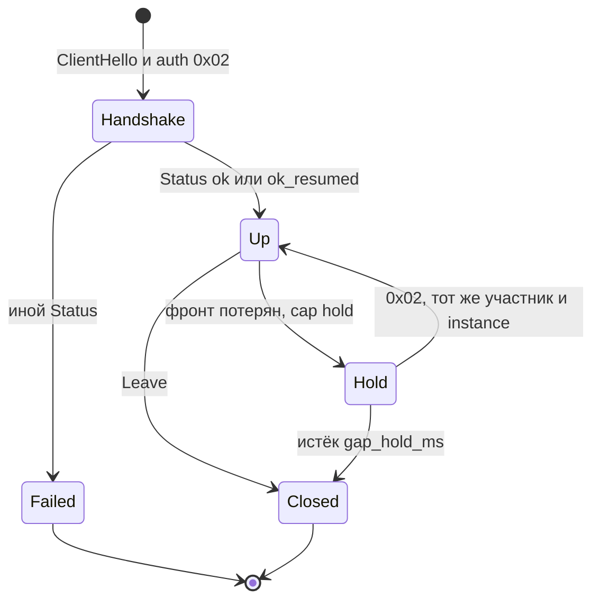
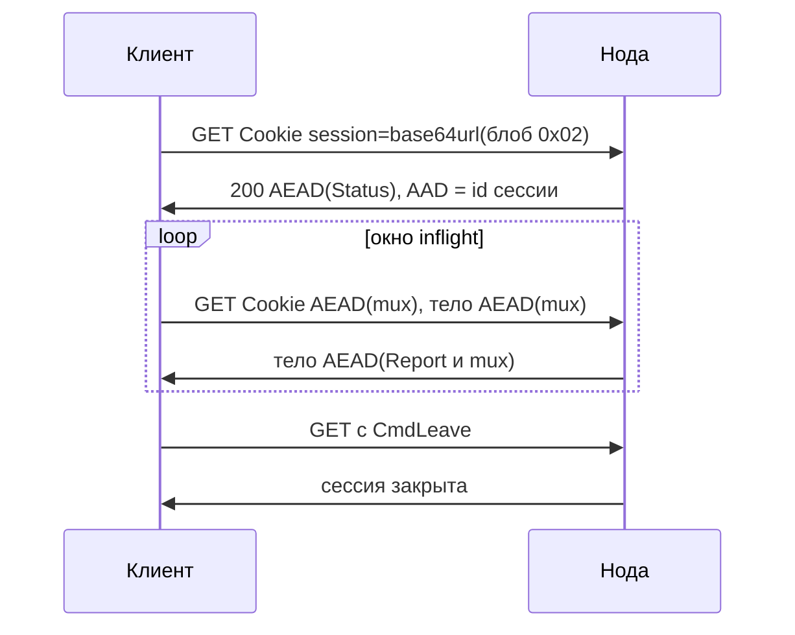

# Протокол loft 1.0

[English](protocol.md) · **Русский** · [中文](protocol_zh.md)

Этот документ задаёт **loft/1.0** — мультиплексированный оверлей внутри обычного HTTPS. Сторонняя реализация, следующая этому тексту, МОЖЕТ работать с нодой loft. Программа на Go в этом репозитории — одна из реализаций. Лицензия: [Apache-2.0](../LICENSE).

Версия протокола loft/1.0 (`0x0100`) не зависит от строки версии реализации (`VERSION`, сейчас 1.0.28). В рукопожатии передаются обе. Слова **ДОЛЖЕН**, **НЕ ДОЛЖЕН**, **СЛЕДУЕТ**, **МОЖЕТ** соответствуют MUST, MUST NOT, SHOULD, MAY из [RFC 2119](https://www.rfc-editor.org/rfc/rfc2119). Получатель ДОЛЖЕН игнорировать неизвестные поля в хвосте Hello и Status.

Эксплуатация эталонной ноды: [guide_ru.md](guide_ru.md). Раскладка исходников: [architecture_ru.md](architecture_ru.md).

---

## Аннотация

loft — частный оверлей, внешний путь которого есть TLS 1.3 на порту 443 с ClientHello в форме браузера и прикладными данными HTTPS. CDN, обратный прокси или TLS-терминатор МОЖЕТ завершить эту сессию TLS. Внутренние потоки мультиплексируются и запечатываются ChaCha20-Poly1305, поэтому терминатор TLS не получает открытый текст mux.

Внутренний протокол один. Внешний перенос — GET, WebSocket, HTTP/2 CONNECT, QUIC, HTTP/3 CONNECT или необязательный L3 CONNECT — выбирается при развёртывании и МОЖЕТ меняться без повышения версии протокола. Нода МОЖЕТ предъявлять настроенный HTTPS-origin тем, у кого нет ключа участника, так что сканер и проверка доступности наблюдают веб-сайт. Ключи участников, аренды адресов и список живых фронтов хранятся на контроллере. Relay — сменные края TLS. Клиенты получают подписанный roster фронтов и именованные списки адресов и отображают эти списки на локальную маршрутизацию. Участников одной сети МОЖНО изолировать на хабе, соединять через ноду (mesh) или разрешить прямую попытку TCP.

Типичные развёртывания: доступ в лабораторную сеть снаружи, парк серверов, связь площадок.

---

## Содержание

1. [Введение](#1-введение)
2. [Обозначения, термины и архитектура](#2-обозначения-термины-и-архитектура)
3. [Фронты](#3-фронты)
4. [Аутентификация и ключ сессии](#4-аутентификация-и-ключ-сессии)
5. [Hello и Status](#5-hello-и-status)
6. [Мультиплекс](#6-мультиплекс)
7. [Участник, экземпляр и таймеры](#7-участник-экземпляр-и-таймеры)
8. [Коды Status](#8-коды-status)
9. [Оверлей](#9-оверлей)
10. [Контроллер и relay](#10-контроллер-и-relay)
11. [Совместимость с путём](#11-совместимость-с-путём)
12. [Ограничения](#12-ограничения)
13. [Версии](#13-версии)
14. [Тестовые векторы](#14-тестовые-векторы)
15. [Ссылки](#15-ссылки)

---

## 1. Введение

CDN, обратный прокси и TLS-терминатор передают обычный HTTPS: TLS 1.3, ClientHello браузера, затем GET, WebSocket или CONNECT. Протокол с собственным рукопожатием на отдельном порту этими устройствами не проксируется. Туннель на выделенном IP необходимо явно указывать в каждом ACL на пути; этот адрес — единственная точка отказа.

loft занимает то же внешнее место, что HTTPS, и поэтому МОЖЕТ быть поставлен за CDN или прокси, как сайт. Внутри работает один mux. Снаружи GET, WebSocket, HTTP/2 CONNECT, QUIC или HTTP/3 CONNECT несут этот mux согласно фронтам ноды. Имя сервера TLS выбирает нода. Клиент без ключа участника завершает TLS с настроенным origin.

Фронт, который перестал отвечать, заменяется из подписанного roster без перенумерации адресов оверлея. Relay регистрируются, отправляют heartbeat и покидают roster при молчании. Ключ участника в roster не входит.

**Область действия.** Документ задаёт кадрирование, аутентификацию, мультиплекс, пересылку оверлея, плоскость управления (roster, флот, списки адресов) и наблюдаемый путь. SOCKS, TUN и маршрутизация ОС локальны для клиента и не являются возможностями протокола.

**Вне области.** loft не является mixnet. Спецификация не утверждает конфиденциальность против посредника, у которого уже есть ключ участника; против пути, на котором нет ни одного разрешённого назначения; против TLS-терминатора, которому также известен внутренний ключ сессии.

---

## 2. Обозначения, термины и архитектура

### 2.1 Кодирование

Целые числа — в порядке big-endian. Строковые поля Hello, Status и большинства записей флота — `u8 length || bytes`, не длиннее 64 байт. URL и значения списков — `u16be length || bytes`, не длиннее 255 байт, если раздел не указывает иное.

### 2.2 Термины

| Термин | Значение |
|--------|----------|
| **Нода** | Сервер оверлея (`loft-node`): аутентифицирует участников и пересылает mux. |
| **Участник** (member) | Обладатель ключа. Ключ — `lt_` и 48 шестнадцатеричных символов в нижнем регистре (24 байта). Нода хранит SHA-256 всей строки. |
| **Экземпляр** (instance) | Идентификатор, порождаемый клиентом и хранимый локально. Вместе с участником именует аренду. |
| **Фронт** | Внешний перенос HTTPS, несущий mux: `get`, `ws`, `h2`, `quic`, `h3`. Необязательный `connect` стыкует TCP без внутреннего Open. Необязательный `l3` — тот же HTTP/2 CONNECT, что и `h2`, затем IP-дейтаграммы вместо mux. |
| **Origin** | Настроенный HTTPS-сайт. Участник без действительной метки стыкуется с этим сайтом (decoy splice). |
| **Mux** | Внутренний протокол потоков и датаграмм под AEAD. |
| **Roster** | Список живых фронтов, подписанный Ed25519. |
| **Relay** | Сменный край TLS. Не хранит ключи участников и не расшифровывает mux. |
| **Контроллер** | Хранилище ключей, аренд, ACL и ключа подписи roster. |
| **Hold** | Удержание потоков mux при кратковременной потере фронта и возобновление новым `0x02` с тем же участником и `instance_id`. |
| **Park** | Локальное состояние после неожиданной потери фронта при действующем Hold: потоки mux сохранены, фронта нет. |
| **Resin** | Кадры mux, которые ДОЛЖНЫ повторно передаваться на том же порядковом номере GET, пока Report не покроет этот номер. |
| **Draft** | Кадры mux, передаваемые один раз. |
| **Canary** | Флаги Status о целостности пути TLS (дополненный или разрезанный ClientHello). Не скрывают SNI от инспектора, собирающего записи. |
| **Sid** | 32-байтовый `session_id` TLS ClientHello, метка участника (v3 или v2). Не путать с идентификатором GET-сессии (24 hex в пути URL). |
| **Seal** | `nonce[12] \|\| ChaCha20-Poly1305` по [RFC 8439](https://www.rfc-editor.org/rfc/rfc8439). |

### 2.3 Слои

```
приложение   TCP / UDP          (SOCKS и TUN локальны)
    mux       Open Data Close Reset Ping Pong Pad Dgram Leave
      AEAD    ChaCha20-Poly1305
        фронт get | ws | h2 | quic | h3 | l3
          TLS 1.3
            TCP/443 или UDP/443
```

1. **TLS.** Снаружи. CDN, балансировщик или origin МОЖЕТ его завершить.
2. **Аутентификация и AEAD.** Внутри. Обладание ключом участника доказывает членство. ChaCha20-Poly1305 скрывает mux от терминатора TLS.
3. **Mux.** Потоки и датаграммы между клиентом и нодой и через ноду — в Интернет или к другим участникам. Фронт `l3` несёт здесь IP-дейтаграммы вместо mux.

ClientHello СЛЕДУЕТ формировать как у актуального браузера (список шифров, расширения, JA3/JA4). Имена вендоров CDN — профили развёртывания. Они НЕ ДОЛЖНЫ входить в возможности протокола.

Зарезервированные цели mux на транке relay: `hub:1` (HTTP/1.1), `hub:2` (HTTP/2), `ctl:1` (управление флотом). Объявление прослушивания оверлея: `loft.peer:<port>`.



---

## 3. Фронты

Нода объявляет включённые фронты в Status `caps`. Клиент объявляет фронты, которыми будет пользоваться, в Hello `caps`. После первого Status клиент ДОЛЖЕН использовать только пересечение, в своём настроенном порядке, и ДОЛЖЕН переходить к следующему оставшемуся фронту, когда текущий отказывает.

Если нода не указала `fronts`, включён только `get`. `ws`, `h2`, `quic`, `h3`, `connect` и `l3` выключены, пока их не перечислили. Когда обе стороны перечислили все транспортные фронты, порядок попыток: `get`, `ws`, `h2`, `quic`, `h3`. `l3` в этот список попыток не входит.

### 3.1 Decoy splice

ClientHello loft несёт 32-байтовый `session_id`. Нода принимает любую из двух конструкций ниже и сначала пробует v3.

**sid v3.** Пусть `P` — статический закрытый ключ X25519 ноды (HKDF-SHA256 от секрета ноды, info `"loft-mask-x25519"`), `X` — X25519 `key_share` из ClientHello, `R` — 32-байтовый `client_random`, `S` — SNI в нижнем регистре:

```
shared = X25519(P, X)
session_id = HKDF-SHA256(ikm=shared, salt=R, info="loft-sid-v3" || 0x00 || S, L=32)
```

Парный открытый ключ — Status / roster `mask_pub` (32 байта) и МОЖЕТ быть передан в query ссылки импорта как `pbk`. Чтобы отличить такие ClientHello, нужен `P`. Украденный ключ участника их не маркирует.

**sid v2 (запасной).** Пусть `token` — ключ участника:

```
HKDF-SHA256(ikm=token, salt=R, info="loft-sid-v2" || 0x00 || S || X, L=32)
```

Клиент, ещё не получивший `mask_pub`, отправляет v2. Обладание `token` позволяет обнаруживать ClientHello v2. Привязка к `R`, `S` и `X` не даёт совпасть конструкции вида HMAC(`token`, `random`).

Когда mask включён, ClientHello с SNI имени-приманки принимается только как sid v3. sid v2 на этом имени стыкуется с origin: украденный ключ участника его не метит. Own SNI по-прежнему принимает v2 — этот путь показывает сертификат ноды. Клиент, у которого есть `mask_pub`, ОБЯЗАН слать sid v3 и НЕ ДОЛЖЕН откатываться на v2. `client_random`, уже виденный за последние 10 минут, стыкуется.

Любой другой TCP ClientHello стыкуется с настроенным origin: TLS уже завершён, последующие байты уходят на этот сайт. Первый origin — личность ноды. Если SNI совпал с одним из origin ноды, используется он, иначе основной. Имена origin — конфигурация. Они НЕ ДОЛЖНЫ быть константами протокола.

Без действительного `session_id` поле — 32-байтовая строка той же формы, что compatibility-`session_id` у Chrome. На прямом пути клиент ДОЛЖЕН ставить в SNI основное имя origin ноды. Имя берётся из Status, из roster или из сертификата, который увидел бы зонд. После Status при несовпадении клиент ДОЛЖЕН переподключиться с объявленным именем. CDN-фронт сохраняет hostname CDN.

### 3.2 Decoy mask

Когда mask включён, ClientHello loft завершает TLS 1.3 сертификатом, повторяющим форму назначения: лист ECDSA P-256 копирует Subject, SAN и срок действия origin. Серийный номер листа:

```
HKDF-SHA256(ikm=shared, salt=R, info="loft-cert-serial", L=16)
```

`shared` — тот же ECDH, что у sid v3. CertificateVerify — `ecdsa_secp256r1_sha256` под этим листом. Клиент, знающий `mask_pub`, ДОЛЖЕН проверить привязку серийного номера и подпись ECDSA. Длины application-записей СЛЕДУЕТ выдерживать по образцу origin, в том числе после первых снятых записей. Status `mask_pub` и roster `mask_pub` несут 32-байтовый открытый ключ X25519. Пустое значение — mask выключен. Зонды по-прежнему стыкуются. Реализация, которая только стыкует, совместима с нодами без mask.

Если ClientHello предлагает группу X25519MLKEM768 (`0x11EC`, [RFC 10024](https://www.rfc-editor.org/rfc/rfc10024)), сервер выбирает её. На вход расписания ключей TLS 1.3 идёт общий секрет ML-KEM-768, за которым идёт общий секрет X25519. Половина X25519 — это 32 байта внутри этой группы. Совпадать с отдельным X25519 share она не обязана. sid v3 по-прежнему берёт отдельный share (группа `0x001d`), когда присутствуют оба, и половину гибрида, когда это единственный X25519. ClientHello только с X25519 получает ответ X25519. Гибридная группа не делает лист цепочкой публичного УЦ.

### 3.3 WebSocket (`ws`)

Сначала TLS, затем HTTP upgrade. Путь локален для ноды (по умолчанию `/api/v1/sync`). Первое сообщение клиента — блоб аутентификации открытым текстом. Первое сообщение ноды — AEAD(Status). Далее — AEAD(пачка mux). Пустые пачки отправлять НЕ ДОЛЖНО. Закрытие сокета завершает сессию. Клиенту СЛЕДУЕТ послать CmdLeave в пачке mux до этого закрытия.

### 3.4 GET (`get`)

Для краёв, которые передают только GET. Перенос — HTTP/2. Пути имеют форму статических ресурсов: `{base}/{session}/{seq}.js`. Mux переносится пачками запросов и ответов, а не одним длинным потоком TCP.



**GET рукопожатия.** Cookie `session=<base64url(блоб аутентификации)>`. Тег блоба — `0x02`. В пути уже лежит выбранный клиентом идентификатор сессии (24 hex). Ответ 200, `Cache-Control: private, no-store`, тело AEAD(Status) с AAD, равным этому идентификатору. Ноде СЛЕДУЕТ повторить тот же идентификатор в `X-Session`.

**Последующие GET.** Cookie `session=` несёт base64url или Z85 от AEAD(пачка mux), AAD = идентификатор сессии, тело AEAD(пачка mux). Ноде СЛЕДУЕТ ставить в начало тела CmdReport (`applied` — последний сплошной принятый порядковый номер GET). Клиент, получивший его, ДОЛЖЕН прекратить повторы исходящих номеров ≤ `applied`. Cookie рукопожатия проверяется как `0x02`; последующие GET — AEAD. Неуспешная аутентификация ДОЛЖНА давать HTTP 404 с телом HTML.

**Бюджет и кодирование.** Исходящие данные ДОЛЖНЫ умещаться в один заголовок. Status `header_budget` — байты закодированного Cookie; если поле опущено — 16 КиБ HTTP-заголовка. Status `uplink_enc` 1 — `~` плюс Z85 от `u16be длина || AEAD` (ZeroMQ Z85); 0 и отсутствие поля — base64url. Cookie рукопожатия остаётся base64url. Нода ДОЛЖНА принимать оба. Status `h2_conns` (1–4) — число HTTP/2-соединений к этому фронту; 0 оставляет одно. Inflight — сумма незавершённых GET по всем этим соединениям. Одновременно незавершённых GET — от 2 до 8 (в протоколе по умолчанию 4; Status `inflight` — верхняя граница).

**Смена сокета без смены сессии.** Клиент МОЖЕТ заменить HTTP/2-соединение по локальному max-age (0 или отсутствие — держать до ошибки). Mux и идентификатор GET-сессии не меняются. Клиент МОЖЕТ также заменить пул HTTP/2 после смены локального исходящего адреса: mux, идентификатор GET-сессии, порядковый номер и ключ AEAD сохраняются; нового `0x02` нет. Нода ключует сессию по GET sid, а не по адресу клиента. Стыковка CONNECT на старом пуле завершается вместе с этими сокетами.

**Ошибки HTTP.** 413: уменьшить бюджет вдвое, нижняя граница 1024, и разбить. 405: этот фронт не GET. Клиент, получивший HTTP/2 `GOAWAY ENHANCE_YOUR_CALM`, ДОЛЖЕН сделать паузу на той же сессии и МОЖЕТ послать CmdTune event 1 на следующем GET, который уже несёт mux. Нода МОЖЕТ снизить `header_budget` / `inflight` для этого фронта и ответить CmdTune event 0 в теле того же GET.

**Простой и удержание GET.** Пустой исходящий канал в простое: ждать не меньше `keepalive_ms / 2` и не меньше 1 с. GET, который уже несёт mux Data, Open, Dgram или Leave, простоем не считается. Ноде СЛЕДУЕТ ждать входящие данные до 250 мс; удерживать GET дольше 1 с НЕ ДОЛЖНО. Если исходящий канал уже содержит CmdData, нода МОЖЕТ ответить, как только входящие Data встали в очередь. Если в этом исходящем ≥ 2 КиБ CmdData, ноде СЛЕДУЕТ ограничить тело этого GET 96 КиБ, чтобы следующая Cookie ушла быстрее; GET только на скачивание оставляют 256 КиБ (192 КиБ при нескольких потоках).

Обрыв HTTP/2 без Leave сессию не завершает. Перед выходом процесса клиент ДОЛЖЕН послать последний GET, чья исходящая пачка содержит CmdLeave. Тогда нода закрывает mux-сессию, забывает идентификатор GET-сессии, отсоединяет (Detach) пира оверлея и освобождает (Release) аренду. `lease_hold` по-прежнему держит IP оверлея для `ok_resumed`.

### 3.5 HTTP/2 CONNECT (`h2`)

ALPN `h2`. CONNECT на путь ноды (по умолчанию `/api/v1/tunnel`). Ответ 200, затем сообщения `u32be length || bytes`: аутентификация, AEAD(Status), AEAD(пачка mux).

### 3.6 QUIC mux (`quic`)

Первый двунаправленный поток, открытый клиентом; те же сообщения с префиксом длины, что у `h2`. ALPN ДОЛЖЕН быть `h3`. Если HTTP/3 CONNECT также включён на этом UDP-порту, нода различает их по первому байту первого потока: 0 — этот mux (4-байтная длина, не больше 1 МиБ), 1 — кадр HEADERS HTTP/3. SETTINGS HTTP/3 нода отправляет до того, как узнает тип; клиент mux этот поток не читает.

### 3.7 HTTP/3 CONNECT (`h3`)

ALPN `h3`. CONNECT на путь той же формы, что у `h2`.

### 3.8 Канарейка пути

Канарейка измеряет целостность TLS на пути. Участники предъявляют ClientHello в форме браузера, чтобы CDN, обратные прокси и TLS-посредники наблюдали обычный HTTPS. Если посредник переписывает рукопожатие, сессия не устанавливается: нода отказывает искажённому пути TLS. Канарейка не скрывает SNI от инспектора, собирающего записи.

Status МОЖЕТ выставить `canary_flags`: бит 0 — дополненный («толстый») ClientHello, бит 1 — ClientHello разрезан на две TLS-записи (нода склеивает). `canary_pad` — дополнительные байты заполнения, 0–2048.

### 3.9 Стыковка CONNECT (`connect`)

GET-mux — потоковый протокол поверх запросов и ответов. Нода МОЖЕТ выставить в Status возможность `connect`, если в `fronts` есть `connect` (по умолчанию выключено). После рукопожатия GET или WebSocket (аренда, IP оверлея) клиент МОЖЕТ открыть TCP через HTTP/2 `CONNECT` с `:authority` `host:port` вместо mux `CmdOpen`. CONNECT идёт по тому же живому пулу HTTP/2 GET (необязательный `h2_max_age_ms`). Этот CONNECT ДОЛЖЕН нести тот же Cookie 0x02, что и рукопожатие GET (`Cookie: session=` base64url). Неверный proof — HTTP 404. Нода соединяется с целью и стыкует байты. Она ДОЛЖНА отказать loopback, link-local (включая `169.254.169.254`), multicast, unspecified и `localhost`. IP участников оверлея, UDP и ICMP остаются на mux. Нода без `connect` держит mux для каждого TCP. HTTP CONNECT без этого фронта ДОЛЖЕН быть 404.

### 3.10 L3 (`l3`)

Нода МОЖЕТ выставить в Status возможность `l3`, если в `fronts` есть `l3` (по умолчанию выключено). Внешний перенос — тот же HTTP/2 CONNECT, что и `h2` (§3.5): ALPN `h2`, CONNECT на путь ноды (по умолчанию `/api/v1/tunnel`), `:protocol` `loft`. Аутентификация и AEAD(Status) — те же сообщения с длиной. После Status внутренний открытый текст — не mux. Каждый открытый текст AEAD:

```
u8    тип
байты полезная нагрузка
```

Тип `0x00` — одна IPv4- или IPv6-дейтаграмма (семейство задаёт полубайт версии первого байта нагрузки). Тип `0x01` — пачка `u16be n || дейтаграмма` (n — длина дейтаграммы). Отправитель СЛЕДУЕТ копить дейтаграммы в один открытый текст AEAD, не больше 16 КиБ или 2 мс, чтобы Seal не шёл на каждый MSS. ICMP и TCP SYN, FIN, RST СЛЕДУЕТ сбрасывать сразу. Получатель ДОЛЖЕН принимать и `0x00`, и `0x01`. Неизвестные типы игнорируются.

Нода пересылает по назначению оверлея: шлюз оверлея отвечает на ICMP echo; другой участник с сессией `l3` получает дейтаграмму; назначение вне CIDR оверлея исходит с ноды. Hello ДОЛЖЕН выставить возможность `l3` для этой внутренности; CONNECT Hello без этого бита остаётся mux, если включён `h2`. Закрытие потока CONNECT завершает этот фронт. IP оверлея следует `instance_id` и `lease_hold`, как на других фронтах. Новый CONNECT с тем же `instance_id` МОЖЕТ сохранить NAT-потоки: ответы идут в текущую сессию L3 по IP оверлея. Hold mux нет. SOCKS, TUN и маршрутизация ОС остаются локальными для клиента.

---

## 4. Аутентификация и ключ сессии

Ключ участника — `lt_` и 48 шестнадцатеричных символов (24 байта). Нода хранит SHA-256 всей строки. Развёртывание МОЖЕТ использовать один токен на всех участников; это конфигурация.

### 4.1 Доказательство без часов клиента

Аутентификация не использует часы клиента. Узел с неверными часами всё равно может войти.

```
0x02 || nonce[16] || eph_c[32] || HMAC-SHA256(key, "lft-a2" || nonce || eph_c)[0:16] || Hello
```

`eph_c` — эфемерный открытый ключ X25519 клиента. Новый nonce — новое рукопожатие. Тот же `nonce||eph_c` внутри 10-минутного кэша по часам ноды — идемпотентный повтор (GET Cookie). Другой `eph_c` на том nonce отклоняется.

### 4.2 Возобновление

GET МОЖЕТ сохранить сессию при смене локального исходящего адреса без нового `0x02` (§3.4). Смена пути на `ws`, `h2`, `quic` или `h3`, неудачная смена пула GET или новый процесс отправляет свежий `0x02` с новым эфемерным ключом и тем же Hello `instance_id`. Hold снова присоединяет припаркованный mux по аутентифицированному участнику и instance. Переход на реплику — `0x02` на новой ноде; IP оверлея следует `lease_hold` и instance. После рукопожатия GET поле Status `ticket` — идентификатор этой GET-сессии. Пустой ticket: нода не умеет attach (§4.4).

### 4.3 Ключ сессии

```
ss = X25519(sk_c, eph_n)
HKDF-SHA256(ikm=ss, salt=nonce, info="loft-v1", L=32)
```

Первое сообщение ноды — `eph_n[32] || Seal(Status)`. Дальнейшие сообщения mux — только Seal. `eph_n` — эфемерный открытый ключ X25519 ноды на это рукопожатие. HMAC покрывает `eph_c`, поэтому украденной Cookie сессию не собрать: ключ AEAD требует `sk_c`, который с клиента не уходит.

Seal: `nonce[12] || ChaCha20-Poly1305(key, nonce, plaintext, aad)` ([RFC 8439](https://www.rfc-editor.org/rfc/rfc8439)). Nonce ДОЛЖЕН быть уникален на ключ сессии. Эталон: 32-битный случайный префикс и 64-битный счётчик, чтобы припаркованная GET-сессия продолжала счётчик. GET использует AAD = идентификатор сессии; присоединяемые фронты (§4.4) и рукопожатие `0x02` на `ws`/`h2`/`quic`/`h3` — пустой AAD. Attach делит ключ сессии GET, поэтому делит этот счётчик nonce.

### 4.4 Attach (`0x04`)

Сессия рождается GET `0x02`. Дальнейшие фронты входят в неё тегом `0x04`. Второй `0x02` слать НЕЛЬЗЯ.

```
0x04 || u8 sid_len || sid || nonce[16] || u8 front_len || front || HMAC-SHA256(session_key, "lft-a4" || sid || nonce || front)[0:16]
```

`sid` — Status `ticket` (идентификатор GET-сессии, 24 hex). `front` — `ws`, `h2`, `quic` или `h3`. HMAC — ключ AEAD сессии из §4.3, не ключ члена. `l3` и `connect` присоединять НЕЛЬЗЯ.

Нода находит GET-сессию по `sid`, проверяет HMAC и отвергает nonce, уже использованный на этой сессии (кэш 10 минут, часы ноды). Успех: одно length-prefixed AEAD-тело с mux `CmdFront` и именем фронта (пустой AAD). Неудача: закрыть фронт (на GET — HTTP 404).

GET остаётся в сессии для keepalive, Leave и запасного bulk. Bulk mux идёт по одному фронту (`CmdFront`). Отвал присоединяемого фронта возвращает bulk на GET: тот же ключ, mux, seq, без нового `0x02`. `CmdFront` со значением `get` в uplink GET снимает attach.

Старые клиенты игнорируют непустой `ticket`. Старые ноды оставляют `ticket` пустым; клиент НЕ ДОЛЖЕН слать `0x04`. Рукопожатие `0x02` на `ws`/`h2`/`quic`/`h3` остаётся, если GET-сессии для attach нет.

Attach только на той ноде, где живёт GET-сессия.

AEAD покрывает mux. TLS покрывает путь до терминатора. CDN, который завершает TLS, видит шифротекст mux.

---

## 5. Hello и Status

Hello дописывается к блобу аутентификации. Первое сообщение ноды — `eph_n[32] || Seal(Status)`. Status — открытый текст AEAD. Ни Hello, ни Status не являются командой mux.

### 5.1 Hello

```
u8    version          (= 1)
u8    member_id_len || member_id
u8    instance_id_len || instance_id
u16be proto_min
u16be proto_max
u64be caps
u8    program_len || program
u8    software_len || software
```

`instance_id` хранится на клиенте. Пустое значение означает, что нода выдаёт его в Status; клиент ДОЛЖЕН его сохранить. Строки ≤ 64 байт. Версия протокола — `major<<8|minor` (`0x0100` = 1.0). Возможность `relay` помечает транк relay. Возможность `p2p` помечает клиента, который будет объявлять порт прослушивания.

Старый блоб без proto/caps по-прежнему декодируется. Неизвестные байты в хвосте получатель ДОЛЖЕН игнорировать.

### 5.2 Status

Поля по порядку:

| поле | кодирование |
|------|-------------|
| code | u16be |
| lease_sec | u32be |
| mtu | u16be |
| vlan | u16be |
| keepalive_ms, idle_ms, reconnect_min_ms, reconnect_max_ms | u32be каждое |
| reconnect_fast_n | u16be |
| ip, gateway, instance_id | u8 len \|\| bytes |
| reconnect_fast_for_ms | u32be |
| selected proto, min, max | u16be каждое |
| caps | u64be |
| program, software | u8 len \|\| bytes |
| ticket | u16be len \|\| bytes |
| decoy | u8 n, затем n × (u8 len \|\| bytes) |
| mask_pub | u8 len \|\| bytes (0 или 32) |
| replicas | u8 n, затем n × (u8 len \|\| bytes) |
| canary_flags | u8 |
| canary_pad | u16be |
| roster | u16be len \|\| bytes |
| lists_serial | u64be |
| lists_hash | u8 len \|\| bytes (0 или 32) |
| peers | u8 (0 hub, 1 mesh, 2 vlan) |
| p2p | u8 (1 = нода разрешает) |
| peer hints | u8 n ≤ 16, затем n × (ip, host, port u16be, vlan u16be) |
| dns | u8 n ≤ 8, затем n × (u8 len \|\| bytes) — IPv4/IPv6 резолверов для клиентского TUN. Пусто: клиент ДОЛЖЕН оставить системный DNS без изменения. |
| ip6, gateway6 | необязательный хвост: каждое u8 len \|\| bytes. Опускается целиком, когда оба пусты (только IPv4). Декодер, который их не читает, ДОЛЖЕН игнорировать хвостовые байты. |
| header_budget, inflight | необязательно после ip6/gateway6: u16be бюджет закодированного Cookie GET, u8 inflight. Есть, когда хотя бы одно поле не ноль (тогда на IPv4 ip6/gateway6 — пустые строки). Значения рукопожатия — верхняя граница; живой CmdTune главнее. 0 = клиент оставляет своё. |
| h2_conns, uplink_enc | необязательно после inflight: u8 HTTP/2-соединений (1–4; 0 = клиент оставляет одно), u8 кодирования исходящего (0 base64url, 1 Cookie Z85). Есть, когда хотя бы одно поле не ноль. Старые клиенты лишние байты игнорируют. |
| gap_hold_ms | необязательно после uplink_enc: u32be. Сколько нода держит потоки mux после потери фронта без Leave. 0 = умолчание клиента (8 с). Старые клиенты лишние байты игнорируют. |
| routes | необязательно после gap_hold_ms: u8 n ≤ 16, затем n × (dst, via) как u8 len \|\| bytes. Управляемые CIDR: сеть за участником (`via` — IP оверлея этого участника, из `ip route` VIA / `member ID` / `tag NAME`). Нода стыкует Open `host:port` на этого участника. Клиент НЕ ДОЛЖЕН ставить маршрут, чей `via` — его собственный IP оверлея. Старые клиенты игнорируют лишние байты. |
| policy | необязательно после routes: компактный ACL, чтобы клиент применял тот же Allow на прямом P2P. `u8 n_own_tags` и теги; `u8 acl_default` (0 peers/accept, 1 drop); `u8 n_rules` и правила; `u8 n_peers` затем IP оверлея и теги. Пустое опускается. Декодер, который видит этот хвост, ДОЛЖЕН поставить Present. Старые клиенты игнорируют лишние байты. |
| session_ttl_ms | необязательно после policy: u32be максимум живой сессии. 0 = выкл. Это не `lease_sec` (удержание IP после обрыва). Если поле есть без policy, кодер сначала записывает пустой policy. Старые клиенты игнорируют лишние байты. |
| rate_bps | необязательно после session_ttl_ms: u32be потолок массовых `CmdData`/`CmdDgram` этой сессии, оба направления, байт/с. 0 = выкл. Управление и мелкие кадры (Open, Ping, ACK ≤ 4 КиБ, DNS/ICMP Dgram ≤ 512 Б) не ограничиваются. Нода применяет. Если поле есть без `session_ttl_ms`, кодер сначала записывает ttl 0. Старые клиенты игнорируют лишние байты. |
| fronts | необязательно после rate_bps: u8 n ≤ 8, затем n × (имя, путь, url) как u8 len \|\| bytes. Mux-фронты, которые нода принимает (`get` `ws` `h2` `h3` `quic`). Пустой url — host:port фронта, на котором был `0x02`. У `quic` путь пустой. Пустой список = клиент оставляет URI/умолчания. Если поле есть без `rate_bps`, кодер сначала записывает rate 0. Старые клиенты игнорируют лишние байты. После успешного Status карта ноды — источник истины; клиенту рекомендуется сохранить её в профиль. |

Выбранный протокол — максимум пересечения двух диапазонов. Пустое пересечение даёт код `protocol` (0x0203), mux не открывается.

### 5.3 Биты возможностей (caps)

| бит | имя | смысл |
|-----|-----|--------|
| 0 | multi | несколько экземпляров на одном ключе |
| 1 | resume | `ok_resumed` и удержание аренды |
| 2 | sticky_ip | закреплённый IP оверлея на ключе |
| 3 | vlan | VLAN с ключа |
| 4 | rules | ACL коммутатора |
| 5 | get | фронт GET |
| 6 | ws | фронт WebSocket |
| 7 | status | Hello/Status с кодом |
| 8 | timers | keepalive / idle / reconnect в Status |
| 9 | hello_caps | этот блок возможностей |
| 10 | reset | CmdReset |
| 11 | quic | фронт QUIC mux |
| 12 | dgram | CmdDgram |
| 13 | clockless | аутентификация без часов клиента |
| 14 | ticket | Status `ticket` — sid GET; attach `0x04` (§4.4) |
| 15 | decoy | Status перечисляет origin |
| 16 | h2 | HTTP/2 CONNECT |
| 17 | h3 | HTTP/3 CONNECT |
| 18 | mask | сертификат в форме назначения |
| 19 | relay | эта сессия — транк relay |
| 20 | roster | Status МОЖЕТ нести подписанный roster |
| 21 | lists | Status МОЖЕТ объявлять serial/hash списков |
| 22 | p2p | прямые соединения участников при mesh |
| 23 | dns | Status МОЖЕТ нести DNS-серверы; gateway:53 — резолвер |
| 24 | connect | стыковка HTTP/2 CONNECT: TCP Open без внутреннего mux |
| 25 | resin | CmdReport и исходящий GET resin/draft |
| 26 | hold | потоки mux переживают кратковременную потерю фронта; возобновление `0x02` тем же участником и `instance_id` |
| 27 | quic_mark | quic на ноде с decoy: Initial ДОЛЖЕН нести метку loft (§11.3) |
| 28 | h3_mark | h3 на ноде с decoy: Initial ДОЛЖЕН нести метку loft (§11.3) |
| 29 | l3 | HTTP/2 CONNECT с IP-дейтаграммами (без mux) |

Нода, выключающая фронт, ДОЛЖНА сбросить этот бит. Клиент, который фронтом пользоваться не будет, ДОЛЖЕН сбросить его. SOCKS, TUN, вендор CDN, ОС, git и имена origin — не возможности протокола.

Согласование версии: `max(intersection(client.min..client.max, node.min..node.max))`. Возможности в Status — объявленный набор ноды. Клиент решает, какими из них пользоваться.

---

## 6. Мультиплекс

После Status каждый открытый текст AEAD — склейка кадров:

```
u16be payload_length   0..16384
u8    cmd
u32be stream_id
bytes payload
```

Идентификаторы потоков клиента нечётные, начиная с 1. У ноды — чётные, начиная с 2. Занятый идентификатор брать повторно НЕ ДОЛЖНО. После Close или Reset его МОЖНО взять снова.

| cmd | имя | полезная нагрузка |
|-----|-----|-------------------|
| 1 | Open | цель |
| 2 | Data | байты |
| 3 | Close | пусто |
| 4 | Ping | 8 байт, эхо |
| 5 | Pong | те же 8 байт |
| 6 | Pad | игнорируется |
| 7 | Reset | u16be code |
| 8 | Dgram | префикс цели Open, затем полезная нагрузка UDP |
| 9 | Leave | пусто; stream_id ДОЛЖЕН быть 0 |
| 10 | Tune | 4 байта: `u8 event \|\| u8 inflight \|\| u16be header_budget`, необязательный 5-й байт `h2_conns`. У клиента event ≠ 0 — один обрыв фронта (1 `ENHANCE_YOUR_CALM`, 2 HTTP 413, 3 HTTP 404, 4 сброс соединения, 5 HTTP 429, 6 прочий GOAWAY), один раз на следующем GET, который уже несёт mux. У ноды event 0 задаёт живые GET `header_budget` / `inflight` / `h2_conns` (0 в поле = не менять). Нода отвечает, только когда значения меняются. stream_id ДОЛЖЕН быть 0. |
| 11 | Report | `u64be applied` (наибольший сплошной порядковый номер GET, который нода приняла). stream_id ДОЛЖЕН быть 0. Старые клиенты неизвестные команды mux игнорируют. |
| 12 | Front | имя фронта (`get`, `ws`, `h2`, `quic`, `h3`). stream_id ДОЛЖЕН быть 0. Клиент: bulk mux на этом attach. Нода: ack. `get` возвращает bulk на GET. |

**Resin и draft.** Кадр mux относится к одному из двух классов.

- **Resin** удерживается, пока Report не покроет его порядковый номер GET, затем повторяется на том же номере: Open, Ping, Pong, Leave, Tune, Report, Front, Close, Reset и Dgram на порт 53.
- **Draft** отправляется один раз: Data, Pad, прочий Dgram. Внутренний TCP или UDP породит новый кадр, если приложению байты ещё нужны.

Один Pull mux даёт до трёх порядковых номеров GET: управляющий resin, draft Data, затем Close/Reset. Close НЕ ДОЛЖЕН делить Cookie с Data того же потока. После ошибки HTTP клиент повторяет тот же номер только с resin (или Pad, если Cookie был только draft), чтобы закрыть дыру последовательности и не воспроизводить draft. Первый HTTP 404 на пачке inflight GET — шум края; три 404 **на повторе** того же sid означают, что origin потерял сессию. Повторный Open на живой stream_id ДОЛЖЕН игнорироваться.

Цель Open: `u16be host_len || host || u16be port`. Полезная нагрузка Dgram — этот префикс плюс датаграмма.

Leave завершает mux-сессию. stream_id = 0. Полезная нагрузка пустая. Нода ДОЛЖНА закрыть сессию, отсоединить (Detach) пира оверлея и освободить (Release) аренду (`Online=false`). `lease_hold` по-прежнему держит IP для того же `instance_id`. Кадры после Leave в той же пачке МОЖНО игнорировать. Реализация, ещё не обрабатывающая Leave, ДОЛЖНА игнорировать команду (неизвестные команды mux получатель ДОЛЖЕН игнорировать и НЕ ДОЛЖЕН из-за них сбрасывать сессию). CmdClose завершает один поток; сессию не завершает.

Реализации ДОЛЖНЫ собирать кадры в пачки (около 1–16 КиБ на открытый текст AEAD). Отбрасывать Data под давлением буфера НЕ ДОЛЖНО: применяется обратное давление. Приёмный буфер на поток не меньше 64 КиБ и не больше 256 КиБ. Open, который нельзя завершить, — Reset `stream_refused` (0x0501). Интервал Ping — `keepalive_ms`. Таймаут простоя — `idle_ms`. На `get` Pad так, чтобы открытый текст до AEAD был около 400–600 байт.

Обёртки с префиксом длины (`h2`, `quic`, `h3`, `ctl`): `u32be length || payload`, не больше 1 МиБ. Полезная нагрузка mux внутри AEAD остаётся ≤ 16384.

---

## 7. Участник, экземпляр и таймеры

Участник — это ключ. Экземпляр — идентификатор, который клиент порождает и хранит у себя. Пустой экземпляр: нода выдаёт его в Status, клиент сохраняет.

Тот же экземпляр при повторном подключении получает `ok_resumed` и тот же IP оверлея. Второй экземпляр при выключенном `multi` получает `auth_already_online`. При включённом `multi` следующие экземпляры получают адреса из пула до `multi_limit` (по умолчанию 8), затем `auth_limit`. Закреплённый IP на ключе отдаётся первому экземпляру.

После отключения `lease_hold_ms` (по умолчанию 45 с) держит IP для этого экземпляра. Leave сразу снимает `Online` (Release); удержание — только бронь IP под возобновление. GET-сессия, исчезнувшая без Leave, остаётся `Online`, пока нода снова не увидит эту сессию.

Когда Hello и Status оба объявляют `hold`, неожиданная потеря фронта (разрыв радиоканала или смена пути, которая переводит в Park) НЕ ДОЛЖНА закрывать потоки mux в течение `gap_hold_ms` (по умолчанию 8 с). Смена HTTP/2 у GET на том же sid — не потеря. Клиент в Park перенабирает свежим `0x02` и тем же `instance_id`; нода снова присоединяет припаркованный mux только тому участнику, чей proof совпал. Внутренний TCP сохраняется. Если за `gap_hold_ms` сессия не вернулась, нода закрывает mux. Leave по-прежнему закрывает сразу.

Клиент МОЖЕТ локально не отправлять draft в известное окно разрыва; resin всё равно идёт. Это не поле протокола.

Значения по умолчанию: рукопожатие 10 с, простой 120 с, keepalive 15 с, удержание аренды 45 с, удержание на разрыве 8 с, повторное подключение минимум 200 мс, максимум 8 с, 5 быстрых попыток за 8 с, затем экспоненциальная пауза.

---

## 8. Коды Status

Числовые значения стабильны. Имена МОЖНО пополнять. Номера не изменяются.

| код | имя | смысл |
|-----|-----|--------|
| 0x0000 | ok | новая аренда |
| 0x0001 | ok_resumed | тот же экземпляр, тот же IP |
| 0x0101 | auth_bad_key | неизвестный ключ |
| 0x0102 | auth_revoked | ключ сменён или удалён |
| 0x0103 | auth_expired | истёк TTL входа |
| 0x0104 | auth_not_authorized | участник выключен |
| 0x0105 | auth_limit | multi_limit |
| 0x0106 | auth_already_online | multi выключен, другой экземпляр |
| 0x0107 | auth_instance | неверный instance id |
| 0x0108 | auth_clock | расхождение часов (не используется при clockless) |
| 0x0201 | net_disabled | сеть выключена |
| 0x0202 | net_unknown | не та сеть |
| 0x0203 | protocol | нет общей версии |
| 0x0204 | rate_limit | слишком много рукопожатий |
| 0x0205 | timeout | рукопожатие или простой |
| 0x0206 | internal | сбой ноды |
| 0x0301 | ip_pool | пул исчерпан |
| 0x0302 | ip_conflict | столкновение закреплённых IP |
| 0x0303 | vlan_denied | VLAN не разрешена |
| 0x0401 | policy_drop | ACL или изоляция на хабе |
| 0x0501 | stream_refused | Open не удался |
| 0x0502 | stream_reset | Reset со стороны пира |

Status, отличный от OK, запрещает mux. HTTP 404 при GET-аутентификации трактуется как `auth_bad_key`.

---

## 9. Оверлей

Нода загружает документ сети (CIDR, шлюз, участники, ACL). IP оверлея и VLAN появляются в Status. Open на адрес внутри CIDR оверлея пересылается согласно `peers`:

| peers | Overlay Open |
|-------|----------------|
| hub | Reset `policy_drop`. Open в Интернет не меняется. Open на CIDR за участником всё равно стыкуется. |
| mesh | Стыковка с сессией пира: Open `127.0.0.1:port` на этом участнике. |
| vlan | Как mesh, только если оба конца в одной VLAN. |

Стыковка через хаб: принимающий клиент принимает поток и открывает соединение с локальным портом.

`p2p` на сети по умолчанию включён для mesh и vlan. Когда включён, Status несёт до 16 подсказок о пирах (IP оверлея, хост, наблюдаемый на TLS, порт прослушивания, VLAN, 32-байтовый открытый ключ X25519). Клиент с возможностью `p2p` в Hello слушает TCP, объявляет Open `loft.peer:<port>` и 32-байтовый открытый ключ X25519 на этом потоке и МОЖЕТ соединяться с `host:port` с 42-байтовым предисловием, прежде чем отступить к стыковке через хаб:

```
"LFT" || 0x00 || src_ipv4[4] || HMAC-SHA256(ss, "lft" || nonce || dest_port || src_ipv4)[0:16] || nonce[16] || dest_port u16be
```

`ss` — X25519(свой_sk, pub пира из подсказки). У двух участников с разными `lt_` всё равно общая пара, и HMAC считается от неё. Принимающий ищет `src_ipv4` в своих подсказках. Нет открытого ключа или MAC не сошёлся — сокет закрывается, инициатор берёт стыковку через хаб. Клиент с `p2p: false` ДОЛЖЕН пользоваться только стыковкой через хаб. Хост, наблюдаемый через relay, — сам relay; прямая попытка тогда не удаётся, и берётся стыковка через хаб. Когда Status несёт policy, инициатор и принимающий ДОЛЖНЫ применять тот же Allow, что и стыковка через хаб, до локального порта. Status без policy (старая нода) эту проверку пропускает.

Запись подсказки: `u8 ip | ip | u8 host | host | u16be port | u16be vlan`, затем по желанию `u8 32 | pub[32]`. Байт после vlan, не равный 32, декодер ДОЛЖЕН считать следующим полем (старые блобы или пир без объявленного открытого ключа).

Правила ACL — первое совпадение, `accept` или `drop`. Пустые правила всё равно применяют `peers`. Поля пакета: источник, назначение, VLAN источника, VLAN назначения, тег источника, тег назначения, к шлюзу, routed (назначение совпало с `ip route` через участника). Адреса: `any`, `host <IP>`, CIDR, `tag NAME` (`group` — тот же токен). `default deny` в `ip access-list overlay` оставляет трафик к шлюзу и отбрасывает остальное, пока не совпадёт permit. TCP Open идёт тем же Allow, что ICMP оверлея. Следующий хоп `ip route DST` — IP оверлея, `member ID` или `tag NAME` (первый живой, иначе закреплённый IP).

ICMP echo оверлея — CmdDgram на `dst:1` (IP-протокол ICMP) с IPv4-пакетом в полезной нагрузке. Нода отвечает на адрес шлюза. Прочие назначения оверлея следуют `peers` (хаб отбрасывает обмен между участниками; mesh/vlan стыкует с этим участником). Echo на адрес вне CIDR оверлея нода отправляет как настоящий ICMP echo; ответ возвращается как CmdDgram `session-ip:1`. Клиент отвечает на echo своего IP оверлея локально и НЕ ДОЛЖЕН подделывать ответы за чужие адреса оверлея или Интернета. Нода ДОЛЖНА считать IP оверлея сессии источником пакета (фиктивный адрес Darwin utun `169.254.8.1` переписывается). Клиент МОЖЕТ вернуть этот фиктивный адрес в echo-reply, чтобы ядро сопоставило его с сокетом ping.

---

## 10. Контроллер и relay

Контроллер хранит ключи, аренды, ACL и ключ подписи. Relay завершает внешний TLS и копирует HTTP после TLS на транк-сессию: Open `hub:1` или `hub:2`. Внутренний mux AEAD и FinishAuth остаются на контроллере; relay оверлейные кадры не расшифровывает и ключи участников не хранит. Только Hello с возможностью `relay` МОЖЕТ открывать `hub:*` или `ctl:1`. Участник НЕ ДОЛЖЕН ставить этот бит (это не фронт). Эталонный клиент его в Hello не отправляет; `loft-node` в роли relay ставит через ExtraCaps. При `enrol: list` нода ещё требует, чтобы id ключа был в `relays:` (пустой id в Hello — общий токен relay; `enrol_req` id всё равно проверяется). Возможность `hold` и возобновление `0x02` от этого бита не зависят. Аутентификация участника и IP оверлея остаются на контроллере.

```
клиент ──TLS──► relay ──транк (mux hub:1|hub:2, ctl:1)──► контроллер
                     ▲
                     ключ участника на relay не хранится
```

### 10.1 Roster

Ed25519 по телу:

```
u64be serial
u8 n
repeat n:
  id                 (u8+bytes)
  url                (u16be+bytes)
  decoy              (u8+bytes)
  fronts             u8 k, k × (u8+bytes), k ≤ 16
  drain              u8
  weight             u8 (0 значит 100)
  path               (u8+bytes)
  mask_pub           u8 len, 0..32 bytes
```

Затем `u8 pub_len || pub || u16be sig_len || sig`. Подпись — Ed25519 по телу. Открытый ключ — 32 байта. Подпись — 64 байта.

Живой roster = `advertise` (id `self`) плюс отвечающие heartbeat relay без drain. Три пропущенных удара (интервал по умолчанию 10 с) или мёртвый поток `ctl` снимают relay и увеличивают serial.

Запрос после аутентификации: Status `roster`. Запрос до аутентификации: `GET {roster_path}` (по умолчанию `/static/v3/manifest.json`), JSON `{"v":1,"p":"<base64url>"}`, `Cache-Control: public, max-age=60`. Этот GET проходит на CDN или на хосте с настоящим сертификатом. IP со стыковкой decoy без HMAC сессии пересылается на origin. Документ НЕ ДОЛЖЕН содержать токен участника. Эталонный клиент принимает roster только с `controller_pub`. Доверие при первом использовании (`tofu: true`) — явный флаг клиента, не значение по умолчанию.

### 10.2 Флот (`ctl:1`)

Каждое сообщение `u32be length || u8 type || body`.

| type | имя | тело |
|------|-----|------|
| 1 | enrol_req | id, url, decoy, fronts |
| 2 | enrol_ok | подписанный slice |
| 3 | enrol_no | u16be code, reason |
| 4 | beat | load u8, conns u32be, program, uptime_s u32be |
| 5 | slice | подписанный slice |
| 6 | drain | id, u8 |

Slice (Ed25519 по телу): serial, id, url, decoy, fronts, drain, weight, beat_ms u32be, expires unix u64be, затем pub и sig как в roster. `enrol: list` требует id в `relays:` контроллера. `enrol: open` принимает любой аутентифицированный транк. YAML перекрывает URL, decoy, fronts, weight, когда они заданы. Отказ в enrol: 1 неизвестный id, 2 неверная форма, 3 дубль, 4 выключен.

Ввод машин и сертификатов в эксплуатацию лежит вне этого протокола.

### 10.3 Списки адресов

Контроллер МОЖЕТ публиковать именованные списки адресов. Сами по себе имена в протоколе ничего не значат. Клиент сопоставляет имена с `direct`, `via` или `drop`. Если хост попал в несколько сопоставленных списков, применяется drop, затем direct, затем via. Несовпавшие назначения берут значение клиента по умолчанию (СЛЕДУЕТ `via`).

Тело (Ed25519, тот же ключ, что у roster):

```
u64be serial
u8 nsets
repeat:
  name               (u8+bytes)
  u16be n
  repeat n: u8 kind, u16be+bytes value
```

Kind 1 — точный домен, 2 — суффикс, 3 — CIDR. Затем открытый ключ и подпись как в roster.

Status несёт `lists_serial` и SHA-256 подписанного блоба. Клиент запрашивает `GET {lists_path}` (по умолчанию `/static/v3/lists.json`), когда serial или хеш новее. YAML оператора: ведущая `.` или `*.` — суффикс; строка CIDR — kind 3. Совпадение имён без учёта регистра. SOCKS сопоставляет hostname. TUN сопоставляет IP (CIDR).

---

## 11. Совместимость с путём

Раздел классифицирует, что наблюдает CDN, обратный прокси или TLS-терминатор. loft не является mixnet. IP оверлея, ключ участника и ключ контроллера — секреты развёртывания.

| Наблюдатель | Видит |
|-------------|--------|
| TLS-терминатор без ключа участника | HTTPS к origin или сертификат в форме назначения (mask); mux — шифротекст AEAD |
| Посредник без закрытого ключа ноды `P` | 32-байтовый `session_id` длины Chrome; sid v3 без `P` неотличим |
| Обладатель украденного ключа участника | ClientHello sid v2; не sid v3 |
| Активный зонд без действительного sid | настроенный origin (живой сертификат и байты) |
| TLS-терминатор, которому также известен ключ AEAD | открытый текст mux (вне протокола) |

### 11.1 Рукопожатие

ClientHello, совпадающий с актуальным браузером, проходит те же фильтры JA3/JA4, что уже стоят перед банками и порталами. Эталонный клиент использует отпечатки uTLS. Собственный ALPN, собственный GREASE или список шифров Go по умолчанию идентифицируют не-браузер. Поэтому ALPN QUIC — `h3`.

`session_id` — 32 байта, выглядящие случайными. sid v3 — HKDF под ECDH со статическим X25519 ноды; посреднику нужен этот закрытый ключ, чтобы пометить такие ClientHello. Украденный ключ участника маркирует только sid v2. Нода с mask не принимает sid v2 на SNI приманки, поэтому этот ключ не метит ClientHello с именем приманки. Посредник без любого из секретов видит строку той же длины, которую Chrome уже отправляет.

Mask предъявляет лист ECDSA P-256 в форме назначения и CertificateVerify `ecdsa_secp256r1_sha256`, привязанный серийным номером к тому же ECDH. Посредник, проверяющий цепочку публичного УЦ, лист не примет; посредник, смотрящий имена, даты и схему подписи, видит значения, типичные для назначения. Если ClientHello предлагает X25519MLKEM768, ServerHello выбирает эту группу. Длины application-записей на пути loft СЛЕДУЕТ брать из образца origin. Ноды, которые только стыкуют, mask не используют. Лист в обоих случаях вне WebPKI.

### 11.2 Назначение

IP, на котором обслуживается только loft, — единственная точка отказа. Hostname CDN или origin, который уже отдаёт сайт, — штатный фронт. Relay нужны, чтобы адрес убрать из roster, а учёт участников оставить на контроллере.

Зонд без ключа видит origin. Вывести hostname или IP origin из обслуживания — решение оператора, не константа протокола.

### 11.3 Активный зонд

Сканер, открывающий TLS без действительного `session_id`, стыкуется с настроенным origin — включая own SNI (CT / reverse-DNS hostname), пустой SNI и первый пакет, который не является TLS ClientHello. Он получает живой сертификат origin и байты. UDP на этом IP пересылается на тот же origin, поэтому QUIC-зонд видит назначение, не loft. Исключение — Initial QUIC v1 с меткой loft. Его source connection ID — 20 байт `HKDF-SHA256(secret, salt = client_random, info = "loft-quic-v3")`, где client_random — эфемерный открытый ключ X25519 (старший бит случайный), а secret — ECDH(этот ключ, `mask_pub`). Клиент без `mask_pub` берёт info `loft-quic-v2` и свой ключ участника как secret. Нода открывает Initial публичными ключами Initial ([RFC 9001](https://www.rfc-editor.org/rfc/rfc9001) §5.2), проверяет метку, держит каждый client_random одноразовым 10 минут и отдаёт этот адрес клиента своим фронтам quic/h3. TCP `client_random` одноразовый те же 10 минут; повтор стыкуется. На ноде с mask метка QUIC только v3 (`quic_mark` / `h3_mark`): Initial v2 пересылается на origin. Собственные connection ID ноды несут HMAC, поэтому пакет с коротким заголовком с нового адреса остаётся у loft. Такая нода объявляет `quic_mark` / `h3_mark` вместо `quic` / `h3`; клиент, который не ставит метку, НЕ ДОЛЖЕН их использовать. Для sid v3 нужен `mask_pub`; Hello оверлея по-прежнему требует ключ участника. Исключение — CDN origin pull: настроенные CIDR `cdn_peers` МОГУТ завершить TLS с сертификатом ноды на own SNI без sid.

GET без действительной Cookie отвечает 404 с HTML. Roster, списки и статика — обычный GET.

### 11.4 Повтор и часы

Auth `0x02` — nonce, эфемерный открытый ключ X25519 и HMAC под ключом участника. Тот же `nonce||eph_c` внутри TTL кэша — идемпотентный повтор. Новый nonce — новое рукопожатие. Часы клиента не используются. Реплики принимают свежий `0x02`; этот кэш они не разделяют.

### 11.5 Roster и списки

Подписанный roster лежит как обычный файл на пути CDN. Кто может выполнить GET, читает список живых фронтов. Ключа участника там нет. Клиент с закреплённым `controller_pub` отвергает подмену ключа. Доверие при первом использовании (`tofu`) выключено: эталон неизвестного подписанта не закрепляет.

### 11.6 Оверлей

Изоляция на хабе — Reset `policy_drop` на Open между участниками. Mesh стыкует через ноду. P2P — необязательная попытка TCP по хосту, наблюдаемому на TLS; NAT и relay эту попытку срывают, после чего берётся стыковка через хаб. Прямой P2P берёт policy из Status и тот же ACL, что нода. Контроллер хранит хеши ключей, аренды и адреса оверлея. Чужой IP оверлея участник узнаёт, когда открывает его (mesh/vlan). При включённом `p2p` в Status ещё хост, наблюдаемый на TLS, порт прослушивания и открытый ключ X25519. Прямой TCP доказывает LFT (секрет пары ECDH). `session_ttl_ms` — максимум живой сессии; `lease_sec` — удержание IP после обрыва. Свежий `0x02` с тем же `instance_id` начинает новый TTL.

### 11.7 Вне протокола

TLS-посредник, у которого уже есть ключ участника, спецификацией не рассматривается. Путь, на котором нет ни одного разрешённого назначения, не рассматривается. TLS-терминатор, которому также известен внутренний ключ оверлея, видит открытый текст mux. Эти случаи вне протокола.

---

## 12. Ограничения

| ограничение | значение |
|-------------|----------|
| полезная нагрузка mux | ≤ 16384 |
| строки Hello/Status | ≤ 64 |
| URL roster | ≤ 255 |
| одновременных GET | ≤ 8 |
| потоков на сессию | СЛЕДУЕТ ≤ 256 |
| пачка AEAD | ≤ 48 КиБ (`ws`), ≤ бюджета заголовка (`get`) |
| заполнение GET до AEAD | около 400 байт |
| обёртка с префиксом длины | ≤ 1 МиБ |
| подсказок о пирах | ≤ 16 |
| записей roster | ≤ 255 |
| фронтов на запись | ≤ 16 |
| кэш nonce | TTL 10 мин; очистка выше 50 000 записей |
| canary_pad | 0–2048 |
| gap_hold_ms | 0–600000 (по умолчанию 8000) |
| rate_bps | 0 = выкл; иначе байт/с, u32 |
| fronts | n ≤ 8; имя/путь/url каждое ≤ 64 |

---

## 13. Версии

Версия протокола 1.0 (`0x0100`) не меняется вместе со строкой версии реализации. Повышение major: несовместимое кадрирование или аутентификация. Повышение minor: новые возможности; старые клиенты по-прежнему работают. Рукопожатие выбирает высшую версию в обоих диапазонах.

Версия реализации — строка в Hello и Status. Хеши git опускаются. Имени программы и semver на пути достаточно.

Клиент ДОЛЖЕН реализовать хотя бы `get` или `ws`, mux и аутентификацию. Запрос roster, decoy, mask, списки и пересылка оверлея обязательны для клиента, который пойдёт через CDN или TLS-терминатор, или в mesh-сети.

---

## 14. Тестовые векторы

Ниже — полезные нагрузки кадров mux до Seal.

Data, поток 1, полезная нагрузка `hi`:

```
00 02 02 00 00 00 01 68 69
```

Open `example.com:443` (полезная нагрузка CmdOpen):

```
00 0b 65 78 61 6d 70 6c 65 2e 63 6f 6d 01 bb
```

Reset `stream_refused`: полезная нагрузка `05 01`.

Форма ключа участника: `lt_` + 48 шестнадцатеричных символов в нижнем регистре. SHA-256 всей строки — то, что хранит нода.

sid v3, серийный номер сертификата и source connection ID QUIC v3. Секрет ноды — строка ASCII `loft-vector-node`. Скаляр X25519 клиента — `01 02 … 20` (32 байта). `R` — 32 байта `0x11`. SNI — `origin.example`. `client_random` QUIC — это X25519(скаляр, базовая точка), старший бит сброшен, а ключ HKDF — тот же ECDH, что у серийного номера.

```
mask_pub   cccb563311f0de9f0c3dd28b1450d978bdabfc63ca6d73cf561f2ff3ecc09443
X          07a37cbc142093c8b755dc1b10e86cb426374ad16aa853ed0bdfc0b2b86d1c7c
session_id 699f169d38b0f02b98ade7ad3234aab2006d7cb3da449842d3a0d791b12dfb87
serial     46112462b0f8327be74b9dac22a7ce55
quic scid  25b8c53ebe475334b474445e3ee3253691b18faa
```

---

## 15. Ссылки

1. [RFC 2119](https://www.rfc-editor.org/rfc/rfc2119). Key words for use in RFCs to Indicate Requirement Levels.
2. [RFC 5869](https://www.rfc-editor.org/rfc/rfc5869). HMAC-based Extract-and-Expand Key Derivation Function (HKDF).
3. [RFC 7748](https://www.rfc-editor.org/rfc/rfc7748). Elliptic Curves for Security (X25519).
4. [RFC 8439](https://www.rfc-editor.org/rfc/rfc8439). ChaCha20 and Poly1305 for IETF Protocols.
5. [RFC 8032](https://www.rfc-editor.org/rfc/rfc8032). Edwards-Curve Digital Signature Algorithm (Ed25519).
6. [RFC 8446](https://www.rfc-editor.org/rfc/rfc8446). The Transport Layer Security (TLS) Protocol Version 1.3.
7. [RFC 9000](https://www.rfc-editor.org/rfc/rfc9000) / [RFC 9001](https://www.rfc-editor.org/rfc/rfc9001). QUIC.
8. [RFC 9113](https://www.rfc-editor.org/rfc/rfc9113). HTTP/2.
9. [RFC 9114](https://www.rfc-editor.org/rfc/rfc9114). HTTP/3.
10. [RFC 6455](https://www.rfc-editor.org/rfc/rfc6455). The WebSocket Protocol.
11. [RFC 1928](https://www.rfc-editor.org/rfc/rfc1928). SOCKS Protocol Version 5.
12. ZeroMQ RFC 32. Z85 (ZeroMQ Base-85 Encoding).
13. [RFC 10024](https://www.rfc-editor.org/rfc/rfc10024). Hybrid key exchange in TLS 1.3 (X25519MLKEM768).
