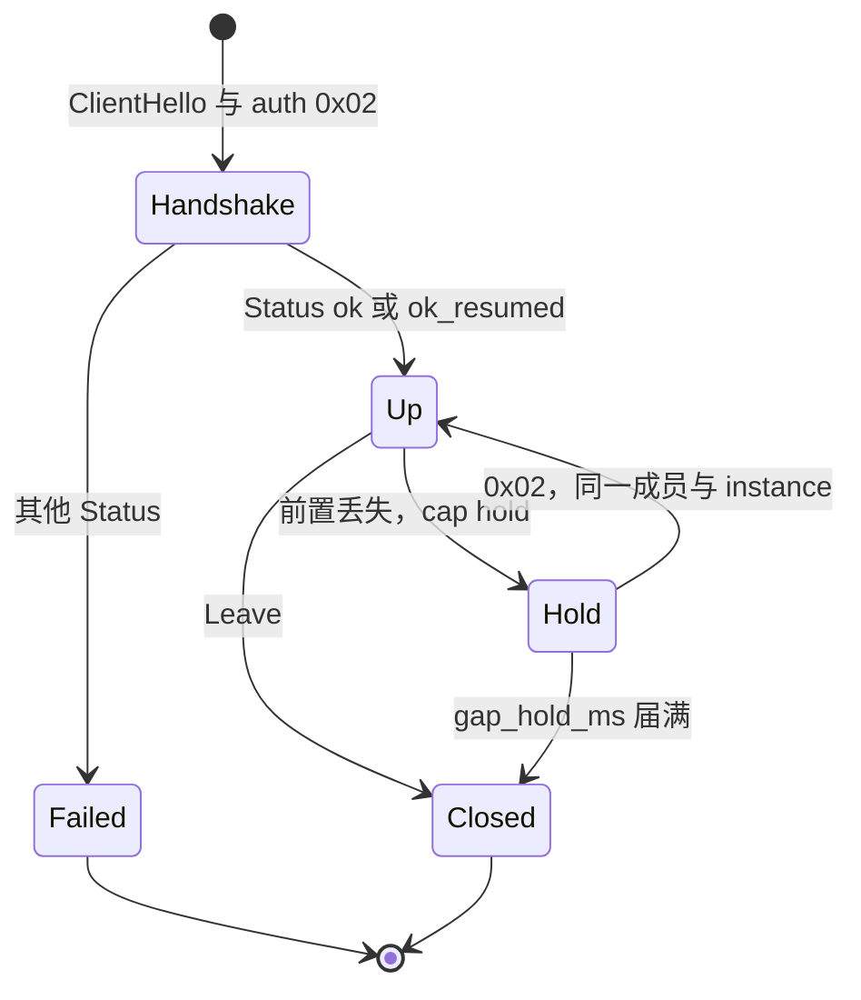
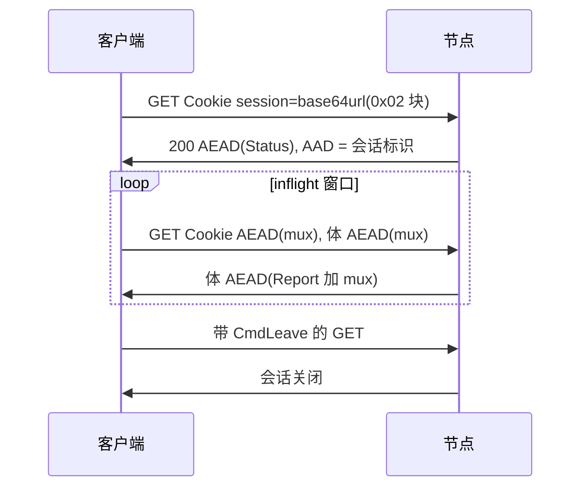

# loft 协议 1.0

[English](protocol.md) · [Русский](protocol_ru.md) · **中文**

本文规定 **loft/1.0**：在普通 HTTPS 内承载的多路复用覆盖网。第三方实现若遵循本文，可以与 loft 节点互通。本仓库中的 Go 程序是其中一种实现。许可：[Apache-2.0](../LICENSE)。

协议版本 loft/1.0（`0x0100`）与实现版本字符串（`VERSION`，当前为 1.0.28）相互独立。握手同时携带二者。关键词 **必须**、**不得**、**应该**、**可以** 分别对应 [RFC 2119](https://www.rfc-editor.org/rfc/rfc2119) 的 MUST、MUST NOT、SHOULD、MAY。接收方必须忽略 Hello 与 Status 尾部未知字段。

参考节点的运营见 [guide_zh.md](guide_zh.md)。源码布局见 [architecture_zh.md](architecture_zh.md)。

---

## 摘要

loft 是私有覆盖网，其外部路径为端口 443 上的 TLS 1.3，ClientHello 呈浏览器形态，应用数据为 HTTPS。CDN、反向代理或 TLS 终结器可以终结该 TLS 会话。内部流经多路复用。默认数据封装是 ChaCha20-Poly1305，因此 TLS 终结器得不到 mux 明文。直连前置（`ws`、`h2`、`quic`、`h3`、`l3`）可以在 Status 之后协商不用内部 AEAD，或用 AES-256-GCM。前置 `get` 保持 ChaCha20-Poly1305：CDN 可以在这条路径上终结 TLS。

内部协议只有一套。外部传输——GET、WebSocket、HTTP/2 CONNECT、QUIC、HTTP/3 CONNECT 或可选的 L3 CONNECT——按部署选择，可以变更而不提高协议版本。节点可以向没有成员密钥的对端出示已配置的 HTTPS 源站，使扫描器与健康检查观察到网站。成员密钥、地址租约与存活前置名单由控制器持有。中继是可替换的 TLS 边缘。客户端获取经签名的前置名册与具名地址列表，并将这些列表映射到本机路由。同一网络的成员可以在枢纽上隔离、经节点做 mesh，或允许直接尝试 TCP。

典型部署：从外部进入实验室局域网、管理机群、站点互联。

---

## 目录

1. [引言](#1-引言)
2. [记法、术语与体系结构](#2-记法术语与体系结构)
3. [前置](#3-前置)
4. [认证与会话密钥](#4-认证与会话密钥)
5. [Hello 与 Status](#5-hello-与-status)
6. [多路复用](#6-多路复用)
7. [成员、实例与定时器](#7-成员实例与定时器)
8. [Status 码](#8-status-码)
9. [覆盖网](#9-覆盖网)
10. [控制器与中继](#10-控制器与中继)
11. [安全考虑](#11-安全考虑)
12. [隐私](#12-隐私)
13. [登记与扩展](#13-登记与扩展)
14. [限制](#14-限制)
15. [版本](#15-版本)
16. [测试向量](#16-测试向量)
17. [参考文献](#17-参考文献)

---

## 1. 引言

CDN、反向代理与 TLS 终结器转发的是普通 HTTPS：TLS 1.3、浏览器 ClientHello，随后是 GET、WebSocket 或 CONNECT。使用私有握手、占用私有端口的协议不会被这些设备转发。绑定到专用 IP 的隧道必须写入路径上每一份 ACL；该地址是单点故障。

loft 占据与 HTTPS 相同的外部位置，因此可以像站点一样部署在 CDN 或代理之后。内部运行一套 mux。外部由 GET、WebSocket、HTTP/2 CONNECT、QUIC 或 HTTP/3 CONNECT 按节点已配置的前置承载该 mux。TLS 服务器名由节点选定。没有成员密钥的客户端与已配置的源站完成 TLS。

停止应答的前置从经签名的名册替换，覆盖网地址不必重新编号。中继登记、发送心跳，沉默后离开名册。成员密钥不出现在名册中。

**范围。** 本文规定成帧、认证、多路复用、覆盖网转发、控制平面（名册、机群、地址列表）以及可观察路径。SOCKS、TUN 与操作系统路由属于客户端本机，不是协议能力。

**非目标。** loft 不是 mixnet。本规范不主张对抗已持有成员密钥的中间盒的机密性，不主张对抗路径上不存在任何许可目的地的机密性，也不主张对抗同时持有内部会话密钥的 TLS 终结器的机密性。协商了 clear 的直连前置会把 mux 明文交给终结该前置 TLS 的一方。前置 `get` 不协商 clear。

---

## 2. 记法、术语与体系结构

### 2.1 编码

整数为大端。Hello、Status 及多数机群记录的字符串字段为 `u8 length || bytes`，至多 64 字节。URL 与列表值为 `u16be length || bytes`，至多 255 字节，除非某节另有说明。

### 2.2 术语

| 术语 | 含义 |
|------|------|
| **节点** | 覆盖网服务器（`loft-node`）：认证成员并转发 mux。 |
| **成员** | 成员密钥的持有者。密钥为 `lt_` 加 48 个小写十六进制字符（24 字节）。节点存储整串的 SHA-256。 |
| **实例** | 客户端生成并本地保存的标识。与成员一起命名一份租约。 |
| **前置** | 承载 mux 的外部 HTTPS 传输：`get`、`ws`、`h2`、`quic`、`h3`。可选的 `connect` 拼接 TCP，不经内部 mux Open。可选的 `l3` 与 `h2` 同为 HTTP/2 CONNECT，其后为 IP 数据报而非 mux。 |
| **源站** | 已配置的 HTTPS 站点。没有有效成员标记的对端拼接到该站点（诱饵拼接）。 |
| **Mux** | AEAD 之下的内部流与数据报协议。 |
| **名册** | 经 Ed25519 签名的存活前置列表。 |
| **中继** | 可替换的 TLS 边缘。不存储成员密钥，不解密 mux。 |
| **控制器** | 密钥、租约、ACL 以及名册签名密钥的持有者。 |
| **Hold** | 在短暂丢失前置后保留 mux 流，再以新的 `0x02` 与同一成员加 `instance_id` 续上。 |
| **Park** | Hold 生效时意外丢失前置后的本地状态：mux 流仍在，前置已无。 |
| **Resin** | mux 帧，必须在同一 GET 序号上重传，直至 Report 覆盖该序号。 |
| **Draft** | 只发送一次的 mux 帧。 |
| **金丝雀** | Status 中关于 TLS 路径完整性的标志（填充或拆分的 ClientHello）。不向会重组记录的检查器隐瞒 SNI。 |
| **Sid** | TLS ClientHello 中 32 字节 `session_id`，用作成员标记（v3 或 v2）。有别于 GET 会话标识（URL 路径中的 24 hex）。 |
| **Seal** | Status 之后的数据格式。默认与握手：`nonce[12] \|\| ChaCha20-Poly1305`（[RFC 8439](https://www.rfc-editor.org/rfc/rfc8439)）。协商的 AES-256-GCM 使用同样的 12 字节 nonce 与 16 字节标签（[RFC 5116](https://www.rfc-editor.org/rfc/rfc5116)）。协商的 clear 是明文，没有 nonce，也没有标签。 |

### 2.3 层次

```
application   TCP / UDP          （SOCKS 与 TUN 为本机）
    mux       Open Data Close Reset Ping Pong Pad Dgram Leave
      AEAD    ChaCha20-Poly1305（默认）
        front get | ws | h2 | quic | h3 | l3
          TLS 1.3
            TCP/443 or UDP/443
```

1. **TLS。** 外部。CDN、负载均衡或源站可以终结它。
2. **认证与 AEAD。** 内部。持有成员密钥即证明成员身份。握手 Status 始终是 ChaCha20-Poly1305。此后直连前置上的数据可以是 clear 或 AES-256-GCM（§4.3）。前置 `get` 保持 ChaCha20-Poly1305，因此终结 TLS 的 CDN 仍然得不到 mux 明文。
3. **Mux。** 客户端与节点之间、以及经节点到互联网或其他成员的流与数据报。前置 `l3` 在此承载 IP 数据报，而非 mux。

TLS ClientHello 应该做成当下浏览器那样（密码套件、扩展、JA3/JA4）。CDN 厂商名是部署配置。它们不得作为协议能力出现。

中继干线上预留的 mux 目标：`hub:1`（HTTP/1.1）、`hub:2`（HTTP/2）、`ctl:1`（机群控制）。覆盖网监听宣告：`loft.peer:<port>`。



---

## 3. 前置

节点在 Status `caps` 中宣告已开启的前置。客户端在 Hello `caps` 中宣告将使用的前置。第一次 Status 之后，客户端必须只用交集，按其配置顺序，当前前置失败时必须切到剩下的下一条前置。

节点省略 `fronts` 时只开启 `get`。`ws`、`h2`、`quic`、`h3`、`connect` 与 `l3` 未列入则关闭。双方都列出全部传输前置时，尝试顺序为 `get`、`ws`、`h2`、`quic`、`h3`。`l3` 不在该尝试列表中。

### 3.1 诱饵拼接

loft 的 ClientHello 携带 32 字节 `session_id`。节点接受下列两种构造，先试 v3。

**sid v3。** 令 `P` 为节点的静态 X25519 私钥（节点密钥的 HKDF-SHA256，info `"loft-mask-x25519"`），`X` 为 ClientHello 的 X25519 `key_share`，`R` 为 32 字节 `client_random`，`S` 为小写 SNI：

```
shared = X25519(P, X)
session_id = HKDF-SHA256(ikm=shared, salt=R, info="loft-sid-v3" || 0x00 || S, L=32)
```

对应公钥为 Status / 名册 `mask_pub`（32 字节），可以出现在导入链接 query `pbk`。要标出这类 ClientHello，必须有 `P`。窃得的成员密钥标不出它们。

**sid v2（回退）。** 令 `token` 为成员密钥：

```
HKDF-SHA256(ikm=token, salt=R, info="loft-sid-v2" || 0x00 || S || X, L=32)
```

尚未学到 `mask_pub` 的客户端发送 v2。持有 `token` 即可检测 v2 ClientHello。绑定到 `R`、`S` 与 `X`，使形如 HMAC(`token`, `random`) 的构造无法匹配。

伪装开启时，SNI 为诱饵名的 ClientHello 只作为 sid v3 准入。该名字上的 sid v2 拼接到源站，因此窃得的成员密钥标不出它。自身 SNI 仍接受 v2：这条路出示节点证书。已有 `mask_pub` 的客户端必须发送 sid v3，不得回退到 v2。最近 10 分钟内已经见过的 `client_random` 被拼接。

任何其他 TCP ClientHello 拼接到已配置的源站：TLS 已经完成，后续字节发往该站点。第一个源站是节点的身份。若 SNI 匹配节点源站之一，则用该源站，否则用主源站。源站主机名是配置。它们不得作为协议常量出现。

没有有效 `session_id` 时，该字段是与 Chrome 兼容 `session_id` 同形的 32 字节串。在直连路径上，客户端必须把节点的主源站主机名作为 SNI 发出。该名字来自 Status、名册，或探测会看到的证书。Status 之后若不匹配，必须用宣告的名字重连。CDN 前置继续使用 CDN 主机名。

### 3.2 诱饵伪装

伪装开启时，loft ClientHello 以目的地形态的证书完成 TLS 1.3：ECDSA P-256 叶子，抄写源站的 Subject、SAN 与有效期。叶子序列号为

```
HKDF-SHA256(ikm=shared, salt=R, info="loft-cert-serial", L=16)
```

其中 `shared` 为 sid v3 的 ECDH。CertificateVerify 为该叶子上的 `ecdsa_secp256r1_sha256`。知道 `mask_pub` 的客户端必须核验序列号绑定与 ECDSA 签名。应用记录长度应该跟随从源站采样的样式，包括采样过的前几条之后。Status `mask_pub` 与名册 `mask_pub` 携带 32 字节 X25519 公钥。空表示伪装关闭。探测仍拼接。只做拼接的实现，与不做伪装的节点仍然兼容。

若 ClientHello 提供群组 X25519MLKEM768（`0x11EC`，[RFC 10024](https://www.rfc-editor.org/rfc/rfc10024)），服务器选择它。TLS 1.3 密钥调度的输入是 ML-KEM-768 共享秘密拼接 X25519 共享秘密。X25519 那一半是该群组内的 32 字节。它不必等于单独的 X25519 share。两者都在时，sid v3 仍用单独的 share（群组 `0x001d`）；它是唯一的 X25519 时用混合那一半。只提供 X25519 的 ClientHello 得到 X25519 应答。混合群组并不使叶子成为公开 CA 链。

### 3.3 WebSocket (`ws`)

先 TLS，再 HTTP upgrade。路径为节点本地（默认 `/api/v1/sync`）。客户端第一条消息为明文认证块。节点第一条为 AEAD(Status)。其后为 AEAD(mux 批次)。空批次不得发送。关闭套接字即结束会话。客户端应该在关闭前于 mux 批次中发送 CmdLeave。

### 3.4 GET (`get`)

用于只转发 GET 的边缘。传输为 HTTP/2。路径呈静态资源形态：`{base}/{session}/{seq}.js`。Mux 以请求/响应批次承载，不是一条长寿命的 TCP 字节流。



**握手 GET。** Cookie `session=<base64url(认证块)>`。块标签为 `0x02`。路径中已含客户端选定的会话标识（24 hex）。响应 200，`Cache-Control: private, no-store`，体为 AEAD(Status)，AAD 等于该标识。节点应该在 `X-Session` 中回显同一标识。

**后续 GET。** Cookie `session=` 携带 AEAD(mux 批次) 的 base64url 或 Z85，AAD = 会话标识，体为 AEAD(mux 批次)。节点应该在该体前附加 CmdReport（`applied` = 最后一段连续收下的 GET 序号）。收到它的客户端必须停止重试上行序号 ≤ `applied`。握手 Cookie 按 `0x02` 校验；其后 GET 为 AEAD。认证失败必须为带 HTML 体的 HTTP 404。

**预算与编码。** 上行必须装进一个头。Status `header_budget` 为编码后 Cookie 字节；省略时为 16 KiB HTTP 头。Status `uplink_enc` 为 1 时是 `~` 加 `u16be length || AEAD` 的 Z85（ZeroMQ Z85）；0 与省略为 base64url。握手 Cookie 仍为 base64url。节点必须两种都收。Status `h2_conns`（1–4）为到该前置的 HTTP/2 连接数；0 保持一条。Inflight 为这些连接上未完成 GET 的总数。并发未完成 GET 为 2–8（协议默认 4；Status `inflight` 为上限）。

**GET 预设。** 握手 GET 是一次请求。Status `edge` 随其后，在客户端打开 inflight 泵之前。`0` 或省略为 `plain`：客户端保留那次首个 GET 的限额。`1` 为 `tight`：Cookie 预算 16 KiB、16 条未完成 GET、其后每条 GET 6 秒超时。预设 `1` 用于 origin 位于 CDN 或反向代理之后，而该代理会丢掉过胖的并发 HEADERS 突发。`header_budget` 与 `inflight` 非零时为该预设之下的上限。厂商名不是 Status 字段。*说明，非规范。* 节点配置把预设 `1` 写成 `edge: tight`。见 [guide_zh.md](guide_zh.md)。

**GET 未完成。** 已启用其他 mux 前置的客户端，在 GET 握手未能产生会话时必须尝试那些前置。尝试顺序为已启用的 GET、WebSocket、HTTP/2、QUIC、HTTP/3 子集。若客户端另有边缘 URL，第一次 GET 使用它。下一次 GET 与其余前置使用节点主机。节点的密封认证失败在每个已试前置同样失败后使客户端停止。GET 封面的 HTTP 404 仅为 GET 的该失败；其本身不禁止下一个前置。

**更换套接字而不更换会话。** 客户端可以在本地 max-age 之后更换一条 HTTP/2 连接（省略或 0：保留到出错）。Mux 与 GET 会话标识不变。客户端也可以在本机出口变更后更换 HTTP/2 池：mux、GET 会话标识、序号与 AEAD 密钥留下，不再发新的 `0x02`。节点按 GET sid 识别会话，不按客户端地址。旧池上的 CONNECT 拼接随这些套接字结束。

**HTTP 错误。** 413：预算减半，下限 1024，再拆分。405：该前置不是 GET。收到 HTTP/2 `GOAWAY ENHANCE_YOUR_CALM` 的客户端必须在同一会话上退避，可以在下一条已经携带 mux 的 GET 上发送 CmdTune event 1。节点可以降低该前置的 `header_budget` / `inflight`，并在该 GET 体中回显 CmdTune event 0。

**GET 的空闲与保持。** 空闲上行：至少等待 `keepalive_ms / 2`，且不少于 1 秒。已经携带 mux Data、Open、Dgram 或 Leave 的 GET 不算空闲。节点应该为下行等待至多 250 ms，不得将 GET 保持超过 1 秒。上行已含 CmdData 时，节点可以在下行 Data 入队后立即返回。该上行有 ≥ 2 KiB CmdData 时，节点应该将该 GET 体封顶 96 KiB，以便下一条 Cookie 周转；仅下载的 GET 仍为 256 KiB（多条流时 192 KiB）。

HTTP/2 断开但没有 Leave，会话不结束。进程退出前，客户端必须再发一个 GET，上行批次含 CmdLeave。节点于是关闭 mux 会话，忘记 GET 会话标识，卸下覆盖网对端，并释放租约。`lease_hold` 仍为 `ok_resumed` 保留覆盖网 IP。*说明，非规范。* 一种实现把卸下叫做 Detach，把释放租约叫做 Release。

### 3.5 HTTP/2 CONNECT (`h2`)

ALPN `h2`。CONNECT 到节点本地路径（默认 `/api/v1/tunnel`）。响应 200，随后消息为 `u32be length || bytes`：认证、AEAD(Status)、AEAD(mux 批次)。

### 3.6 QUIC mux (`quic`)

客户端发起的第一条双向流；长度前缀消息与 `h2` 相同。ALPN 必须为 `h3`。若该 UDP 口上也开启了 HTTP/3 CONNECT，节点按第一条流的第一个字节区分：0 为本 mux（4 字节长度，至多 1 MiB），1 为 HTTP/3 HEADERS 帧。节点在判明之前先发 HTTP/3 SETTINGS；mux 客户端忽略该流。

### 3.7 HTTP/3 CONNECT (`h3`)

ALPN `h3`。CONNECT 路径形态与 `h2` 相同。

### 3.8 路径金丝雀

金丝雀度量 TLS 路径完整性。成员出示浏览器形态的 ClientHello，使 CDN、反向代理与 TLS 中间盒观察到普通 HTTPS。若中间盒改写握手，会话起不来：节点拒绝被改坏的 TLS 路径。金丝雀不向会重组记录的检查器隐瞒 SNI。

Status 可以置 `canary_flags`：bit 0 为填充（“胖”）ClientHello，bit 1 为 ClientHello 拆成两条 TLS 记录（节点拼接）。`canary_pad` 为额外填充，0–2048 字节。

### 3.9 CONNECT 拼接 (`connect`)

GET mux 是请求/响应上的流协议。节点可以在 `fronts` 列出 `connect` 时于 Status 置能力 `connect`（默认关）。GET 或 WebSocket 握手（租约、覆盖网 IP）之后，客户端可以用 HTTP/2 `CONNECT` `:authority` `host:port` 打开 TCP，而不用 mux `CmdOpen`。CONNECT 走与 GET 同一份存活的 HTTP/2 池（可选 `h2_max_age_ms`）。该 CONNECT 必须携带与 GET 握手相同的 0x02 Cookie（`Cookie: session=` base64url）。证明失败为 HTTP 404。节点拨打目标并拼接字节。它必须拒绝 loopback、link-local（含 `169.254.169.254`）、multicast、unspecified 与 `localhost`。覆盖网成员 IP、UDP 与 ICMP 仍走 mux。没有 `connect` 的节点，每条 TCP 都走 mux。未开此前置的 HTTP CONNECT 必须为 404。

### 3.10 L3 (`l3`)

节点可以在 `fronts` 列出 `l3` 时于 Status 置能力 `l3`（默认关）。外部传输与 `h2` 相同（§3.5）：ALPN `h2`，CONNECT 到节点本地路径（默认 `/api/v1/tunnel`），`:protocol` `loft`。认证与 AEAD(Status) 仍是带长度前缀的同一套报文。Status 之后内部明文不是 mux。每段 AEAD 明文为：

```
u8    type
bytes payload
```

类型 `0x00` 为一份 IPv4 或 IPv6 数据报（载荷首字节的版本半字节选择族）。类型 `0x01` 为批：重复 `u16be n || 数据报`（n 为数据报长度）。发送方宜把数据报攒进一段 AEAD 明文，最多 16 KiB 或 2 ms，使 Seal 不按每个 MSS 执行。ICMP 与 TCP SYN、FIN、RST 宜立即刷出。接收方必须同时接受 `0x00` 与 `0x01`。未知类型忽略。

节点按覆盖网目的转发：覆盖网网关应答 ICMP echo；另一名带 `l3` 会话的成员收到该数据报；覆盖网 CIDR 之外的目的由节点发出。Hello 必须为此内部置能力 `l3`；未置该位的 CONNECT Hello 在开启 `h2` 时仍走 mux。关闭 CONNECT 流即结束该前置。覆盖网 IP 跟随 `instance_id` 与 `lease_hold`，与其他前置相同。带同一 `instance_id` 的新 CONNECT 可以保留 NAT 流：回程按覆盖网 IP 查找当前 L3 槽。没有 mux hold。SOCKS、TUN 与操作系统路由仍属客户端本地。

---

## 4. 认证与会话密钥

成员密钥为 `lt_` 加 48 个十六进制字符（24 字节）。节点存储整串的 SHA-256。部署可以让所有成员共用一个令牌；那是配置。

### 4.1 无客户端时钟的证明

认证不使用客户端时钟。时钟不准的主机仍可加入。

```
0x02 || nonce[16] || eph_c[32] || HMAC-SHA256(key, "lft-a2" || nonce || eph_c)[0:16] || Hello
```

`eph_c` 为客户端的临时 X25519 公钥。新 nonce 即新握手。同一 `nonce||eph_c` 落在以节点时钟为键、时长 10 分钟的缓存内，为幂等重试（GET Cookie）。同一 nonce 换了 `eph_c` 则拒绝。

### 4.2 续上

GET 可以在本机出口变更后保持会话、不再发新的 `0x02`（§3.4）。`ws`、`h2`、`quic` 或 `h3` 换路径、GET 换池失败、或进程重启，发送新的 `0x02`，新的临时密钥，同一个 Hello `instance_id`。Hold 按已认证成员加实例把停着的 mux 再挂上。副本故障切换是在新节点上发 `0x02`；覆盖网 IP 跟随 `lease_hold` 与实例。GET 握手后 Status `ticket` 即该 GET 会话标识。空 ticket 表示节点不会 attach（§4.4）。

### 4.3 会话密钥

```
ss = X25519(sk_c, eph_n)
HKDF-SHA256(ikm=ss, salt=nonce, info="loft-v1", L=32)
```

节点第一条消息为 `eph_n[32] || Seal(Status)`。其后 mux 消息只 Seal。`eph_n` 为节点本次握手的临时 X25519 公钥。HMAC 覆盖 `eph_c`，因此窃得的 Cookie 组不成会话：AEAD 密钥需要 `sk_c`，它从未离开客户端。

握手的 Seal(Status) 始终是 `nonce[12] || ChaCha20-Poly1305(key, nonce, plaintext, aad)`（[RFC 8439](https://www.rfc-editor.org/rfc/rfc8439)）。对 ChaCha20-Poly1305 和 AES-256-GCM，nonce 都必须对每个会话密钥唯一。其后的记录不得复用已经与该密钥、该算法用过的 nonce。clear 记录不带 nonce，也不带标签。GET 使用 AAD = 会话标识；attach 的前置（§4.4）以及 `ws`/`h2`/`quic`/`h3`/`l3` 上的 `0x02` 使用空 AAD。Attach 共用会话密钥。clear 忽略 AAD。

*说明，非规范。* 一种实现取 32 位随机前缀加 64 位计数器，使停着的 GET 会话继续同一个计数器。握手的 Seal 取该计数器的一个值。其后该密钥上的 AES-256-GCM 记录接着计数。接收方接受任何唯一 nonce，不要求这种布局。

Status 之后的数据密码是 Hello 与 Status 上的一个字节（§5.1、§5.2）。没有该字节就是 ChaCha20-Poly1305。`0` 表示没有内部 AEAD，只剩该前置的 TLS。`1` 是 ChaCha20-Poly1305，与没有该字节相同。`2` 是 AES-256-GCM：32 字节 HKDF 密钥、12 字节 nonce、16 字节标签，成帧与 ChaCha 相同，为 `nonce[12] || ciphertext`（[RFC 5116](https://www.rfc-editor.org/rfc/rfc5116)）。一把会话密钥只有一种数据密码。

客户端在 Hello 里请求。节点在 Status 里确认恰好一个标识，或者不写该字节。ChaCha20-Poly1305 始终可以，不能关掉。未知标识、策略里没有的标识，或其他不一致，会话留在 ChaCha20-Poly1305。会话仍然建立。前置 `get` 不得确认 `0` 或 `2`：CDN 可以终结 TLS，内部 AEAD 就是对这个 CDN 隐藏 mux 的东西。前置 `ws`、`h2`、`quic`、`h3`、`l3` 可以在客户端请求了该标识且节点策略列出它时确认 `0` 或 `2`。`connect` 是拼接，没有数据密码。选定 `0` 的会话不得 attach 前置 `get`（§4.4）。AES-256-GCM 可以 attach `get`：CDN 看到的仍是密文。旧对端不写该字节，留在 ChaCha20-Poly1305。双方都省略该字节时可以互通。这个选择不改变协议版本 `0x0100`。

*说明，非规范。* 运营方如何写下节点策略和客户端请求见 [guide_zh.md](guide_zh.md)。文件名和标志不是交换格式的一部分。

### 4.4 Attach（`0x04`）

会话由 GET `0x02` 建立。后续前置用标签 `0x04` 加入该会话。不得再发第二个 `0x02`。

```
0x04 || u8 sid_len || sid || nonce[16] || u8 front_len || front || HMAC-SHA256(session_key, "lft-a4" || sid || nonce || front)[0:16]
```

`sid` 为 Status `ticket`（GET 会话标识，24 hex）。`front` 为 `ws`、`h2`、`quic` 或 `h3`。HMAC 使用 §4.3 的会话 AEAD 密钥，不是成员令牌。`l3` 与 `connect` 不得 attach。

节点按 `sid` 查找 GET 会话、校验 HMAC，并拒绝该会话上已用过的 nonce（10 分钟缓存，节点时钟）。成功：一条带长度前缀的 AEAD 明文，内含 mux `CmdFront` 及该前置名（空 AAD）。失败：关闭该前置（GET 上为 HTTP 404）。

GET 留在会话中做 keepalive、Leave 和 bulk 回退。Mux bulk 同一时刻只走一个前置（`CmdFront`）。附加前置断开后 bulk 回到 GET：同一密钥、mux、序号，不再发 `0x02`。GET 上行 `CmdFront` 为 `get` 时拆除 attach。

旧客户端忽略非空 `ticket`。旧节点 `ticket` 为空；客户端不得发 `0x04`。没有可 attach 的 GET 会话时，`ws`/`h2`/`quic`/`h3` 上的 `0x02` 握手仍然有效。

Attach 只发生在持有该 GET 会话的节点上。

数据密码为 ChaCha20-Poly1305 或 AES-256-GCM 时，AEAD 覆盖 mux。TLS 覆盖到终结器的路径。在 `get` 上终结 TLS 的 CDN 看到的是 mux 密文。数据密码为 clear 的会话不得 attach `get`。attach 上的 AES-256-GCM `get` 仍是密文。

---

## 5. Hello 与 Status

Hello 接在认证块之后。节点第一条消息为 `eph_n[32] || Seal(Status)`。Status 为 AEAD 明文。Hello 与 Status 都不是 mux 命令。

### 5.1 Hello

```
u8    version          (= 1)
u8    member_id_len || member_id
u8    instance_id_len || instance_id
u16be proto_min
u16be proto_max
u64be caps
u8    program_len || program
u8    software_len || software
u8    inner            可选。仅当客户端请求时有一个字节
```

`instance_id` 在客户端持久保存。空则节点在 Status 中签发一个；客户端必须存储它。字符串 ≤ 64 字节。协议版本为 `major<<8|minor`（`0x0100` = 1.0）。能力 `relay` 标记中继干线。能力 `p2p` 标记将宣告监听端口的客户端。

没有 proto/caps 的旧块仍可解码。尾部未知字节必须忽略。`software` 之后若还剩一个字节，那是数据密码请求（§4.3）：`0` 为 clear，`2` 为 AES-256-GCM。没有该字节不是 `0`。再往后的字节必须忽略。旧解码器忽略该请求，留在 ChaCha20-Poly1305。

### 5.2 Status

字段顺序：

| 字段 | 编码 |
|------|------|
| code | u16be |
| lease_sec | u32be |
| mtu | u16be |
| vlan | u16be |
| keepalive_ms, idle_ms, reconnect_min_ms, reconnect_max_ms | 各 u32be |
| reconnect_fast_n | u16be |
| ip, gateway, instance_id | u8 len \|\| bytes |
| reconnect_fast_for_ms | u32be |
| selected proto, min, max | 各 u16be |
| caps | u64be |
| program, software | u8 len \|\| bytes |
| ticket | u16be len \|\| bytes |
| decoy | u8 n，然后 n × (u8 len \|\| bytes) |
| mask_pub | u8 len \|\| bytes（0 或 32） |
| replicas | u8 n，然后 n × (u8 len \|\| bytes) |
| canary_flags | u8 |
| canary_pad | u16be |
| roster | u16be len \|\| bytes |
| lists_serial | u64be |
| lists_hash | u8 len \|\| bytes（0 或 32） |
| peers | u8（0 hub，1 mesh，2 vlan） |
| p2p | u8（1 = 节点允许） |
| peer hints | u8 n ≤ 16，然后 n × (ip, host, port u16be, vlan u16be) |
| dns | u8 n ≤ 8，然后 n × (u8 len \|\| bytes) — 客户端 TUN 的解析器 IPv4/IPv6。空：客户端必须保持操作系统 DNS 不变。 |
| ip6, gateway6 | 可选尾部：各 u8 len \|\| bytes。二者皆空时整段省略（仅 IPv4）。不读它们的解码器必须忽略尾部字节。 |
| header_budget, inflight | ip6/gateway6 之后可选：u16be 编码后 GET Cookie 预算，u8 inflight。任一非零即出现（IPv4 时 ip6/gateway6 为空串）。握手值为上限；存活 CmdTune 为准。0 = 客户端保留自己的。 |
| h2_conns, uplink_enc | inflight 之后可选：u8 HTTP/2 连接数（1–4；0 = 客户端保持一条），u8 上行编码（0 base64url，1 Cookie Z85）。任一非零即出现。旧客户端忽略多余字节。 |
| gap_hold_ms | uplink_enc 之后可选：u32be。前置丢失且无 Leave 后，节点保留 mux 流的时长。0 = 客户端默认（8 s）。旧客户端忽略多余字节。 |
| routes | gap_hold_ms 之后可选：u8 n ≤ 16，然后 n × (dst, via)，各为 u8 len \|\| bytes。受管 CIDR：成员背后的实验室局域网（`via` 为该成员的覆盖网 IP，由 `ip route` VIA / `member ID` / `tag NAME` 解析）。节点把 Open `host:port` 拼到该成员。客户端不得安装 `via` 为自己覆盖网 IP 的路由。旧客户端忽略多余字节。 |
| policy | routes 之后可选：紧凑 ACL，使客户端能在直接 P2P 上执行同一套 Allow。`u8 n_own_tags` 然后标签；`u8 acl_default`（0 peers/accept，1 drop）；`u8 n_rules` 然后规则；`u8 n_peers` 然后覆盖网 IP 与标签。空则省略。见到该尾部的解码器必须置 Present。旧客户端忽略多余字节。 |
| session_ttl_ms | policy 之后可选：u32be 存活会话上限。0 = 关。有别于 `lease_sec`（断开后的 IP 保留）。有本字段而无 policy 时，编码器先写空 policy。旧客户端忽略多余字节。 |
| rate_bps | session_ttl_ms 之后可选：u32be 本会话双向批量 `CmdData`/`CmdDgram` 上限，字节每秒。0 = 关。控制与小帧（Open、Ping、ACK ≤ 4 KiB、DNS/ICMP Dgram ≤ 512 B）不整形。由节点执行。有本字段而无 `session_ttl_ms` 时，编码器先写 ttl 0。旧客户端忽略多余字节。 |
| fronts | rate_bps 之后可选：u8 n ≤ 8，然后 n ×（name、path、url），各为 u8 len \|\| bytes。本节点接受的 mux 前置（`get` `ws` `h2` `h3` `quic`）。空 url 为完成 `0x02` 的前置的 host:port。`quic` 路径为空。空列表 = 客户端保留 URI/默认。有本字段而无 `rate_bps` 时，编码器先写 rate 0。旧客户端忽略多余字节。成功 Status 后节点地图为权威；客户端应写入已保存的配置。 |
| edge | fronts 之后可选：u8，GET 预设。`0` 为 plain，`inner` 也不存在时省略。`1` 为 tight。出现 `inner` 时，即使该字节为 `0` 也必须写出，并写出 `fronts`（n 可以为 0），以免下一字节被读成 `edge`。旧客户端忽略多余字节。 |
| inner | edge 之后可选：u8，此 Status 之后记录的数据密码。仅当 Hello 请求过、策略允许该标识、且完成 `0x02` 的前置不是 `get` 时，节点才写它。`0` 无内部 AEAD。`1` 为 ChaCha20-Poly1305，与省略该字节相同；节点可以不写 `1`。`2` 为 AES-256-GCM。没有该字节、未知标识或拒绝，都是 ChaCha20-Poly1305，会话仍然建立。此 Status 的握手 Seal 无论哪种都是 ChaCha20-Poly1305。旧客户端忽略多余字节。 |

选定协议为两范围交集的最大值。交集为空则码为 `protocol`（0x0203），无 mux。

### 5.3 能力位

| 位 | 名称 | 含义 |
|----|------|------|
| 0 | multi | 同一密钥上多个实例 |
| 1 | resume | `ok_resumed` 与租约保留 |
| 2 | sticky_ip | 密钥上预留的覆盖网 IP |
| 3 | vlan | 密钥上的 VLAN |
| 4 | rules | 交换 ACL |
| 5 | get | GET 前置 |
| 6 | ws | WebSocket 前置 |
| 7 | status | 带码的 Hello/Status |
| 8 | timers | Status 中的 keepalive / idle / reconnect |
| 9 | hello_caps | 本能力块 |
| 10 | reset | CmdReset |
| 11 | quic | QUIC mux 前置 |
| 12 | dgram | CmdDgram |
| 13 | clockless | 无客户端时钟的认证 |
| 14 | ticket | Status `ticket` 为 GET sid；`0x04` attach（§4.4） |
| 15 | decoy | Status 列出源站 |
| 16 | h2 | HTTP/2 CONNECT |
| 17 | h3 | HTTP/3 CONNECT |
| 18 | mask | 目的地形态证书 |
| 19 | relay | 本会话为中继干线 |
| 20 | roster | Status 可以携带经签名的名册 |
| 21 | lists | Status 可以宣告列表序号/散列 |
| 22 | p2p | mesh 时的对等覆盖网 |
| 23 | dns | Status 可以携带 DNS 服务器；gateway:53 为解析器 |
| 24 | connect | HTTP/2 CONNECT 拼接：TCP Open 不经内部 mux |
| 25 | resin | CmdReport 与 resin/draft GET 上行 |
| 26 | hold | mux 流在短暂丢失前置后仍在；以 `0x02` 与同一成员加 `instance_id` 续上 |
| 27 | quic_mark | 诱饵节点上的 quic：Initial 必须携带 loft 标记（§11.3） |
| 28 | h3_mark | 诱饵节点上的 h3：Initial 必须携带 loft 标记（§11.3） |
| 29 | l3 | HTTP/2 CONNECT 承载 IP 数据报（无 mux） |

节点关闭某前置必须清该位。客户端不使用某前置必须清该位。SOCKS、TUN、CDN 厂商、操作系统、git 与源站主机名不是能力。第 30–63 位在本修订中没有名称（§13.1）。

版本协商：`max(intersection(client.min..client.max, node.min..node.max))`。Status 中的 caps 为节点宣告集。客户端决定使用其中哪些。

---

## 6. 多路复用

Status 之后，每份 AEAD 明文为帧的拼接：

```
u16be payload_length   0..16384
u8    cmd
u32be stream_id
bytes payload
```

客户端流标识为奇数，从 1 起。节点标识为偶数，从 2 起。存活标识不得复用。Close 或 Reset 之后可以复用。

| cmd | 名称 | 载荷 |
|-----|------|------|
| 1 | Open | 目标 |
| 2 | Data | 字节 |
| 3 | Close | 空 |
| 4 | Ping | 8 字节，原样回显 |
| 5 | Pong | 那 8 字节 |
| 6 | Pad | 忽略 |
| 7 | Reset | u16be 码 |
| 8 | Dgram | Open 目标前缀再加 UDP 载荷 |
| 9 | Leave | 空；stream_id 必须为 0 |
| 10 | Tune | 4 字节：`u8 event \|\| u8 inflight \|\| u16be header_budget`，可选第 5 字节 `h2_conns`。客户端 event ≠ 0 为一次前置中断（1 `ENHANCE_YOUR_CALM`，2 HTTP 413，3 HTTP 404，4 连接复位，5 HTTP 429，6 其他 GOAWAY），在下一条已经携带 mux 的 GET 上发送一次。节点 event 0 设定存活 GET 的 `header_budget` / `inflight` / `h2_conns`（字段为 0 = 保持不变）。仅当这些值变化时节点才回复。stream_id 必须为 0。 |
| 11 | Report | `u64be applied`（节点已连续收下的最高 GET 序号）。stream_id 必须为 0。旧客户端忽略未知 mux 命令。 |
| 12 | Front | 前置名（`get`、`ws`、`h2`、`quic`、`h3`）。stream_id 必须为 0。客户端：bulk mux 走该 attach 前置。节点：ack。`get` 把 bulk 交回 GET。 |

**Resin 与 draft。** mux 帧为 resin 或 draft。

- **Resin** 持有至 Report 覆盖其 GET 序号，再在同一序号上重传：Open、Ping、Pong、Leave、Tune、Report、Front、Close、Reset，以及发往端口 53 的 Dgram。
- **Draft** 只发送一次：Data、Pad、其他 Dgram。内部 TCP 或 UDP 在应用仍需要这些字节时产生新帧。

一次 mux Pull 最多变成三个 GET 序号：控制 resin、draft Data，然后 Close/Reset。Close 不得与同一流的 Data 共享 Cookie。HTTP 错误之后，客户端以仅 resin（若 Cookie 原为仅 draft 则以 Pad）重试同一序号，以填补序号空洞且不重放 draft。若干 inflight GET 上的首次 HTTP 404 为边缘噪声；同一 sid 上三次 **重试** 404 表示源站已丢失会话。对存活 stream_id 的重复 Open 必须忽略。

Open 目标：`u16be host_len || host || u16be port`。Dgram 载荷为该前缀加数据报。

Leave 结束 mux 会话。stream_id 为 0。载荷为空。节点必须关闭 mux 会话、卸下覆盖网对端，并释放租约。该对端不再在线。`lease_hold` 仍为同一 `instance_id` 保留 IP。同一批次中 Leave 之后的帧可以忽略。尚未处理 Leave 的实现必须忽略该命令（未知 mux 命令必须忽略，且不得复位会话，§13.2）。*说明，非规范。* 一种实现把卸下叫做 Detach，把释放租约叫做 Release，并清掉标志 `Online`。CmdClose 结束一条流；它不结束会话。

实现必须把帧打成批次（每份 AEAD 明文约 1–16 KiB）。缓冲压力下不得丢弃 Data：施加反压。每流接收缓冲至少 64 KiB、至多 256 KiB。无法完成的 Open 以 Reset `stream_refused`（0x0501）。Ping 间隔为 `keepalive_ms`。空闲超时为 `idle_ms`。在 `get` 上，Pad 使 AEAD 前明文约 400–600 字节。

长度前缀包装（`h2`、`quic`、`h3`、`ctl`）：`u32be length || payload`，至多 1 MiB。AEAD 内的 mux 载荷仍 ≤ 16384。

---

## 7. 成员、实例与定时器

成员是一把密钥。实例是客户端生成并本地保存的标识。空实例：节点在 Status 中签发一个；客户端持久保存。

同一实例重连得到 `ok_resumed` 与同一覆盖网 IP。`multi` 关闭时第二个实例得到 `auth_already_online`。`multi` 开启时，后续实例得到池地址，直至 `multi_limit`（默认 8），然后 `auth_limit`。密钥上的粘滞 IP 给第一个实例。

断开后，`lease_hold_ms`（默认 45 s）为该实例保留 IP。Leave 立即把该对端标为不在线；保留的只是供续上的 IP 预订。没有 Leave 就消失的 GET 会话保持在线，直至节点再次见到该会话。

Hello 与 Status 都宣告 `hold` 时，意外丢失前置（无线电间隙，或导致 Park 的路径变更）在 `gap_hold_ms`（默认 8 s）内不得关闭 mux 流。在 GET 上以同一 sid 更换 HTTP/2 不算丢失。Park 的客户端以新的 `0x02` 与同一 `instance_id` 重拨；节点仅为匹配新证明的成员重新挂上停着的 mux。内部 TCP 保持。`gap_hold_ms` 内无续上，节点关闭 mux。Leave 仍立即关闭。

客户端可以在已知间隙附近本地暂停 draft；resin 仍发送。该暂停不是协议字段。

默认：握手 10 s，空闲 120 s，keepalive 15 s，租约保留 45 s，间隙保留 8 s，重连最小 200 ms、最大 8 s，8 s 内 5 次快速尝试，然后指数退避。

---

## 8. Status 码

数值稳定。名称可以增长。编号不移动。

| 码 | 名称 | 含义 |
|----|------|------|
| 0x0000 | ok | 新租约 |
| 0x0001 | ok_resumed | 同一实例，同一 IP |
| 0x0101 | auth_bad_key | 未知密钥 |
| 0x0102 | auth_revoked | 密钥轮换或删除 |
| 0x0103 | auth_expired | 加入 TTL |
| 0x0104 | auth_not_authorized | 成员停用 |
| 0x0105 | auth_limit | multi_limit |
| 0x0106 | auth_already_online | multi 关，另有实例 |
| 0x0107 | auth_instance | 坏的实例 id |
| 0x0108 | auth_clock | 时间戳偏差（clockless 时不用） |
| 0x0201 | net_disabled | 网络关闭 |
| 0x0202 | net_unknown | 错误网络 |
| 0x0203 | protocol | 无共同版本 |
| 0x0204 | rate_limit | 握手过多 |
| 0x0205 | timeout | 握手或空闲 |
| 0x0206 | internal | 节点故障 |
| 0x0301 | ip_pool | 地址池耗尽 |
| 0x0302 | ip_conflict | 粘滞冲突 |
| 0x0303 | vlan_denied | VLAN 不允许 |
| 0x0401 | policy_drop | ACL 或枢纽隔离 |
| 0x0501 | stream_refused | Open 失败 |
| 0x0502 | stream_reset | 对端 Reset |

非 OK 的 Status 禁止 mux。GET 认证上的 HTTP 404 视为 `auth_bad_key`。表中没有的码在本修订中没有名称（§13.3）。

---

## 9. 覆盖网

节点加载网络文档（CIDR、网关、成员、ACL）。覆盖网 IP 与 VLAN 出现在 Status。对覆盖网 CIDR 内地址的 Open 按 `peers` 转发：

| peers | 覆盖网 Open |
|-------|-------------|
| hub | Reset `policy_drop`。互联网 Open 不变。对成员背后受管 CIDR 的 Open 仍拼接。 |
| mesh | 拼接到对端会话：在该成员上 Open `127.0.0.1:port`。 |
| vlan | 同 mesh，仅当两端共享 VLAN。 |

枢纽拼接：接收客户端接受该流并拨打本机端口。

网络上的 `p2p` 对 mesh 与 vlan 默认开启。开启时，Status 携带至多 16 条对等提示（覆盖网 IP、TLS 观察到的主机、监听端口、VLAN、32 字节 X25519 公钥）。带 Hello 能力 `p2p` 的客户端在 TCP 上监听，以 Open `loft.peer:<port>` 加该流上 32 字节 X25519 公钥宣告，并可以在回退到枢纽拼接前用 42 字节前言拨打 `host:port`：

```
"LFT" || 0x00 || src_ipv4[4] || HMAC-SHA256(ss, "lft" || nonce || dest_port || src_ipv4)[0:16] || nonce[16] || dest_port u16be
```

`ss` 为 X25519(local_sk, 提示中的 peer_pub)。两个 `lt_` 不同的成员仍共享该对密钥，HMAC 使用它。应答方在其提示中查找 `src_ipv4`。缺少公钥或 MAC 失败则关闭套接字；发起方使用枢纽拼接。`p2p: false` 的客户端必须只用枢纽拼接。经中继观察到的主机是中继；直接尝试于是失败，改用枢纽拼接。Status 携带 policy 时，发起方与应答方在拼接本机端口前必须应用与枢纽拼接相同的 Allow。没有 policy 的 Status（旧节点）跳过该检查。

每条提示记录为 `u8 ip | ip | u8 host | host | u16be port | u16be vlan`，然后可选 `u8 32 | pub[32]`。解码器必须把随后不是 32 的字节视为下一字段（较旧的块，或尚未宣告公钥的对端）。

ACL 规则为首次匹配，`accept` 或 `drop`。空规则仍应用 `peers`。分组字段：源、目的、源 VLAN、目的 VLAN、源标签、目的标签、到网关、已路由（目的匹配经成员的 `ip route`）。地址记号：`any`、`host <IP>`、CIDR、`tag NAME`（`group` 为同一记号）。`ip access-list overlay` 下的 `default deny` 保留到网关的流量，其余丢弃，除非有 permit 匹配。TCP Open 与覆盖网 ICMP 走同一条 Allow 路径。`ip route DST` 下一跳为覆盖网 IP、`member ID` 或 `tag NAME`（第一个存活成员，否则粘滞 IP）。

覆盖网 ICMP echo 为发往 `dst:1` 的 CmdDgram（IP 协议 ICMP），载荷为 IPv4 分组。节点应答网关地址。其他覆盖网目的跟随 `peers`（hub 丢弃成员到成员；mesh/vlan 拼到该成员）。对覆盖网 CIDR 外地址的 echo 由节点作为真实 ICMP echo 发出；应答以 CmdDgram `session-ip:1` 返回。客户端对本覆盖网 IP 的 echo 在本地应答，不得为其他覆盖网或互联网地址伪造应答。节点必须将会话覆盖网 IP 视为分组源（Darwin utun 哑地址 `169.254.8.1` 被改写）。客户端可以在 echo-reply 上恢复该哑地址，使内核匹配 ping 套接字。

---

## 10. 控制器与中继

控制器持有密钥、租约、ACL 与签名。中继终结外部 TLS，并把 TLS 之后的 HTTP 复制到干线会话：Open `hub:1` 或 `hub:2`。内部 mux AEAD 与 FinishAuth 留在控制器上；中继不解密覆盖网帧，不存储成员密钥。只有带能力 `relay` 的 Hello 可以 Open `hub:*` 或 `ctl:1`。成员不得置该位（它不是前置）。中继置该位。控制器处于允许名单模式时，已认证成员 id 必须在该名单上。空的 Hello 成员 id 是共享令牌中继；enrol 检查仍作用于该 id。能力 `hold` 与续上 `0x02` 独立于该位。*说明，非规范。* 一种客户端在 Hello 中省略该位。中继角色的 Go 节点经 ExtraCaps 置位。允许名单模式是 `enrol: list`，名单是 `relays:`。见 [guide_zh.md](guide_zh.md)。成员认证与覆盖网 IP 仍在控制器上。

```
client ──TLS──► relay ──trunk (mux hub:1|hub:2, ctl:1)──► controller
                     ▲
                     成员密钥从不存储在中继上
```

### 10.1 名册

Ed25519 覆盖体：

```
u64be serial
u8 n
repeat n:
  id                 (u8+bytes)
  url                (u16be+bytes)
  decoy              (u8+bytes)
  fronts             u8 k, k × (u8+bytes), k ≤ 16
  drain              u8
  weight             u8（0 表示 100）
  path               (u8+bytes)
  mask_pub           u8 len, 0..32 bytes
```

然后 `u8 pub_len || pub || u16be sig_len || sig`。签名为体上的 Ed25519。公钥 32 字节。签名 64 字节。

存活名册为 `advertise`（id `self`）加上未 drain、正在发心跳的中继。三次错过心跳（默认间隔 10 s）或死亡的 `ctl` 流移除该中继并递增序号。

认证后获取：Status `roster`。认证前获取：`GET {roster_path}`（默认 `/static/v3/manifest.json`），JSON `{"v":1,"p":"<base64url>"}`，`Cache-Control: public, max-age=60`。该 GET 在 CDN 或持有真实证书的主机上成功。没有会话 HMAC 的诱饵拼接 IP 被转发到源站。文档不得包含成员令牌。客户端必须拒绝签名者与已钉控制器公钥不符的名册。接受未知签名者是运营方的选项，默认关闭。*说明，非规范。* 一种客户端把钉住写成 `controller_pub`，把该选项写成 `tofu`。见 [guide_zh.md](guide_zh.md)。

### 10.2 机群（`ctl:1`）

每条消息 `u32be length || u8 type || body`。

| type | 名称 | 体 |
|------|------|----|
| 1 | enrol_req | id, url, decoy, fronts |
| 2 | enrol_ok | 经签名的切片 |
| 3 | enrol_no | u16be 码, reason |
| 4 | beat | load u8, conns u32be, program, uptime_s u32be |
| 5 | slice | 经签名的切片 |
| 6 | drain | id, u8 |

切片（体上的 Ed25519）：serial, id, url, decoy, fronts, drain, weight, beat_ms u32be, expires unix u64be，然后与名册相同的 pub 与 sig。允许名单模式要求 id 在控制器的中继名单上。开放模式接受任何已认证干线。登记拒绝：1 未知 id，2 格式错误，3 重复，4 停用。*说明，非规范。* 允许名单模式、开放模式，以及按中继覆盖 URL、decoy、fronts、weight 的配置名，见 [guide_zh.md](guide_zh.md)。

机器与证书的置备在本协议之外。

### 10.3 地址列表

控制器可以发布具名地址列表。名称没有协议含义。客户端把名称映射到 `direct`、`via` 或 `drop`。主机匹配多个已映射列表时，先 drop，再 direct，再 via。未匹配的目的使用客户端默认（应该为 `via`）。

体（Ed25519，与名册同一密钥）：

```
u64be serial
u8 nsets
repeat:
  name               (u8+bytes)
  u16be n
  repeat n: u8 kind, u16be+bytes value
```

Kind 1 精确域名，2 后缀，3 CIDR。然后公钥与签名同名册。

Status 携带 `lists_serial` 与已签名块的 SHA-256。序号或散列更新时，客户端获取 `GET {lists_path}`（默认 `/static/v3/lists.json`）。名称匹配不区分大小写。*说明，非规范。* 运营文件如何书写后缀或 CIDR，见 [guide_zh.md](guide_zh.md)。SOCKS 匹配主机名。TUN 匹配 IP（CIDR）。

---

## 11. 安全考虑

CDN、反向代理或 TLS 终结器能观察到什么，以及握手依赖哪些检查。还有谁能读到成员密钥、覆盖网地址和名册，见 §12。

| 观察者 | 所见 |
|--------|------|
| 没有成员密钥的 TLS 终结器 | 到源站的 HTTPS，或目的地形态证书（伪装）；ChaCha20-Poly1305 与 AES-256-GCM 上 mux 为 AEAD 密文 |
| 协商了 clear 的直连前置上的 TLS 终结器 | mux 明文。前置 `get` 不协商 clear |
| 没有节点私钥 `P` 的中间盒 | Chrome 长度的 32 字节 `session_id`；没有 `P` 则 sid v3 不可区分 |
| 窃得成员密钥的持有者 | sid v2 ClientHello；不是 sid v3 |
| 没有有效 sid 的主动探测 | 已配置源站（存活证书与字节） |
| 同时持有 AEAD 会话密钥的 TLS 终结器 | mux 明文（在本协议之外） |

### 11.1 握手

与当下浏览器匹配的 ClientHello 通过银行与门户前已经部署的同一套 JA3/JA4 过滤器。私有 ALPN、私有 GREASE 模式或 Go 默认密码套件列表会标出非浏览器。因此 QUIC ALPN 为 `h3`。*说明，非规范。* 一种客户端用 uTLS 构造该 ClientHello。见 [guide_zh.md](guide_zh.md)。

`session_id` 为 32 个看似随机的字节。sid v3 为与节点静态 X25519 的 ECDH 下的 HKDF；中间盒需要该私钥才能标出这些 ClientHello。窃得的成员密钥只标出 sid v2。伪装节点不在诱饵 SNI 上准入 sid v2，因此该密钥标不出携带诱饵名的 ClientHello。两种秘密都没有的中间盒看到的是 Chrome 已经发送的同长度串。

伪装出示目的地形态的 ECDSA P-256 叶子与 `ecdsa_secp256r1_sha256` CertificateVerify，序列号绑定到同一 ECDH。核验公开 CA 链的中间盒不会接受该叶子；检查名称、日期与签名方案的中间盒看到目的地典型值。ClientHello 提供 X25519MLKEM768 时，ServerHello 选择该群组。loft 路径上的应用记录长度应该跟随从源站采样的样式。只拼接的节点跳过伪装。叶子在两种情况下都不在 WebPKI 之内。

### 11.2 目的地

只服务 loft 的 IP 是单点故障。CDN 主机名，或已经服务站点的源站，才是预期前置。中继的存在使地址可以离开名册，而成员身份留在控制器上。

没有密钥的探测看到源站。把源站主机名或 IP 撤出服务是运营决定，不是协议常量。

### 11.3 主动探测

没有有效 `session_id` 就打开 TLS 的扫描器拼接到已配置源站，包括自身 SNI（CT / 反向 DNS 主机名）、空 SNI，以及首包不是 TLS ClientHello 的情况。它收到源站的存活证书与字节。该 IP 上的 UDP 转发到同一源站，因此 QUIC 探测看到目的地，而不是 loft。例外是带标记的 loft QUIC v1 Initial。其源连接 ID 为 20 字节 `HKDF-SHA256(secret, salt = client_random, info = "loft-quic-v3")`，其中 client_random 为临时 X25519 公钥（最高位随机），secret 为 ECDH(该临时密钥, `mask_pub`)。没有 `mask_pub` 的客户端使用 info `loft-quic-v2`，以成员密钥为 secret。节点用公开 Initial 密钥打开 Initial（[RFC 9001](https://www.rfc-editor.org/rfc/rfc9001) §5.2），检查标记，将每个 client_random 单次持有 10 分钟，并把该客户端地址交给其 quic/h3 前置。TCP `client_random` 在同样的 10 分钟内单次使用；重复则拼接。伪装节点上的 QUIC 标记只有 v3（`quic_mark` / `h3_mark`）：v2 Initial 转发到源站。节点自身的连接 ID 携带 HMAC，因此来自新地址的短头分组仍留在 loft。此类节点宣告 `quic_mark` / `h3_mark` 而非 `quic` / `h3`；不打标记的客户端不得使用它们。构成 sid v3 需要 `mask_pub`；覆盖网 Hello 仍需要成员密钥。例外是 CDN 源站拉取：已配置的 `cdn_peers` CIDR 可以在自身 SNI 上以节点证书完成 TLS，无需 sid。

没有有效 Cookie 的 GET 返回带 HTML 的 404。名册、列表与静态资源是普通 GET。

### 11.4 重放与时钟

Auth `0x02` 为 nonce、临时 X25519 公钥，以及成员密钥下的 HMAC。缓存 TTL 内同一 `nonce||eph_c` 为幂等重试。新 nonce 即新握手。客户端时钟不用。副本接受新的 `0x02`；它们不共享此缓存。

### 11.5 名册与列表

经签名的名册是 CDN 路径上的公开文件。能 GET 该路径者即可读存活前置。成员密钥不在其中。钉住控制器公钥的客户端拒绝被替换的密钥。首次使用信任关闭：除非运营方打开该选项，客户端不得钉住未知签名者（§10.1）。

### 11.6 覆盖网

枢纽隔离是成员到成员 Open 上的 Reset `policy_drop`。Mesh 经节点拼接。P2P 是使用 TLS 观察到的主机的可选 TCP 尝试；NAT 与中继使该尝试失败，随后使用枢纽拼接。直接 P2P 使用 Status policy，ACL 与节点相同。控制器持有成员密钥散列、租约与覆盖网地址。其他成员在 Open 某对端时得知其覆盖网 IP（mesh/vlan）。`p2p` 开启时，Status 对等提示还携带 TLS 观察到的主机、监听端口与 X25519 公钥。直接 TCP 以 LFT（ECDH 对密钥）认证。`session_ttl_ms` 为存活会话上限；`lease_sec` 为断开后的 IP 保留。带同一 `instance_id` 的新 `0x02` 开始新的 TTL。

### 11.7 本协议之外

已持有成员密钥的 TLS 中间盒不在范围内。路径上不存在任何许可目的地的情形不在范围内。同时持有内部覆盖网密钥的 TLS 终结器看到 mux 明文。协商了 clear 的直连前置会把 mux 明文交给它的 TLS 终结器，而不需要那把密钥。这些情形在本协议之外。

---

## 12. 隐私

loft 不是 mixnet。路径看得到一条 TLS 1.3 会话。控制器看得到成员、租约和覆盖网地址。终结 TLS 的中继看得到客户端地址和 TLS 之后的 HTTP 字节。它不持有成员密钥，也不解密 mux 帧。

| 数据 | 谁能读 |
|------|--------|
| 成员密钥 | 成员与控制器。名册、地址列表和中继都不携带它。 |
| 控制器签名密钥 | 控制器。持有公钥的客户端拒绝被替换的签名者。钉住未知签名者默认关闭，除非运营方打开该选项（§10.1）。 |
| 覆盖网 IP、VLAN、租约 | 控制器。mesh 或 vlan 把 Open 转到另一成员时，该成员得知对方的覆盖网 IP。`p2p` 开启时，Status 对等提示还携带该覆盖网 IP、TLS 观察到的主机、监听端口和 X25519 公钥（§11.6）。 |
| mux 明文 | 会话密钥的持有者。没有该密钥的 TLS 终结器在 ChaCha20-Poly1305 和 AES-256-GCM 上看到的是 AEAD 密文（§11）。前置 `get` 不协商 clear，因此在 `get` 上终结 TLS 的 CDN 得不到 mux 明文。协商了 clear 的直连前置把 mux 明文交给该前置的 TLS 终结器。 |
| 名册与地址列表 | 任何能 GET 该公开路径的人。`Cache-Control: public`。这不是成员目录。 |
| `get` 上的大小与时序 | 终结该 TLS 的 CDN 或反向代理，包括 Cookie 长度。内部 AEAD 仍然隐藏 mux 明文。 |

成员密钥、控制器签名密钥和覆盖网地址规划是部署秘密。公布名册并不公布它们。

---

## 13. 登记与扩展

本文是能力位、mux 命令和 Status 码的登记处。本文尚未赋值的号码，要么保留给本规范的后续修订，要么是实验用。分叉若把保留值用作自己的含义，会与日后的赋值冲突。实验值只在双方于本协议之外另行约定该含义时才安全。

能力字段是无符号 64 位集合。第 63 位不是符号位。

### 13.1 能力位

| 位 | 类别 |
|----|------|
| 0–29 | 已赋值（§5.3） |
| 30–47 | 保留 |
| 48–63 | 实验 |

保留位不得用于本规范尚未赋值的含义。本规范从第 30 位向上赋值。实验位不得向未另行约定该含义的对端置位。接收方必须忽略自己未实现的位。未知位不使握手失败。接收方不得因此复位会话。

### 13.2 mux 命令

命令是一个字节。

| cmd | 类别 |
|-----|------|
| 0 | 保留，不使用 |
| 1–12 | 已赋值（§6） |
| 13–191 | 保留 |
| 192–255 | 实验 |

接收方未实现的命令必须忽略，且不得因此复位会话（§6）。该规则覆盖保留值与实验值。发送方不得使用保留命令。实验命令不得发给未另行约定该含义的对端。

### 13.3 Status 码

码为 `u16be`。高字节是类别。

| 范围 | 类别 |
|------|------|
| 0x0000–0x00FF | 成功。已赋值：`0x0000` ok、`0x0001` ok_resumed。该类其余保留。 |
| 0x0100–0x01FF | 认证。已赋值：`0x0101`–`0x0108`（§8）。其余保留。 |
| 0x0200–0x02FF | 网络与协议。已赋值：`0x0201`–`0x0206`。其余保留。 |
| 0x0300–0x03FF | 地址。已赋值：`0x0301`–`0x0303`。其余保留。 |
| 0x0400–0x04FF | 策略。已赋值：`0x0401`。其余保留。 |
| 0x0500–0x05FF | 流。已赋值：`0x0501`、`0x0502`。其余保留。 |
| 0x0600–0x7FFF | 保留。新类别为 `0x06`–`0x7F`。 |
| 0x8000–0xFFFF | 实验 |

只有 `0x0000` 和 `0x0001` 是成功。任何其他码都禁止 mux（§8）。这包括类别 `0x00` 中的未知码，以及接收方未实现的实验码。发送方不得发出保留码。实验码不得发给未另行约定该含义的对端。

已经赋值的号码不挪动。后续修订在保留槽里增加名称。它不把实验值收作标准含义。

---

## 14. 限制

| 限制 | 值 |
|------|----|
| mux 载荷 | ≤ 16384 |
| Hello/Status 字符串 | ≤ 64 |
| 名册 URL | ≤ 255 |
| inflight GET | ≤ 8 |
| 每会话流数 | 应该 ≤ 256 |
| AEAD 批次 | ≤ 48 KiB（`ws`），≤ 头预算（`get`） |
| GET 填充明文 | AEAD 前约 400 字节 |
| 长度前缀包装 | ≤ 1 MiB |
| 对等提示 | ≤ 16 |
| 名册条目 | ≤ 255 |
| 每条目前置 | ≤ 16 |
| nonce 缓存 | TTL 10 min；超过 50 000 条则清扫 |
| canary_pad | 0–2048 |
| gap_hold_ms | 0–600000（默认 8000） |
| rate_bps | 0 = 关；否则字节/秒，u32 |
| fronts | n ≤ 8；name/path/url 各 ≤ 64 |

---

## 15. 版本

协议版本 1.0（`0x0100`）不随实现版本字符串变化。主版本提高表示不兼容的成帧或认证。次版本提高增加能力；旧客户端仍能交谈。握手选择两范围中的最高版本。数据密码字节（§4.3）是可选尾部。它不提高 `0x0100`。次版本提高从保留范围分配能力位（§13.1）。实验值（§13）不是本规范扩展自身的方式。

实现版本是 Hello 与 Status 上的字符串。省略 git 散列。程序名与 semver 在路径上已足够。

客户端必须至少实现 `get` 或 `ws`、mux 与认证。将经 CDN 或 TLS 终结器运行、或在 mesh 网络中运行的客户端，必须实现名册获取、诱饵、伪装、列表与覆盖网转发。

---

## 16. 测试向量

除加引号者外，所有值为 hex。*说明，非规范。* 一种实现在 `internal/crypto/vectors_test.go` 与 `internal/transport/vectors_test.go` 中校验下列向量。X25519 标量为 RFC 7748 clamping 之前的原始 32 字节。

### 16.1 mux 帧

以下为 Seal 之前的 mux 帧载荷。

Data，流 1，载荷 `hi`：

```
00 02 02 00 00 00 01 68 69
```

Open `example.com:443`（CmdOpen 的载荷）：

```
00 0b 65 78 61 6d 70 6c 65 2e 63 6f 6d 01 bb
```

Reset `stream_refused`：载荷 `05 01`。

成员密钥形态：`lt_` + 48 个小写十六进制。节点存储的是整串的 SHA-256。

### 16.2 认证 `0x02`

成员密钥 `"lt_00112233445566778899aabbccddeeff0011223344556677"`。HMAC 密钥为整串的 ASCII 字节（51 字节）。`nonce` 为 `00 01 … 0f`。客户端临时标量 `sk_c` 为 `20 21 … 3f`。

Hello：版本 1，空 `member_id`，`instance_id` `"0123456789abcdef01234567"`，`proto_min` = `proto_max` = `0x0100`，caps `0x060077e0`（get、ws、status、timers、hello_caps、reset、dgram、clockless、ticket、resin、hold），program `"loft"`，software `"1.0.28"`，无数据密码字节。

```
eph_c   358072d6365880d1aeea329adf9121383851ed21a28e3b75e965d0d2cd166254
hello   0100183031323334353637383961626364656630313233343536370100010000000000060077e0046c6f667406312e302e3238
mac     00dd255f82e8d3e9afb3a74294cfadd1
auth    02000102030405060708090a0b0c0d0e0f358072d6365880d1aeea329adf9121383851ed21a28e3b75e965d0d2cd16625400dd255f82e8d3e9afb3a74294cfadd10100183031323334353637383961626364656630313233343536370100010000000000060077e0046c6f667406312e302e3238
```

GET 握手 Cookie 值为无填充的 base64url：

```
AgABAgMEBQYHCAkKCwwNDg81gHLWNliA0a7qMprfkSE4OFHtIaKOO3XpZdDSzRZiVADdJV-C6NPpr7OnQpTPrdEBABgwMTIzNDU2Nzg5YWJjZGVmMDEyMzQ1NjcBAAEAAAAAAAYAd-AEbG9mdAYxLjAuMjg
```

### 16.3 会话密钥与节点首条消息

节点临时标量 `sk_n` 为 `40 41 … 5f`。`X25519(sk_c, eph_n)` 等于 `X25519(sk_n, eph_c)`；密钥为该秘密的 HKDF，盐为 §16.2 的 `nonce`（§4.3）。

Status：code `ok`，`lease_sec` 3600，`mtu` 1380，`vlan` 0，keepalive 15000，idle 120000，reconnect 200 / 8000，`reconnect_fast_n` 5，ip `"10.77.0.2"`，gateway `"10.77.0.1"`，§16.2 的 `instance_id`，`reconnect_fast_for_ms` 8000，协议 `0x0100` / `0x0100` / `0x0100`，caps `0x000063e0`（get、ws、status、timers、hello_caps、clockless、ticket），program `"loft-node"`，software `"1.0.28"`，ticket `"a1b2c3d4e5f60718293a4b5c"`，无 decoy、mask、replicas、canary、roster、lists，peers hub，p2p 0，无 peer hints，dns `"10.77.0.1"`，无可选尾部。

握手走 GET，因此 AAD 为该 24 字符会话标识的 ASCII。Seal nonce 为 `01020304 0000000000000001`（§4.3 的前缀与计数器）。

```
eph_n   79a631eede1bf9c98f12032cdeadd0e7a079398fc786b88cc846ec89af85a51a
key     864e5c505dde097ea873c026daa20d1ff565a2458ebee8bc49c58779b9a89920
status  000000000e100564000000003a980001d4c0000000c800001f4000050931302e37372e302e320931302e37372e302e311830313233343536373839616263646566303132333435363700001f4001000100010000000000000063e0096c6f66742d6e6f646506312e302e323800186131623263336434653566363037313832393361346235630000000000000000000000000000000000000000010931302e37372e302e31
first   79a631eede1bf9c98f12032cdeadd0e7a079398fc786b88cc846ec89af85a51a0102030400000000000000017e625678697eaa81d462a48e6d0d612023b3ce1eadd7fd76c1dc0b353685f4e25f2c2e0fdf2d68537a2f5f872446c0e56ae544da11a7a7ce353affc210c35c682006d4dcedb0ca3560368d1109b5fd47f76bb3fc2619e21c659d569ff56c1e5f923dc79fc23c013f2d7e891ad638e25868264abd03a0bea1dc10039fb1479e91b425195c1cacba02e3aae67d3d21864d545eecc4ff13b696ec480b713f8d74c0da3f40688299eae1690ffb44f887c1be108c566b59
```

`first` 即 `eph_n || Seal(status)`。

### 16.4 Status 可选尾部

§16.3 的 Status，加 `gap_hold_ms` 8000 与一条路由 `"192.168.10.0/24"` 经 `"10.77.0.5"`。以下字节位于 `dns` 之后。`routes` 之前的每个可选字段都写出，取零或空：`ip6`、`gateway6`、`header_budget`、`inflight`、`h2_conns`、`uplink_enc`。

```
tail    0000000000000000001f40010f3139322e3136382e31302e302f32340931302e37372e302e35
```

### 16.5 Attach `0x04`

§16.3 的会话密钥，`sid` 为 §16.3 的 ticket，`nonce` 16 × `33`，front `"ws"`。

```
attach  0418613162326333643465356636303731383239336134623563333333333333333333333333333333330277735ea380c409c8b53fa95ca96ea2cf9826
```

### 16.6 Roster 与地址列表

控制器 Ed25519 种子为 32 × `07`。

Roster：serial 1，一条记录：id `"self"`，url `"https://loft.example.com"`，decoy `"origin.example"`，fronts `get` `ws`，drain 0，weight 0（编码为 100），path `"/static/v3/build"`，`mask_pub` 见 §16.8。

Lists：serial 1，一个集合 `"lan"`：kind 3 `"10.0.0.0/8"`，kind 2 `"example.com"`。

```
pub     ea4a6c63e29c520abef5507b132ec5f9954776aebebe7b92421eea691446d22c
roster  0000000000000001010473656c66001868747470733a2f2f6c6f66742e6578616d706c652e636f6d0e6f726967696e2e6578616d706c6502036765740277730064102f7374617469632f76332f6275696c6420cccb563311f0de9f0c3dd28b1450d978bdabfc63ca6d73cf561f2ff3ecc0944320ea4a6c63e29c520abef5507b132ec5f9954776aebebe7b92421eea691446d22c004013bd9272db764ecd3aa9335db1c1aece3af0838f7df21a46e9b1d9391d52ecc48a19838063efcc622b3f7edb6e5d019c9f6d52d9ca3183e5b842178c80e1be0b
lists   000000000000000101036c616e000203000a31302e302e302e302f3802000b6578616d706c652e636f6d20ea4a6c63e29c520abef5507b132ec5f9954776aebebe7b92421eea691446d22c0040541d93536cb973e7188e50ba6d12bf34bf9ed123f063d00c59135802a86699c44fc71673500af47eb1f675588b44587569bbb8fad4e96980cf8166bcf3f99802
hash    eb289e3f96097285b9c703641b0467935938ca480af998847f2e3607e2348d25
```

`hash` 即 Status 的 `lists_hash`：`lists` 的 SHA-256。`roster_path` 上的 roster 文档携带无填充的 base64url：

```
{"v":1,"p":"AAAAAAAAAAEBBHNlbGYAGGh0dHBzOi8vbG9mdC5leGFtcGxlLmNvbQ5vcmlnaW4uZXhhbXBsZQIDZ2V0AndzAGQQL3N0YXRpYy92My9idWlsZCDMy1YzEfDenww90osUUNl4vav8Y8ptc89WHy_z7MCUQyDqSmxj4pxSCr71UHsTLsX5lUd2rr6-e5JCHuppFEbSLABAE72Sctt2Ts06qTNdscGuzjrwg4998hpG6bHZOR1S7MSKGYOAY-_MYis_fttuXQGcn21S2coxg-W4QheMgOG-Cw"}
```

### 16.7 Cookie Z85

§16.1 Data 帧的 uplink 编码 1。`u16be length || blob` 为 11 字节；补一个零字节到 12（4 的倍数）。解码方从前两字节取长度并忽略填充。

```
~00@Sb0SSi20CDfE
```

### 16.8 ClientHello 标记与 P2P 前导

sid v3、证书序列号与 QUIC v3 源连接 ID。节点秘密为 ASCII 串 `loft-vector-node`。客户端 X25519 标量为 `01 02 … 20`（32 字节）。`R` 为 32 字节 `0x11`。SNI 为 `origin.example`。QUIC `client_random` 为 X25519(标量, 基点)，最高位清零，HKDF 密钥与证书序列号同一 ECDH。

```
mask_pub   cccb563311f0de9f0c3dd28b1450d978bdabfc63ca6d73cf561f2ff3ecc09443
X          07a37cbc142093c8b755dc1b10e86cb426374ad16aa853ed0bdfc0b2b86d1c7c
session_id 699f169d38b0f02b98ade7ad3234aab2006d7cb3da449842d3a0d791b12dfb87
serial     46112462b0f8327be74b9dac22a7ce55
quic scid  25b8c53ebe475334b474445e3ee3253691b18faa
```

节点静态标量为 `HKDF-SHA256(ikm = 节点秘密, salt = 空, info = "loft-mask-x25519", L = 32)`。

同一 ClientHello 上的 sid v2，以 §16.2 的成员密钥为 `token`：

```
sid v2  17b91ad703fd8239930f8dc0091830d956a0432cd72e90159ee4447a0f96ecd2
```

P2P 前导（§9）。本地标量 `60 61 … 7f`，对端标量 `80 81 … 9f`，`ss` = X25519(local, peer_pub)，`src_ipv4` 10.77.0.2，nonce 16 × `44`，`dest_port` 8080。

```
peer_pub  493e82fc74464a59268817623d2053c5eb8e2cc4a988b4fee179ec6b010d531d
preface   4c4654000a4d0002a5faf9ab72c1285b6a6f9ab64d0a8e55444444444444444444444444444444441f90
```

---

## 17. 参考文献

1. [RFC 2119](https://www.rfc-editor.org/rfc/rfc2119). Key words for use in RFCs to Indicate Requirement Levels.
2. [RFC 5869](https://www.rfc-editor.org/rfc/rfc5869). HMAC-based Extract-and-Expand Key Derivation Function (HKDF).
3. [RFC 7748](https://www.rfc-editor.org/rfc/rfc7748). Elliptic Curves for Security (X25519).
4. [RFC 8439](https://www.rfc-editor.org/rfc/rfc8439). ChaCha20 and Poly1305 for IETF Protocols.
5. [RFC 8032](https://www.rfc-editor.org/rfc/rfc8032). Edwards-Curve Digital Signature Algorithm (Ed25519).
6. [RFC 8446](https://www.rfc-editor.org/rfc/rfc8446). The Transport Layer Security (TLS) Protocol Version 1.3.
7. [RFC 9000](https://www.rfc-editor.org/rfc/rfc9000) / [RFC 9001](https://www.rfc-editor.org/rfc/rfc9001). QUIC.
8. [RFC 9113](https://www.rfc-editor.org/rfc/rfc9113). HTTP/2.
9. [RFC 9114](https://www.rfc-editor.org/rfc/rfc9114). HTTP/3.
10. [RFC 6455](https://www.rfc-editor.org/rfc/rfc6455). The WebSocket Protocol.
11. [RFC 1928](https://www.rfc-editor.org/rfc/rfc1928). SOCKS Protocol Version 5.
12. ZeroMQ RFC 32. Z85 (ZeroMQ Base-85 Encoding).
13. [RFC 10024](https://www.rfc-editor.org/rfc/rfc10024). Post-Quantum Traditional (PQ/T) Hybrid Key Agreement Mechanisms for TLS 1.3。2026 年 8 月。群组 X25519MLKEM768 为 4588（`0x11EC`）。
14. [RFC 5116](https://www.rfc-editor.org/rfc/rfc5116). An Interface and Algorithms for Authenticated Encryption. AES-256-GCM，12 字节 nonce，16 字节标签。
