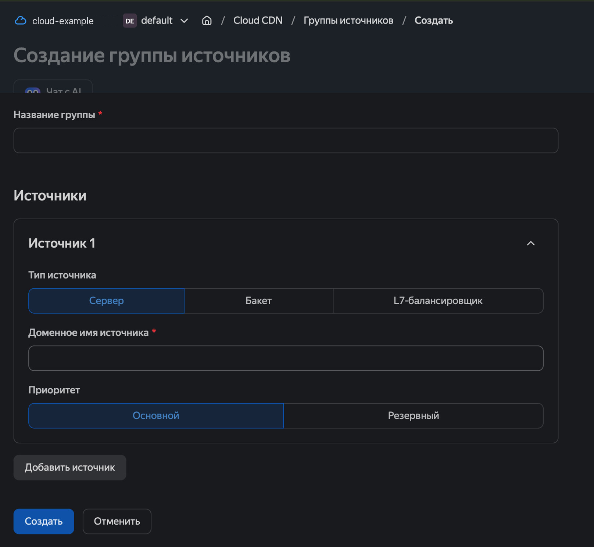
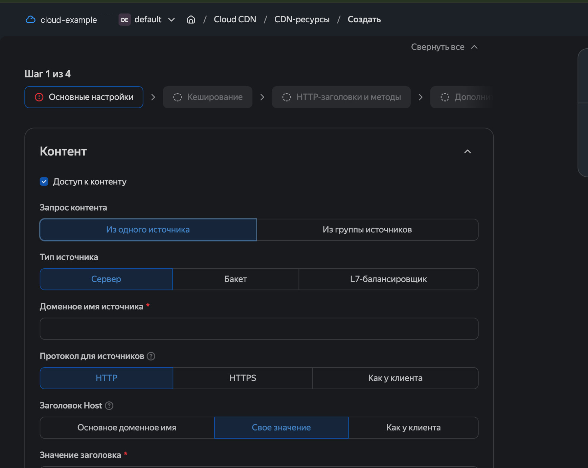
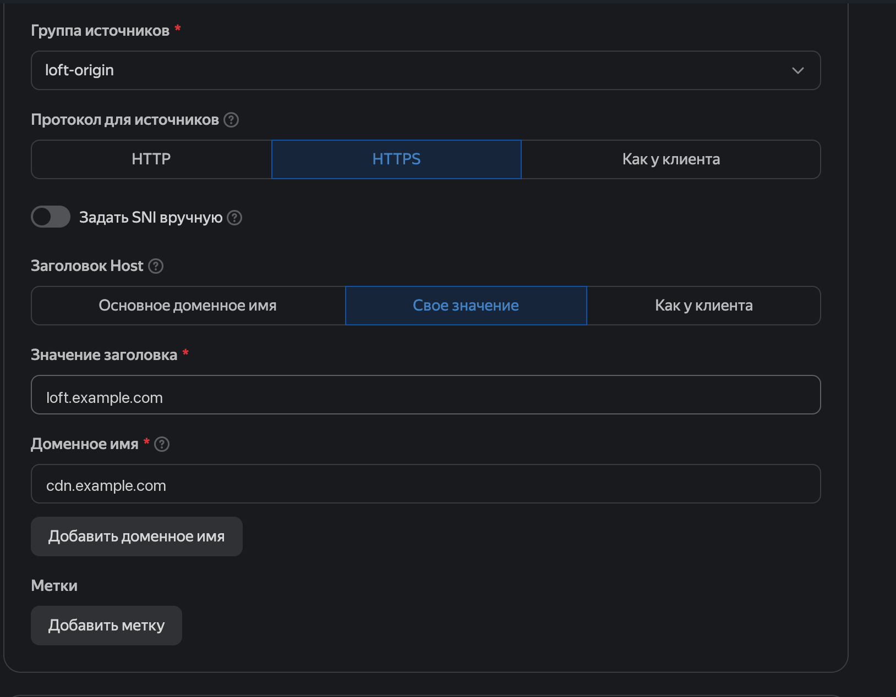
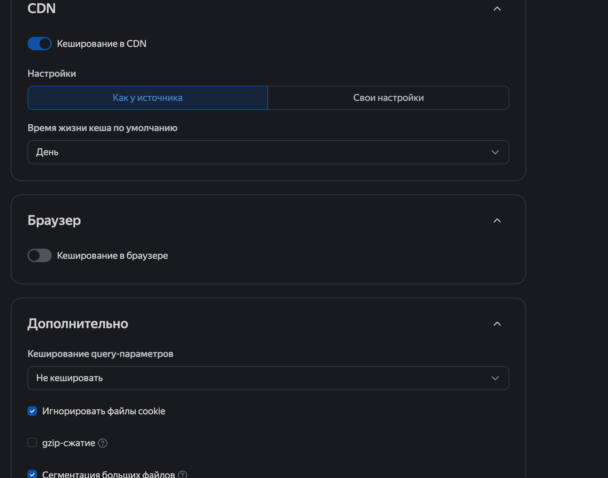
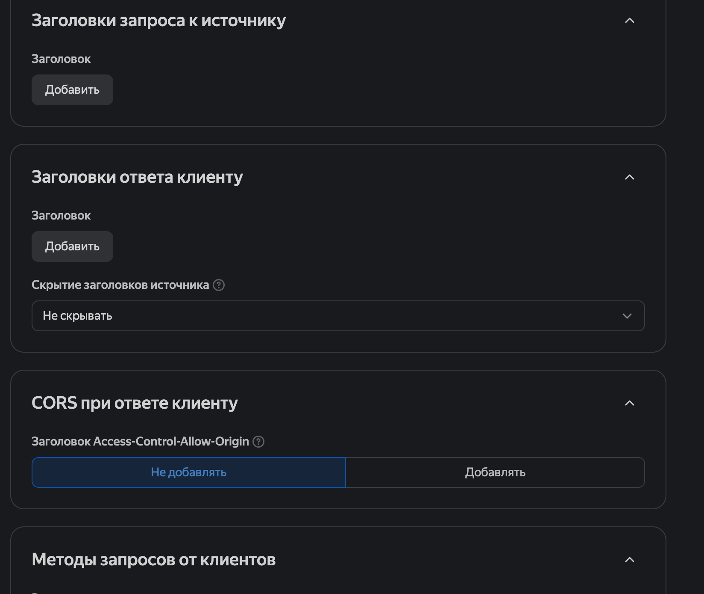
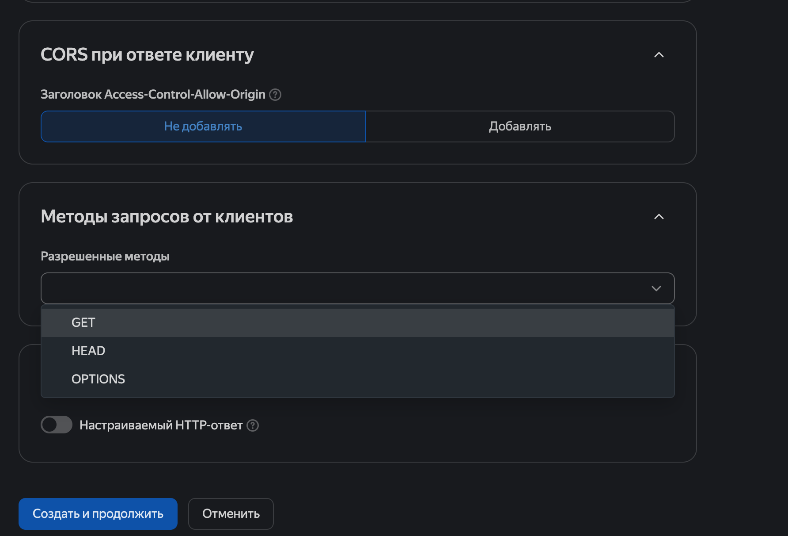
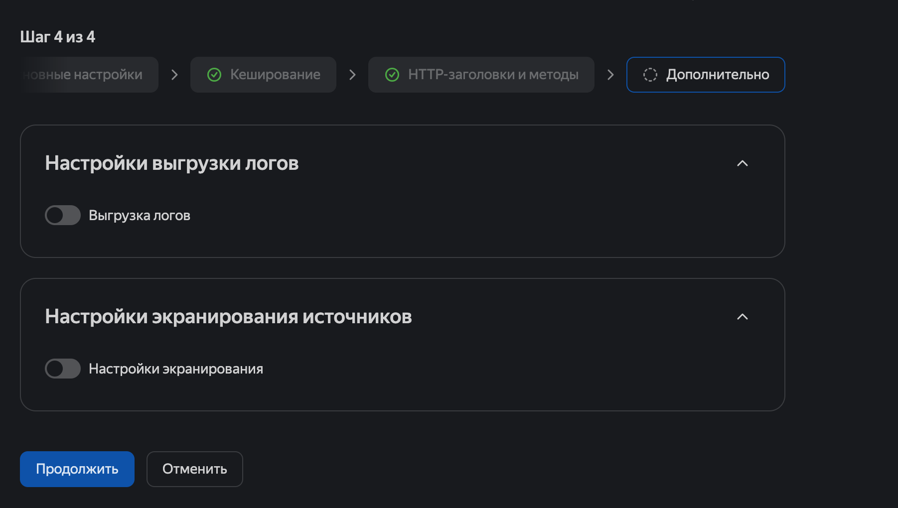

# loft 用 Yandex Cloud CDN

[English](../README.md) · [Русский](yandex-cdn_ru.md) · **中文**

运营方说明书：Yandex Cloud 控制台该点哪里，才能让 loft 的 GET 前置走 Cloud CDN。

客户端里的配置 `cdn: yandex` 不是协议能力。信道上仍是 `get` 前置。YAML 里写 Yandex 只是收紧头预算和 SNI。

这个边缘**只过 GET**。POST 和 WebSocket 回 405。头长过约 12 KiB 给 413。源站必须在 5 秒内应答。CDN 只走 IPv4 去 origin。

截图是 Cloud CDN 控制台（目录 `default`）。例子里 origin 是 `loft.example.com`，分发是 `cdn.example.com`。屏上的标签和表一致。

---

## 例子里的名字

换成你自己的。例子里是这样：

| 角色 | 值 |
|------|-----|
| Origin（节点） | `loft.example.com:444` — `advertise https://loft.example.com`，节点证书 `CN=loft.example.com` |
| CDN 资源 | `cdn.example.com` |
| 分发 CNAME | `cdn.example.com` → `<id>.topology.gslb.yccdn.ru` |
| ACME | `_acme-challenge.cdn.example.com` → `<卡片上的目标>.cm.yandexcloud.net` |
| GET path | `/static/v3/build`（节点默认；`node.conf` 里 `get_path` 为空时） |
| 源站组 | `loft-origin` |
| 面板 | `#loft/node` — 字段 **节点证书** |

令牌和访问密钥不往 CDN 控制台里放。它们留在 `{dir}/members.keys` 和客户端 YAML。

---

## 1. Origin — loft 节点，控制台之前

CDN 对节点开**自己的** TLS。客户端 ClientHello 里的 HMAC 到不了节点。会话活在 HTTP 里：第一个 GET 是 `Cookie: session=` 和 `X-Auth: 1`，后面也是 `Cookie: session=`（边缘经常切掉 `X-Request-Id`）。节点的应答必须把 `X-Session` 头送到客户端。

所以 CDN 的 origin 是**自己**回答 `get_path` 上 `GET` 的监听口，而不是把别人的 ClientHello 拼进诱饵。

节点上：

```yaml
listen: ":444"
advertise: https://loft.example.com
get_path: /static/v3/build   # 和客户端同一个 path
get_h2: 2                   # 给 CDN 的第二条 HTTP/2；inflight 共用。1 = 和以前一样
fronts: [get]               # 这个监听口上 CDN 过不了 ws/h2/quic
# decoy/mask 可以留着：边缘带着 advertise 的 SNI（loft.example.com）来，
# 没有 session_id — 节点用自己的证书应答，不拼接。
# 别人的 SNI 照样进诱饵。CDN 的 Host 和 SNI 是 loft.example.com。
```

节点证书必须盖住 CDN 敲 origin 时用的 Host/SNI。例子里是 `loft.example.com`。面板：`#loft/node` → **节点证书** → 池子里签了这个名字的那一对 → 保存。`node.conf` 里的路径仍是 `/etc/loft/tls/fullchain.pem` 和 `privkey.pem`。

节点上挂的是 `other.example.net` 的证书，而 CDN 的 Host 是 `loft.example.com`，TLS 客户端和 CDN 的 origin 检查对不上。

绕过 CDN 直接探 origin。SNI 必须是 `loft.example.com`——否则开了诱饵时握手会进拼接：

```bash
curl -sI --max-time 5 --resolve loft.example.com:444:ORIGIN_IPV4 \
  https://loft.example.com:444/static/v3/build
```

期望是节点自己的应答（掩护页，或裸 path 没有 session 时的 404），不是诱饵页，也不是超时断开。

origin 防火墙放行来自 Yandex CDN 地址的 IPv4。纯 IPv6 的 origin 边缘不接。

客户端到边缘、以及节点出网，也是 IPv4（`tcp4`）。覆盖网 IPv6 还没发下来时，DNS 桩对 AAAA 回空 NOERROR，否则 Happy Eyeballs 会走节点的原生 IPv6。

节点已经给 GET 加上 `Cache-Control: private, no-store`、`CDN-Cache-Control: no-store`、`Vary: Cookie, X-Request-Id`。这还不够：**CDN 资源**上的缓存照样要关掉（向导第 2 步）。

`:444` 上 loft GET 前面不需要 Nginx：节点自己就是 origin。同一台机器上 nginx 听 80/443（别的站点）的话，loft-node 听 `:444`。边缘的 origin pull 打到 `:444`。这条路上没有 Xray 指南（第 7 步）那种 nginx；把它放在 GET 前面只会缓冲、`proxy_read_timeout`，再切掉 `Cookie`/`X-Session`。

---

## 2. 付款账户

Cloud CDN 从**付款账户**扣费。它标识付款人，绑在结算账户上。资源（目录、CDN）它不管。

控制台：[Yandex Cloud Billing](https://console.yandex.cloud/billing) → **账户** 标签 → **创建账户**。

官方：[创建新付款账户](https://yandex.cloud/ru/docs/billing/operations/create-new-account)。

1. 用 Yandex ID 或 Yandex 360 账户登录。
2. 还没有组织 — [Identity Hub](https://console.yandex.cloud) → 创建组织。里面会出现目录 `default`。
3. 打开服务 **Yandex Cloud Billing**。
4. 在 **账户** 标签点 **创建账户**。第二个及以后的账户 — 当前名字旁边的加号。
5. 创建窗口里：
   - **账户名称** — 列表里怎么显示。
   - **组织** — 你要开 CDN 的那个。
   - **账户类型** — **个人** 或企业账户（个体户 / 法人）。创建之后类型不能改。
   - **国家** — 付款人税务居住地。同一个 Yandex ID 下所有付款人用同一种货币。
   - **付款方式** — 银行卡或手动充值。
6. 账户页的 **已绑定的云和服务** 里，云已经绑到这个付款账户。不绑的话云是未激活的，里面建不了 Cloud CDN。

创建账户需要组织所有者角色。Billing 页上的状态是已激活或试用期；Cloud CDN 要到[管理控制台](https://console.yandex.cloud)里、这个云的目录中去建。

---

## 3. 源站组

面包屑：`Cloud CDN / 源站组 / 创建`。标题 **创建源站组**。这张表上没有证书 — 只有 origin。



| 屏上字段 | 写什么 |
|----------|--------|
| **组名称** | `loft-origin` |
| **源站类型** | **服务器**（不是存储桶，不是 L7 负载均衡器） |
| **源站域名** | `loft.example.com:444` |
| **优先级** | **主要** |

不要点 **添加源站**。蓝色按钮 **创建**。

CLI：

```bash
yc cdn origin-group create --name loft-origin \
  --origin source=loft.example.com:444,enabled=true \
  --provider-type ourcdn
```

记住组的 `id`。

文档：[创建源站组](https://yandex.cloud/ru/docs/cdn/operations/origin-groups/create-group)。

---

## 4. CDN 资源

面包屑：`Cloud CDN / CDN 资源 / 创建`。向导 **第 1 步，共 4 步 — 基本设置**。

### 第 1 步. 基本设置（内容块）

表单上方默认是 **来自单个源站**。需要已经建好的组：



| 屏上字段 | 选什么 / 写什么 |
|----------|-----------------|
| **内容访问** | 勾着 |
| **内容请求** | **来自源站组**（组 `loft-origin`） |
| **源站类型** / **源站域名** | 选了组就不需要 |
| **源站协议** | **HTTPS** |
| **手动指定 SNI** | **打开**，值 = `loft.example.com`（不要端口） |
| **Host 头** | **自定义值** |
| **头的值** | `loft.example.com` |
| **域名** | `cdn.example.com`（你的分发名）。创建之后名字不能改 |
| **标签** | 空 |

同一步的下半是 Host 和分发名：



截图里 **手动指定 SNI** 开关是关的。要打开，并填和 Host 一样的名字：`loft.example.com`。否则边缘会带着 SNI `cdn.example.com` 来，节点证书没签这个名。

### 第 2 步. 缓存

这是**默认**样子。对 loft 有害：GET 的体是 AEAD，边缘上的缓存和分段会弄坏会话。



| 屏上字段 | 设成什么 |
|----------|----------|
| **CDN 中缓存** | **关掉**（现在是蓝色开关） |
| **浏览器缓存** | 关着 — 保持 |
| **query 参数缓存** | **不缓存** |
| **忽略 cookie 文件** | **去掉**勾 |
| **gzip 压缩** | 关 |
| **大文件分段** | **去掉**勾 |

关掉 CDN 缓存之后，「跟源站一样 / 一天」那块会消失 — 就该这样。

### 第 3 步. HTTP 头和方法

`Cookie`、`X-Auth`、`X-Request-Id` 客户端自己带。不要用静态头再复制一份。节点应答里的 `X-Session` 能到客户端，只要 **不隐藏** 还开着。





| 屏上字段 | 设成什么 |
|----------|----------|
| **发往源站的请求头** → **添加** | 不要点 |
| **给客户端的应答头** → **添加** | 不要点 |
| **隐藏源站头** | **不隐藏** |
| **CORS** / Access-Control-Allow-Origin | **不添加** |
| **客户端请求方法** | GET、HEAD、OPTIONS |
| **自定义 HTTP 应答** | 关 |

### 第 4 步. 附加



| 屏上字段 | 设成什么 |
|----------|----------|
| **日志导出** | 关 |
| **源站屏蔽** | 关 |

**继续**。生效最多 15 分钟。改过缓存之后清一下资源缓存。

CLI（骨架）：

```bash
yc cdn resource create cdn.example.com \
  --origin-group-id ORIGIN_GROUP_ID \
  --origin-protocol HTTPS \
  --host-header loft.example.com \
  --disable-cache \
  --cert-manager-ssl-cert-id CERT_ID
```

文档：[创建资源](https://yandex.cloud/ru/docs/cdn/operations/resources/create-resource)，[头](https://yandex.cloud/ru/docs/cdn/operations/resources/configure-headers)，[缓存](https://yandex.cloud/ru/docs/cdn/concepts/caching)。

---

## 5. DNS 和 CDN 证书

Let's Encrypt 证书签在**分发名**上（`cdn.example.com`），不是 origin（`loft.example.com`）。origin 已经用面板里的节点证书盖住了。

源站组表单上没有证书。证书在资源上：字段 **证书类型**。

最简单是从那里签发：**证书类型** → Certificate Manager → 给 `cdn.example.com` 签 Let's Encrypt。

如果单独进 Certificate Manager（还是目录 `default`）：

1. 面包屑里点**小房子**（`Cloud CDN` 左边）— 这是目录仪表盘，不是 Cloud CDN。
2. 控制台顶部搜索：`Certificate Manager`。
3. 服务 **Certificate Manager** → **添加证书** → **Let's Encrypt 证书**。
4. **域名：** `cdn.example.com`。权属验证走 DNS。在分发名的区里：

```
_acme-challenge.cdn.example.com.  CNAME  <证书卡片上的目标>.cm.yandexcloud.net.
```

目标从证书卡片里取。Certificate Manager 不会马上看见记录 — 等一下。

状态变成「已签发」之后，在 CDN 资源里选这张证书。还挂着默认的 `*.yccdn.cloud.yandex.net` 时，`cdn.example.com` 上的 HTTPS 会断（SAN mismatch / RST）。

LE 还没粘上时的绕过：资源开成仅 HTTP，客户端 `url: http://cdn.example.com`（边缘上没有 TLS）。origin 这时仍是 HTTPS。

资源创建之后，控制台会给出形如 `….topology.gslb.yccdn.ru` 的目标。DNS 里：

```
cdn.example.com.  CNAME  <id>.topology.gslb.yccdn.ru.
```

客户端校验这张证书（`insecure_skip_verify: false`）。

官方：[添加 Let's Encrypt 证书](https://yandex.cloud/ru/docs/certificate-manager/operations/managed/cert-create)。

---

## 6. 客户端

出站 `path` = 节点的 `get_path`（`/static/v3/build`）。`url` 是 scheme `https` 和 CDN 名，不要 origin 端口。

```yaml
listen:
  socks5: 127.0.0.1:18080
select: cdn-get
outbounds:
  - name: cdn-get
    type: get
    cdn: yandex
    url: https://cdn.example.com
    path: /static/v3/build
    fingerprint: chrome
    header_budget: 12288
    inflight: 16
    insecure_skip_verify: false
```

`internal/cdn/yandex.go` 里的 `cdn: yandex` 把预算钉在 12 KiB、inflight 16。边缘对 origin 大约维持 10–12 条 HTTP/1.1：32 个在飞 GET 会把 Cookie 的 TTFB 抬到约 900 ms，下载仍约 3 Mbit。显式写 `header_budget: 12288`，配置没接上时也能兜住。

客户端 SNI 是 `cdn.example.com`。设了 `cdn` 时传输自己会这么做。

macOS `loft-front` 现在写死 16 KiB 和 `Insecure`。探边缘用上面这份 YAML 的 CLI `loft`，或 `loft-bench -cdn yandex`。

---

## 7. 检查

先走 CDN 看掩护页（没有令牌）：

```bash
curl -sI --max-time 8 https://cdn.example.com/
curl -sI --max-time 8 https://cdn.example.com/static/v3/build
```

期望是节点的应答，状态不是 502/504。裸 `/static/v3/build` 没有会话 — 节点普通的掩护页/404。

然后 GET 会话。`loft-bench` 默认 `-path` 是 `/static/js`，要盖掉：

```bash
make bench
./dist/clients/go/loft-bench \
  -cdn yandex \
  -type get \
  -url https://cdn.example.com \
  -path /static/v3/build \
  -token "$LOFT_TOKEN"
```

`-cdn yandex` 设 12 KiB 预算和 TLS 校验。这条边缘不上 WS。

或者 CLI：

```bash
./dist/clients/go/loft -c cdn-client.yaml
ALL_PROXY=socks5://127.0.0.1:18080 curl -sI https://example.com
```

CLI `loft` / `loft-front` 不写端口时听 `127.0.0.1:18080`，免得占掉开着的 GUI 的 `1080`。YAML 来自 §6（`cdn-get` + `listen.socks5: 127.0.0.1:18080`）。

---

## 边缘常见应答

| 现象 | 查什么 |
|------|--------|
| 413 | `header_budget` 超过约 12 KiB；客户端没写 `cdn: yandex` |
| 405 | WS 或 POST；Yandex 只要 GET |
| 502 | 去 origin 的 Host/SNI 和节点证书对不上（`other.example.net` 盖不住 `loft.example.com`）；诱饵拼接了边缘 |
| 504 / origin 超时 5 秒 | 去 origin 的 SNI/Host 不是 advertise 名（节点在拼接）；防火墙；origin 没有 IPv4 |
| 握手有了，mux 空 | CDN 藏了 `X-Session`，或没放过 `Cookie` / `X-Request-Id` |
| 会话串台 | 资源上缓存还开着；「忽略 Cookie」开着 |
| 客户端 TLS 对不上 | CNAME 还没散开；边缘上是默认的 `*.yccdn.cloud.yandex.net`，不是 `cdn.example.com` 的 LE |
| `loft-bench` 404 / mux 空 | 忘了 `-path /static/v3/build` |

边缘限制：[源站](https://yandex.cloud/ru/docs/cdn/concepts/origins)（IPv4，5 秒），[和 origin 的交换](https://yandex.cloud/ru/docs/cdn/concepts/servers-to-origins)。

---

## 仓库里已经有的

| 文件 | 角色 |
|------|------|
| `internal/cdn/yandex.go` | 配置：GET，12 KiB，inflight 16 |
| `internal/transport/get.go` | `setCDNHeaders`，Cookie / `X-Request-Id` / `X-Session` |
| `clients/go/configs/client.yaml` | 出站例子 `cdn-get`，path `/static/v3/build` |
| `clients/go/cmd/loft-bench` | `-cdn yandex`；path 要显式写 |
| `docs/img/yandex-cdn/` | 这份说明书对应的控制台截图 |
